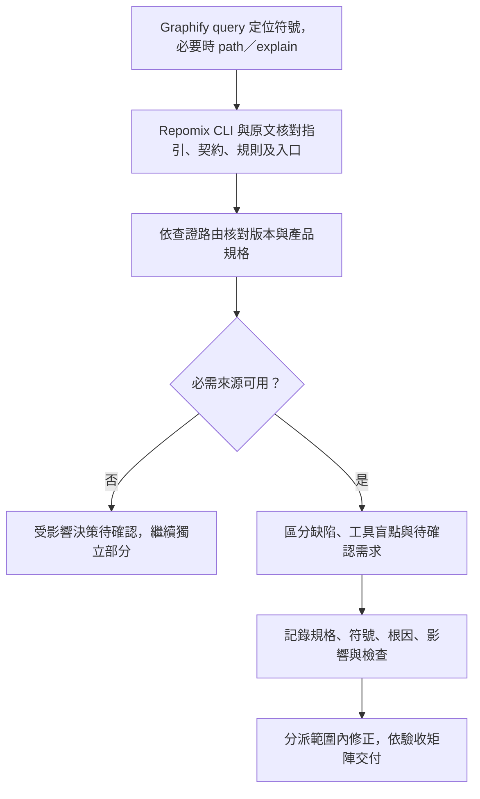

# 實作與審查

已確認工作範圍後，從使用者入口追到適用契約與目前程式。修改前讀取目標路徑上的巢狀指引，按需要選用[操作配方](../recipes/README.md)。

核對既有呼叫者及資料語意，實作可從正常入口驗收的完整變更。交付前按[驗收矩陣](../tooling/testing/commands.md)選檢查，並記錄[證據限制](../verification/evidence.md)。

## 完整實作就緒條件

核對本次操作的 API、schema、狀態機與驗收案例，逐一確認角色及各分支的結果。涉及[平台交付提案的 P01–P07](../../proposals/platform/delivery.md#產品決策閘門)時，只追蹤本功能依賴的決策，現行行為以[領域規格](../../domains/README.md)為準。

若要新增到場判定或定位歷史，先依[定位契約](../../integrations/geolocation/browser-api.md)確認 P08 的目的、精度與新鮮度、替代流程、保存期及同意。未決前維持既有功能範圍。

## Deployment and browser location routing

部署與瀏覽器定位任務分別依[部署指引](../../operations/AGENTS.md)與[定位指引](../../../frontend/miniapp/src/shared/location/AGENTS.md)載入適用決策與操作文件；實際驗收依 [acceptance](../verification/evidence.md#cloud-run-and-browser-location)。本節不另外維護部署政策。

## Mandatory documentation verification

All roles MUST follow the [root source-verification policy](../../../AGENTS.md#mandatory-documentation-verification)
and the [Markdown policy](../../standards/documentation.md). Reuse applicable
evidence; report unavailable sources and leave affected decisions pending.
Documentation evidence does not replace implementation checks or authorize
additional writes.

## Business Operation compliance

業務開發、審查及修正必須先讀 [操作模型](../../contracts/business-operations.md)。任務分派附上操作契約、規格來源、既有實作、檔案所有權與驗收條件。

**開發與維運指引**

圖譜可能過期或漏掉動態關係，無節點時核對原始碼。核對 Repomix 打包範圍，Markdown／TOML 等遺漏內容直接讀取並記錄。產物放任務專屬的未提交目錄。

Context7 先解析 library ID 再查適用版本。LINE、Google Cloud 與 Codex 依[工具查證指引](../tooling/agents/AGENTS.md)。產品決策以使用者與已接受規格為準。

目前代理先唯讀探索，再依授權修改並進行自我審查，必要時依除錯流程定位。保留既有變更，範圍外另列；自我審查不等於獨立審查。依[驗收矩陣](../tooling/testing/commands.md)核對契約、實作與證據。程式修改後依根指引更新 Graphify，重新打包受影響內容並沿用有效證據。

交付列出：發現 → 規格依據 → 修改位置 → 檢查結果 → 剩餘限制。不把工具成功等同業務正確，不無限重跑全庫檢查。此流程不增加 push、部署或資料遷移授權。

沿用已註冊角色即可，不新增 compliance agent。協調者可直接完成小任務；角色是責任分工，不是必須逐一啟動的階段。

[開發流程索引](README.md)
