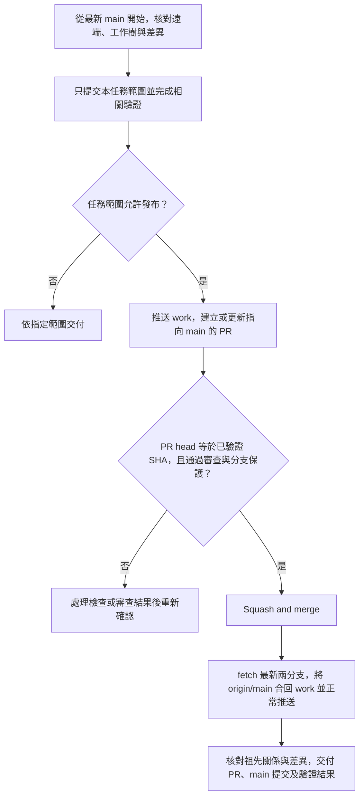

# 版本控制與 PR 交付

需發布已驗證的變更時，按本頁核對分支、PR、已驗證的提交與發布授權。

## Repository publication

**開發與維運指引**

`work` 可保存多筆開發提交，`main` 每項可獨立回退的變更保留一筆提交，可涵蓋同一功能的前端、API 與後端。PR 描述最終行為、驗證和限制。同步時若他人已推進分支，先核對新增內容。版本驗收後可按發布安排加標籤。重寫已發布歷史需單次明確授權與可還原備份，遠端拒絕時遵循分支保護與審核結果。

GitHub MCP 與 Git CLI 的使用見 [GitHub 工具指南](../tooling/mcp/github.md)。推送、CI 與正式部署分別核對，見 [發布驗收](../../guides/release/release-acceptance.md)。

[開發流程索引](README.md)
