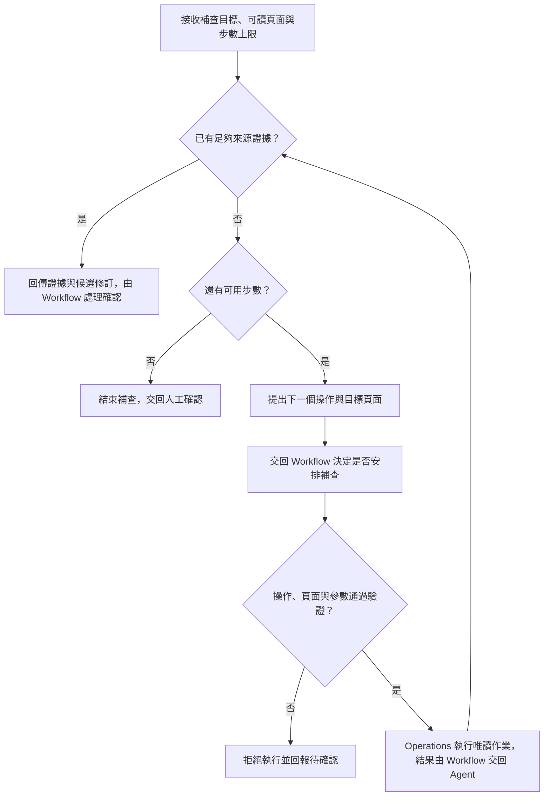

# Agent 設計

**狀態：指定頁面的引文補查已實作；通用操作選擇為提案** · [補查流程](#design-diagram) · [跨領域驗收](../../proposals/domain-collaboration.md) · [模組規則](../../../backend/AGENTS.md)

現行[引文補查](../../../backend/internal/business/agent/application/investigator.go)在呼叫端指定的頁面與步數內讀取來源，並核對模型回傳的引文是否出自原文。[範圍與預算測試](../../../backend/internal/business/agent/application/investigator_test.go)涵蓋無效輸入與超出預算的情境。

[Domain guidance](../../AGENTS.md)

## 核心契約

以下為領域責任與概念範圍；現行實作及提案狀態依頁首與後端分層結構區分。Agent 負責理解、推理、規劃與決策。

- 代理定義（Agent）
- 指令（Instruction）
- 目標（Goal）
- 工作階段（Session）
- 記憶（Memory）
- 推理（Reasoning）
- 規劃（Planning）
- 工具選擇（Tool Selection）
- 決策（Decision）
- 結果評估（Evaluation）

**輸出**為決策、計畫或作業請求。

## Agent 領域設計

以下執行模型為提案。目錄入口見[領域導覽](../../../backend/internal/business/agent/)。

Agent 依任務目標與目前證據選擇下一步。呼叫端指定可讀資源、允許的[操作](../operations/design.md)及步數上限。在文件流程中，Agent 可交回候選建議、證據、單一唯讀作業請求或停止原因；Workflow 決定是否安排 Operations 執行請求，Operations 再核對工具、執行授權與參數。Agent 不批准 Object 草稿或正式寫入。共用的文字生成供應商實作位於[Platform](../../../backend/internal/platform/textgeneration/)；業務欄位與驗證仍歸使用它的領域。

### 執行邊界

依 [用例](../../references/ddd/use-case.md)及[出站 Port](../../references/ddd/driven-port.md)，以一次有界補查建模。任務輸入包含可信資源範圍、唯讀工具及預算；候選包含來源定位與待確認事項。由呼叫端保存流程狀態及決定是否採納。模型與工具 Adapter 由組裝層注入；用測試替身驗證越界、耗盡預算及來源不足時能停止。

<a id="design-diagram"></a>

### 補查與終止流程圖

未來設計



### PDF 補查與驗收

[Workflow](../workflow/design.md) 可在候選工項缺少來源時委派補查。Agent 可請求重讀允許的頁面，並依 Workflow 交回的結果提出證據與候選修訂，交由流程處理確認。驗收時涵蓋找到來源、要求讀取範圍外頁面，以及用盡步數仍無證據三種結果。後兩種應拒絕越權或結束補查，將待確認狀態交回呼叫端。

### 對外契約草案

以下為邏輯簽章，實作時對照既有介面。身分及資源範圍取自可信呼叫情境。

| 操作                                                           | 結果、副作用與失敗語意                                                                                           |
| -------------------------------------------------------------- | ---------------------------------------------------------------------------------------------------------------- |
| Investigate(task, resourceScope, allowedOperations, stepLimit) | 回傳有頁碼的候選修訂或明確的人工處理原因。每次工具呼叫由執行端重新驗證；失敗嘗試亦消耗預算。                     |
| Analyze(task, extraction, evidence, lastOperationResult)       | 文件流程每輪回傳候選建議、單一唯讀作業請求或待人工處理原因。Workflow 安排下一步。                                |
| AssessEvidence(candidate, pages)（由呼叫領域擁有）             | 核對引用頁屬於選取範圍且支持數量、單位與項次。有矛盾或無法驗證時保留待確認。採納修訂後產生新版，再由使用者確認。 |

[共用架構、時序與驗收](../../proposals/domain-collaboration.md)

## 後端分層結構

現行檔案樹；只列出已實作的正式程式碼：

```text
backend/internal/
├── business/agent/
│   ├── application/
│   │   ├── port/investigate.go  # 補查範圍、證據與入站 Investigator 契約
│   │   └── investigator.go     # 有界逐頁補查；定義 QuoteModel、PageReader 出站契約
│   └── adapter/genai/evidence.go  # 將文字生成轉為 Agent 引文建議
├── platform/textgeneration/
│   ├── openai.go             # 共用 OpenAI 文字生成呼叫
│   └── gemini.go             # 共用 Gemini 文字生成呼叫
└── bootstrap/agent.go        # 選擇供應商並注入 Agent Adapter
```

`PageReader` 由呼叫端提供並負責目前資源的讀權；Application 再核對引文確實出自所讀頁面。兩個 Object 上傳入口依[共用文件準備流程](../../proposals/domain-collaboration.md#現行同步接線)使用 Agent 的頁碼判讀；有界動態補查尚未接入。Platform 只處理供應商 I/O，Agent Adapter 負責引文格式。現行模組沒有獨立 Domain 層或通用工具選擇 Adapter；上方通用操作選擇仍是提案。

[agent 模組原始碼](../../../backend/internal/business/agent/) · [代表測試](../../../backend/internal/business/agent/application/investigator_test.go) · [六邊形架構參考](../../references/ddd/hexagonal-architecture.md)
