# Basic attendance

**Implemented** · [Design](strategy.md) · [Core flow](#decision-flow) · [Representative tests](../../../backend/internal/business/attendance/adapter/firestore/attendance_integration_test.go) · [Code](../../../backend/internal/business/attendance/README.md) · [Guidance](../../../backend/internal/business/attendance/AGENTS.md)

[Attendance, business features and LINE journeys](journey.md)

## Purpose and scope

Specifications for attendance, punches, corrections, leave and review.

Design entries: [subdomains/investment assumptions](strategy.md) · [context mapping/integration contracts](context-map.md) · [tactical correction design](correction-design.md). This page owns attendance language/boundaries.

## Bounded context

Attendance answers who attended in which group/time, what evidence supports it and how much worktime is confirmed. Maintain separate states per person/group. Multiple daily shifts are allowed; monthly reports intersect shifts with report months.

| Boundary | Facts exchanged | Responsibility |
|---|---|---|
| Identity/groups | Verified actor and operation-bound group | Entry/identity modules authenticate; Attendance determines punch/query/review eligibility and reads reviewer group authorization itself. Membership alone grants no correction-review rights. |
| LINE/MINI App | Group actions, preflight, personal submission/results | Entry points translate requests into Attendance operations. Locations evidence individual punches; opening pages does not punch. |
| Scheduling/payroll | Confirmed net worktime, estimated totals and pending reasons | Attendance currently defines neither expected schedules, overtime eligibility nor pay amounts. |

## Ubiquitous language

| Term | Meaning here |
|---|---|
| Punch Event | Identified attempt with action, time/result. Rejected attempts also have results; only accepted actions change shifts. |
| Shift (worktime.Session) | One person's clock-in/out within one group. Open shifts lack end times; this Session differs from login sessions. |
| Interval | Start/end values for clipping reports, merging overlaps and calculating breaks; value-comparable without identity. |
| Attendance Record | Identifiable shift with times, event sequence and correction version; target of corrections. |
| Break confirmation | Personal confirmation that breaks are complete. Empty lists distinguish confirmed no-break from unconfirmed. |
| Confirmed net / Estimated total | Confirmed time requires complete verifiable evidence. Estimated total already includes confirmed time; never add them. |
| Correction | Reasoned changes to a specified record. Request, review decision and effective record are distinct. |
| Leave registration | Personal group leave type, period/reason. Registration neither approves leave nor changes attendance. |

## Subdomains and capabilities

Capabilities below share attendance language/rules by current responsibility. Independent deployments/contexts are not presently needed.

| Capability | Decisions owned | Specification |
|---|---|---|
| Punches/shifts | Clock-in, break-start/end and clock-out eligibility; processed retries | [Worktime/transitions](worktime.md) |
| Worktime | Rebuild shifts from events, clip months and confirm minutes | [Calculation](worktime.md) |
| Corrections/review | Submission, withdrawal, decisions and approval versions/evidence | [Evidence](worktime.md), [queries/retries](queries.md) |
| Leave | Input/retry validity and personal registration persistence | [Leave](leave.md) |
| Personal queries/group boards | Read scope and distinct-person working/resting/finished counts | [Queries](queries.md), [boards](board.md) |

## Consistency and acceptance

- **Punches.** Bound state by person/group. needs_position preflight must not create shifts or consume successful receipts. Submit transitions transactionally; redelivery returns original results without extra shifts.
- **Corrections.** Applicants may withdraw. Reviewers require group eligibility and must differ from applicants. Approval transactionally rechecks records, event sequences and overlaps before saving evidence/shifts. Cover self-review, repeat approval and records changed after submission.
- **Reports.** Empty unconfirmed breaks must not count as confirmed net time. Damaged approval evidence yields pending confirmation. Reports/boards are read results, not direct shift-write entry points.

## Current layers and next design decisions

Domains separate [entity](../../../backend/internal/business/attendance/domain/entity/README.md), [valueobject](../../../backend/internal/business/attendance/domain/valueobject/README.md), [service](../../../backend/internal/business/attendance/domain/service/README.md), [event](../../../backend/internal/business/attendance/domain/event/README.md) and [policy](../../../backend/internal/business/attendance/domain/policy/README.md). Records/shifts own identity/state; intervals/locations validate values; calculations, corrections/evidence are domain operations; policies decide reviewers/retry conflicts. [Firestore transactions](../../../backend/internal/business/attendance/adapter/firestore/attendance_correction.go) atomically store decisions/evidence.

The [review use case](../../../backend/internal/business/attendance/application/command/review.go) checks authorization, retries and correction results through transaction ports. HTTP/LINE share the [monthly use case](../../../backend/internal/business/attendance/application/query/monthly.go). Scheduling, overtime/payroll need separately confirmed rules/ownership if adopted.

## Related specifications

[Local specifications and guidance](../../../api/contract/attendance/README.md)

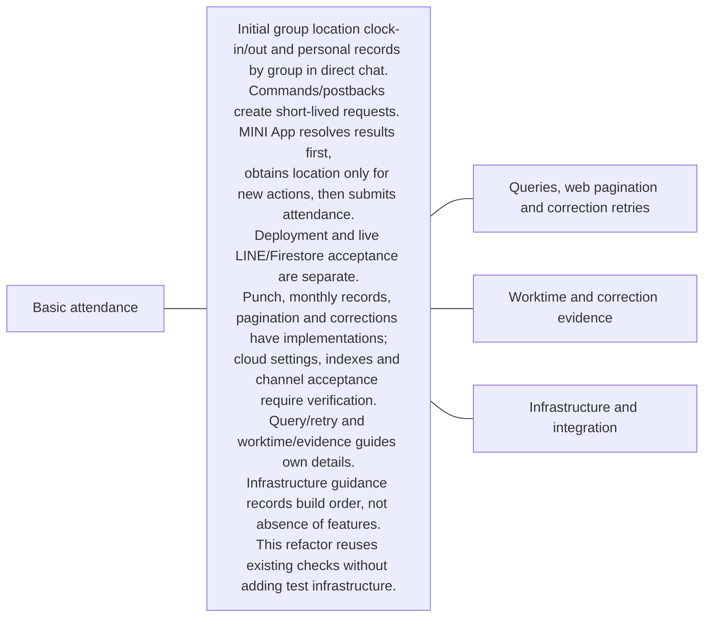

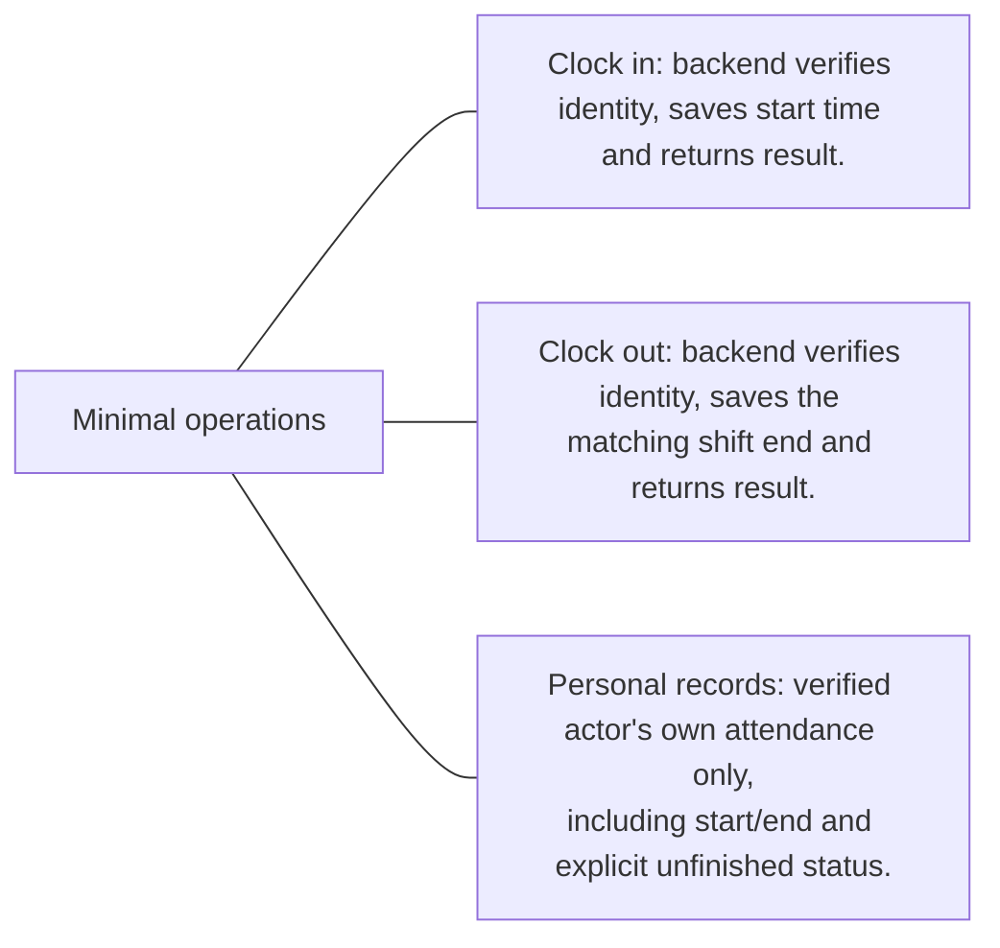

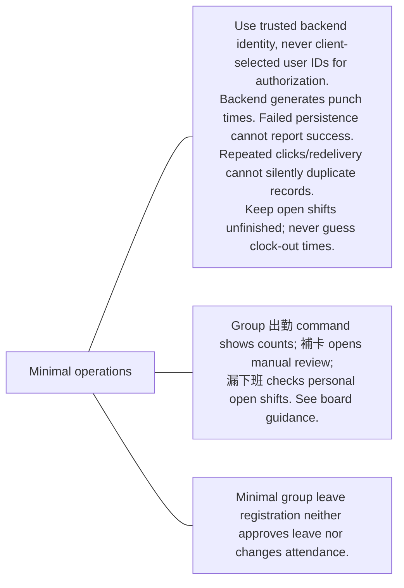

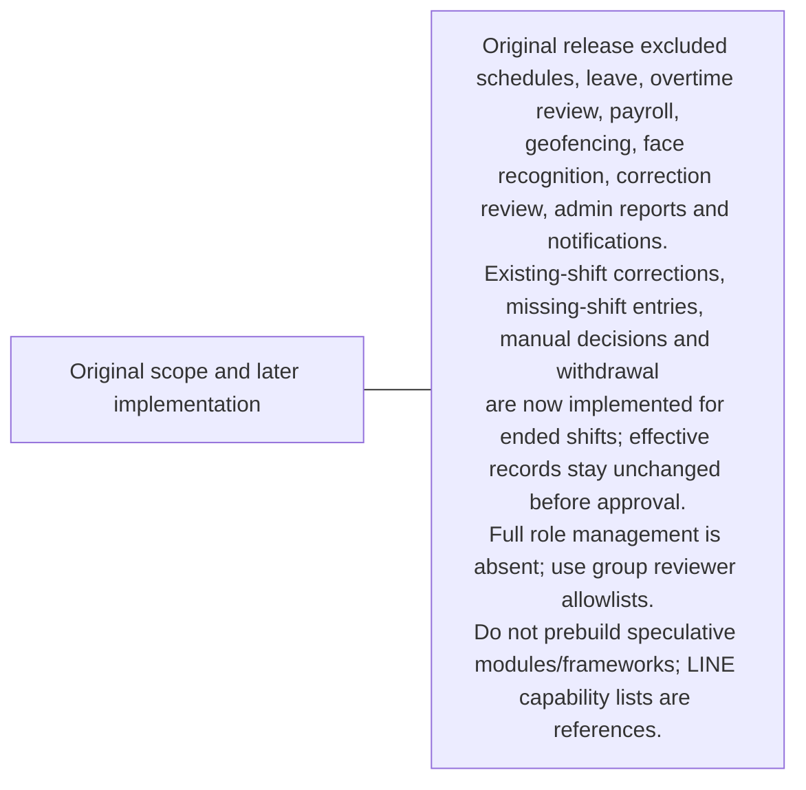

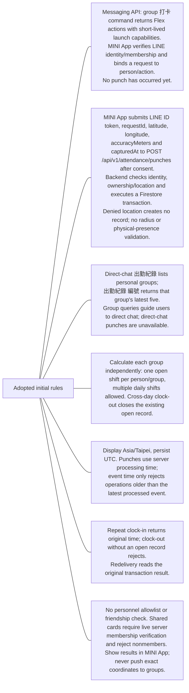

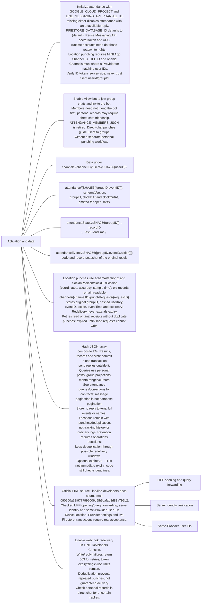

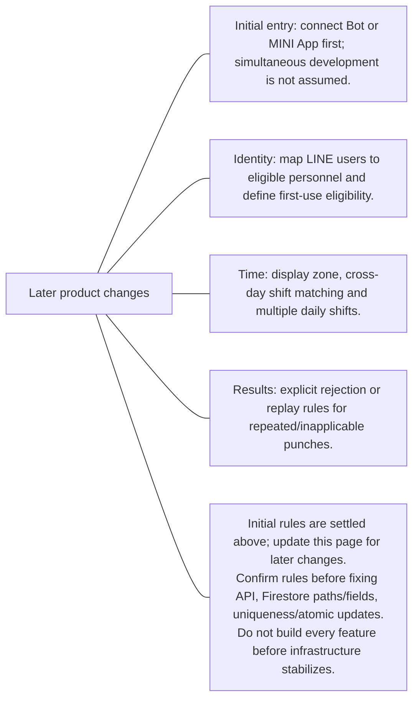

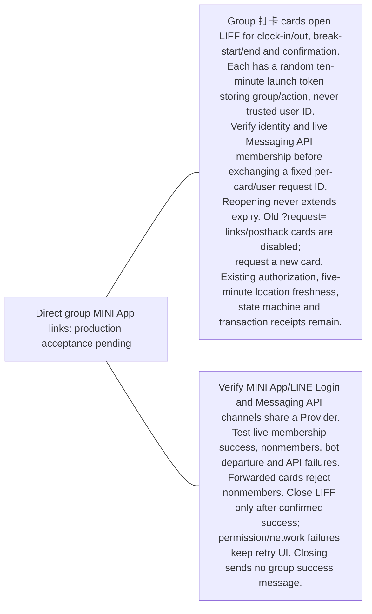

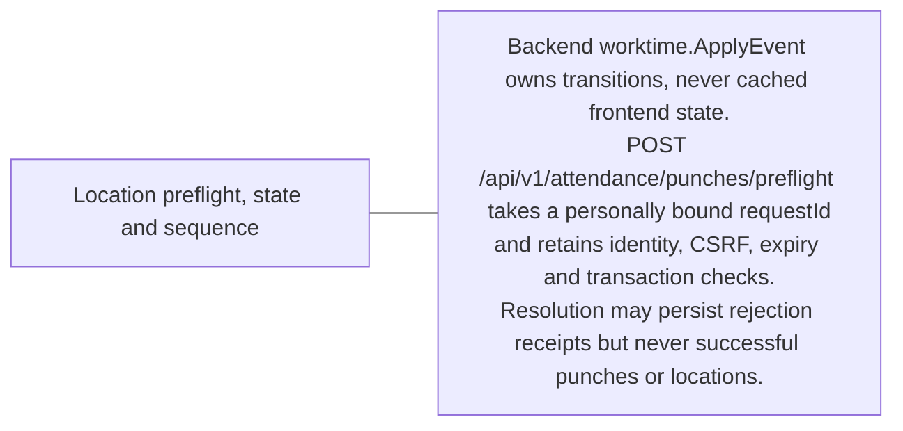

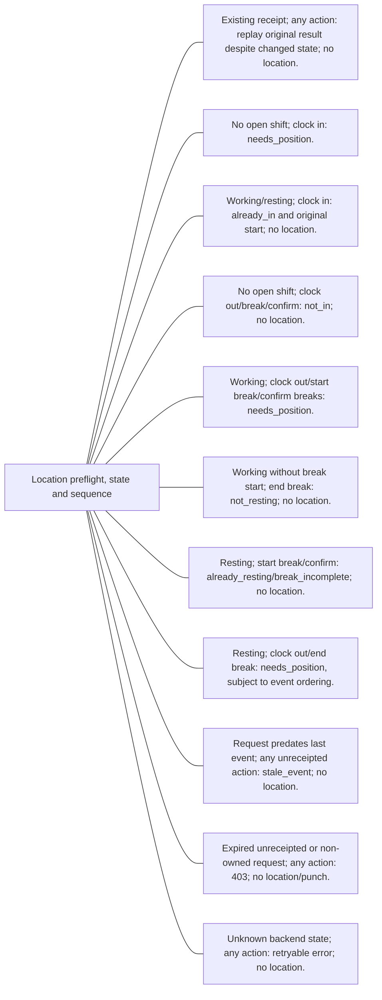

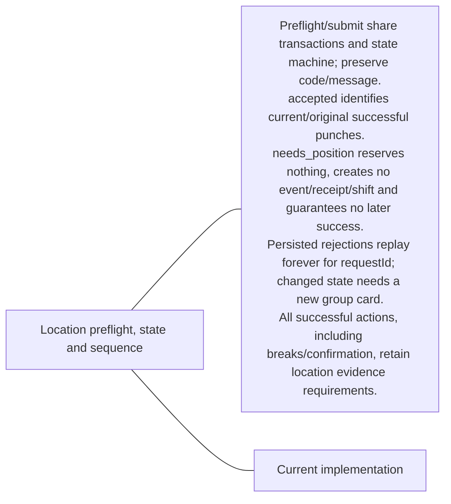

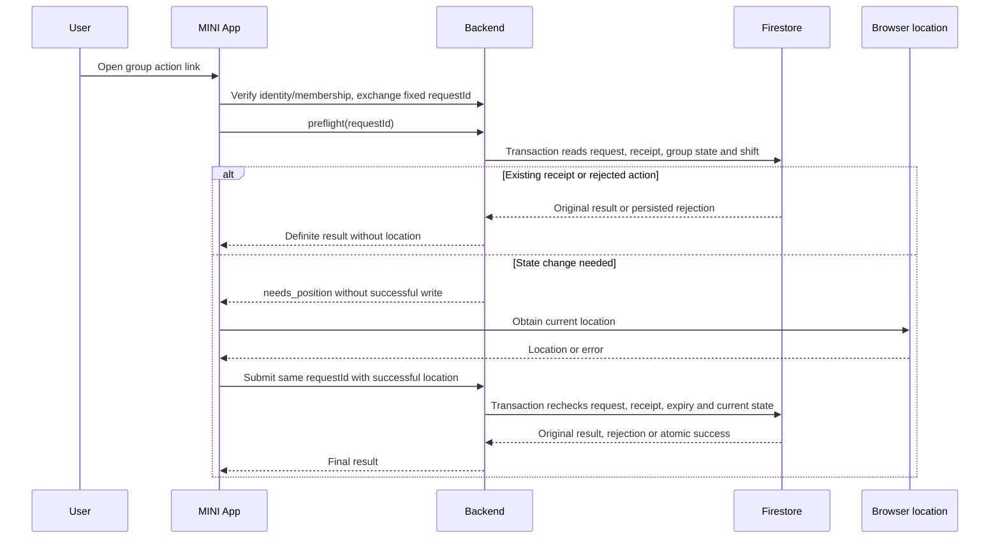

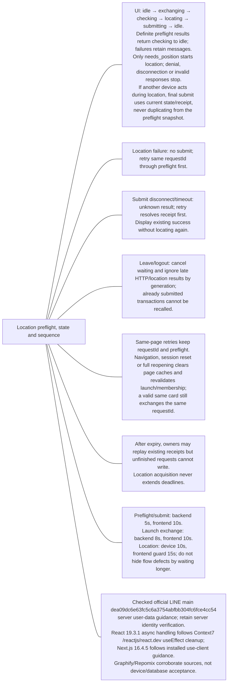

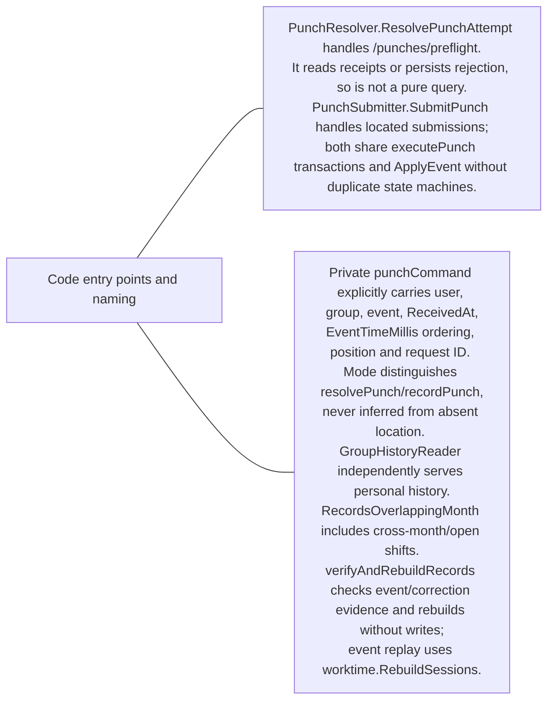

## Group punch decision flow

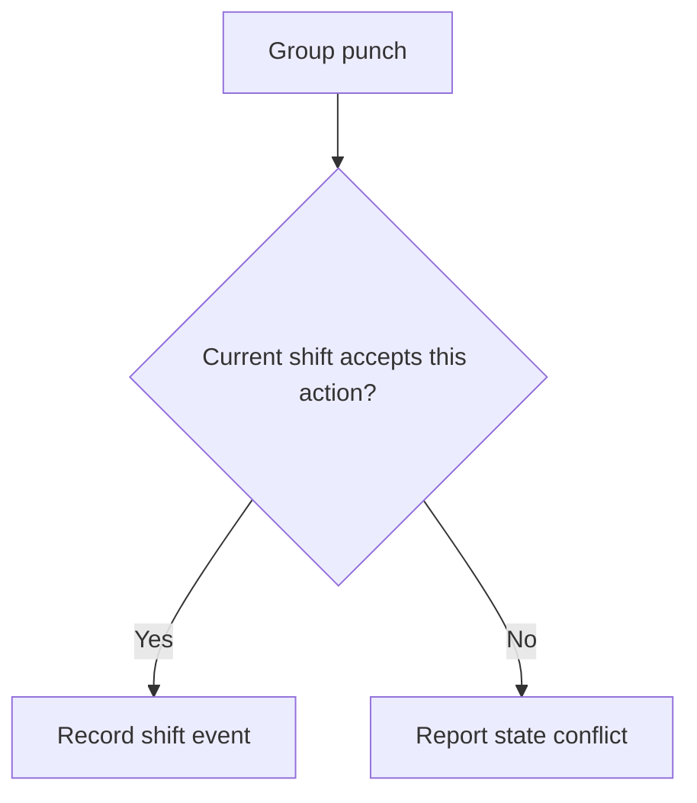

[Entry adapter](../../../backend/internal/business/attendance/adapter/http/routes.go) · [Decision rules](../../../backend/internal/business/attendance/adapter/firestore/attendance_integration_test.go) · [Application output port](../../../backend/internal/business/attendance/application/port/errors.go) · [Related tests](../../../backend/internal/business/attendance/adapter/firestore/attendance_integration_test.go)

[applicable guidance](../AGENTS.md) · [parent directory guide](../README.md)
