# 基礎出勤

## 用途與範圍

保存出勤、打卡、補卡、請假與審核的規格。

## 架構與責任邊界

此處定義出勤結果與授權，協定格式由出勤 API 契約維護。

## 閱讀與修改入口

先查閱[queries.md](queries.md)。

## 相關規格

[本層規格與指引](../../../api/contract/attendance/README.md)

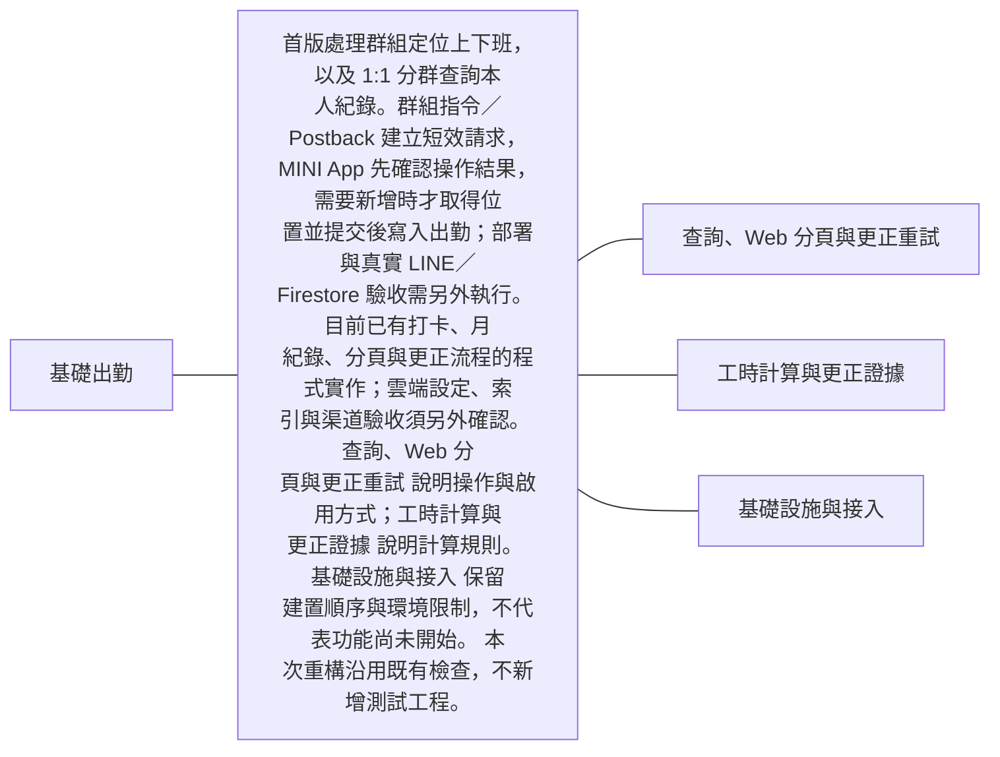

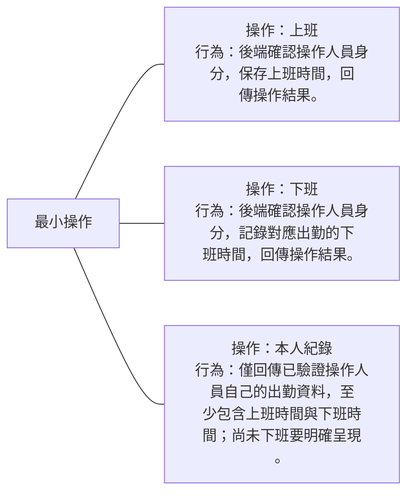

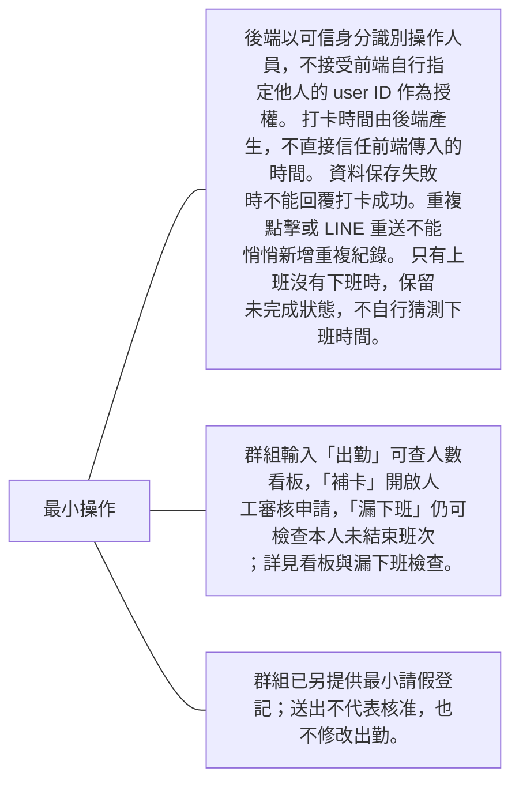

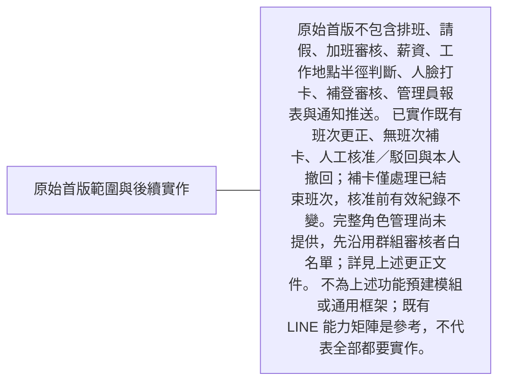

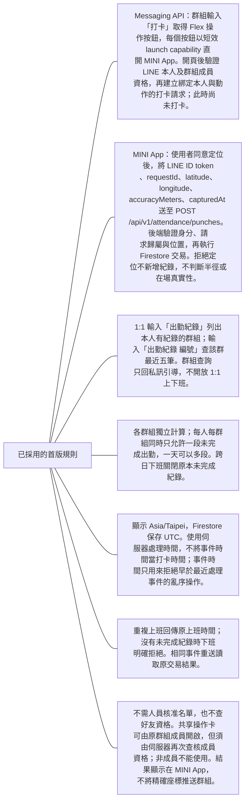

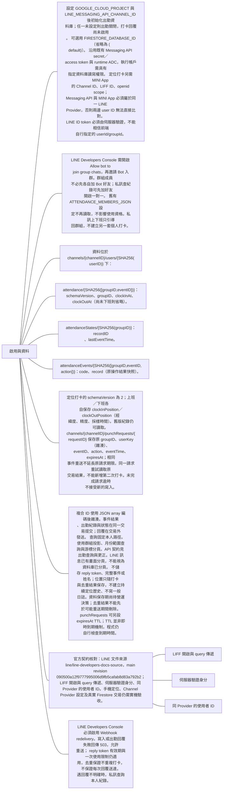

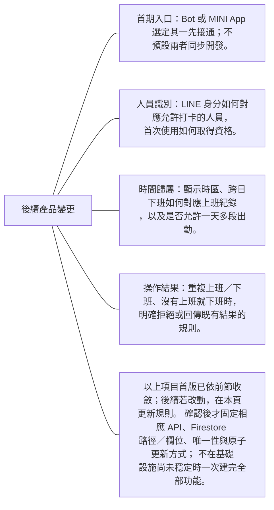

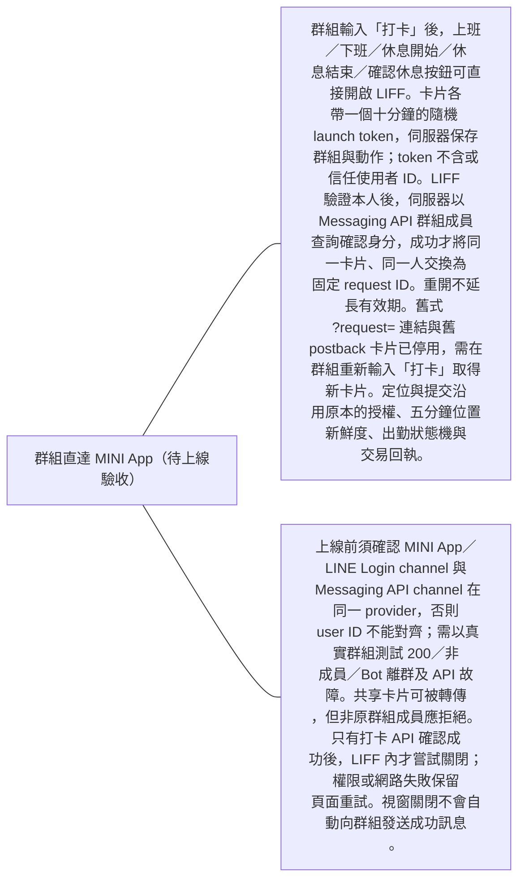

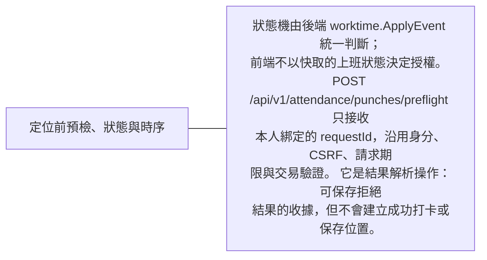

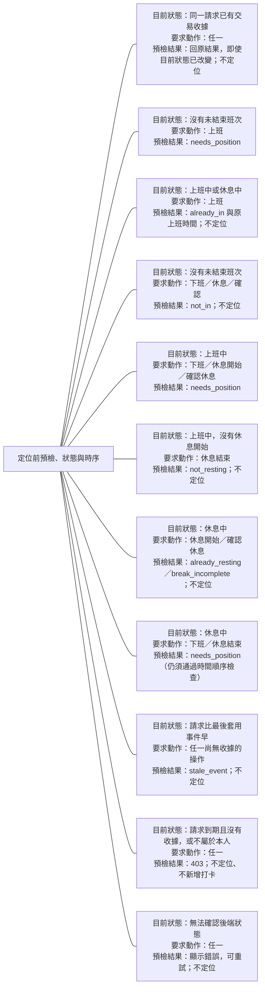

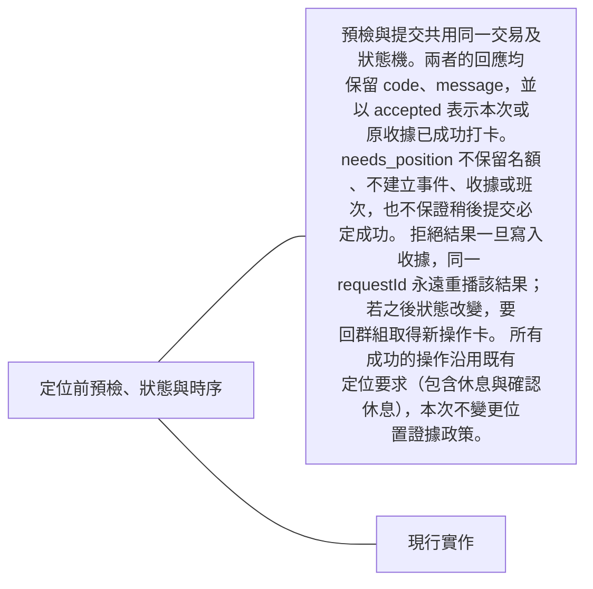

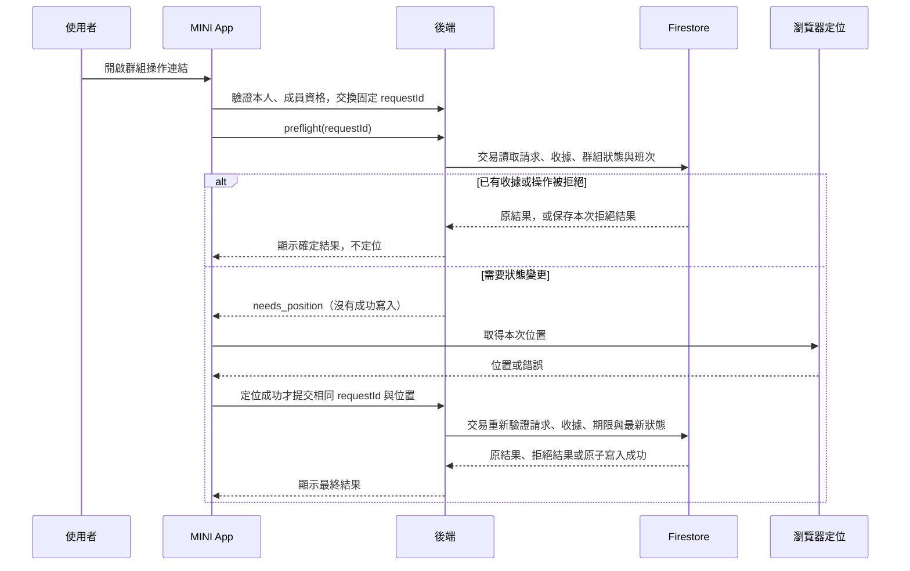

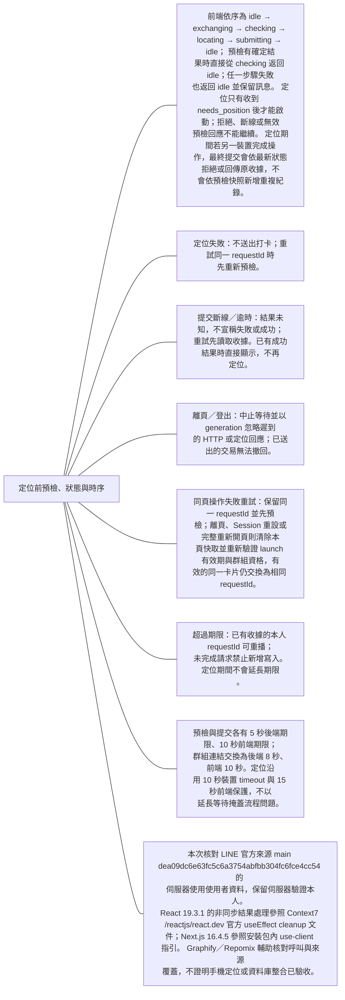

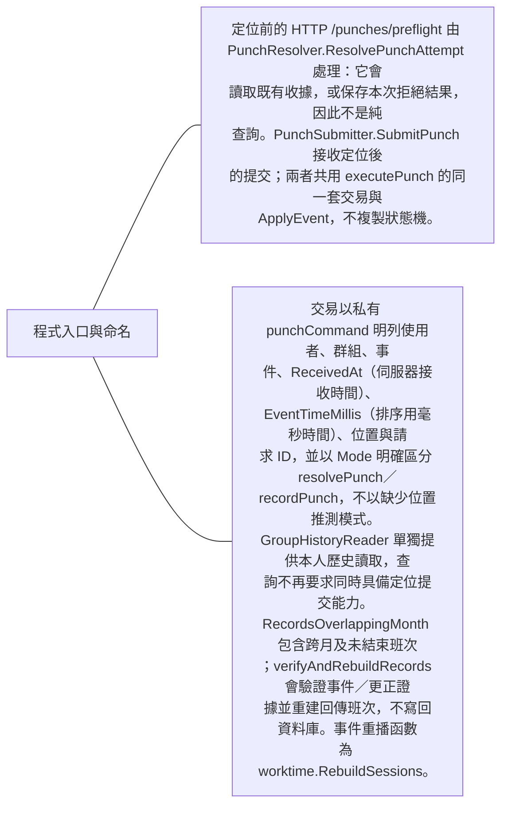
