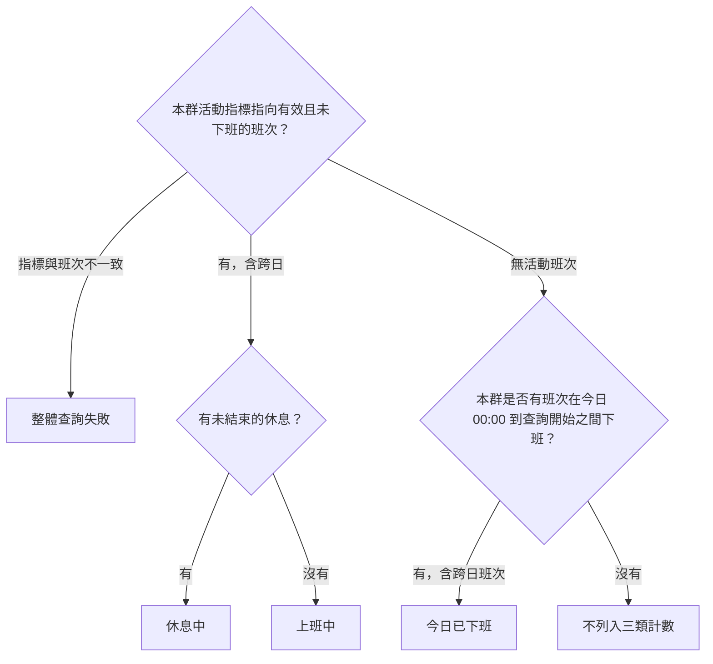

# 群組出勤看板與本人漏下班檢查

## 群組操作

| 群組輸入         | 回覆                                                                         |
| ---------------- | ---------------------------------------------------------------------------- |
| 補卡             | 開啟本群補卡／時間更正申請；人工核准後才生效。                               |
| 出勤             | 本群上班中、休息中、今日已下班人數，以及查詢完成時間。                       |
| 漏下班／下班提醒 | 只查詢發話者在本群的活動班次；有未結束班次時提供「現在下班（需定位）」按鈕。 |

- 這是按指令查詢的最小版本，沒有背景排程、固定時間推播或全群催打卡。群內訊息對所有成員可見，因此看板不顯示姓名、座標或個別明細；本人檢查只回覆本次查詢者是否有未結束班次，不公開上班時間。

- 「現在下班」沿用原有短效連結、LINE本人／群組成員驗證、定位與交易寫入；開啟按鈕本身不會直接下班。記錄的是後端目前時間，不是推測的昨日下班時間。若是過去漏打，應從「補卡」入口或私訊「出勤紀錄」選擇原班次提出申請，不用現在下班來冒充過去時間。

- 連結與既有打卡卡片同樣允許原群組成員使用，但每人只能操作自己的班次；轉傳不會取得查詢者的班次操作權限。不是固定指向某一名員工的補登連結。

## 計數語意

- 日期與顯示時間採 Asia/Taipei，每人每群組只計 一次，三類互斥：

- 現行實作

- 同日下班多次仍只計一人。下班後再次上班時，以目前活動班次判定上班中或休息中。

- 統計來自打卡紀錄，不是LINE即時成員名冊、排班、實際在場人數或缺勤統計。已離群者若仍有未結束班次，也可能出現在紀錄統計中；請先處理該班次。沒有打卡不能推論缺勤。「未結束」不自動等於確定漏打，第一版沒有班表或逾時判定。

## 資料與成本界線

- 讀取既有 channels/{channel}/users 子集合資料，使用 DocumentRefs 包含只有子集合、沒有父文件的歷史使用者；不新增投影、資料回填、排程或環境變數。

- 每位使用者讀取本群 attendanceStates 與其活動班次；沒有活動班次時，以 clockOutAt 單欄範圍查詢今日已結束班次，於後端過濾本群。使用單欄自動索引，不新增複合索引；若正式環境已豁免該欄位索引，查詢會明確失敗，不能宣稱已驗收。

- 為限制首版讀取成本，單一channel最多列舉200個使用者，每人今日已結束班次查詢上限500筆（包含其他群組）；取得第201人或第501筆時整體拒絕，不回部分人數。看板讀取和本人檢查各有10秒期限，查詢失敗沿用既有Webhook錯誤／重送流程。此讀取方式適用小規模初版，非固定成本的大型群組聚合方案。

- 既有使用者的狀態與班次在同一唯讀交易讀取；使用者列舉在交易之前，不保證同時新增的使用者會納入該次看板。更新時間代表查詢完成時間，不是自動更新或持續即時訂閱。輸入指令才重新讀取。

## 查證與驗證

- [LINE官方文件來源庫 default branch main，本次確認revision dea09dc6e63fc5c6a3754abfbb304fc6fce4cc54：群組事件與訊息可見性。](https://developers.line.biz/en/docs/messaging-api/group-chats/)

- Context7 /websites/cloud_google_firestore_native 查核單欄索引與範圍查詢。Context7 SDK搜尋未提供DocumentRefs細節，另直接核對官方Firestore Go v1.29.2 CollectionRef來源與已安裝同版SDK，確認會包含缺少父文件的使用者；交易API亦核對同版transaction.go。Google Developer Knowledge MCP在本側聊未提供，未操作雲端設定。

  - [單欄索引與範圍查詢](https://docs.cloud.google.com/firestore/native/docs/standard-index-overview)

  - [Firestore Go v1.29.2 CollectionRef來源](https://github.com/googleapis/google-cloud-go/blob/firestore/v1.29.2/firestore/collref.go)

- 本機測試與圖譜更新不代表新增群組流程已在真實LINE或正式Firestore通過。缺少Firestore emulator時既有整合測試會skip，應分開回報。main推送可能觸發既有CI/CD，Git發布不等同部署驗收。

- 功能索引 · 出勤總覽 · 文件總索引

  - [功能索引](../)

  - [出勤總覽](design.md)

  - [文件總索引](../../)

- 本次本機結果：fmt-check、lint（0 issues）、mise check（mod verify／vet／既有Go race suite）、mise build、設定檢查及 git diff --check 通過；Graphify 已更新。govulncheck 呼叫路徑未發現漏洞，仍列出3個未被呼叫的相依模組漏洞。Firestore emulator 未設定，既有整合測試明確skip，新增看板查詢及提醒交易仍待外部驗收。

## 群組選單入口

- [群組快捷入口依 LINE Bot 聊天指令。快捷按鈕可開啟對應流程；不會直接寫入出勤或核准請假。舊訊息的選單不會自動更新。](../../integrations/line/commands.md#群組)

- [選單依LINE官方Quick Reply規格支援群聊，最多13個按鈕，實際選項依應用與群組入口設定而定。查證沿用官方來源revision dea09dc6e63fc5c6a3754abfbb304fc6fce4cc54 的 Quick Reply文件。](https://developers.line.biz/en/docs/messaging-api/using-quick-reply/)
