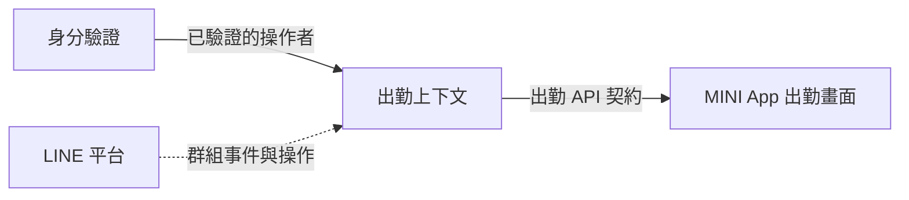

# 出勤上下文映射

圖中的實線表示提供方的契約或語意會影響使用方。虛線表示傳遞操作的技術入口。圖中同時標出外部系統與客戶端，以免把每個技術元件都當成業務上下文。

| 關係            | 映射方式及契約                                                                                                     | 變更時應保住的行為                                                                     |
| --------------- | ------------------------------------------------------------------------------------------------------------------ | -------------------------------------------------------------------------------------- |
| 身分驗證 → 出勤 | 身分是上游。出勤依賴驗證結果，審核資格則由出勤的授權資料決定。                                                     | 更換登入方式後，申請人仍不得自審；同一群組的一般成員也不能代為核准。                   |
| LINE → 出勤入口 | LINE 定義事件格式；入口將群組與操作轉為出勤可理解的命令。此轉譯承擔防腐層（ACL）的作用。                           | 調整按鈕文案或事件格式時，同一打卡事件重送仍得到原結果。                               |
| 出勤 → MINI App | 出勤定義 API；OpenAPI 是兩端共用的發布語言（Published Language）。請求雖由前端發出，結果欄位的業務語意由出勤定義。 | 定位預檢回應要求提供位置時，畫面不得顯示打卡成功；月報不得把暫估合計與已確認工時相加。 |

審核交易從本 Channel 的 `attendanceReviewers` 讀取可審核的群組。這條規則不能由 LINE 群組成員資格或前端角色標籤取代。現行資料也不足以判定團隊之間採用 Partnership 或 Shared Kernel。排班與薪資未有交換契約，故未列為現行上下游。

[出勤 API 契約](../../../api/contract/attendance/) · [LINE 入口](../../../backend/internal/business/attendance/adapter/line/attendance.go) · [審核交易](../../../backend/internal/business/attendance/adapter/firestore/attendance_correction.go)
