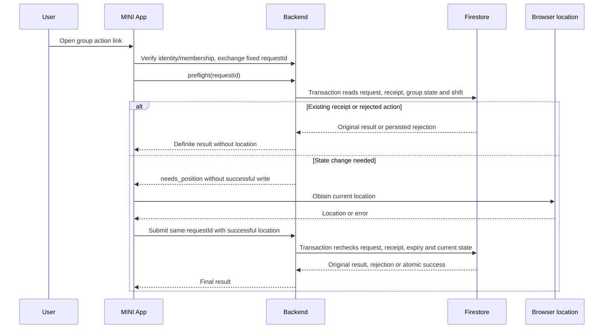
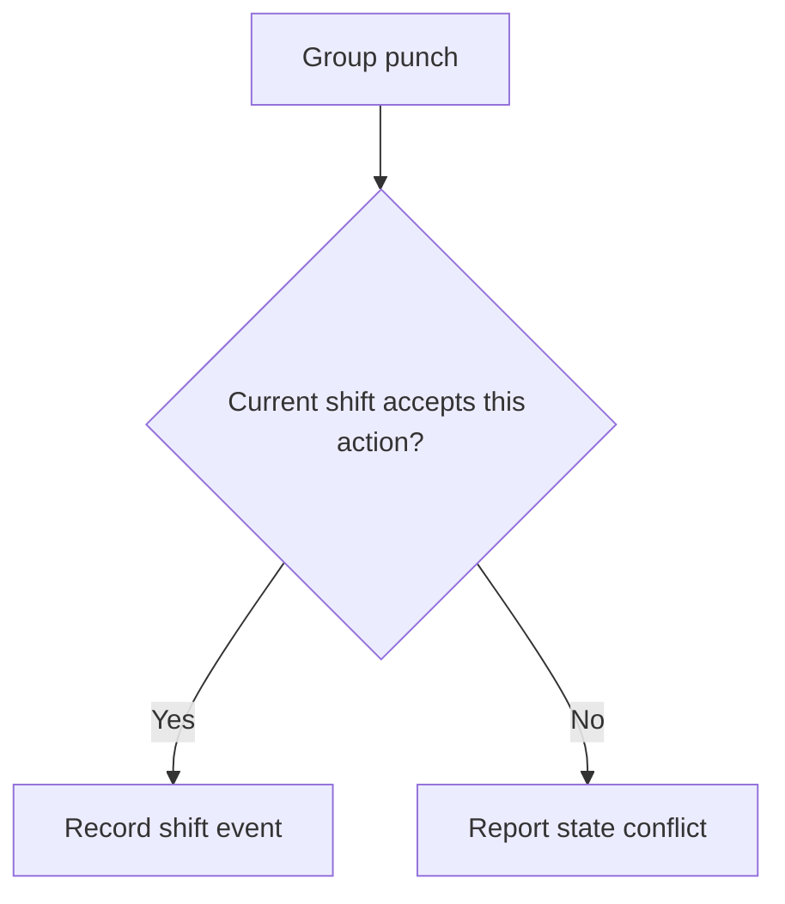
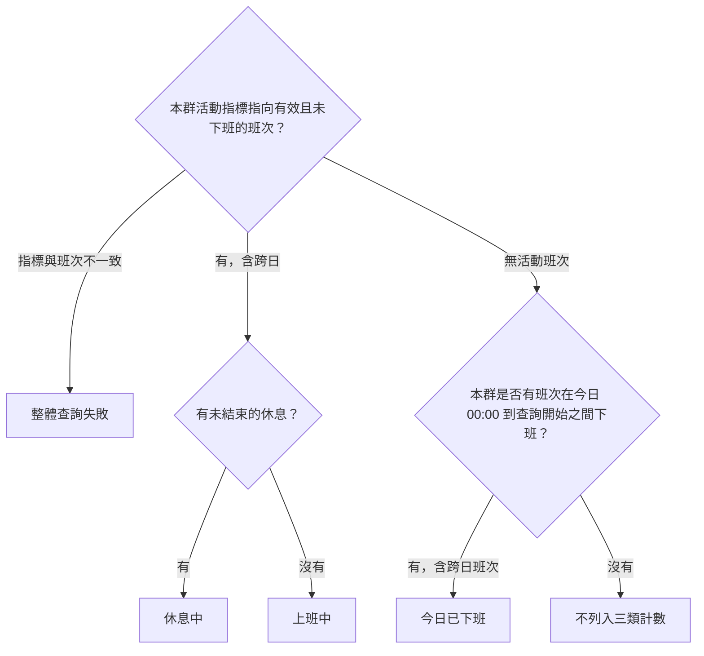
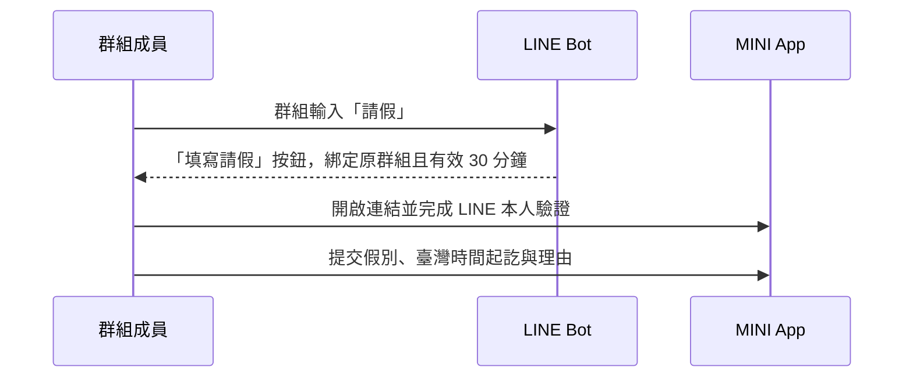
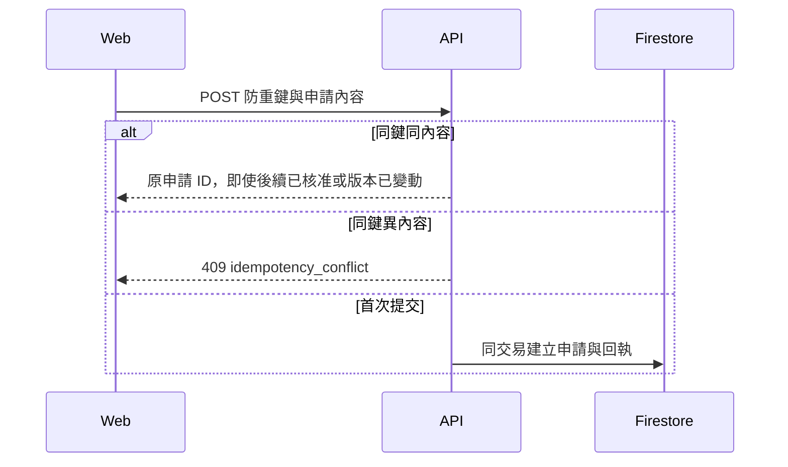
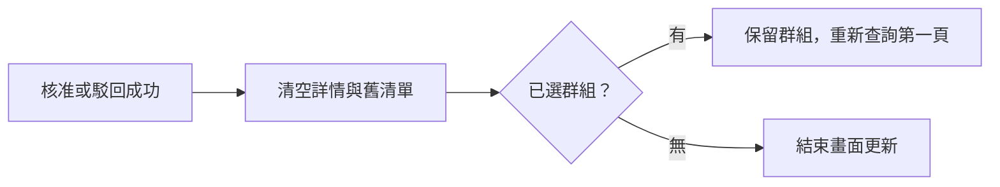
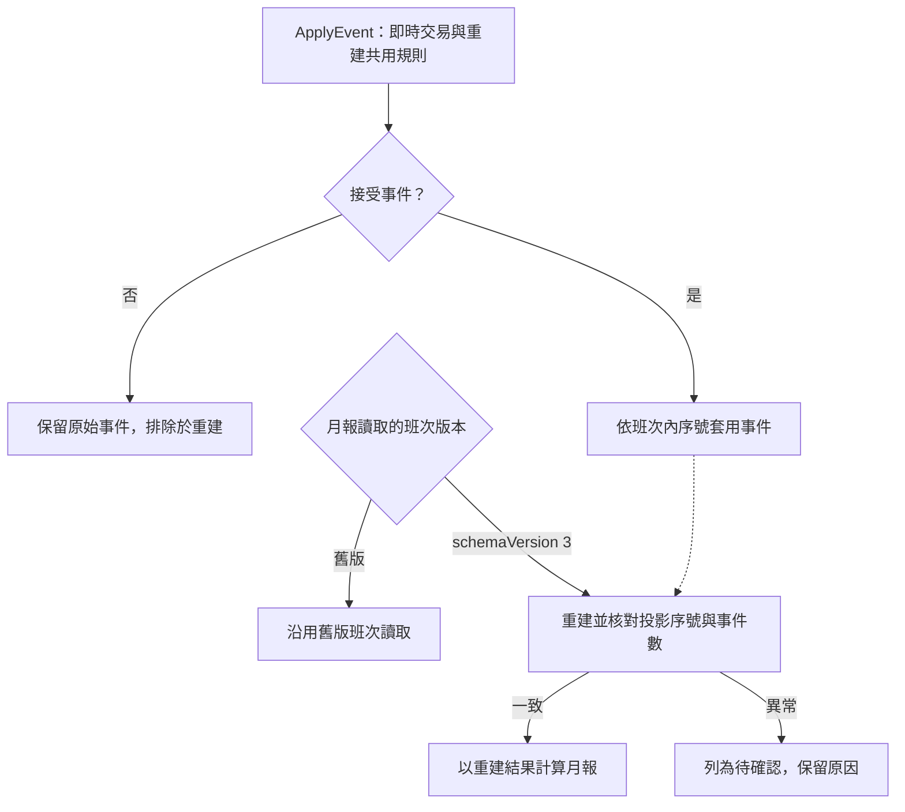
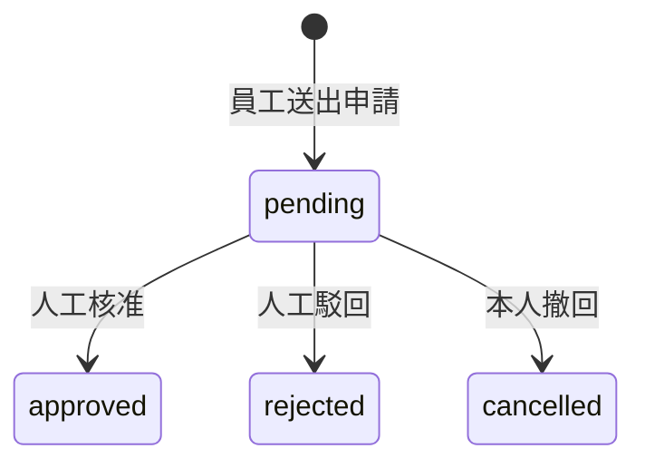
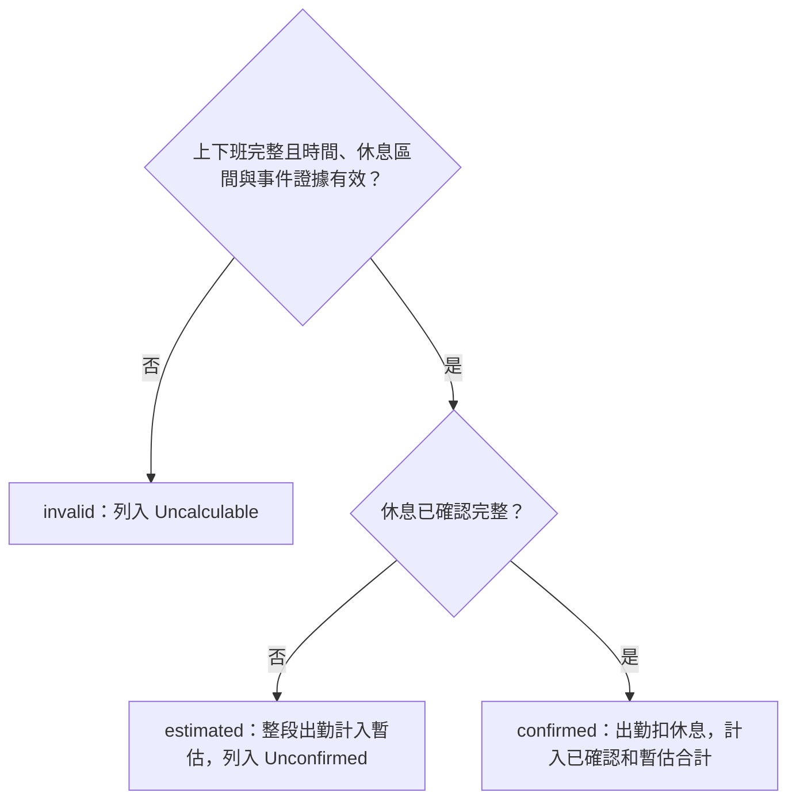

# Basic attendance 設計

**現行實作** · [群組打卡判定](#decision-flow) · [代表測試](../../../backend/internal/business/attendance/adapter/firestore/attendance_integration_test.go) · [模組規則](../../../backend/AGENTS.md)

[Attendance, business features and LINE journeys](../../integrations/line/journey.md#attendance-journey)

## Purpose and scope

Specifications for attendance, punches, corrections, leave and review.

設計入口：[子域分類與投資假設](#出勤的子域分類與投資假設) · [上下文映射與整合契約](../../architecture/runtime/dependencies.md#attendance-context-map) · [補正設計](#queries-單筆補正的審核判定)。本頁維護出勤用語與邊界。

## Bounded context

Attendance answers who attended in which group/time, what evidence supports it and how much worktime is confirmed. Maintain separate states per person/group. Multiple daily shifts are allowed; monthly reports intersect shifts with report months.

| Boundary           | Facts exchanged                                              | Responsibility                                                                                                                                                                                |
| ------------------ | ------------------------------------------------------------ | --------------------------------------------------------------------------------------------------------------------------------------------------------------------------------------------- |
| Identity/groups    | Verified actor and operation-bound group                     | Entry/identity modules authenticate; Attendance determines punch/query/review eligibility and reads reviewer group authorization itself. Membership alone grants no correction-review rights. |
| LINE/MINI App      | Group actions, preflight, personal submission/results        | Entry points translate requests into Attendance operations. Locations evidence individual punches; opening pages does not punch.                                                              |
| Scheduling/payroll | Confirmed net worktime, estimated totals and pending reasons | Attendance currently defines neither expected schedules, overtime eligibility nor pay amounts.                                                                                                |

## Ubiquitous language

| Term                            | Meaning here                                                                                                           |
| ------------------------------- | ---------------------------------------------------------------------------------------------------------------------- |
| Punch Event                     | Identified attempt with action, time/result. Rejected attempts also have results; only accepted actions change shifts. |
| Shift (worktime.Session)        | One person's clock-in/out within one group. Open shifts lack end times; this Session differs from login sessions.      |
| Interval                        | Start/end values for clipping reports, merging overlaps and calculating breaks; value-comparable without identity.     |
| Attendance Record               | Identifiable shift with times, event sequence and correction version; target of corrections.                           |
| Break confirmation              | Personal confirmation that breaks are complete. Empty lists distinguish confirmed no-break from unconfirmed.           |
| Confirmed net / Estimated total | Confirmed time requires complete verifiable evidence. Estimated total already includes confirmed time; never add them. |
| Correction                      | Reasoned changes to a specified record. Request, review decision and effective record are distinct.                    |
| Leave registration              | Personal group leave type, period/reason. Registration neither approves leave nor changes attendance.                  |

## Subdomains and capabilities

Capabilities below share attendance language/rules by current responsibility. Independent deployments/contexts are not presently needed.

| Capability                    | Decisions owned                                                        | Specification                                      |
| ----------------------------- | ---------------------------------------------------------------------- | -------------------------------------------------- |
| Punches/shifts                | Clock-in, break-start/end and clock-out eligibility; processed retries | [Worktime/transitions](#worktime)                  |
| Worktime                      | Rebuild shifts from events, clip months and confirm minutes            | [Calculation](#worktime)                           |
| Corrections/review            | Submission, withdrawal, decisions and approval versions/evidence       | [Evidence](#worktime), [queries/retries](#queries) |
| Leave                         | Input/retry validity and personal registration persistence             | [Leave](#leave)                                    |
| Personal queries/group boards | Read scope and distinct-person working/resting/finished counts         | [Queries](#queries), [boards](#board)              |

## 出勤的子域分類與投資假設

員工下班時漏打卡，隔天補交一個下班時間。月報能否採用這個時間，取決於誰提出、誰核准、原紀錄是否已改變，以及休息證據是否完整。從這條流程可以辨認三組不同的業務能力。

| 子域分類               | 出勤案例                                                   | 設計與投資依據                                                                                                                   |
| ---------------------- | ---------------------------------------------------------- | -------------------------------------------------------------------------------------------------------------------------------- |
| 核心候選（Core）       | 由打卡事件重建班次，保留人工補正證據，區分已確認與暫估工時 | 若使用者選用本產品的原因是工時可追溯，優先投入證據核對、並行審核與可重現的月報計算。仍需以實際採用理由驗證。                     |
| 支援候選（Supporting） | 請假登記、群組出勤看板                                     | 支援群組日常運作。登記請假與實際出勤可以並存；看板計算不同人的目前狀態。若未來要判定「應到未到」，先確認班表與應到名單由誰提供。 |
| 通用能力（Generic）    | 操作者身分驗證                                             | 出勤重用已驗證的身分，再自行判斷本人資料與群組審核資格。可替換身分驗證方案的條件，是出勤仍能可靠辨識同一操作者。                 |

這些分類用於討論投資優先順序。現行模型將打卡、工時計算、補正、查詢與請假放在同一出勤限界上下文；子域分類本身不要求拆服務。若要拆出請假，應先找出它獨有的詞義、生命週期與規則，例如組織是否真的需要假額或核准流程。

[工時計算](#worktime) · [請假登記](#leave) · [群組看板](#board)

## Consistency and acceptance

- **Punches.** Bound state by person/group. needs_position preflight must not create shifts or consume successful receipts. Submit transitions transactionally; redelivery returns original results without extra shifts.
- **Corrections.** Applicants may withdraw. Reviewers require group eligibility and must differ from applicants. Approval transactionally rechecks records, event sequences and overlaps before saving evidence/shifts. Cover self-review, repeat approval and records changed after submission.
- **Reports.** Empty unconfirmed breaks must not count as confirmed net time. Damaged approval evidence yields pending confirmation. Reports/boards are read results, not direct shift-write entry points.

## Current layers and next design decisions

Domains separate [entity](../../../backend/internal/business/attendance/domain/entity/), [valueobject](../../../backend/internal/business/attendance/domain/valueobject/), [service](../../../backend/internal/business/attendance/domain/service/), [event](../../../backend/internal/business/attendance/domain/event/) and [policy](../../../backend/internal/business/attendance/domain/policy/). Records/shifts own identity/state; intervals/locations validate values; calculations, corrections/evidence are domain operations; policies decide reviewers/retry conflicts. [Firestore transactions](../../../backend/internal/business/attendance/adapter/firestore/attendance_correction.go) atomically store decisions/evidence.

The [review use case](../../../backend/internal/business/attendance/application/command/review.go) checks authorization, retries and correction results through transaction ports. HTTP/LINE share the [monthly use case](../../../backend/internal/business/attendance/application/query/monthly.go). Scheduling, overtime/payroll need separately confirmed rules/ownership if adopted.

## Related specifications

[Local specifications and guidance](../../../api/AGENTS.md)

## Basic attendance

- Initial group location clock-in/out and personal records by group in direct chat.Commands/postbacks create short-lived requests. MINI App resolves results first,obtains location only for new actions, then submits attendance.Deployment and live LINE/Firestore acceptance are separate.Punch, monthly records, pagination and corrections have implementations;cloud settings, indexes and channel acceptance require verification.Query/retry and worktime/evidence guides own details.Infrastructure guidance records build order, not absence of features.This refactor reuses existing checks without adding test infrastructure.

  - [Queries, web pagination and correction retries](#queries)

  - [Worktime and correction evidence](#worktime)

  - [Infrastructure and integration](../../development/environment/verification.md)

## Minimal operations

- Clock in: backend verifies identity, saves start time and returns result.

- Clock out: backend verifies identity, saves the matching shift end and returns result.

- Personal records: verified actor's own attendance only,including start/end and explicit unfinished status.

- Use trusted backend identity, never client-selected user IDs for authorization.Backend generates punch times. Failed persistence cannot report success.Repeated clicks/redelivery cannot silently duplicate records.Keep open shifts unfinished; never guess clock-out times.

- [Group 出勤 command shows counts; 補卡 opens manual review;漏下班 checks personal open shifts. See board guidance.](#board)

- [Minimal group leave registration neither approves leave nor changes attendance.](#leave)

## Original scope and later implementation

Original release excluded schedules, leave, overtime review, payroll,geofencing, face recognition, correction review, admin reports and notifications.Existing-shift corrections, missing-shift entries, manual decisions and withdrawalare now implemented for ended shifts; effective records stay unchanged before approval.Full role management is absent; use group reviewer allowlists.Do not prebuild speculative modules/frameworks; LINE capability lists are references.

## Adopted initial rules

- Messaging API: group 打卡 command returns Flex actions with short-lived launch capabilities.MINI App verifies LINE identity/membership and binds a request to person/action.No punch has occurred yet.

- MINI App submits LINE ID token, requestId, latitude, longitude,accuracyMeters and capturedAt to POST /api/v1/attendance/punches after consent.Backend checks identity, ownership/location and executes a Firestore transaction.Denied location creates no record; no radius or physical-presence validation.

- Direct-chat 出勤紀錄 lists personal groups;出勤紀錄 編號 returns that group's latest five.Group queries guide users to direct chat; direct-chat punches are unavailable.

- Calculate each group independently: one open shift per person/group,multiple daily shifts allowed. Cross-day clock-out closes the existing open record.

- Display Asia/Taipei, persist UTC. Punches use server processing time;event time only rejects operations older than the latest processed event.

- Repeat clock-in returns original time; clock-out without an open record rejects.Redelivery reads the original transaction result.

- No personnel allowlist or friendship check. Shared cards require live servermembership verification and reject nonmembers. Show results in MINI App;never push exact coordinates to groups.

## Activation and data

- Initialize attendance with GOOGLE_CLOUD_PROJECT and LINE_MESSAGING_API_CHANNEL_ID;missing either disables attendance with an unavailable reply.FIRESTORE_DATABASE_ID defaults to (default). Reuse Messaging API secret/token and ADC;runtime accounts need database read/write rights.Location punching requires MINI App Channel ID, LIFF ID and openid.Channels must share a Provider for matching user IDs.Verify ID tokens server-side; never trust client userId/groupId.

- Enable Allow bot to join group chats and invite the bot.Members need not friend the bot first; personal records may require direct-chat friendship.ATTENDANCE_MEMBERS_JSON is retired. Direct-chat punches guide users to groups,without a separate personal punching workflow.

- Data under channels/{channelID}/users/{SHA256(userID)}:

- attendance/{SHA256([groupID,eventID])}: schemaVersion,groupID, clockInAt and clockOutAt, omitted for open shifts.

- attendanceStates/{SHA256(groupID)}：recordID、lastEventTime。

- attendanceEvents/{SHA256([groupID,eventID,action])}:code and record snapshot of the original result.

- Location punches use schemaVersion 2 and clockInPosition/clockOutPosition(coordinates, accuracy, sample time); old records remain readable.channels/{channelID}/punchRequests/{requestID} stores original groupID, hashed userKey,eventID, action, eventTime and expiresAt. Redelivery never extends expiry.Retries read original receipts without duplicate punches; expired unfinished requests cannot write.

- [Hash JSON-array composite IDs. Results, records and state commit in one transaction;send replies outside it. Queries use personal paths, group projections, month ranges/cursors.See attendance queries/corrections for contracts; message pagination is not database pagination.Store no reply tokens, full events or names. Locations remain with punches/deduplication,not tracking history or ordinary logs. Retention requires operations decisions;keep deduplication through possible redelivery windows.Optional expiresAt TTL is not immediate expiry; code still checks deadlines.](#queries)

- Official LINE source: line/line-developers-docs-source main090500a12f9777995006d9fb5cafab8d83a792b2.Checked LIFF opening/query forwarding, server identity and same-Provider user IDs.Device location, Provider settings and live Firestore transactions require real acceptance.

  - [LIFF opening and query forwarding](https://developers.line.biz/en/docs/liff/opening-liff-app/)

  - [Server identity verification](https://developers.line.biz/en/docs/liff/using-user-profile/)

  - [Same-Provider user IDs](https://developers.line.biz/en/docs/messaging-api/getting-user-ids/)

- Enable webhook redelivery in LINE Developers Console.Write/reply failures return 503 for retries; token expiry/single-use limits remain.Deduplication prevents repeated punches, not guaranteed delivery.Check personal records in direct chat for uncertain replies.

## Later product changes

- Initial entry: connect Bot or MINI App first; simultaneous development is not assumed.

- Identity: map LINE users to eligible personnel and define first-use eligibility.

- Time: display zone, cross-day shift matching and multiple daily shifts.

- Results: explicit rejection or replay rules for repeated/inapplicable punches.

- Initial rules are settled above; update this page for later changes.Confirm rules before fixing API, Firestore paths/fields, uniqueness/atomic updates.Do not build every feature before infrastructure stabilizes.

## Direct group MINI App links: production acceptance pending

- Group 打卡 cards open LIFF for clock-in/out, break-start/end and confirmation.Each has a random ten-minute launch token storing group/action, never trusted user ID.Verify identity and live Messaging API membership before exchanging a fixed per-card/user request ID.Reopening never extends expiry. Old ?request= links/postback cards are disabled;request a new card. Existing authorization, five-minute location freshness,state machine and transaction receipts remain.

- Verify MINI App/LINE Login and Messaging API channels share a Provider.Test live membership success, nonmembers, bot departure and API failures.Forwarded cards reject nonmembers. Close LIFF only after confirmed success;permission/network failures keep retry UI. Closing sends no group success message.

## Location preflight, state and sequence

Backend worktime.ApplyEvent owns transitions, never cached frontend state.POST /api/v1/attendance/punches/preflight takes a personally bound requestIdand retains identity, CSRF, expiry and transaction checks.Resolution may persist rejection receipts but never successful punches or locations.

- Existing receipt; any action: replay original result despite changed state; no location.

- No open shift; clock in: needs_position.

- Working/resting; clock in: already_in and original start; no location.

- No open shift; clock out/break/confirm: not_in; no location.

- Working; clock out/start break/confirm breaks: needs_position.

- Working without break start; end break: not_resting; no location.

- Resting; start break/confirm: already_resting/break_incomplete; no location.

- Resting; clock out/end break: needs_position, subject to event ordering.

- Request predates last event; any unreceipted action: stale_event; no location.

- Expired unreceipted or non-owned request; any action: 403; no location/punch.

- Unknown backend state; any action: retryable error; no location.

- Preflight/submit share transactions and state machine; preserve code/message.accepted identifies current/original successful punches.needs_position reserves nothing, creates no event/receipt/shift and guarantees no later success.Persisted rejections replay forever for requestId; changed state needs a new group card.All successful actions, including breaks/confirmation, retain location evidence requirements.

- Current implementation

- UI: idle → exchanging → checking → locating → submitting → idle.Definite preflight results return checking to idle; failures retain messages.Only needs_position starts location; denial, disconnection or invalid responses stop.If another device acts during location, final submit uses current state/receipt,never duplicating from the preflight snapshot.

- Location failure: no submit; retry same requestId through preflight first.

- Submit disconnect/timeout: unknown result; retry resolves receipt first.Display existing success without locating again.

- Leave/logout: cancel waiting and ignore late HTTP/location results by generation;already submitted transactions cannot be recalled.

- Same-page retries keep requestId and preflight.Navigation, session reset or full reopening clears page caches and revalidates launch/membership;a valid same card still exchanges the same requestId.

- After expiry, owners may replay existing receipts but unfinished requests cannot write.Location acquisition never extends deadlines.

- Preflight/submit: backend 5s, frontend 10s. Launch exchange: backend 8s, frontend 10s. Location: device 10s, frontend guard 15s; do not hide flow defects by waiting longer.

- [Checked official LINE main dea09dc6e63fc5c6a3754abfbb304fc6fce4cc54server user-data guidance; retain server identity verification.React 19.3.1 async handling follows Context7 /reactjs/react.dev useEffect cleanup;Next.js 16.4.5 follows installed use-client guidance.Graphify/Repomix corroborate sources, not device/database acceptance.](https://developers.line.biz/en/docs/liff/using-user-profile/)

## Code entry points and naming

- PunchResolver.ResolvePunchAttempt handles /punches/preflight.It reads receipts or persists rejection, so is not a pure query.PunchSubmitter.SubmitPunch handles located submissions;both share executePunch transactions and ApplyEvent without duplicate state machines.

- Private punchCommand explicitly carries user, group, event, ReceivedAt,EventTimeMillis ordering, position and request ID. Mode distinguishes resolvePunch/recordPunch,never inferred from absent location. GroupHistoryReader independently serves personal history.RecordsOverlappingMonth includes cross-month/open shifts.verifyAndRebuildRecords checks event/correction evidence and rebuilds without writes;event replay uses worktime.RebuildSessions.

## Group punch decision flow

[Entry adapter](../../../backend/internal/business/attendance/adapter/http/routes.go) · [Decision rules](../../../backend/internal/business/attendance/adapter/firestore/attendance_integration_test.go) · [Application output port](../../../backend/internal/business/attendance/application/port/errors.go) · [Related tests](../../../backend/internal/business/attendance/adapter/firestore/attendance_integration_test.go)

[Domain guidance](../../AGENTS.md)

## 後端分層結構

[attendance 模組原始碼](../../../backend/internal/business/attendance/) · [代表測試](../../../backend/internal/business/attendance/domain/service/correction_test.go) · [六邊形分層與依賴方向](../../architecture/runtime/backend-boundaries.md#六邊形分層參考)

## 群組出勤看板與本人漏下班檢查

### 群組操作

| 群組輸入         | 回覆                                                                         |
| ---------------- | ---------------------------------------------------------------------------- |
| 補卡             | 開啟本群補卡／時間更正申請；人工核准後才生效。                               |
| 出勤             | 本群上班中、休息中、今日已下班人數，以及查詢完成時間。                       |
| 漏下班／下班提醒 | 只查詢發話者在本群的活動班次；有未結束班次時提供「現在下班（需定位）」按鈕。 |

- 這是按指令查詢的最小版本，沒有背景排程、固定時間推播或全群催打卡。群內訊息對所有成員可見，因此看板不顯示姓名、座標或個別明細；本人檢查只回覆本次查詢者是否有未結束班次，不公開上班時間。

- 「現在下班」沿用原有短效連結、LINE本人／群組成員驗證、定位與交易寫入；開啟按鈕本身不會直接下班。記錄的是後端目前時間，不是推測的昨日下班時間。若是過去漏打，應從「補卡」入口或私訊「出勤紀錄」選擇原班次提出申請，不用現在下班來冒充過去時間。

- 連結與既有打卡卡片同樣允許原群組成員使用，但每人只能操作自己的班次；轉傳不會取得查詢者的班次操作權限。不是固定指向某一名員工的補登連結。

### 計數語意

- 日期與顯示時間採 Asia/Taipei，每人每群組只計 一次，三類互斥：

- 現行實作

- 同日下班多次仍只計一人。下班後再次上班時，以目前活動班次判定上班中或休息中。

- 統計來自打卡紀錄，不是LINE即時成員名冊、排班、實際在場人數或缺勤統計。已離群者若仍有未結束班次，也可能出現在紀錄統計中；請先處理該班次。沒有打卡不能推論缺勤。「未結束」不自動等於確定漏打，第一版沒有班表或逾時判定。

### 資料與成本界線

- 讀取既有 channels/{channel}/users 子集合資料，使用 DocumentRefs 包含只有子集合、沒有父文件的歷史使用者；不新增投影、資料回填、排程或環境變數。

- 每位使用者讀取本群 attendanceStates 與其活動班次；沒有活動班次時，以 clockOutAt 單欄範圍查詢今日已結束班次，於後端過濾本群。使用單欄自動索引，不新增複合索引；若正式環境已豁免該欄位索引，查詢會明確失敗，不能宣稱已驗收。

- 為限制首版讀取成本，單一channel最多列舉200個使用者，每人今日已結束班次查詢上限500筆（包含其他群組）；取得第201人或第501筆時整體拒絕，不回部分人數。看板讀取和本人檢查各有10秒期限，查詢失敗沿用既有Webhook錯誤／重送流程。此讀取方式適用小規模初版，非固定成本的大型群組聚合方案。

- 既有使用者的狀態與班次在同一唯讀交易讀取；使用者列舉在交易之前，不保證同時新增的使用者會納入該次看板。更新時間代表查詢完成時間，不是自動更新或持續即時訂閱。輸入指令才重新讀取。

### 查證與驗證

- [LINE官方文件來源庫 default branch main，本次確認revision dea09dc6e63fc5c6a3754abfbb304fc6fce4cc54：群組事件與訊息可見性。](https://developers.line.biz/en/docs/messaging-api/group-chats/)

- Context7 /websites/cloud_google_firestore_native 查核單欄索引與範圍查詢。Context7 SDK搜尋未提供DocumentRefs細節，另直接核對官方Firestore Go v1.29.2 CollectionRef來源與已安裝同版SDK，確認會包含缺少父文件的使用者；交易API亦核對同版transaction.go。Google Developer Knowledge MCP在本側聊未提供，未操作雲端設定。

  - [單欄索引與範圍查詢](https://docs.cloud.google.com/firestore/native/docs/standard-index-overview)

  - [Firestore Go v1.29.2 CollectionRef來源](https://github.com/googleapis/google-cloud-go/blob/firestore/v1.29.2/firestore/collref.go)

- 本機測試與圖譜更新不代表新增群組流程已在真實LINE或正式Firestore通過。缺少Firestore emulator時既有整合測試會skip，應分開回報。main推送可能觸發既有CI/CD，Git發布不等同部署驗收。

- 功能索引 · 出勤總覽 · 文件總索引

  - [功能索引](../)

  - [出勤總覽](design.md)

  - [文件總索引](../../)

- 本次本機結果：fmt-check、lint（0 issues）、mise check（mod verify／vet／既有Go race suite）、mise build、設定檢查及 git diff --check 通過；Graphify 已更新。govulncheck 呼叫路徑未發現漏洞，仍列出3個未被呼叫的相依模組漏洞。Firestore emulator 未設定，既有整合測試明確skip，新增看板查詢及提醒交易仍待外部驗收。

### 群組選單入口

- [群組快捷入口依 LINE Bot 聊天指令。快捷按鈕可開啟對應流程；不會直接寫入出勤或核准請假。舊訊息的選單不會自動更新。](../../integrations/line/commands.md#群組)

- [選單依LINE官方Quick Reply規格支援群聊，最多13個按鈕，實際選項依應用與群組入口設定而定。查證沿用官方來源revision dea09dc6e63fc5c6a3754abfbb304fc6fce4cc54 的 Quick Reply文件。](https://developers.line.biz/en/docs/messaging-api/using-quick-reply/)

## 群組請假登記

### 最小流程

現行實作

- 請假可直接送出，無須取得定位。

- 假別為事假、病假、特休、其他。理由必填，最多500字；結束須晚於開始，單筆期間最多366天，開始年份限制2000至2100。允許登記過去時段，不計算應到日或可用假額。

- 第一版僅登記，不代表核准。 沒有審核、扣假、撤回、通知或自動發布群組結果；請另行聯絡主管確認。請假不改寫打卡、工時或更正資料，不以假單推定出勤。理由及假別不回傳群聊。

- 本人可在 /miniapp/leave 或首頁「本人請假紀錄」查看跨群組最近20筆登記；畫面顯示群組ID供區分。沒有主管查看全群假單的權限或入口。新增申請須從原群組取得連結，不能自行指定群組或他人 user ID。

### API 與儲存

- POST /api/v1/attendance/leaves：launch、requestKey（UUID）、kind、start、end、reason。時間為帶時區 RFC3339。回傳已保存的 LeaveRecord，status 固定為 registered，不是 approved。

- GET /api/v1/attendance/leaves：登入本人最近20筆登記，按建立時間遞減，不代表完整歷史列表。

- 沿用既有 Cookie Session／Bearer 認證、CSRF 與 OpenAPI 請求驗證。後端以 LINE API 確認原群組成員，只有200才允許送出；非成員拒絕，API故障不寫入。

- 同一本人的 requestKey 在相同內容重試時回原登記；不同內容回409。前端在結果未知時鎖住草稿並重試原內容；成功後才可明確建立另一筆。

- 一般側欄入口供查閱本人紀錄；持群組連結才顯示登記表單。伺服器判定連結過期或失去成員資格後停止送件。回應逾時不代表失敗，先重新載入本人紀錄。頁面重開、連結過期後，應先確認最近紀錄再重新填寫；第一版不保存跨頁草稿，也不提供語意重複／時段重疊的自動拒絕。

- Firestore：channels/{channel}/leaveLaunches/{tokenHash} 保存群組與到期；channels/{channel}/users/{userHash}/leaveRequests/{requestKeyHash} 保存伺服器以 google/uuid 產生的 UUID v4 申請編號、群組、token雜湊、假別、UTC起訖、理由及建立時間。原始 token 不寫入假單文件；交易再次確認連結有效，重試不建立第二筆。

- 最近紀錄在本人子集合依 createdAt 排序，最多顯示 20 筆，沿用單欄索引，無須回填或新增環境變數。超出顯示範圍的登記仍保留。請假理由與去重紀錄的保存期限待定，首版不設定自動刪除（TTL）。

- MINI App 與 Messaging API 仍需同一 Provider，且 Bot 在群組中。沿用 LINE_MINI_APP_ENV 選定的 LIFF ID 設定、身分／Session 與出勤資料庫設定。主頁的 ?leave= 及 LIFF liff.state 會導向請假頁，打卡連結維持原流程。

### 查證與驗證邊界

- 本次查核 LINE 官方來源庫 default branch main，revision dea09dc6e63fc5c6a3754abfbb304fc6fce4cc54： 群組訊息與群組來源、伺服器驗證本人、LIFF連結與附加參數。

  - [群組訊息與群組來源](https://developers.line.biz/en/docs/messaging-api/group-chats/)

  - [伺服器驗證本人](https://developers.line.biz/en/docs/liff/using-user-profile/)

  - [LIFF連結與附加參數](https://developers.line.biz/en/docs/liff/opening-liff-app/)

- [交易讀取先於寫入與重試語意使用 Context7 /websites/cloud_google_firestore_native 查核官方交易文件，對照專案Firestore Go v1.29.2；前端參照 Context7 /react/react/v19.3.1 與已安裝 Next.js 16.4.5 Pages Router 指引。未新增依賴。](https://docs.cloud.google.com/firestore/native/docs/manage-data/transactions)

- 本機檢查不能代替 LINE iOS／Android、真實群組成員 API 或正式 Firestore 寫入驗收。Git 推送可能觸發既有CI/CD，不等於部署已成功；本次不手動操作雲端設定。

- 功能索引 · 出勤功能 · 文件總索引

  - [功能索引](../)

  - [出勤功能](design.md)

  - [文件總索引](../../)

### 本次本機驗證

- 已通過 fmt-check、lint（0 issues）、mise check（mod verify／vet／既有 race suite）、mise build、前後端 pnpm build、TypeScript check、12個既有前端測試、API生成同步／相容性（含 origin/main 歷史比較）、設定檢查與 git diff --check。govulncheck 沒有呼叫路徑中的漏洞；相依模組仍報3個未被呼叫的漏洞。

- 啟動未設定雲端的本機服務，確認 /miniapp/leave、主頁 ?leave=、liff.state 請假連結均回200並呈現請假頁，原打卡連結仍呈現打卡頁；未設定時請假 API 回503。Graphify 已更新。

- 沿用既有測試，未新增測試工程或案例。Firestore emulator 未設定，既有整合測試明確 skip；新增請假交易與真實 LINE 成員檢查仍須外部驗收，不把既有測試通過視為新流程整合已通過。

- 新申請的 API id 為 UUID v4；文件路徑保留 requestKeyHash 以維持原子防重複。舊資料沒有 id 時仍回傳原文件編號，不改寫歷史資料。UUID 產生失敗時交易不寫入。

## 出勤查詢與更正

本人跨群組首屏與待我審核彙整的目標規格見[下文](#queries-本人出勤服務與補卡審核)。MINI App 本人出勤首頁直接讀當月跨群組班次。`/records` 的 `group` 可省略，分頁綁定本人、月份與群組篩選；月工時摘要仍需指定群組。「待我審核」使用 `/corrections?scope=review`，由後端每頁讀取審核授權，只回傳有權處理且尚未結案的申請。單群組查詢仍可指定 `group`；彙整清單若本頁全為已處理或本人申請，仍以游標繼續。

[本頁記錄現有出勤功能的資料讀取、Web 工作流程與更正重試契約。維持 Go + Next.js／React；不增加角色系統或通知。定位打卡仍沿用 基礎出勤 的本人／群組／launch 授權。](design.md)

### 本人出勤服務與補卡審核

MINI App 由 `/miniapp/attendance` 提供出勤紀錄、請假紀錄、補卡與更正、補卡審核四個分頁。舊網址由服務端轉到對應分頁並保留查詢參數。LINE 打卡沿用 `/miniapp/punch`。

以下為目標規格。本人服務以登入者為查詢範圍，審核服務以出勤授權為範圍。群組保留為班次與申請的歸屬。查本人資料時，首屏直接載入分頁結果，無須先載入或選取群組。每筆顯示所屬群組。我的出勤紀錄依月份顯示，切換月份時直接重新載入。

| 功能       | 預設查詢                                           | 群組何時必要                                                       |
| ---------- | -------------------------------------------------- | ------------------------------------------------------------------ |
| 出勤紀錄   | 本人當月班次，跨群組按時間排序。                   | 建立打卡時須確認出勤群組。                                         |
| 請假紀錄   | 本人各群組的登記及處理狀態。                       | 新登記須有適用群組；既有可信群組入口可直接帶入。                   |
| 補卡與更正 | 本人各群組的申請及狀態。                           | 更正從原班次帶入群組與班次；缺少原班次時選擇群組和日期。           |
| 待我審核   | 彙整本人有出勤審核權的群組待審申請，每筆標示群組。 | 列表與詳情均按群組審核權判定，送出決定前再核驗目前授權與申請狀態。 |

Attendance 管理審核授權。LINE 群組成員、儲存庫管理者及專案管理者的身分本身不授予審核權；既有不得審核本人申請的規則照常適用。1:1 私訊與 MINI App 待辦可導入同一審核詳情。進入工作台或收到通知不會授權。

驗收使用同時有 A、B 班次的員工和只負責 A 的審核者。員工首屏看到兩群紀錄，從 A 班次發起更正後仍歸 A。審核者只看到 A 的待辦。若授權在送出前撤回，後端拒絕且原班次不變。MINI App 已直接讀取本人當月出勤與補正申請；請假紀錄已有跨群組讀取。待我審核直接載入有權處理的跨群組待辦。LINE 私人通知與指定申請直達仍待接線。

### 單筆補正的審核判定

**情境。** 員工針對一筆班次提出補正後，另一個打卡事件更新了原紀錄。即使審核者有權核准，系統仍需用最新資料重新判定這份提案能否生效。

| 戰術概念      | 在補正中的責任                                                                                                                                |
| ------------- | --------------------------------------------------------------------------------------------------------------------------------------------- |
| Entity        | 出勤紀錄有穩定的紀錄 ID；補正申請也可獨立追蹤。申請送出時，班次尚未被修改。                                                                   |
| Value Object  | 工時區間以起訖表示；兩段區間是否相同由時間值決定。已結束的休息與正在休息必須分開表達。                                                        |
| Domain Policy | 審核者須有該群組授權且不能是申請人。取消則由申請人本人執行。                                                                                  |
| 一致性邊界    | 核准時在同一交易核對資格、最新班次與提案是否相容，再更新紀錄及核准證據。交易涉及多份資料；現有實作並未據此宣告它們都是同一個 Aggregate Root。 |

**目前實作。** 審核資格與補正計算已有純 Go 規則，交易內讀取先前決定與核准證據後，由 [Decision.NeedsDecision](../../../backend/internal/business/attendance/domain/policy/review.go) 判斷是否繼續。已有核准證據時，再次核准成功，改為取消或拒絕則衝突；若只有已保存的決定，狀態與理由都須一致才視為成功重送。Firestore 負責取得最新事實與寫入。[應用層用例](../../../backend/internal/business/attendance/application/command/review.go) 透過 ReviewTransaction 取得最新資料，交易重試時重新執行決策。HTTP 層負責轉換請求與回應；用例不應拿交易外讀到的舊紀錄直接覆寫現況。

| 驗收情境                               | 應觀察到的結果                       |
| -------------------------------------- | ------------------------------------ |
| 申請人有同群組審核資格，又審自己的申請 | 拒絕核准，原班次不變。               |
| 授權審核者重送已核准的決定             | 回傳成功，僅保留一次生效的補正。     |
| 提案之後，原班次的事件序列已改變       | 過期提案不得覆寫較新的紀錄。         |
| 讀取月報時，核准證據無法對應當前紀錄   | 反映待確認狀態，不計為已確認淨工時。 |

[審核資格](../../../backend/internal/business/attendance/domain/policy/review.go) · [補正計算](../../../backend/internal/business/attendance/domain/service/correction.go) · [交易整合測試](../../../backend/internal/business/attendance/adapter/firestore/attendance_integration_test.go)

### Web 工作流程

- /miniapp 為入口；月紀錄、更正與授權審核各自獨立，定位示範保留獨立入口。群組打卡連結仍開獨立定位打卡頁。各頁共用登入及 API 生命週期，不要求具備其他頁面的 DOM。

- 月份以 Asia/Taipei 月初至下月月初的半開區間計算，再轉為 UTC。跨月班次與未下班班次保留；不猜測下班時間。切換群組／月份、登出或離頁會取消讀取並使舊回應失效。頁面條件、明細與更正的班次必須一致。

### 查詢 API

伺服器以 Session Cookie 或 LINE ID token 驗證本人，不接受指定他人的 user ID。回應不快取；新版列表與詳情不公開精確位置或原始事件證據。

下表均為 GET，路徑前綴為 `/api/v1/attendance`。參數型別與回應結構見[出勤 OpenAPI](../../../api/contract/attendance/records.yaml)。

| 用途         | 路徑               | 查詢參數                                             | 回應與範圍                                             |
| ------------ | ------------------ | ---------------------------------------------------- | ------------------------------------------------------ |
| 選群組       | `/groups/page`     | `pageSize`、`cursor`                                 | `items`（id、name）、`nextCursor`、`asOf`、`queryMode` |
| 查單群月摘要 | `/monthly/summary` | `group`、`month`（YYYY-MM）                          | 完整月份 Calculation、`count`、`asOf`                  |
| 列出本人班次 | `/records`         | `month`、`pageSize`、`cursor`；可選 `group` 篩選單群 | `items`、`nextCursor`、`asOf`、`queryMode`             |
| 查班次明細   | `/records/{id}`    | `group`                                              | 本人在該群組的班次詳情與版本                           |

- pageSize 預設20、範圍1–100；cursor 必須與本人、channel、群組／月份與排序版本相符，無效回400 invalid_cursor。班次排序為上班時間DESC、下班時間DESC（未下班的零值排在同上班時間的已下班班次之後）、文件ID DESC，以完整排序欄位消歧義，不使用offset。沒有下一頁時 nextCursor 為空。上一頁由瀏覽器保存已使用的cursor。

- 月摘要計算完整相關班次，不是目前一頁的加總。既有 /monthly、/groups 與 LINE 查詢保持契約，不能靜默截成一頁。即時分頁不提供跨HTTP請求快照保證；asOf只是產生時間。核准後重新查詢，資料變更時從第一頁重新載入。

### 資料查詢切換

- 新寫入同交易維護 isOpen 與本人 attendanceGroups 群組投影。

- 新 Channel 直接使用索引查詢，API queryMode 為 indexed。

- 索引模式以已下班的時間重疊條件與未下班集合查候選班次；完整月摘要仍須讀取相關班次原始事件與更正audit證據，不能為減少讀取而省略。資料依批次讀取不等於月摘要成本固定，多range索引仍需以官方Query Explain確認實際掃描量。

- 發布前依 firestore.indexes.json 建立出勤索引並等待 READY，再發布使用索引的版本。

### 更正提交重試

- 新版Web在 POST /api/v1/attendance/corrections 帶一個 Idempotency-Key UUID。一次已確認的payload與key在結果未知時保持不變，重試不能產生新key；更改表單才建立新的提交。key不含使用者或敏感資料。

- 伺服器以channel、已驗證本人與key隔離回執，對固定版本的業務payload做正規化雜湊。時間以UTC正規化，breaks順序保留，server ID／CreatedAt不參與。申請與最小回執同交易建立；交易可能重跑，但不能建立第二筆申請。

- 現行實作

- 空白、無效或重複header：400 invalid_idempotency_key。

- 無header：保留舊呼叫契約，但沒有跨請求去重保證；新Web一律帶header。

- [省略 recordId 可提交無原班次的補卡，核准前不建立有效紀錄；其餘流程與限制見 補卡與人工審核。](#worktime-補卡與人工審核)

- 提交回應 status=accepted 只表示申請已接收，不宣稱仍待審；目前狀態使用既有狀態查詢取得。申請本人與審核權限仍由後端決定，禁止自己核准；核准保留 expectedRevision／expectedEventSequence 與不可變audit驗證。回執不保存token，未確定保存政策前不擅自設定TTL。

### 驗證邊界

- 沿用既有檢查，不新增測試基建。Firestore emulator缺席時整合測試skip必須明列；本機編譯或純函數通過不代表遠端索引、LINE裝置或正式部署已驗收。

- 依據：Google官方 多range與索引、游標、交易；使用官方Developer Knowledge查得，2026-11-10核對。瀏覽器取消語意以Context7 /mdn/content 查證的 AbortController 為準；generation guard另負責拒收已完成的舊回應。

  - [多range與索引](https://firebase.google.com/docs/firestore/query-data/multiple-range-fields)

  - [游標](https://firebase.google.com/docs/firestore/query-data/query-cursors)

  - [交易](https://firebase.google.com/docs/firestore/manage-data/transactions)

  - [AbortController](https://developer.mozilla.org/en-US/docs/Web/API/AbortController/abort)

### 申請編號

- 新更正申請以 github.com/google/uuid 產生 UUID v4 作為文件與查詢／審核編號；重試從既有收據回傳已保存的編號，保留原 payload hash 衝突檢查。舊申請、收據與稽核編號不改寫，仍可查詢與審核。UUID 產生錯誤會返回失敗，不使用會 panic 的 NewString。

- [UUID API 已對照 官方 v1.6.0 原始碼。Context7 團隊篩選拒絕此套件文件，因此未取得 Context7 查證；版本沿用既有 v1.6.0。](https://github.com/google/uuid/blob/v1.6.0/version4.go)

### 審核畫面狀態同步

現行實作

第一頁資料與分頁游標以伺服器最新回應為準。查詢失敗時維持空清單並提供重查。手動輸入編號且未選群組時直接結束畫面更新。審核權限、禁止自審與狀態轉換由後端執行。補卡休息確認使用 shadcn Checkbox，保留必填與後端驗證。

補正清單及審核詳情回傳目前查詢身分可執行的操作。本人清單的待審與過期申請可撤回。審核者可核准待審申請，也可駁回待審或過期申請。畫面依 `canApprove`、`canReject`、`canCancel` 顯示操作；送出後仍在交易內核對資格與最新資料。

### 日誌使用的群組出勤參考

`GET /api/v1/attendance/daily-headcount` 以群組及 Asia/Taipei 工作日期查詢。後端核驗當下群組成員資格，只回傳人數與查詢時間。每位有一筆當天開始的班次的人計一次；跨夜班計在上班日。在規模上限或查詢失敗時回傳不可用，日誌顯示暫無資料。此人數與實際施工名單分開，查詢不寫入出勤或日誌。

## 工時計算第一階段

`backend/internal/business/attendance/domain/service` 是純函數模組，獨立於 LINE、Firestore 與薪資規則。

- RebuildSessions：依事件順序與時間重播、按事件 ID 去重，回傳班次 Session 與異常；不是單純建立 Interval。 衝突事件及不合法順序會列出異常，相關輸入不作已確認或暫估工時計算。

- Calculate：接受班次與查詢起訖，分開計算出勤時數、已確認淨工時與含已確認的暫估合計；扣除經確認休息，合併重疊區間， 只計算報表範圍內的時間。保留 duration 精度，總計最後才換算整分鐘。

- 計算結果包含規則版本、有效區間、待確認筆數與原因，沒有正常／加班分類。

### 操作

- 在群組開啟「打卡」選單，使用「休息開始」「休息結束」記錄休息， 下班前點「確認本班休息紀錄」。每次操作沿用本人驗證與定位確認頁。 確認代表目前休息紀錄完整；未記休息時代表確認本班沒有可扣除的休息。 新休息操作會取消確認狀態。休息未結束仍允許記錄下班，保留異常不猜測休息時間。

- 舊班次沒有休息確認證據時仍標示待確認；上下班完整可按出勤時間暫估，不能將暫估視為已確認沒有休息，也不自動扣一小時。 歷史班次可從操作頁提出更正，須由授權審核者核准；不可直接覆寫原始紀錄。 一天可以有多個完成的班次；每次下班後重新上班產生新班次。

### 儲存與報表

- 原 attendance 文件仍為班次讀取模型，新增休息區間及確認狀態。 每個新操作另在使用者 attendanceRawEvents 保存原始事件、來源、時間、 班次與結果，和事件收據、班次在同一交易提交。既有去重收據阻止重送重複寫入。 既有舊紀錄保留原樣，不虛構舊事件。

- 月查詢包含與月份重疊的班次，計算時裁切為臺灣時間月初至下月初， 不把跨月整班時間全部算到上班月份。相同工作區間只累計一次並回報重疊異常。 月卡與 Web 顯示暫估合計（包含已確認工時）、出勤時數、休息待確認與無法計算筆數，正常工時／加班待認定。

- 尚未包含：排班日別、週工時規則、 加班認定、薪資計算、保留期限與匯出管理。本階段不代表勞基法完整驗收。 Firestore 交易仍須使用 emulator／真實測試環境驗證；單元測試不是外部整合證據。

### 共用狀態規則與事件重建

#### 狀態規則

現行實作

#### 事件重建與結果

- ApplyEvent 產生結果代碼與班次、休息狀態。新休息開始或結束會取消先前確認。同一事件 ID 的內容須一致。舊版缺失的歷史維持缺失，重建異常時以待確認狀態取代投影的已確認旗標。

- 計算結果與班次包含來源事件 ID；規則版本為 worktime-v3。 原始資料目前以查詢時計算；更正透過下列提案與核准流程處理，尚未新增持久化報表快照。

### 補卡與人工審核

- 補卡處理漏上班、漏下班或整班皆漏；已有資料但時間不正確則為時間更正，共用同一申請與審核核心。漏下班通常已有上班紀錄，仍屬補卡，不以「有沒有整筆紀錄」分類。沒有打卡資料不能自動認定缺勤或實際出勤。

- 員工送出時只建立申請；待審、駁回或撤回均不改有效工時。所有補卡及更正一律須人工核准。

- 完整角色管理延後；沿用伺服器管理的 attendanceReviewers 群組白名單，禁止自審。未配置審核者時維持待審，不自動核准。

- 核准同交易保存有效投影、before／proposal／after 稽核與決定；新補登班次無原始打卡事件或GPS，不偽造定位打卡。既有班次保留原始事件與版本檢查。

- 駁回保存理由、審核人及時間；撤回僅本人可操作。終態不能互換；相同決定重送不重複生效。撤回／駁回後要修改內容，另建申請。

- 核准時重查同員工、同群組的班次重疊；以既有 attendanceStates 群組文件協調正常打卡與核准交易。端點相接不算重疊，跨日／跨月不自動拒絕。

- 首版用 groupID 等值掃描檢查重疊，單員工／群組最多1000筆，超過時拒絕處理，不回傳部分驗證結果；不宣稱固定讀取成本。後續需依資料規模改為時段索引。

- 本人與審核清單使用作用域綁定游標、預設20筆、最多100筆，依文件ID穩定分頁，不保證時間排序。群組審核清單隱藏本人申請；無權審核者不能讀取。

- API 契約集中於 api/contract/attendance/{corrections,approvals}.yaml：GET corrections 為本人清單，scope=review 且指定 group 為授權群組清單；GET corrections/reviewer-groups 為可審核群組；POST corrections/{id}/reject 接收 reason；POST corrections/{id}/cancel 撤回本人申請。原有提交、狀態、審核明細及核准路徑保留。

- 新增無班次補卡時，HTTP 層使用已驗證使用者向 LINE 查核原群組成員身分，不能只相信網址或前端群組值；查核失敗時不寫入申請。前端保留同草稿冪等鍵，結果不明時以同內容重試。

- 現行實作

stale 表示原紀錄已變動，須重送或撤回。invalid 表示核准證據異常，不能當作正常工時。兩者是檢查結果。

### 事件驗證、更正與共用月報

- [ValidateEventStream 在重建前檢查契約版本、群組／班次身分、事件 ID 唯一性、 從 1 起連續序號及投影期望事件數。月報只讀本月相關班次的完整原始事件流， 避免為一次月查詢讀取整個群組的所有歷史事件。班次索引支援相容與最佳化模式， 啟用、回填與分頁條件見 出勤查詢。 CalculateMonthlyAttendance 統一回傳紀錄、計算、事件與更正 ID，供聊天及 API 共用。](#queries)

- 下列 API 沿用既有 LINE 身分驗證，支援 Session Cookie 或 LINE ID token：

- `GET /api/v1/attendance/monthly?group={groupId}&month=YYYY-MM`：只讀登入者本人的月報，包含班次 ID、revision 與 eventSequence。

- POST /api/v1/attendance/corrections：JSON 提交 groupId、recordId、expectedRevision、expectedEventSequence、reason、start、end、breaks、restConfirmed。時間使用帶時區的 RFC3339；休息區間使用 Start／End。指定 recordId 時對本人既有班次提案；省略 recordId 時申請新增缺失班次。兩者都不直接更動有效紀錄。

- `POST /api/v1/attendance/corrections/{id}/approve`：核准提案，僅授權審核者可用且不可自審。

- 審核權限由受信任管理者預先配置 channels/{channel}/attendanceReviewers/{員工雜湊鍵} 中的 groups 字串陣列；LINE 群組身分不自動授權。沒有配置時任何人均無法核准。 核准交易重新檢查事件序號與更正版本，防止提出後又打卡或其他更正被覆蓋。 核准後保存不可變的提案、修改前後內容、審核者與時間；不覆寫原始事件。 如果補齊尚未下班的班次，交易同時清除該班次的活動指標。 已核准更正的投影用於月報，來源包含 correction ID；重送核准不會再新增版本。 已提供補卡／時間更正表單、本人申請清單、授權群組申請清單與核准／駁回操作。無原班次可申請新增；目前僅受理已結束班次的完整實際上下班與休息區間，仍在工作且漏上班者須於班次結束後申報，不能填寫假的下班時間。

### 最小結果閉環

- [GET /api/v1/attendance/corrections/{id} 只允許提案本人查詢。 狀態及生效規則以補卡與人工審核為準。 已核准申請即使之後有其他更正，仍保留已核准的歷史狀態；目前紀錄以月報為準。](#worktime-補卡與人工審核)

- 月報讀取最新核准的 before／proposal／after 稽核內容，重算本次更正並比對目前紀錄。 稽核缺失、提案歸屬錯誤或內容不符時，該紀錄列為異常，不計入已確認或暫估工時。 這個檢查同時涵蓋舊版班次的更正。僅驗證最新一次核准，不新增完整歷史鏈遍歷。

### 基礎操作頁

- [開啟 /miniapp/history 查本人月紀錄，由班次連結進入 /miniapp/correction 提出更正並查詢結果；沒有班次時使用補卡入口，首次無群組紀錄者從原 LINE 群組輸入「補卡」進入。 授權審核者在 /miniapp/review 選擇群組查看申請，或依申請編號讀取，核准或填寫理由駁回。時間以臺灣時間解讀。 尚無多級簽核或通知；詳見 操作與重試契約。](#queries)

- Firestore 閉環測試：設定僅供本地測試的 FIRESTORE_EMULATOR_HOST 後， 執行 go test ./internal/business/attendance/adapter/firestore -run TestAttendanceCorrectionRoundTrip -v。 測試建立獨立 channel，覆蓋提案、他人查詢拒絕、自審拒絕、重複核准、 月報更新與損壞證據拒絕。未設定 emulator 時明確跳過，不能作為整合已通過的證據。

- 整合驗證以各次交付紀錄為準；需要相容的 Java 與 Firestore emulator。 未啟動 emulator 時，套件測試通過不代表資料庫閉環驗證已通過。

### 休息未確認與暫估工時

現行實作

- 09:00～18:00 的出勤為 540 分鐘。休息待確認時暫估 540 分鐘，即使已有休息區間也先保留整段。確認休息 60 分鐘後，已確認工時與暫估合計均為 480 分鐘，出勤仍為 540 分鐘。暫估僅供顯示，不得作為薪資結算依據。

- Go 核心以 ConfirmedNetMinutes 表達已確認淨工時，以 EstimatedTotalMinutes 表達含已確認部分的暫估總計；兩者不可相加。HTTP adapter 明確映射到既有 Minutes／EstimatedMinutes，不改 API 欄位、Firestore 文件或工時計算規則。

- API Calculation 的舊 Minutes／Duration／Intervals 維持已確認淨工時的意義，新增：

| 欄位              | 意義                                                                                     |
| ----------------- | ---------------------------------------------------------------------------------------- |
| AttendanceMinutes | 上下班及證據有效的出勤時數，尚未扣休息；休息區間異常仍可保留出勤時數                     |
| EstimatedMinutes  | 暫估合計：已確認班次扣休息，加上休息未確認完整班次的出勤區間；已包含 Minutes，不可再相加 |
| Unconfirmed       | 完整、可暫估但休息待確認的班次數                                                         |
| Uncalculable      | 缺上／下班、時間／休息區間異常或事件證據無效，無法計算工時的班次數                       |

- Pending 保留待處理總筆數，為 Unconfirmed 加 Uncalculable。rest_unconfirmed 是待確認 原因，不代表該班次沒有暫估工時；實際異常仍在 Issues。新欄位採相容的額外回應欄位， 沒有任意刷新 frozen API baseline。清單／單筆 AttendanceRecord 另提供完整班次的 AttendanceMinutes、EstimatedMinutes、WorktimeStatus（confirmed／estimated／invalid）。

- 三種時間總計分別合併重疊區間、裁切月份，再累積秒數並向零截斷為整分鐘；不能先逐班 捨去秒數或直接相加已確認／未確認班次。出勤時數本身不代表可支付工時。清單與 LINE 明細顯示完整班次，月摘要只計當月部分，跨月時兩者可能不同。事件重建衝突、投影或 更正證據異常須單獨標記為無效，不能僅透過取消休息確認後當作正常暫估。

- 這次變更是讀取時計算與顯示，不改既有打卡／確認休息／更正核准流程，也不批次改寫 Firestore 舊班次。重新查詢即可依新規則取得結果；無須為取得暫估數字而提出更正。

## 實作閱讀路徑

### Mini App 定位打卡

以 `submitAttendancePunch` 為例，從身分驗證沿程式追到狀態轉換與交易提交。[OpenAPI 契約](../../../api/contract/attendance/punch.yaml)

| 步驟              | 現行責任                                                                                                                | 程式入口                                                                                                                                                                               |
| ----------------- | ----------------------------------------------------------------------------------------------------------------------- | -------------------------------------------------------------------------------------------------------------------------------------------------------------------------------------- |
| 1. 接收請求       | HTTP handler 驗證登入身分、請求識別碼與位置資料，再呼叫 `PunchSubmitter.SubmitPunch`，最後轉成 HTTP 回應。              | [HTTP handler](../../../backend/internal/business/attendance/adapter/http/punch.go)                                                                                                    |
| 2. 呼叫能力契約   | `application/port` 宣告定位打卡需要的輸入與結果，Firestore Adapter 實作這項能力。                                       | [PunchSubmitter](../../../backend/internal/business/attendance/application/port/punch.go) · [Firestore 實作](../../../backend/internal/business/attendance/adapter/firestore/ports.go) |
| 3. 核對請求與重送 | 交易內核對請求與使用者、群組、事件及操作的綁定。已有收據則重播結果，新操作才檢查期限並讀取目前狀態。                    | [executePunch](../../../backend/internal/business/attendance/adapter/firestore/attendance.go)                                                                                          |
| 4. 判定並提交     | `ApplyEvent` 依目前狀態及事件判定轉換。Firestore Adapter 轉換文件，並在同一交易保存該結果所需的紀錄、狀態、事件和收據。 | [領域轉換](../../../backend/internal/business/attendance/domain/service/transition.go) · [交易實作](../../../backend/internal/business/attendance/adapter/firestore/attendance.go)     |
| 接線              | Bootstrap 建立 Firestore Store，將它交給 HTTP Adapter，並註冊出勤 API。                                                 | [建立 Store](../../../backend/internal/bootstrap/attendance.go) · [注入與註冊](../../../backend/internal/bootstrap/server.go)                                                          |

這條路徑由 HTTP Adapter 直接呼叫 `PunchSubmitter`，目前由 Firestore Adapter 協調交易內的讀取、領域判定與寫入。領域層負責狀態轉換，Firestore SDK 與文件格式留在 Adapter。通用職責見[六邊形架構](../../references/ddd/hexagonal-architecture.md)。[後端功能邊界](../../architecture/runtime/backend-boundaries.md)

### 補正審核與重送

若任務是「核准補正後請求重送，可否再套用一次？」，先看[出勤規格](#queries)，再沿下表找答案。把「使用者有權作決定」「本次決定是否已處理」與「哪些寫入必須一起成功」分開核對。

| 要證明的事                   | 現行證據                                                                                                                                                                                                                                                                                                               | 判斷邊界                                                                                                 |
| ---------------------------- | ---------------------------------------------------------------------------------------------------------------------------------------------------------------------------------------------------------------------------------------------------------------------------------------------------------------------- | -------------------------------------------------------------------------------------------------------- |
| 誰能核准、拒絕或撤回？       | [ReviewCorrection](../../../backend/internal/business/attendance/application/command/review.go) 對撤回核對本人，核准與拒絕則取得審核群組並呼叫 CanReview。                                                                                                                                                             | 僅憑前端顯示按鈕，無法推論授權成功。                                                                     |
| 重送時會再套用班次修正嗎？   | 同一用例先讀 PreviousDecision，再以 NeedsDecision 判斷是否繼續；只有需要處理的核准才會進入 SaveApproval。                                                                                                                                                                                                              | 先查既有決定與稽核紀錄的判定，再決定是否需要新的[冪等](../../references/ddd/idempotency.md)機制。        |
| 寫入失敗或兩人同時操作時呢？ | 從[交易介面](../../../backend/internal/business/attendance/application/port/review.go)追到[Firestore 實作](../../../backend/internal/business/attendance/adapter/firestore/attendance_correction.go)，對照[整合測試](../../../backend/internal/business/attendance/adapter/firestore/attendance_integration_test.go)。 | 用例呼叫 SaveApproval 與 SaveDecision 的順序無法單獨證明原子性。逐案指出測試覆蓋、未覆蓋與執行所需環境。 |

交付設計時寫出一個具體反例、負責判斷的模型或用例，以及能區分正確與錯誤結果的驗證。若契約或產品規格沒有決定衝突時誰勝出，保留該問題供決策，不從設計範例推定答案。
