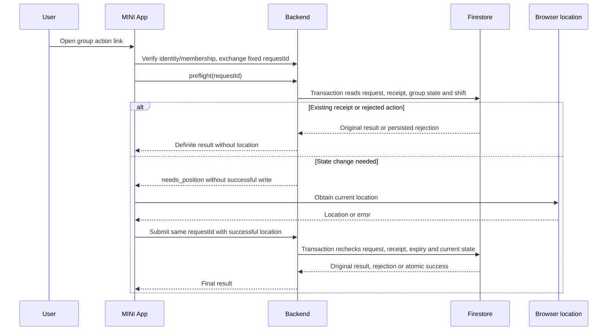
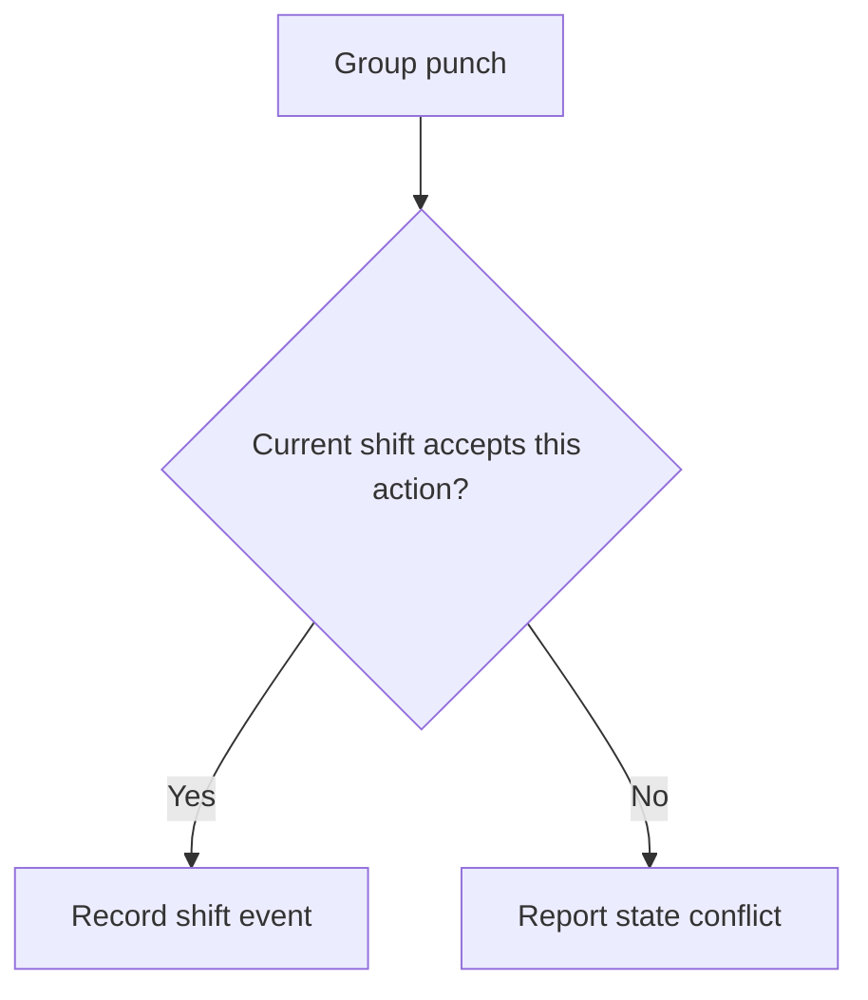

# Basic attendance 設計

**現行實作** · [群組打卡判定](#decision-flow) · [代表測試](../../../backend/internal/business/attendance/adapter/firestore/attendance_integration_test.go) · [模組規則](../../../backend/AGENTS.md)

[Attendance, business features and LINE journeys](../../integrations/line/journey.md#attendance-journey)

<a id="用途與範圍"></a>

## Purpose and scope

Specifications for attendance, punches, corrections, leave and review.

設計入口：[子域分類與投資假設](#出勤的子域分類與投資假設) · [上下文映射與整合契約](../../architecture/runtime/dependencies.md#attendance-context-map) · [補正設計](correction-design.md)。本頁維護出勤用語與邊界。

<a id="限界上下文"></a>

## Bounded context

Attendance answers who attended in which group/time, what evidence supports it and how much worktime is confirmed. Maintain separate states per person/group. Multiple daily shifts are allowed; monthly reports intersect shifts with report months.

| Boundary           | Facts exchanged                                              | Responsibility                                                                                                                                                                                |
| ------------------ | ------------------------------------------------------------ | --------------------------------------------------------------------------------------------------------------------------------------------------------------------------------------------- |
| Identity/groups    | Verified actor and operation-bound group                     | Entry/identity modules authenticate; Attendance determines punch/query/review eligibility and reads reviewer group authorization itself. Membership alone grants no correction-review rights. |
| LINE/MINI App      | Group actions, preflight, personal submission/results        | Entry points translate requests into Attendance operations. Locations evidence individual punches; opening pages does not punch.                                                              |
| Scheduling/payroll | Confirmed net worktime, estimated totals and pending reasons | Attendance currently defines neither expected schedules, overtime eligibility nor pay amounts.                                                                                                |

<a id="通用語言"></a>

## Ubiquitous language

| Term                            | Meaning here                                                                                                           |
| ------------------------------- | ---------------------------------------------------------------------------------------------------------------------- |
| Punch Event                     | Identified attempt with action, time/result. Rejected attempts also have results; only accepted actions change shifts. |
| Shift (worktime.Session)        | One person's clock-in/out within one group. Open shifts lack end times; this Session differs from login sessions.      |
| Interval                        | Start/end values for clipping reports, merging overlaps and calculating breaks; value-comparable without identity.     |
| Attendance Record               | Identifiable shift with times, event sequence and correction version; target of corrections.                           |
| Break confirmation              | Personal confirmation that breaks are complete. Empty lists distinguish confirmed no-break from unconfirmed.           |
| Confirmed net / Estimated total | Confirmed time requires complete verifiable evidence. Estimated total already includes confirmed time; never add them. |
| Correction                      | Reasoned changes to a specified record. Request, review decision and effective record are distinct.                    |
| Leave registration              | Personal group leave type, period/reason. Registration neither approves leave nor changes attendance.                  |

<a id="子域與業務能力"></a>

## Subdomains and capabilities

Capabilities below share attendance language/rules by current responsibility. Independent deployments/contexts are not presently needed.

| Capability                    | Decisions owned                                                        | Specification                                          |
| ----------------------------- | ---------------------------------------------------------------------- | ------------------------------------------------------ |
| Punches/shifts                | Clock-in, break-start/end and clock-out eligibility; processed retries | [Worktime/transitions](worktime.md)                    |
| Worktime                      | Rebuild shifts from events, clip months and confirm minutes            | [Calculation](worktime.md)                             |
| Corrections/review            | Submission, withdrawal, decisions and approval versions/evidence       | [Evidence](worktime.md), [queries/retries](queries.md) |
| Leave                         | Input/retry validity and personal registration persistence             | [Leave](leave.md)                                      |
| Personal queries/group boards | Read scope and distinct-person working/resting/finished counts         | [Queries](queries.md), [boards](board.md)              |

<a id="一致性與驗收"></a>

## 出勤的子域分類與投資假設

員工下班時漏打卡，隔天補交一個下班時間。月報能否採用這個時間，取決於誰提出、誰核准、原紀錄是否已改變，以及休息證據是否完整。從這條流程可以辨認三組不同的業務能力。

| 子域分類               | 出勤案例                                                   | 設計與投資依據                                                                                                                   |
| ---------------------- | ---------------------------------------------------------- | -------------------------------------------------------------------------------------------------------------------------------- |
| 核心候選（Core）       | 由打卡事件重建班次，保留人工補正證據，區分已確認與暫估工時 | 若使用者選用本產品的原因是工時可追溯，優先投入證據核對、並行審核與可重現的月報計算。仍需以實際採用理由驗證。                     |
| 支援候選（Supporting） | 請假登記、群組出勤看板                                     | 支援群組日常運作。登記請假與實際出勤可以並存；看板計算不同人的目前狀態。若未來要判定「應到未到」，先確認班表與應到名單由誰提供。 |
| 通用能力（Generic）    | 操作者身分驗證                                             | 出勤重用已驗證的身分，再自行判斷本人資料與群組審核資格。可替換身分驗證方案的條件，是出勤仍能可靠辨識同一操作者。                 |

這些分類用於討論投資優先順序。現行模型將打卡、工時計算、補正、查詢與請假放在同一出勤限界上下文；子域分類本身不要求拆服務。若要拆出請假，應先找出它獨有的詞義、生命週期與規則，例如組織是否真的需要假額或核准流程。

[工時計算](worktime.md) · [請假登記](leave.md) · [群組看板](board.md)

## Consistency and acceptance

- **Punches.** Bound state by person/group. needs_position preflight must not create shifts or consume successful receipts. Submit transitions transactionally; redelivery returns original results without extra shifts.
- **Corrections.** Applicants may withdraw. Reviewers require group eligibility and must differ from applicants. Approval transactionally rechecks records, event sequences and overlaps before saving evidence/shifts. Cover self-review, repeat approval and records changed after submission.
- **Reports.** Empty unconfirmed breaks must not count as confirmed net time. Damaged approval evidence yields pending confirmation. Reports/boards are read results, not direct shift-write entry points.

<a id="分層現況與下一個設計決策"></a>

## Current layers and next design decisions

Domains separate [entity](../../../backend/internal/business/attendance/domain/entity/), [valueobject](../../../backend/internal/business/attendance/domain/valueobject/), [service](../../../backend/internal/business/attendance/domain/service/), [event](../../../backend/internal/business/attendance/domain/event/) and [policy](../../../backend/internal/business/attendance/domain/policy/). Records/shifts own identity/state; intervals/locations validate values; calculations, corrections/evidence are domain operations; policies decide reviewers/retry conflicts. [Firestore transactions](../../../backend/internal/business/attendance/adapter/firestore/attendance_correction.go) atomically store decisions/evidence.

The [review use case](../../../backend/internal/business/attendance/application/command/review.go) checks authorization, retries and correction results through transaction ports. HTTP/LINE share the [monthly use case](../../../backend/internal/business/attendance/application/query/monthly.go). Scheduling, overtime/payroll need separately confirmed rules/ownership if adopted.

<a id="相關規格"></a>

## Related specifications

[Local specifications and guidance](../../../api/AGENTS.md)

<a id="基礎出勤"></a>

## Basic attendance

- Initial group location clock-in/out and personal records by group in direct chat.Commands/postbacks create short-lived requests. MINI App resolves results first,obtains location only for new actions, then submits attendance.Deployment and live LINE/Firestore acceptance are separate.Punch, monthly records, pagination and corrections have implementations;cloud settings, indexes and channel acceptance require verification.Query/retry and worktime/evidence guides own details.Infrastructure guidance records build order, not absence of features.This refactor reuses existing checks without adding test infrastructure.

  - [Queries, web pagination and correction retries](queries.md)

  - [Worktime and correction evidence](worktime.md)

  - [Infrastructure and integration](../../development/environment/verification.md)

<a id="最小操作"></a>

## Minimal operations

- Clock in: backend verifies identity, saves start time and returns result.

- Clock out: backend verifies identity, saves the matching shift end and returns result.

- Personal records: verified actor's own attendance only,including start/end and explicit unfinished status.

- Use trusted backend identity, never client-selected user IDs for authorization.Backend generates punch times. Failed persistence cannot report success.Repeated clicks/redelivery cannot silently duplicate records.Keep open shifts unfinished; never guess clock-out times.

- [Group 出勤 command shows counts; 補卡 opens manual review;漏下班 checks personal open shifts. See board guidance.](board.md)

- [Minimal group leave registration neither approves leave nor changes attendance.](leave.md)

<a id="原始首版範圍與後續實作"></a>

## Original scope and later implementation

Original release excluded schedules, leave, overtime review, payroll,geofencing, face recognition, correction review, admin reports and notifications.Existing-shift corrections, missing-shift entries, manual decisions and withdrawalare now implemented for ended shifts; effective records stay unchanged before approval.Full role management is absent; use group reviewer allowlists.Do not prebuild speculative modules/frameworks; LINE capability lists are references.

<a id="已採用的首版規則"></a>

## Adopted initial rules

- Messaging API: group 打卡 command returns Flex actions with short-lived launch capabilities.MINI App verifies LINE identity/membership and binds a request to person/action.No punch has occurred yet.

- MINI App submits LINE ID token, requestId, latitude, longitude,accuracyMeters and capturedAt to POST /api/v1/attendance/punches after consent.Backend checks identity, ownership/location and executes a Firestore transaction.Denied location creates no record; no radius or physical-presence validation.

- Direct-chat 出勤紀錄 lists personal groups;出勤紀錄 編號 returns that group's latest five.Group queries guide users to direct chat; direct-chat punches are unavailable.

- Calculate each group independently: one open shift per person/group,multiple daily shifts allowed. Cross-day clock-out closes the existing open record.

- Display Asia/Taipei, persist UTC. Punches use server processing time;event time only rejects operations older than the latest processed event.

- Repeat clock-in returns original time; clock-out without an open record rejects.Redelivery reads the original transaction result.

- No personnel allowlist or friendship check. Shared cards require live servermembership verification and reject nonmembers. Show results in MINI App;never push exact coordinates to groups.

<a id="啟用與資料"></a>

## Activation and data

- Initialize attendance with GOOGLE_CLOUD_PROJECT and LINE_MESSAGING_API_CHANNEL_ID;missing either disables attendance with an unavailable reply.FIRESTORE_DATABASE_ID defaults to (default). Reuse Messaging API secret/token and ADC;runtime accounts need database read/write rights.Location punching requires MINI App Channel ID, LIFF ID and openid.Channels must share a Provider for matching user IDs.Verify ID tokens server-side; never trust client userId/groupId.

- Enable Allow bot to join group chats and invite the bot.Members need not friend the bot first; personal records may require direct-chat friendship.ATTENDANCE_MEMBERS_JSON is retired. Direct-chat punches guide users to groups,without a separate personal punching workflow.

- Data under channels/{channelID}/users/{SHA256(userID)}:

- attendance/{SHA256([groupID,eventID])}: schemaVersion,groupID, clockInAt and clockOutAt, omitted for open shifts.

- attendanceStates/{SHA256(groupID)}：recordID、lastEventTime。

- attendanceEvents/{SHA256([groupID,eventID,action])}:code and record snapshot of the original result.

- Location punches use schemaVersion 2 and clockInPosition/clockOutPosition(coordinates, accuracy, sample time); old records remain readable.channels/{channelID}/punchRequests/{requestID} stores original groupID, hashed userKey,eventID, action, eventTime and expiresAt. Redelivery never extends expiry.Retries read original receipts without duplicate punches; expired unfinished requests cannot write.

- [Hash JSON-array composite IDs. Results, records and state commit in one transaction;send replies outside it. Queries use personal paths, group projections, month ranges/cursors.See attendance queries/corrections for contracts; message pagination is not database pagination.Store no reply tokens, full events or names. Locations remain with punches/deduplication,not tracking history or ordinary logs. Retention requires operations decisions;keep deduplication through possible redelivery windows.Optional expiresAt TTL is not immediate expiry; code still checks deadlines.](queries.md)

- Official LINE source: line/line-developers-docs-source main090500a12f9777995006d9fb5cafab8d83a792b2.Checked LIFF opening/query forwarding, server identity and same-Provider user IDs.Device location, Provider settings and live Firestore transactions require real acceptance.

  - [LIFF opening and query forwarding](https://developers.line.biz/en/docs/liff/opening-liff-app/)

  - [Server identity verification](https://developers.line.biz/en/docs/liff/using-user-profile/)

  - [Same-Provider user IDs](https://developers.line.biz/en/docs/messaging-api/getting-user-ids/)

- Enable webhook redelivery in LINE Developers Console.Write/reply failures return 503 for retries; token expiry/single-use limits remain.Deduplication prevents repeated punches, not guaranteed delivery.Check personal records in direct chat for uncertain replies.

<a id="後續產品變更"></a>

## Later product changes

- Initial entry: connect Bot or MINI App first; simultaneous development is not assumed.

- Identity: map LINE users to eligible personnel and define first-use eligibility.

- Time: display zone, cross-day shift matching and multiple daily shifts.

- Results: explicit rejection or replay rules for repeated/inapplicable punches.

- Initial rules are settled above; update this page for later changes.Confirm rules before fixing API, Firestore paths/fields, uniqueness/atomic updates.Do not build every feature before infrastructure stabilizes.

<a id="群組直達-mini-app待上線驗收"></a>

## Direct group MINI App links: production acceptance pending

- Group 打卡 cards open LIFF for clock-in/out, break-start/end and confirmation.Each has a random ten-minute launch token storing group/action, never trusted user ID.Verify identity and live Messaging API membership before exchanging a fixed per-card/user request ID.Reopening never extends expiry. Old ?request= links/postback cards are disabled;request a new card. Existing authorization, five-minute location freshness,state machine and transaction receipts remain.

- Verify MINI App/LINE Login and Messaging API channels share a Provider.Test live membership success, nonmembers, bot departure and API failures.Forwarded cards reject nonmembers. Close LIFF only after confirmed success;permission/network failures keep retry UI. Closing sends no group success message.

<a id="定位前預檢狀態與時序"></a>

## Location preflight, state and sequence

Backend worktime.ApplyEvent owns transitions, never cached frontend state.POST /api/v1/attendance/punches/preflight takes a personally bound requestIdand retains identity, CSRF, expiry and transaction checks.Resolution may persist rejection receipts but never successful punches or locations.

- Existing receipt; any action: replay original result despite changed state; no location.

- No open shift; clock in: needs_position.

- Working/resting; clock in: already_in and original start; no location.

- No open shift; clock out/break/confirm: not_in; no location.

- Working; clock out/start break/confirm breaks: needs_position.

- Working without break start; end break: not_resting; no location.

- Resting; start break/confirm: already_resting/break_incomplete; no location.

- Resting; clock out/end break: needs_position, subject to event ordering.

- Request predates last event; any unreceipted action: stale_event; no location.

- Expired unreceipted or non-owned request; any action: 403; no location/punch.

- Unknown backend state; any action: retryable error; no location.

- Preflight/submit share transactions and state machine; preserve code/message.accepted identifies current/original successful punches.needs_position reserves nothing, creates no event/receipt/shift and guarantees no later success.Persisted rejections replay forever for requestId; changed state needs a new group card.All successful actions, including breaks/confirmation, retain location evidence requirements.

- Current implementation



- UI: idle → exchanging → checking → locating → submitting → idle.Definite preflight results return checking to idle; failures retain messages.Only needs_position starts location; denial, disconnection or invalid responses stop.If another device acts during location, final submit uses current state/receipt,never duplicating from the preflight snapshot.

- Location failure: no submit; retry same requestId through preflight first.

- Submit disconnect/timeout: unknown result; retry resolves receipt first.Display existing success without locating again.

- Leave/logout: cancel waiting and ignore late HTTP/location results by generation;already submitted transactions cannot be recalled.

- Same-page retries keep requestId and preflight.Navigation, session reset or full reopening clears page caches and revalidates launch/membership;a valid same card still exchanges the same requestId.

- After expiry, owners may replay existing receipts but unfinished requests cannot write.Location acquisition never extends deadlines.

- Preflight/submit: backend 5s, frontend 10s.<br>Launch exchange: backend 8s, frontend 10s.<br>Location: device 10s, frontend guard 15s; do not hide flow defects by waiting longer.

- [Checked official LINE main dea09dc6e63fc5c6a3754abfbb304fc6fce4cc54server user-data guidance; retain server identity verification.React 19.3.1 async handling follows Context7 /reactjs/react.dev useEffect cleanup;Next.js 16.4.5 follows installed use-client guidance.Graphify/Repomix corroborate sources, not device/database acceptance.](https://developers.line.biz/en/docs/liff/using-user-profile/)

<a id="程式入口與命名"></a>

## Code entry points and naming

- PunchResolver.ResolvePunchAttempt handles /punches/preflight.It reads receipts or persists rejection, so is not a pure query.PunchSubmitter.SubmitPunch handles located submissions;both share executePunch transactions and ApplyEvent without duplicate state machines.

- Private punchCommand explicitly carries user, group, event, ReceivedAt,EventTimeMillis ordering, position and request ID. Mode distinguishes resolvePunch/recordPunch,never inferred from absent location. GroupHistoryReader independently serves personal history.RecordsOverlappingMonth includes cross-month/open shifts.verifyAndRebuildRecords checks event/correction evidence and rebuilds without writes;event replay uses worktime.RebuildSessions.

<a id="decision-flow"></a>

<a id="群組打卡的判定流程"></a>

## Group punch decision flow



[Entry adapter](../../../backend/internal/business/attendance/adapter/http/routes.go) · [Decision rules](../../../backend/internal/business/attendance/adapter/firestore/attendance_integration_test.go) · [Application output port](../../../backend/internal/business/attendance/application/port/errors.go) · [Related tests](../../../backend/internal/business/attendance/adapter/firestore/attendance_integration_test.go)

[Domain guidance](../../AGENTS.md)

## 後端分層結構

下列為[Basic attendance 後端模組](../../../backend/internal/business/attendance/)的完整檔案樹，包含實作、測試與目錄文件。

**範圍**　此樹列出「出勤」模組根目錄內的 75 個檔案。檔名以 `_test.go` 結尾的是測試；同名檔案依所在目錄區分職責。

**分層對照**　共通範本中，以下路徑未在此模組根目錄下獨立設置：。子功能的分層以樹中實際路徑為準。

```text
backend/internal/business/attendance/
├── adapter/                                  # 外部系統轉接
│   ├── firestore/                            # Firestore 保存與查詢
│   │   ├── attendance.go                     # 出勤（讀寫 Firestore 資料）；Attendance、Groups
│   │   ├── attendance_correction.go          # 出勤補正（讀寫 Firestore 資料）；ProposeCorrection、ProposeCorrectionOnce
│   │   ├── attendance_integration_test.go    # 驗證出勤整合流程（讀寫 Firestore 資料）；TestAttendanceCorrectionRoundTrip、TestLaunchExchangeIsStableAndScoped
│   │   ├── attendance_launch.go              # 出勤啟動憑證（讀寫 Firestore 資料）；CreateLaunch、ExchangeLaunch
│   │   ├── attendance_query.go               # 出勤分頁查詢（讀寫 Firestore 資料）；GroupsPage、RecordsPage
│   │   ├── board.go                          # 班表看板（讀寫 Firestore 資料）；CurrentShift、GroupBoard
│   │   ├── documents.go                      # 保存文件格式（讀寫 Firestore 資料）
│   │   ├── documents_test.go                 # 驗證保存文件格式（讀寫 Firestore 資料）；TestReceiptHashRetainsLegacyEncoding、TestTechnicalErrorsPassThroughStorage
│   │   ├── errors.go                         # 錯誤分類（讀寫 Firestore 資料）
│   │   ├── leave.go                          # 請假（讀寫 Firestore 資料）；CreateLeaveLaunch、LeaveGroup
│   │   ├── legacy_layout_test.go             # 驗證舊版資料配置（讀寫 Firestore 資料）
│   │   └── ports.go                          # 外部能力介面（讀寫 Firestore 資料）；Punch、SubmitPunch
│   ├── http/                                 # HTTP 入口
│   │   ├── testdata/
│   │   │   ├── legacy-monthly-empty.json
│   │   │   └── legacy-monthly-nil.json
│   │   ├── attendance.go                     # 出勤（處理 HTTP 請求與回應）；Attendance、NewAttendance
│   │   ├── attendance_correction.go          # 出勤補正（處理 HTTP 請求與回應）；ProposeAttendanceCorrection、ApproveAttendanceCorrection
│   │   ├── attendance_launch.go              # 出勤啟動憑證（處理 HTTP 請求與回應）；ExchangeAttendanceLaunch
│   │   ├── attendance_launch_test.go         # 驗證出勤啟動憑證（處理 HTTP 請求與回應）
│   │   ├── attendance_preflight.go           # 打卡前置檢查（處理 HTTP 請求與回應）；PreflightAttendancePunch
│   │   ├── attendance_test.go                # 驗證出勤（處理 HTTP 請求與回應）；TestAttendanceBrowserRequiresAuthentication、TestCorrectionActionsForAuthorizedScope
│   │   ├── contract_dto.go                   # 請求與回應資料轉換（處理 HTTP 請求與回應）
│   │   ├── contract_validation.go            # API契約驗證（處理 HTTP 請求與回應）
│   │   ├── contract_validation_test.go       # 驗證API契約驗證（處理 HTTP 請求與回應）；TestContractRejectsInvalidRequestsBeforeStore、TestContractPreservesAuthAndIdempotency
│   │   ├── identity_test.go                  # 驗證身分（處理 HTTP 請求與回應）
│   │   ├── leave.go                          # 請假（處理 HTTP 請求與回應）；ListOwnLeaveRequests、SubmitLeaveRequest
│   │   ├── location.go                       # 定位資料（處理 HTTP 請求與回應）
│   │   ├── punch.go                          # 打卡（處理 HTTP 請求與回應）；SubmitAttendancePunch
│   │   ├── records.go                        # 紀錄查詢（處理 HTTP 請求與回應）；ListAttendanceGroupPage、ListAttendanceRecords
│   │   ├── request_validation_test.go        # 驗證請求欄位驗證（處理 HTTP 請求與回應）；TestLocationNumberInRange、TestRequestIDPattern
│   │   └── routes.go                         # API路由（處理 HTTP 請求與回應）；RegisterAttendanceAPI
│   ├── line/                                 # LINE 整合
│   │   ├── attendance.go                     # 出勤（處理 LINE 互動）；Attendance、Reply
│   │   ├── attendance_history.go             # 出勤歷史（處理 LINE 互動）；HistoryGroupName
│   │   ├── attendance_launch_test.go         # 驗證出勤啟動憑證（處理 LINE 互動）；TestGroupCardOpensLIFFDirectly
│   │   ├── attendance_test.go                # 驗證出勤（處理 LINE 互動）；TestAttendanceLegacyHistory、TestOldActionPostbacksAreIgnored
│   │   ├── board.go                          # 班表看板（處理 LINE 互動）
│   │   └── menu.go                           # 操作選單（處理 LINE 互動）；AttendanceMenu
│   └── presentation/
│       └── group.go                          # 群組；GroupName
├── application/                              # 應用用例
│   ├── command/                              # 寫入用例
│   │   └── review.go                         # 審核（執行寫入用例）；ApproveCorrection、RejectCorrection
│   ├── dto/                                  # 用例資料型別
│   │   ├── board.go                          # 班表看板（定義傳遞資料）；Board
│   │   ├── correction.go                     # 出勤補正（定義傳遞資料）；CorrectionDetails、CorrectionPage
│   │   ├── monthly.go                        # 月報（定義傳遞資料）；MonthlyReport
│   │   ├── page.go                           # 分頁資料（定義傳遞資料）；GroupPage、RecordPage
│   │   └── punch.go                          # 打卡（定義傳遞資料）；PunchResult
│   ├── port/                                 # 外部能力介面
│   │   ├── errors.go                         # 錯誤分類（定義用例所需介面）
│   │   ├── monthly.go                        # 月報（定義用例所需介面）；MonthlyReader
│   │   ├── punch.go                          # 打卡（定義用例所需介面）；PunchSubmitter、PunchResolver
│   │   ├── review.go                         # 審核（定義用例所需介面）；CorrectionReviewRunner、ReviewTransaction
│   │   └── store.go                          # 資料存取（定義用例所需介面）；Store、GroupHistoryReader
│   └── query/                                # 查詢用例
│       └── monthly.go                        # 月報（執行讀取用例）；ReadMonthlyReport
├── domain/                                   # 領域模型與規則
│   ├── entity/                               # 實體與聚合
│   │   ├── correction.go                     # 出勤補正（維護領域狀態與規則）；Correction
│   │   ├── errors.go                         # 錯誤分類（維護領域狀態與規則）
│   │   ├── leave.go                          # 請假（維護領域狀態與規則）；Leave
│   │   ├── record.go                         # 紀錄（維護領域狀態與規則）；Record
│   │   ├── session.go                        # 工作階段（維護領域狀態與規則）；Session
│   │   └── state.go                          # 狀態（維護領域狀態與規則）；State
│   ├── event/                                # 領域事件
│   │   ├── attendance.go                     # 出勤；Event
│   │   └── version.go                        # 版本
│   ├── policy/                               # 領域政策
│   │   ├── leave.go                          # 請假；NormalizeLeave
│   │   ├── review.go                         # 審核；CanReview、Decision
│   │   └── review_test.go                    # 驗證審核；TestDecisionRetries
│   ├── service/                              # 領域服務
│   │   ├── approval.go                       # 核准決策；VerifyCorrection
│   │   ├── approval_test.go                  # 驗證核准決策；TestVerifyCorrectionRejectsChangedEvidence
│   │   ├── correction.go                     # 出勤補正；ApplyCorrection
│   │   ├── correction_test.go                # 驗證出勤補正；TestCorrectionIsVersionedAndDoesNotMutateOriginal
│   │   ├── event_stream.go                   # 事件序列；ValidateEventStream
│   │   ├── event_stream_test.go              # 驗證事件序列；TestValidateEventStream
│   │   ├── monthly.go                        # 月報；MonthlyReport、CalculateMonthlyAttendance
│   │   ├── transition.go                     # 狀態轉換；Outcome、ApplyEvent
│   │   ├── worktime.go                       # 工時；Issue、Result
│   │   └── worktime_test.go                  # 驗證工時；TestCalculateBreaksOverlapAndMonth、TestIncompleteAndLegacyAreNotGuessed
│   └── valueobject/                          # 值物件
│       ├── correction_key.go                 # 補正識別鍵（定義值與合法範圍）；ValidCorrectionKey
│       ├── interval.go                       # 時間區間（定義值與合法範圍）；Interval、ValidWithin
│       ├── leave_key.go                      # 請假識別鍵（定義值與合法範圍）；ValidLeaveKey
│       └── position.go                       # 位置座標（定義值與合法範圍）；Position、ValidAt
└── AGENTS.md                                 # 本目錄開發指引
```
