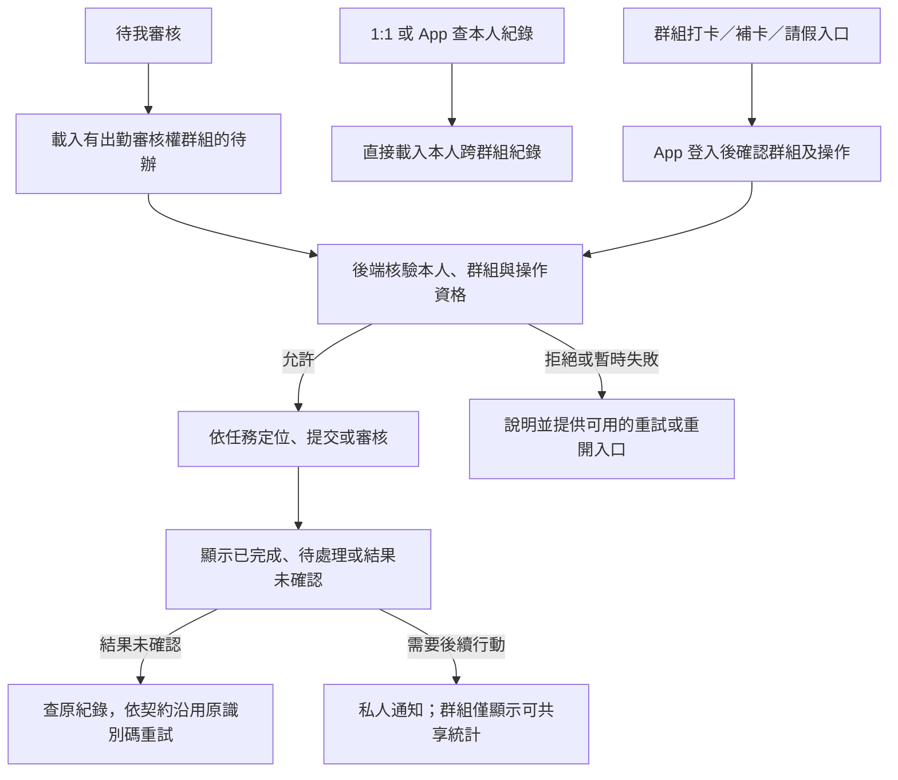

# 出勤、各業務與 LINE 旅程

讓員工在正確群組完成打卡，清楚知道是否已記錄，並能私下處理缺漏。讓審核者找到需要處理的申請，讓團隊掌握可共享的出勤概況。業務規則以[出勤上下文與整合契約](context-map.md)為準。

| 業務                  | 與出勤的邊界                                                                                                  |
| --------------------- | ------------------------------------------------------------------------------------------------------------- |
| 打卡與工時            | 依本人、群組、班次與必要證據判定。已確認工時與暫估工時分開顯示。[工時規格](worktime.md)                       |
| 補卡與請假            | 顯示送出、待處理與已決定的差異；補卡核准前維持原有效紀錄。[補正審核](correction-design.md) · [請假](leave.md) |
| Repository 與 Project | 工程入口可帶群組情境；庫與專案權限不會授予出勤查閱或審核權。                                                  |
| Journal、排班與薪資   | 日誌記錄作業，出勤記錄群組班次。排班、加班核定和薪資依各自契約處理。                                          |

## 本人出勤服務與補卡審核

MINI App 由 `/miniapp/attendance` 提供出勤紀錄、請假紀錄、補卡與更正、補卡審核四個分頁。舊網址由服務端轉到對應分頁並保留查詢參數。LINE 打卡沿用 `/miniapp/punch`。

以下為目標規格。本人服務以登入者為查詢範圍，審核服務以出勤授權為範圍。群組保留為班次與申請的歸屬。查本人資料時，首屏直接載入分頁結果，無須先載入或選取群組。每筆顯示所屬群組。我的出勤紀錄依月份顯示，切換月份時直接重新載入。

| 功能       | 預設查詢                                           | 群組何時必要                                                       |
| ---------- | -------------------------------------------------- | ------------------------------------------------------------------ |
| 出勤紀錄   | 本人當月班次，跨群組按時間排序。                   | 建立打卡時須確認出勤群組。                                         |
| 請假紀錄   | 本人各群組的登記及處理狀態。                       | 新登記須有適用群組；既有可信群組入口可直接帶入。                   |
| 補卡與更正 | 本人各群組的申請及狀態。                           | 更正從原班次帶入群組與班次；缺少原班次時選擇群組和日期。           |
| 待我審核   | 彙整本人有出勤審核權的群組待審申請，每筆標示群組。 | 列表與詳情均按群組審核權判定，送出決定前再核驗目前授權與申請狀態。 |

Attendance 管理審核授權。LINE 群組成員、儲存庫管理者及專案管理者的身分本身不授予審核權；既有不得審核本人申請的規則照常適用。1:1 私訊與 MINI App 待辦可導入同一審核詳情。進入工作台或收到通知不會授權。

驗收使用同時有 A、B 班次的員工和只負責 A 的審核者。員工首屏看到兩群紀錄，從 A 班次發起更正後仍歸 A。審核者只看到 A 的待辦。若授權在送出前撤回，後端拒絕且原班次不變。MINI App 已直接讀取本人當月出勤與補正申請；請假紀錄已有跨群組讀取。待我審核直接載入有權處理的跨群組待辦。LINE 私人通知與指定申請直達仍待接線。[查詢規格](queries.md)

## 現況與目標

群組已有打卡、出勤統計、補卡及請假入口，1:1 可查本人紀錄。MINI App 承接打卡預檢、必要定位、提交與申請。目標是保留原群組與動作，登入後直達指定表單或申請，讓審核者從私人待辦返回原申請。自動通知與實機行為須另外驗收。[LINE 指令](../../integrations/line/commands.md)

未來設計

驗收先測群組打卡與私訊查本人紀錄，再測補卡審核。覆蓋定位拒絕、重送、登入中斷、結果未知及無審核資格。確認不重複寫入、群組不顯示私人資料，並記錄首次完成率、任務時間、重選群組次數及錯誤恢復率。
