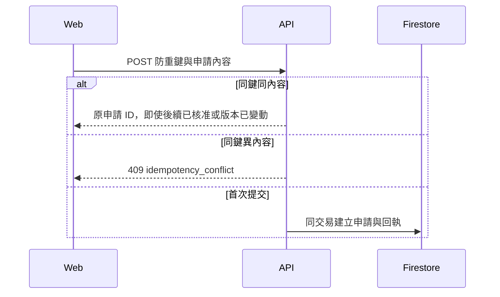
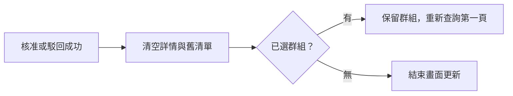

# 出勤查詢與更正

本人跨群組首屏與待我審核彙整的目標規格見[下文](#本人出勤服務與補卡審核)。MINI App 本人出勤首頁直接讀當月跨群組班次。`/records` 的 `group` 可省略，分頁綁定本人、月份與群組篩選；月工時摘要仍需指定群組。「待我審核」使用 `/corrections?scope=review`，由後端每頁讀取審核授權，只回傳有權處理且尚未結案的申請。單群組查詢仍可指定 `group`；彙整清單若本頁全為已處理或本人申請，仍以游標繼續。

[本頁記錄現有出勤功能的資料讀取、Web 工作流程與更正重試契約。維持 Go + Next.js／React；不增加角色系統或通知。定位打卡仍沿用 基礎出勤 的本人／群組／launch 授權。](design.md)

## 本人出勤服務與補卡審核

MINI App 由 `/miniapp/attendance` 提供出勤紀錄、請假紀錄、補卡與更正、補卡審核四個分頁。舊網址由服務端轉到對應分頁並保留查詢參數。LINE 打卡沿用 `/miniapp/punch`。

以下為目標規格。本人服務以登入者為查詢範圍，審核服務以出勤授權為範圍。群組保留為班次與申請的歸屬。查本人資料時，首屏直接載入分頁結果，無須先載入或選取群組。每筆顯示所屬群組。我的出勤紀錄依月份顯示，切換月份時直接重新載入。

| 功能       | 預設查詢                                           | 群組何時必要                                                       |
| ---------- | -------------------------------------------------- | ------------------------------------------------------------------ |
| 出勤紀錄   | 本人當月班次，跨群組按時間排序。                   | 建立打卡時須確認出勤群組。                                         |
| 請假紀錄   | 本人各群組的登記及處理狀態。                       | 新登記須有適用群組；既有可信群組入口可直接帶入。                   |
| 補卡與更正 | 本人各群組的申請及狀態。                           | 更正從原班次帶入群組與班次；缺少原班次時選擇群組和日期。           |
| 待我審核   | 彙整本人有出勤審核權的群組待審申請，每筆標示群組。 | 列表與詳情均按群組審核權判定，送出決定前再核驗目前授權與申請狀態。 |

Attendance 管理審核授權。LINE 群組成員、儲存庫管理者及專案管理者的身分本身不授予審核權；既有不得審核本人申請的規則照常適用。1:1 私訊與 MINI App 待辦可導入同一審核詳情。進入工作台或收到通知不會授權。

驗收使用同時有 A、B 班次的員工和只負責 A 的審核者。員工首屏看到兩群紀錄，從 A 班次發起更正後仍歸 A。審核者只看到 A 的待辦。若授權在送出前撤回，後端拒絕且原班次不變。MINI App 已直接讀取本人當月出勤與補正申請；請假紀錄已有跨群組讀取。待我審核直接載入有權處理的跨群組待辦。LINE 私人通知與指定申請直達仍待接線。

## Web 工作流程

- /miniapp 為入口；月紀錄、更正與授權審核各自獨立，定位示範保留獨立入口。群組打卡連結仍開獨立定位打卡頁。各頁共用登入及 API 生命週期，不要求具備其他頁面的 DOM。

- 月份以 Asia/Taipei 月初至下月月初的半開區間計算，再轉為 UTC。跨月班次與未下班班次保留；不猜測下班時間。切換群組／月份、登出或離頁會取消讀取並使舊回應失效。頁面條件、明細與更正的班次必須一致。

## 查詢 API

伺服器以 Session Cookie 或 LINE ID token 驗證本人，不接受指定他人的 user ID。回應不快取；新版列表與詳情不公開精確位置或原始事件證據。

下表均為 GET，路徑前綴為 `/api/v1/attendance`。參數型別與回應結構見[出勤 OpenAPI](../../../api/contract/attendance/records.yaml)。

| 用途         | 路徑               | 查詢參數                                             | 回應與範圍                                             |
| ------------ | ------------------ | ---------------------------------------------------- | ------------------------------------------------------ |
| 選群組       | `/groups/page`     | `pageSize`、`cursor`                                 | `items`（id、name）、`nextCursor`、`asOf`、`queryMode` |
| 查單群月摘要 | `/monthly/summary` | `group`、`month`（YYYY-MM）                          | 完整月份 Calculation、`count`、`asOf`                  |
| 列出本人班次 | `/records`         | `month`、`pageSize`、`cursor`；可選 `group` 篩選單群 | `items`、`nextCursor`、`asOf`、`queryMode`             |
| 查班次明細   | `/records/{id}`    | `group`                                              | 本人在該群組的班次詳情與版本                           |

- pageSize 預設20、範圍1–100；cursor 必須與本人、channel、群組／月份與排序版本相符，無效回400 invalid_cursor。班次排序為上班時間DESC、下班時間DESC（未下班的零值排在同上班時間的已下班班次之後）、文件ID DESC，以完整排序欄位消歧義，不使用offset。沒有下一頁時 nextCursor 為空。上一頁由瀏覽器保存已使用的cursor。

- 月摘要計算完整相關班次，不是目前一頁的加總。既有 /monthly、/groups 與 LINE 查詢保持契約，不能靜默截成一頁。即時分頁不提供跨HTTP請求快照保證；asOf只是產生時間。核准後重新查詢，資料變更時從第一頁重新載入。

## 資料查詢切換

- 新寫入同交易維護 isOpen 與本人 attendanceGroups 群組投影。

- 新 Channel 直接使用索引查詢，API queryMode 為 indexed。

- 索引模式以已下班的時間重疊條件與未下班集合查候選班次；完整月摘要仍須讀取相關班次原始事件與更正audit證據，不能為減少讀取而省略。資料依批次讀取不等於月摘要成本固定，多range索引仍需以官方Query Explain確認實際掃描量。

- 發布前依 firestore.indexes.json 建立出勤索引並等待 READY，再發布使用索引的版本。

## 更正提交重試

- 新版Web在 POST /api/v1/attendance/corrections 帶一個 Idempotency-Key UUID。一次已確認的payload與key在結果未知時保持不變，重試不能產生新key；更改表單才建立新的提交。key不含使用者或敏感資料。

- 伺服器以channel、已驗證本人與key隔離回執，對固定版本的業務payload做正規化雜湊。時間以UTC正規化，breaks順序保留，server ID／CreatedAt不參與。申請與最小回執同交易建立；交易可能重跑，但不能建立第二筆申請。

- 現行實作

- 空白、無效或重複header：400 invalid_idempotency_key。

- 無header：保留舊呼叫契約，但沒有跨請求去重保證；新Web一律帶header。

- [省略 recordId 可提交無原班次的補卡，核准前不建立有效紀錄；其餘流程與限制見 補卡與人工審核。](worktime.md#補卡與人工審核)

- 提交回應 status=accepted 只表示申請已接收，不宣稱仍待審；目前狀態使用既有狀態查詢取得。申請本人與審核權限仍由後端決定，禁止自己核准；核准保留 expectedRevision／expectedEventSequence 與不可變audit驗證。回執不保存token，未確定保存政策前不擅自設定TTL。

## 驗證邊界

- 沿用既有檢查，不新增測試基建。Firestore emulator缺席時整合測試skip必須明列；本機編譯或純函數通過不代表遠端索引、LINE裝置或正式部署已驗收。

- 依據：Google官方 多range與索引、游標、交易；使用官方Developer Knowledge查得，2026-11-10核對。瀏覽器取消語意以Context7 /mdn/content 查證的 AbortController 為準；generation guard另負責拒收已完成的舊回應。

  - [多range與索引](https://firebase.google.com/docs/firestore/query-data/multiple-range-fields)

  - [游標](https://firebase.google.com/docs/firestore/query-data/query-cursors)

  - [交易](https://firebase.google.com/docs/firestore/manage-data/transactions)

  - [AbortController](https://developer.mozilla.org/en-US/docs/Web/API/AbortController/abort)

## 申請編號

- 新更正申請以 github.com/google/uuid 產生 UUID v4 作為文件與查詢／審核編號；重試從既有收據回傳已保存的編號，保留原 payload hash 衝突檢查。舊申請、收據與稽核編號不改寫，仍可查詢與審核。UUID 產生錯誤會返回失敗，不使用會 panic 的 NewString。

- [UUID API 已對照 官方 v1.6.0 原始碼。Context7 團隊篩選拒絕此套件文件，因此未取得 Context7 查證；版本沿用既有 v1.6.0。](https://github.com/google/uuid/blob/v1.6.0/version4.go)

## 審核畫面狀態同步

現行實作

第一頁資料與分頁游標以伺服器最新回應為準。查詢失敗時維持空清單並提供重查。手動輸入編號且未選群組時直接結束畫面更新。審核權限、禁止自審與狀態轉換由後端執行。補卡休息確認使用 shadcn Checkbox，保留必填與後端驗證。

補正清單及審核詳情回傳目前查詢身分可執行的操作。本人清單的待審與過期申請可撤回。審核者可核准待審申請，也可駁回待審或過期申請。畫面依 `canApprove`、`canReject`、`canCancel` 顯示操作；送出後仍在交易內核對資格與最新資料。

## 日誌使用的群組出勤參考

`GET /api/v1/attendance/daily-headcount` 以群組及 Asia/Taipei 工作日期查詢。後端核驗當下群組成員資格，只回傳人數與查詢時間。每位有一筆當天開始的班次的人計一次；跨夜班計在上班日。在規模上限或查詢失敗時回傳不可用，日誌顯示暫無資料。此人數與實際施工名單分開，查詢不寫入出勤或日誌。
