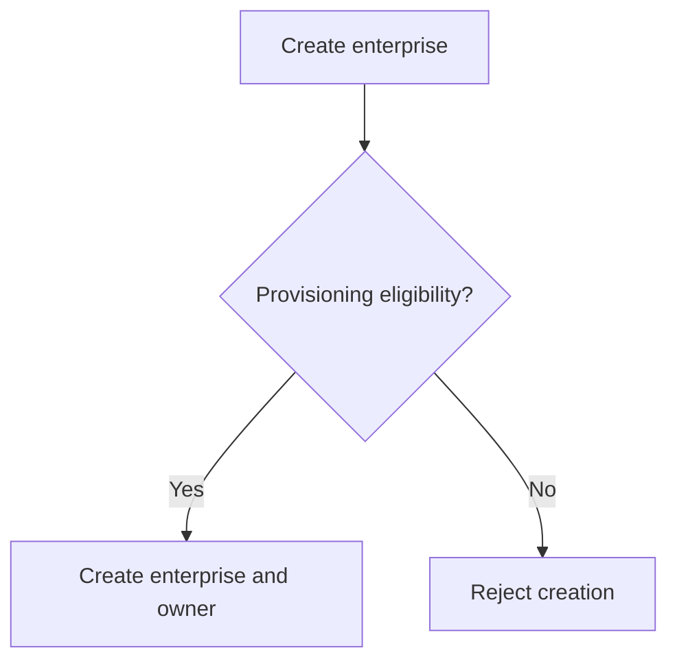

# Enterprise

**Implemented** · [Design](design.md) · [Core flow](#decision-flow) · [Decision implementation](../../../backend/internal/business/enterprise/adapter/firestore/store.go) · [Code](../../../backend/internal/business/enterprise/README.md) · [Guidance](../../../backend/internal/business/enterprise/AGENTS.md)

## Domain design

**Subdomain classification:** governance supporting candidate.

**Language:** provisioning eligibility controls enterprise creation; owners, managers and visible organization links are distinct.

**Context/contracts:** Enterprise owns provisioning/owner management. Organization navigation may show links but does not replace write authorization.

**Acceptance:** authenticated users without provisioning eligibility cannot create enterprises; creation retries revalidate current enterprise lifecycle and ownership. Details access grants no owner-change authority.

[Implementation](../../../backend/internal/business/enterprise/adapter/firestore/store.go) · [Provisioning replay regression](../../../backend/internal/business/enterprise/adapter/firestore/provisioning_test.go) · [Strategic classification criteria](../../references/ddd/README.md)

Organization ownership specifications contain the target enterprise/organization linking design.

[Domain design/operation contracts](design.md) · [Backend entry](../../../backend/internal/business/enterprise/README.md)

## Enterprise creation decision flow

[Entry adapter](../../../backend/internal/business/enterprise/adapter/http/routes.go) · [Decision rules](../../../backend/internal/business/enterprise/adapter/firestore/store.go) · [Application output port](../../../backend/internal/business/enterprise/application/port/store.go) · [Replay lifecycle and HTTP contract regression](../../../backend/internal/business/enterprise/adapter/firestore/provisioning_test.go)

[authorization boundaries across three domains](../../contracts/organization-team-ownership.md#ownership-boundaries)

[applicable guidance](../AGENTS.md) · [parent directory guide](../README.md)
