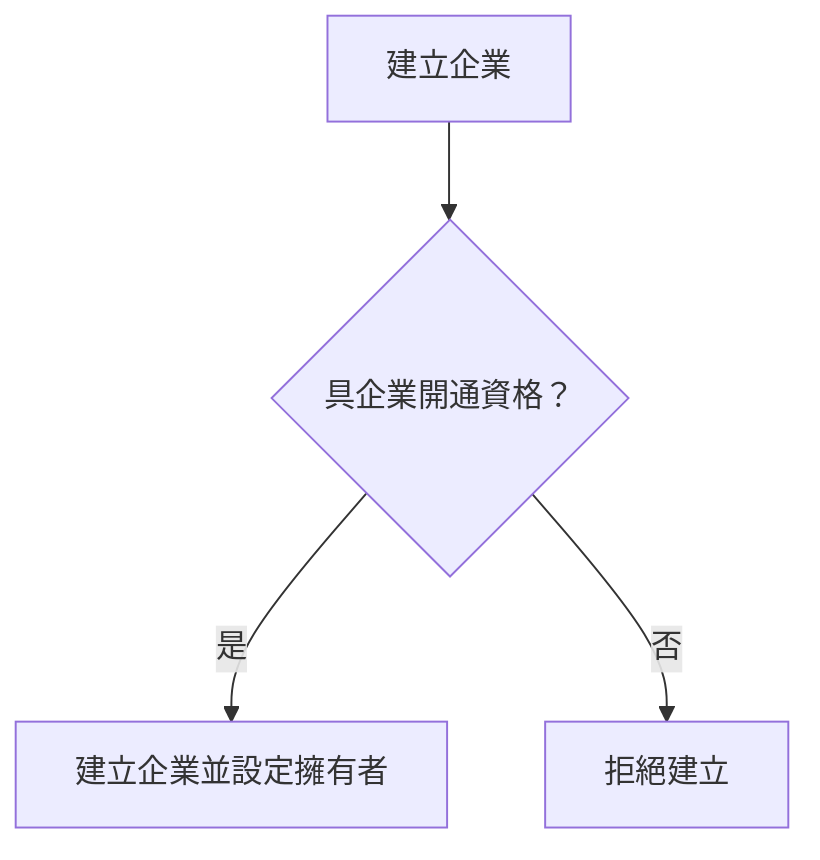

# 企業

**已有實作** · [設計規格](design.md) · [核心流程](#decision-flow) · [判定實作](../../../backend/internal/business/enterprise/adapter/firestore/store.go) · [程式目錄](../../../backend/internal/business/enterprise/README.md) · [維護指引](../../../backend/internal/business/enterprise/AGENTS.md)

## 領域設計

**子域定位**　治理支援候選。

**通用語言**　開通資格決定能否建立企業；企業擁有者、管理者與可見的組織連結是不同概念。

**上下文與契約**　Enterprise 決定企業開通與擁有者管理。Organization 的導覽可顯示企業連結；導覽結果不能取代寫入時的授權檢查。

**驗收案例**　使用者能登入但缺少開通資格時，建立企業應失敗；查閱企業詳情也不等於取得變更擁有者的資格。

[對照實作或測試](../../../backend/internal/business/enterprise/adapter/firestore/store.go) · [戰略設計與分類準則](../../architecture/ddd/README.md)

企業與組織連結的目標設計收錄在組織所有權規格。

[領域設計與操作契約](design.md) · [後端實作入口](../../../backend/internal/business/enterprise/README.md)

## 建立企業的判定流程

[操作入口與適配器](../../../backend/internal/business/enterprise/adapter) · [判定依據](../../../backend/internal/business/enterprise/adapter/firestore/store.go) · [應用層輸出介面](../../../backend/internal/business/enterprise/application/port/store.go) · 本領域目錄未見獨立 Go 測試；以上述驗收案例核對實作

[三領域授權邊界](../../architecture/contracts/organization-team-ownership.md#ownership-boundaries)

[適用工作指引](../AGENTS.md) · [上層導覽](../README.md)
