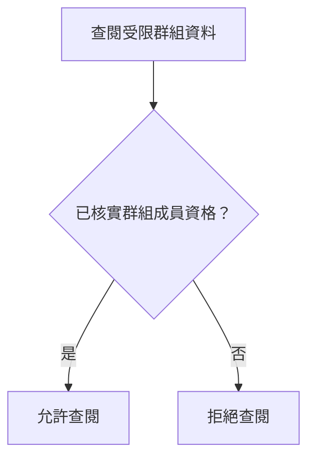

# 群組

**已有實作** · [領域設計](#領域設計) · [核心流程](#decision-flow) · [代表測試](../../../backend/internal/business/group/application/query/group_test.go) · [程式目錄](../../../backend/internal/business/group/README.md) · [維護指引](../../../backend/internal/business/group/AGENTS.md)

## 領域設計

**子域定位**　群組身分與探索的支援能力。

**通用語言**　群組觀測是已驗簽事件帶來的群組狀態；候選成員是可供探索的人員線索。

**上下文與契約**　LINE 提供事件與成員查詢；Group 整理狀態並核驗成員資格。Team 另外決定管理歸屬。

**驗收案例**　曾在事件中出現的使用者即使被列為候選，仍須通過群組成員核驗才能取得受限資料。

[對照實作或測試](../../../backend/internal/business/group/application/query/group.go) · [戰略設計與分類準則](../../architecture/ddd/README.md)

管理群組狀態與 LINE 群組事件。

[後端group 實作說明](../../../backend/internal/business/group/README.md)

## 查閱受限群組資料的判定流程

[入口適配器](../../../backend/internal/business/group/adapter/http/routes.go) · [判定依據](../../../backend/internal/business/group/application/query/group_test.go) · [應用層輸出介面](../../../backend/internal/business/group/application/port/store.go) · [相關測試](../../../backend/internal/business/group/application/query/group_test.go)

[適用工作指引](../AGENTS.md) · [上層導覽](../README.md)
