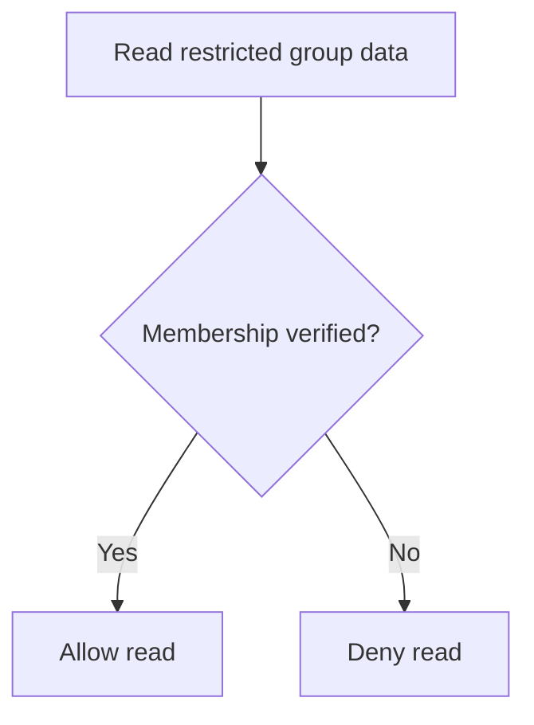

# Group

**Implemented** · [Domain design](#領域設計) · [Core flow](#decision-flow) · [Representative tests](../../../backend/internal/linegroup/application/query/group_test.go) · [Code](../../../backend/internal/linegroup/README.md) · [Guidance](../../../backend/internal/linegroup/AGENTS.md)

## Domain design

**Subdomain classification:** supporting group identity/discovery.

**Language:** observations are state from verified events; member candidates are discovery clues.

**Context/contracts:** LINE supplies events/membership queries; Group organizes state and verifies membership. Team separately determines management affiliation.

**Acceptance:** event-observed candidates still require membership verification for restricted data.

[Implementation/tests](../../../backend/internal/linegroup/application/query/group.go) · [Strategic classification criteria](../../references/ddd/README.md)

Manages group state and LINE events.

[Backend group implementation](../../../backend/internal/linegroup/README.md)

## Restricted group read decision flow

[Entry adapter](../../../backend/internal/linegroup/adapter/http/routes.go) · [Decision rules](../../../backend/internal/linegroup/application/query/group_test.go) · [Application output port](../../../backend/internal/linegroup/application/port/store.go) · [Related tests](../../../backend/internal/linegroup/application/query/group_test.go)

[applicable guidance](../AGENTS.md) · [parent directory guide](../README.md)
