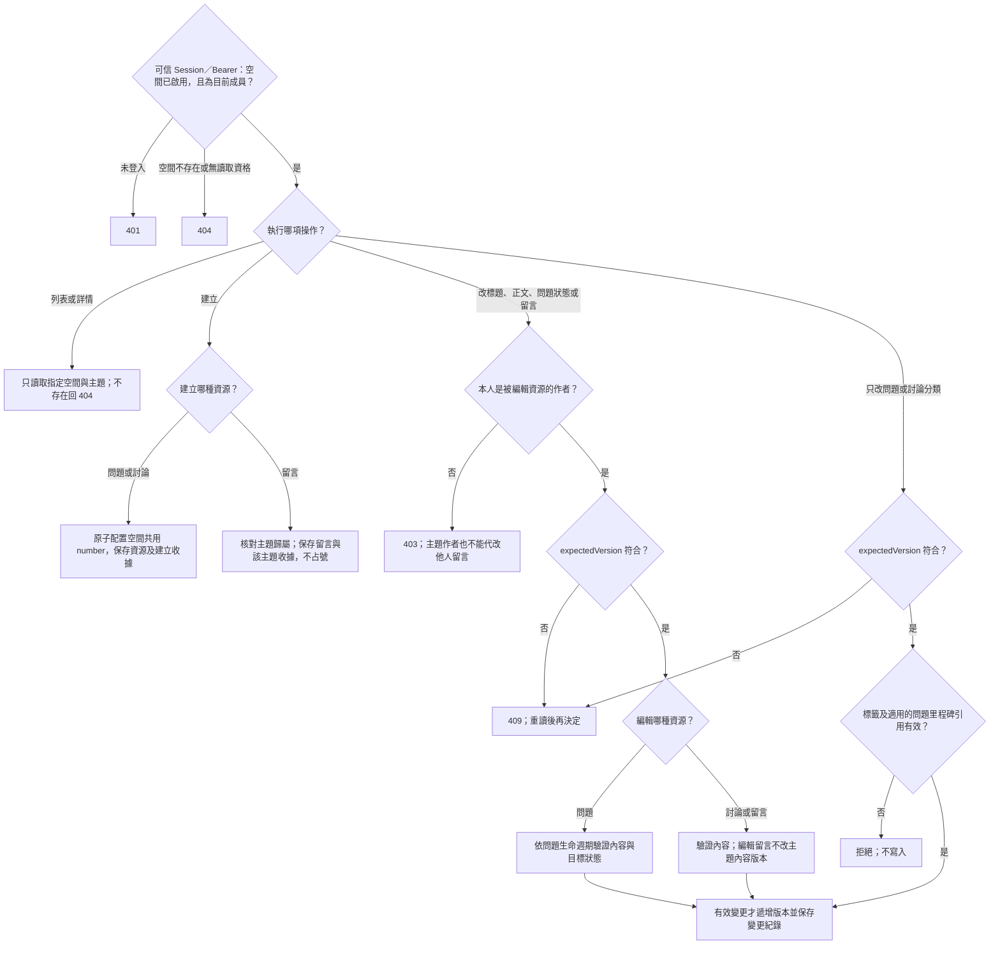

# 空間問題第一階段

- 狀態：已依本對話確認的產品規則完成本機實作，正式 LINE／Firestore 環境待驗收。

- 介面繁中名稱統一為「問題」（Issue）；既有 issue 型別、/issues 路徑、集合、識別碼、狀態與權限保持相容。

## 問題生命週期

Repository 提供資源範圍，Issue 維護自己的開啟與關閉狀態。問題建立者可以直接關閉開啟中的問題，也可以重新開啟；Go 核驗操作權與版本。專案內的操作與驗收見[專案項目進度](../project/project.md#project-item-progress)。

相容實作沿用 API 的 `completed` 表示已關閉，保留既有 `in_progress`
與變更紀錄。新版入口直接關閉或重開，舊客戶端仍可送出原有轉換。

後續若停用舊值，遷移須涵蓋尚未加入專案、只加入一個專案與同時加入多個專案的舊問題。舊的進行中只表達來源問題曾開始處理，無法推知每個專案的實際進度。切換讀寫前須保存這項歷史資訊，
並核對舊客戶端的清單、篩選、編輯與完成數統計。

## 範圍與產品決策

- [2026-11-13 先以 Graphify CLI、Repomix CLI 及原始碼核對 正式空間雛形，未發現阻擋此讀取雛形的結構或方向問題，再進入問題切片。 使用者確認：核驗成員皆可讀取與建立問題；僅建立者可修改及變更自己問題的狀態。首版採待處理、進行中、已完成，不含指派或審核。](../repository/design.md)

- 每個問題歸屬既有 Repository；不新增空間、人類管理員、刪除、附件、通知、留言或專案功能。 讀取資格與寫入政策分開檢查，不影響出勤、補卡或原群組摘要授權。問題完成不代表施工驗收或業務核准。

## 操作契約

現行實作（問題、討論、留言）

依目前成員身分、操作及資源作者判定讀寫結果。

- 讀取無寫入副作用，不額外保存個資；游標綁定渠道、空間、本人與查詢條件。無權空間或不存在的目標回 404。更新交易重新核對容器、資源歸屬、操作權與版本，拒絕時不改資料。有效修改記錄操作者、時間與版本，問題另記前後狀態，不發外部通知。

- 符合資格的成員可單獨更新問題或討論的標籤，以及問題的里程碑。非作者須保留原標題、正文及適用的問題狀態。留言沒有分類。分類輸入與同庫引用驗證見[標籤引用切片](../repository/design.md#labels-標籤引用切片)。

- [建立時由伺服器給定作者、ID 與時間。問題從 open 開始，與討論共用空間編號與收據；留言的建立鍵限定於同一主題與本人。相同鍵及正規化內容返回原資源，不同內容回 409。建立結果不明時沿用原內容與鍵；編輯結果不明時先重讀再決定。](../repository/design.md#numbering)

- 標題去除首尾空白後須有 1–120 個 Unicode 字元；內容去除首尾空白後最多 8000 個字元。HTTP
  JSON 上限 65536 bytes，不接受未知欄位。識別碼、number、操作者與版本來源不可由建立請求指定。

## API、查詢及資料

- [契約唯一來源為 issues.yaml，由既有 OpenAPI 入口組合及生成 Go／TS 型別。](../../../api/contract/issue/issues.yaml)

| 操作  | 路徑                                              | 行為與限制                                               |
| ----- | ------------------------------------------------- | -------------------------------------------------------- |
| GET   | `/api/v1/repositories/{repositoryId}/issues`      | 可選 cursor、state、query；依共用 number 遞減。          |
| POST  | `/api/v1/repositories/{repositoryId}/issues`      | 必填 Idempotency-Key、title、body。                      |
| GET   | `/api/v1/repositories/{repositoryId}/issues/{id}` | 查詢詳情。                                               |
| PATCH | `/api/v1/repositories/{repositoryId}/issues/{id}` | 完整提交 title、body、state、expectedVersion；僅建立者。 |

- 一次最多掃描二十筆候選，搜尋以正規化標題、不區分大小寫的子字串比對，再套用狀態篩選。可能回傳空頁但仍有 nextCursor，前端必須提供繼續載入；不將單頁筆數作總數，不新增複合索引。
  游標無效或換空間／身分／條件後沿用會被拒絕。 建立鍵與同空間同操作者的其他資源共用範圍；相同鍵及內容回同一 ID／number 的目前快照，內容不同回 409。建立雜湊使用
  adapter 明確編碼的 v1 正規化 title／body，不雜湊 HTTP
  DTO。

- 資料保存於既有 channels/{channelId}/repositories/{repositoryId}/issues/{id}；有效更新的追溯資料位於其
  changes/{version}。建立與空間共用編號同一交易提交；更新交易重讀空間、問題、建立者及版本，再提交問題與追溯資料。Bot 停用不刪除問題，但拒絕新的讀寫；再啟用沿用資料。
  LINE 成員核驗與 Firestore 無法組成原子快照，沿用既有外部資格觀察限制；寫入交易另檢查容器狀態及群組綁定。

- 失敗語義：無效輸入 400、未登入 401、非建立者／CSRF
  403、無權空間或不存在問題 404、過期版本或建立鍵衝突 409、非 JSON
  415、服務未配置／不可用／提交結果不明 503。錯誤不回傳 token、輸入內容或內部 SDK 原因。

## 實作歸屬與前端

- [核心：用例、建立資格、建立者權限、內容正規化與狀態轉換；不依賴 HTTP／Firestore DTO。](../../../backend/internal/business/issue/domain/entity/issue.go)

- [HTTP：生成路由與 DTO，沿用既有身份／CSRF，認證後驗證契約，再進用例。](../../../backend/internal/business/issue/adapter/http/routes.go)

- [Firestore：文件轉換、查詢、建立防重與交易；由 bootstrap 注入既有 Repository client 及編號介面，不另建連線。](../../../backend/internal/business/issue/adapter/firestore/store.go)

- [問題畫面：由正式空間入口組合，透過既有 Session client 載入；不將 API 或規則放進 Shell／shared/ui。](../../../frontend/miniapp/src/business/issue/View.tsx)

- 列表、詳情、寫入各有請求取消及世代檢查；登出、重新驗證或空間切換清除舊內容。新增連點由同步鎖阻擋；結果不明時鎖定原內容並沿用建立鍵重試。修改失敗後先重新讀取，不覆蓋新版本。
  建立鍵僅保留於本次畫面，重新開頁或離開問題前應先確認不明結果，不能宣稱跨重新整理防重。

## 查核來源與驗證邊界

- Graphify 定位共用 navigation、Repository
  Context 及業務關係；同名 View 與動態 JSX 另以原始碼／Repomix 交叉核對，不以圖譜無路徑推論無實作。 第一階段六個檔案與先前驗證包相符；沿用當時的型別檢查、23
  個前端測試、靜態建置及七個入口切換證據，問題變更另執行受影響檢查。 Next.js 架構沿用已查閱的 Context7
  /vercel/next.js/v16.4.5 及安裝版 Pages Router 文件；UI 依固定 shadcn
  CLI 的官方範例組合，未改 primitives。 Google skills／Developer Knowledge
  MCP 未提供可用入口；改查 Context7
  /googleapis/google-cloud-go 官方 transaction.go，並核對本機 firestore
  v1.29.2 的交易重試、先讀後寫與游標行為。未操作正式 Google
  Cloud 資源。 實際檢查結果於交付訊息列出；本機檢查不取代真實 LINE 裝置、外部身分及正式資料庫驗收。

- 本次本機驗證：API 能力／生成碼同步／向後相容、Go 格式／lint／vet／完整既有 race
  suite／build、前端型別／23 個既有測試／靜態輸出、設定及文件路徑檢查通過。govulncheck 未發現應用可達漏洞，另報三筆未被程式呼叫的 required-module
  項目。 隔離 Firestore
  emulator 的暫存 Go overlay race
  smoke 確認共用編號、併發建立防重、建立鍵衝突、目前成員與建立者規則、非法狀態拒絕、版本衝突及併發更新只允許一筆成功、追溯紀錄、空頁續查、游標範圍、跨空間隔離、生成 HTTP 驗證、
  停用容器交易拒絕及取消語義。 暫存 React
  smoke 確認正式空間問題入口、建立連點鎖、結果不明重試沿用鍵、三狀態操作、版本衝突後重新讀取、他人問題不顯示寫入操作及登出後拒收遲到回應。smoke 與 Java
  runtime 僅置於 /tmp，未新增正式測試框架或部署設定。

- 進入討論階段前再次查核，修正 Firestore 未保留未知 SDK 原因的缺口：現在以私有 storageFailure 保存原因，Unwrap 只公開 ErrUnavailable，
  維持原 HTTP 失敗語義；受影響套件與分層檢查、後續完整既有 race
  suite 均通過。

- [標籤分類透過既有更新的可選 labelIds 接入，目前成員可套用或移除；省略欄位保留、空陣列清除、同空間及版本規則依 標籤引用切片。既有建立防重雜湊不變。](../repository/design.md#labels-標籤引用切片)

## 後端分層結構

[issue 模組原始碼](../../../backend/internal/business/issue/) · [代表測試](../../../backend/internal/business/issue/domain/entity/issue_test.go) · [六邊形分層與依賴方向](../../architecture/runtime/backend-boundaries.md#六邊形分層參考)
