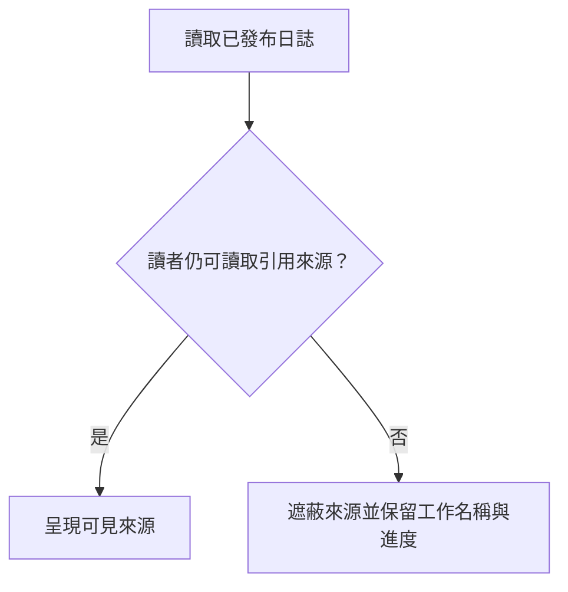

# 日誌

**已有實作** · [設計規格](journal.md) · [核心流程](#decision-flow) · [代表測試](../../../backend/internal/business/journal/domain/entity/entry_test.go) · [程式目錄](../../../backend/internal/business/journal/README.md) · [維護指引](../../../backend/internal/business/journal/AGENTS.md)

## 領域設計

**子域定位**　工程現場紀錄的核心候選。

**通用語言**　工作列保存名稱與進度；引用以來源類型及 ID 指向 Repository 或 Project。

**上下文與契約**　來源領域提供資源與可見性事實，Journal 決定讀者可看到哪些工作列欄位。發布日誌不會移轉引用來源的所有權。

**驗收案例**　發布後讀者失去來源權限時，仍能看到工作名稱與進度，但不能透過日誌取得來源名稱與識別碼。

[對照實作或測試](../../../backend/internal/business/journal/domain/entity/entry_test.go) · [戰略設計與分類準則](../../references/ddd/README.md)

日誌規格說明工作內容、引用與可見範圍。

[相關業務規格](journal.md) · [後端journal 實作說明](../../../backend/internal/business/journal/README.md)

## 讀取已發布日誌的判定流程

[入口適配器](../../../backend/internal/business/journal/adapter/http/routes.go) · [判定依據](../../../backend/internal/business/journal/domain/entity/entry_test.go) · [應用層輸出介面](../../../backend/internal/business/journal/application/port/operations.go) · [相關測試](../../../backend/internal/business/journal/domain/entity/entry_test.go)

[適用工作指引](../AGENTS.md) · [上層導覽](../README.md)
