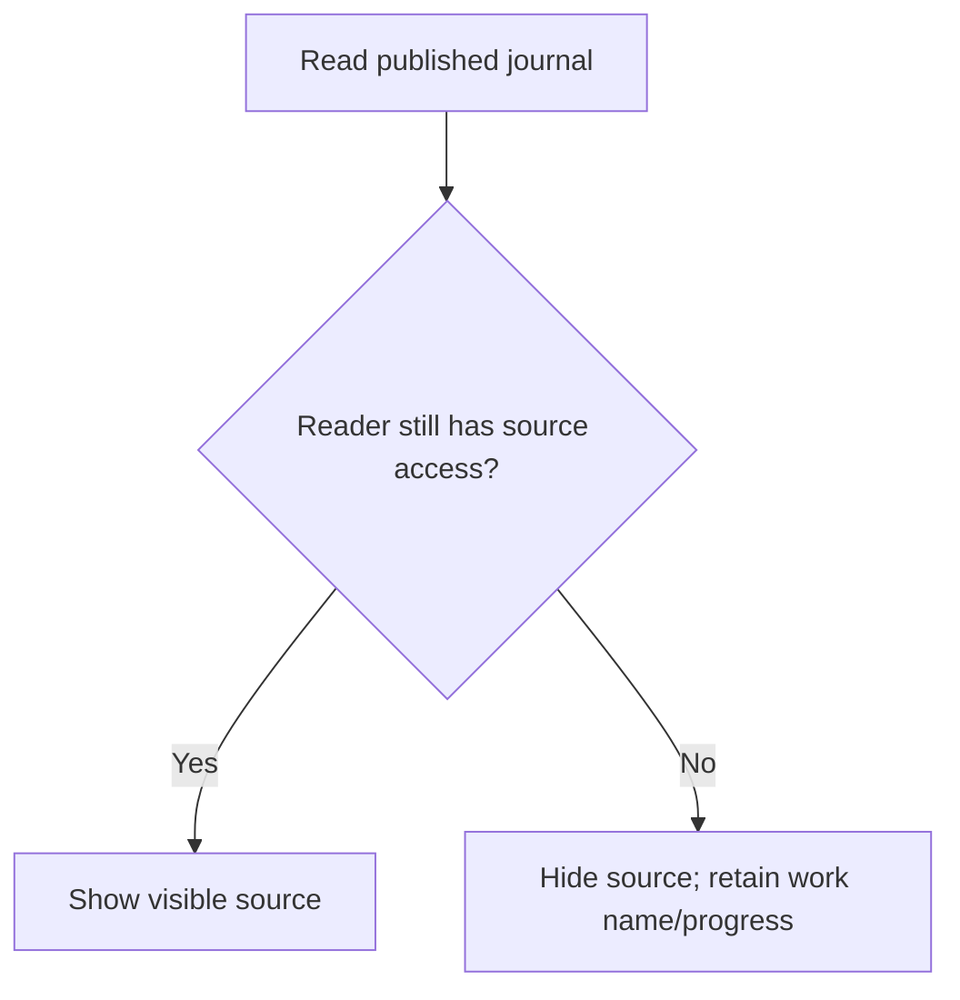

<a id="日誌"></a>

# Journal 設計

**Implemented** · [Design](journal.md) · [Core flow](#decision-flow) · [Representative tests](../../../backend/internal/business/journal/domain/entity/entry_test.go) · [Module guidance](../../../backend/internal/business/journal/AGENTS.md)

[Repository ownership target](journal.md#目標規格日誌歸屬儲存庫) · [Journal, business and LINE journeys](journey.md)

<a id="領域設計"></a>

## Domain design

**Subdomain classification:** core candidate for construction-site records.

**Language:** work rows retain names/progress; references identify Repository/Project sources by type/ID.

**Context/contracts:** source domains provide resources/visibility; Journal decides visible work-row fields. Publication does not transfer source ownership.

**Current acceptance:** readers losing source access retain work names/progress but cannot obtain source names/IDs through journals.

[Implementation/tests](../../../backend/internal/business/journal/domain/entity/entry_test.go) · [Strategic classification criteria](../../references/ddd/AGENTS.md)

Journal specifications define work content, references and visibility.

[Business specification](journal.md) · [Backend journal implementation](../../../backend/internal/business/journal/AGENTS.md)

<a id="decision-flow"></a>

<a id="讀取已發布日誌的判定流程"></a>

## Published journal read decision flow



[Entry adapter](../../../backend/internal/business/journal/adapter/http/routes.go) · [Decision rules](../../../backend/internal/business/journal/domain/entity/entry_test.go) · [Application output port](../../../backend/internal/business/journal/application/port/operations.go) · [Related tests](../../../backend/internal/business/journal/domain/entity/entry_test.go)

[Domain guidance](../AGENTS.md)

## 後端分層結構

下列為[Journal 後端模組](../../../backend/internal/business/journal/)的完整檔案樹，包含實作、測試與目錄文件。

**範圍**　此樹列出「工作日誌」模組根目錄內的 12 個檔案。檔名以 `_test.go` 結尾的是測試；同名檔案依所在目錄區分職責。

**分層對照**　共通範本中，以下路徑未在此模組根目錄下獨立設置：`domain/valueobject/`、`domain/service/`、`domain/event/`、`domain/policy/`、`application/command/`、`adapter/line/`、`adapter/messaging/`、`adapter/scheduler/`。子功能的分層以樹中實際路徑為準。

```text
backend/internal/business/journal/
├── adapter/                                  # 外部系統轉接
│   ├── firestore/                            # Firestore 保存與查詢
│   │   ├── payload.go                        # 提交內容（讀寫 Firestore 資料）
│   │   ├── payload_test.go                   # 驗證提交內容（讀寫 Firestore 資料）；TestPayloadCompatibility
│   │   ├── store.go                          # 資料存取（讀寫 Firestore 資料）；Store、Create
│   │   └── store_test.go                     # 驗證資料存取（讀寫 Firestore 資料）；TestPublishingAndScopedPagination、TestReferenceRedactionCoversBothDays
│   └── http/                                 # HTTP 入口
│       ├── routes.go                         # API路由（處理 HTTP 請求與回應）；Register、CreateJournal
│       └── routes_test.go                    # 驗證API路由（處理 HTTP 請求與回應）；TestJournalRoutes
├── application/                              # 應用用例
│   ├── dto/                                  # 用例資料型別
│   │   └── page.go                           # 分頁資料（定義傳遞資料）
│   ├── port/                                 # 外部能力介面
│   │   └── operations.go                     # 操作（定義用例所需介面）；Operations
│   └── query/                                # 查詢用例
│       └── references.go                     # 來源引用（執行讀取用例）；GroupCatalog、ReferenceCatalog
├── domain/                                   # 領域模型與規則
│   └── entity/                               # 實體與聚合
│       ├── entry.go                          # 日誌項目（維護領域狀態與規則）；ApplyReferenceCheck、Entry
│       └── entry_test.go                     # 驗證日誌項目（維護領域狀態與規則）；TestApplyReferenceCheck
└── AGENTS.md                                 # 本目錄開發指引
```
