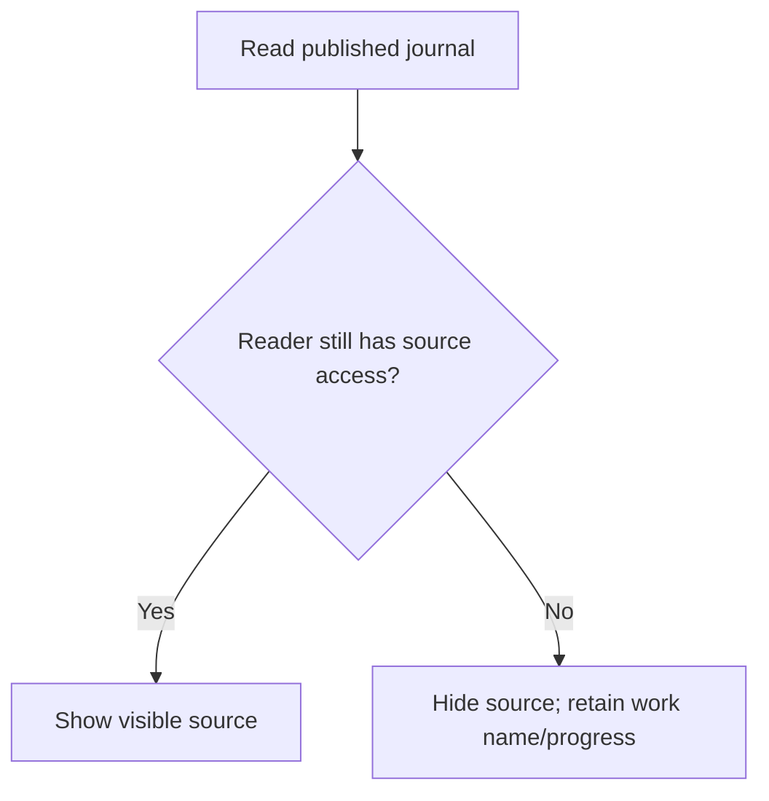

# Journal 設計

**Implemented** · [Design](journal.md) · [Core flow](#decision-flow) · [Representative tests](../../../backend/internal/business/journal/domain/entity/entry_test.go) · [Module guidance](../../../backend/internal/business/journal/AGENTS.md)

[Repository ownership target](journal.md#目標規格日誌歸屬儲存庫) · [Journal, business and LINE journeys](journey.md)

## Domain design

**Subdomain classification:** core candidate for construction-site records.

**Language:** work rows retain names/progress; references identify Repository/Project sources by type/ID.

**Context/contracts:** source domains provide resources/visibility; Journal decides visible work-row fields. Publication does not transfer source ownership.

**Current acceptance:** readers losing source access retain work names/progress but cannot obtain source names/IDs through journals.

[Implementation/tests](../../../backend/internal/business/journal/domain/entity/entry_test.go) · [Strategic classification criteria](../../references/ddd/AGENTS.md)

Journal specifications define work content, references and visibility.

[Business specification](journal.md) · [Backend journal implementation](../../../backend/internal/business/journal/AGENTS.md)

## Published journal read decision flow

[Entry adapter](../../../backend/internal/business/journal/adapter/http/routes.go) · [Decision rules](../../../backend/internal/business/journal/domain/entity/entry_test.go) · [Application output port](../../../backend/internal/business/journal/application/port/operations.go) · [Related tests](../../../backend/internal/business/journal/domain/entity/entry_test.go)

[Domain guidance](../AGENTS.md)
