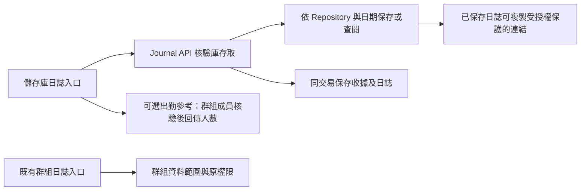
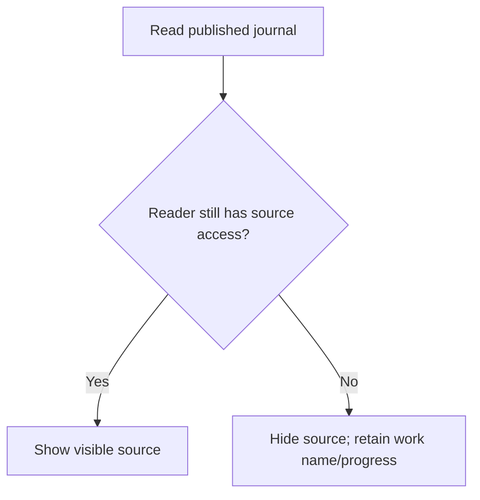

# 獨立日誌feed-與-dashboard

## 目標規格：日誌歸屬儲存庫

每篇新施工日誌必須選定一個主 Repository，並記錄工作日期。儲存庫決定工程歸屬與讀取範圍。LINE 群組是可選的分享對象。選擇、改變或取消分享對象不會改變日誌歸屬。同一天可以有多篇日誌。

| 操作       | 規則                                                                                                                                                                       |
| ---------- | -------------------------------------------------------------------------------------------------------------------------------------------------------------------------- |
| 建立與查閱 | 可信 Session 使用者在建立時須具有該庫的日誌建立資格。列表、詳情、Feed 與 Dashboard 都依讀者目前的庫存取資格判定。以庫和工作日期查閱。失去庫讀權即不能讀取該庫日誌正文。    |
| 填寫工作列 | 可手寫，或引用主庫內有權讀取的 Object、子物件與工區。Project 可作為工作關聯，須另核驗可見性。關聯不改變日誌歸屬；儲存日誌不改寫 Object 成果或 Project 進度。               |
| 分享到群組 | 日誌先保存，使用者可另選有權分享的 LINE 群組。分享只含可公開摘要與日誌入口；連結須重新核驗庫讀權。發送失敗時可重試分享，不重建日誌。                                       |
| 顯示人力   | 日誌填寫人確認本次實際作業人力。若能確認一個相關且有權查詢的出勤群組，可另顯示該群組、工作日期的出勤彙總及資料時間，標示為參考。無對應或查詢失敗顯示無可用資料，仍可填寫。 |
| 處理歷史   | 既有群組日誌保留原群組查閱範圍及各列引用。即使某些工作列選了同一庫，也不自動推定主庫、移轉權限或拆分。若需要全群日報，可另外彙整多篇有權查看或分享的工程日誌。             |

從 Repository 開始時預填主庫；從 LINE 群組開始時，只在能唯一確認且使用者有權建立日誌的庫時預填。使用者要在編輯前看見工程名稱。沒有唯一對應時，讓本人從有權建立的庫中選擇。儲存結果未知時沿用同一提交識別查原結果或重試。正式權限角色及資料遷移若需擴充，須另核對契約後實作。

現行實作

新版已支援從儲存庫建立與查閱。首版以啟用儲存庫既有存取判定核驗操作者：個人庫限本人，群組庫限即時核驗的成員。保存前交易會再檢查庫狀態及擁有者。舊群組日誌保留歷史查閱。建立 API 只接受 `repositoryId`，傳入 `groupId` 或缺少主庫會被拒絕。Feed 與 Dashboard 可切換為儲存庫和工作日期。日誌可複製僅含入口的連結，直接發送群組摘要與正式渠道驗收仍待接線。撰寫時可另選群組查詢[出勤參考](../attendance/queries.md#日誌使用的群組出勤參考)。

以下章節保留舊群組日誌的歷史契約供維護查閱，涉及建立或發布群組日誌的內容僅描述舊行為。新建、查閱與分享以本節為準。

## 獨立日誌、Feed 與 Dashboard

日誌是獨立業務。每篇日誌指定一個發布群組。Feed 提供填寫與瀏覽入口，Dashboard 依日期與群組讀取同一批日誌，以每個有資料的群組一張圖表呈現。

## 日誌內容

| 範圍     | 欄位與語意                                                                           |
| -------- | ------------------------------------------------------------------------------------ |
| 表頭     | 日誌識別碼、工作日期、發布群組、填寫人。允許同一天多篇紀錄。                         |
| 人員配置 | 管理職、管制人員、施作人員各有一份當日姓名清單，允許多人及兼任。職務只描述現場配置。 |
| 今日工作 | 每列保存名稱與累計實際完成度（0–100%）。                                             |
| 明日計畫 | 每列保存名稱與預計隔日累計完成度（0–100%）。                                         |
| 工作關聯 | 每列可選一個儲存庫或專案，以類型及識別碼引用。關聯只屬於該列。                       |

## 工作對象與實際作業空間

每筆工作可直接手寫。選擇儲存庫後，可搜尋該庫的物件或子物件，並選擇最多 20 個實際作業空間。子物件顯示「父物件 › 子物件」，選取時帶入父物件的空間；使用者可移除或加選。切換儲存庫會清除該筆引用，保留工作名稱與完成度。專案關聯維持原有行為，不提供庫內選取。

缺少空間時可輸入名稱並「建立並選用」。空間立即保存，即使取消日誌仍會保留；結果未知時鎖住該筆的關聯與移除，使用原鍵重試，完成前不能取消填寫或發布。

| 操作契約                | 規則                                                                                                                                                                                                                                         |
| ----------------------- | -------------------------------------------------------------------------------------------------------------------------------------------------------------------------------------------------------------------------------------------- |
| Actor／Resource／Action | 可信 Session 使用者，在發布群組新增日誌；每列可引用一個工作對象及多個空間。                                                                                                                                                                  |
| Authority／Policy       | 沿用群組成員與來源閱讀權；只有儲存庫關聯可帶入物件／空間，子物件須屬於指定父物件，所有項目須來自指定庫。                                                                                                                                     |
| Context／Decision       | 發布交易讀取所選資料與儲存庫狀態；缺少來源或跨庫引用拒絕整篇發布，不新增日誌及收據。                                                                                                                                                         |
| Result                  | 保存選取的 ID 與當時的工作對象名稱、空間名稱。日後改名或移動不改寫歷史；來源失權時連同這些欄位一併隱藏。日誌不更新來源進度。                                                                                                                 |
| 重送／併發              | 原發布鍵與輸入內容決定收據；重試回原日誌，不重新計算名稱快照。空間建立沿用既有防重 API。                                                                                                                                                     |
| Audit／實作             | 日誌保留作者及時間；[後端交易](../../../backend/internal/business/journal/adapter/firestore/store.go)、[前端選取](../../../frontend/miniapp/src/business/journal/WorkContext.tsx)及[API 契約](../../../api/contract/journal/journals.yaml)。 |

驗證沿用既有前端、Go 與 API 檢查。正式 Firestore 與 LINE 裝置驗收另行記錄。

## 畫面與雛型範圍

- 側邊欄的 Feed 依工作日期顯示日誌卡片，支援群組篩選。Dashboard 依工作日期與群組篩選，以shadcn 長條圖逐項呈現今日實際及明日預計累計完成度，不合計或平均。展開日誌明細可查閱人員配置並返回 Feed 原文。

- 從 MINI App 側欄「快捷入口」點選「寫日誌」，登入後選擇發布群組，接著填寫及發布。Feed 的群組篩選僅供瀏覽。Feed 與 Dashboard 透過共用 API 讀取保存的日誌，逐列關聯從可讀儲存庫或群組專案選取。

## 正式群組發布的操作契約

後端依可信 Session 設定填寫人，新增時核驗當下群組成員資格及每列來源讀取權。列表與詳情逐次依群組授權，來源失權時隱藏來源內容。寫入須驗證日期、非空工作名稱、百分比範圍與同次提交的防重識別。成功後只新增一篇日誌。關聯不授予閱讀權、不改來源進度。

## 資源名稱與 API 骨架

Journal 表示一篇工作日誌，集合路徑使用 /api/v1/journals。Feed 是按時間排列的瀏覽與發布入口，Dashboard 是依群組及工作日期查閱的畫面。兩者共用列表及詳情契約。

| 操作                             | 用途                                                                                                                                                         |
| -------------------------------- | ------------------------------------------------------------------------------------------------------------------------------------------------------------ |
| POST /api/v1/journals            | 建立日誌，必填 Idempotency-Key。同一作者與同鍵同內容重送取得原結果，異內容回 409。                                                                           |
| GET /api/v1/journals             | Feed 可跨本人可讀群組，Dashboard 以 groupId 和 workDate 篩選。以工作日期、建立時間、ID 依序降冪分頁；nextCursor 為空表示最後一頁。游標綁定使用者與篩選條件。 |
| GET /api/v1/journals/{journalId} | 以日誌 ID 開啟原文，查無資料或無閱讀權均回 404。                                                                                                             |

- [此契約的 groupId 指發布用的 LINE 群組上下文。人員名單記錄當日配置；creatorId 與 createdAt 由服務端產生。工作列可省略 reference。原關聯失權後，讀取端省略該列的 reference。今日與明日清單合計至少一項。完整欄位見 Journal 契約。](../../../api/contract/journal/journals.yaml)

- 後端沿用既有群組、儲存庫、專案及 Firestore 設定。日誌明細與建立收據在同一交易保存。跨群組 Feed 依當下可讀群組分別查詢，再合併排序。單頁最多 20 篇，成本隨可讀群組數增加。缺少必要服務設定時回 503。

## Journal 設計

**現行實作** · [判定流程](#decision-flow) · [代表測試](../../../backend/internal/business/journal/domain/entity/entry_test.go) · [模組規則](../../../backend/AGENTS.md)

[Repository ownership target](#目標規格日誌歸屬儲存庫) · [Journal, business and LINE journeys](../../integrations/line/journey.md#journal-journey)

### Domain design

**Subdomain classification:** core candidate for construction-site records.

**Language:** work rows retain names/progress; references identify Repository/Project sources by type/ID.

**Context/contracts:** source domains provide resources/visibility; Journal decides visible work-row fields. Publication does not transfer source ownership.

**Current acceptance:** an authorized journal reader who loses access only to a referenced source retains work names/progress but cannot obtain source names/IDs through the journal. Losing access to the journal's owning Repository or legacy group blocks the journal itself.

[Implementation/tests](../../../backend/internal/business/journal/domain/entity/entry_test.go) · [Strategic classification criteria](../../references/ddd/design-guide.md)

Journal specifications define work content, references and visibility.

### Published journal read decision flow

[Entry adapter](../../../backend/internal/business/journal/adapter/http/routes.go) · [Decision rules](../../../backend/internal/business/journal/domain/entity/entry_test.go) · [Application output port](../../../backend/internal/business/journal/application/port/operations.go) · [Related tests](../../../backend/internal/business/journal/domain/entity/entry_test.go)

[Domain guidance](../../AGENTS.md)

### 後端分層結構

[journal 模組原始碼](../../../backend/internal/business/journal/) · [代表測試](../../../backend/internal/business/journal/domain/entity/entry_test.go) · [六邊形分層與依賴方向](../../architecture/runtime/backend-boundaries.md#六邊形分層參考)
