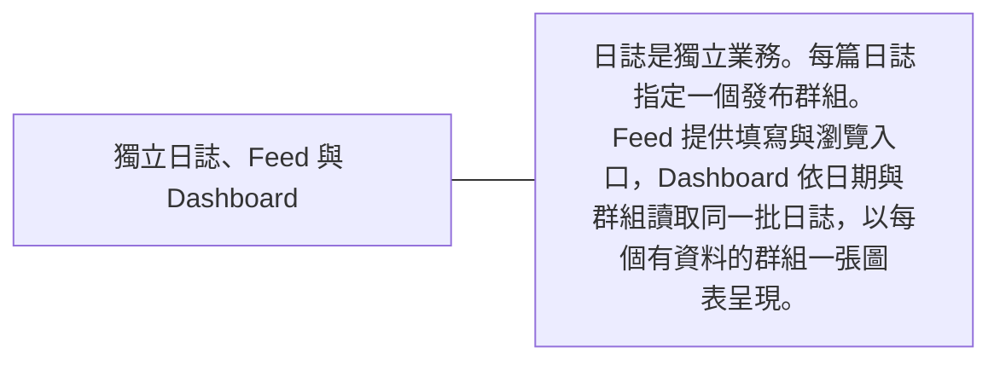
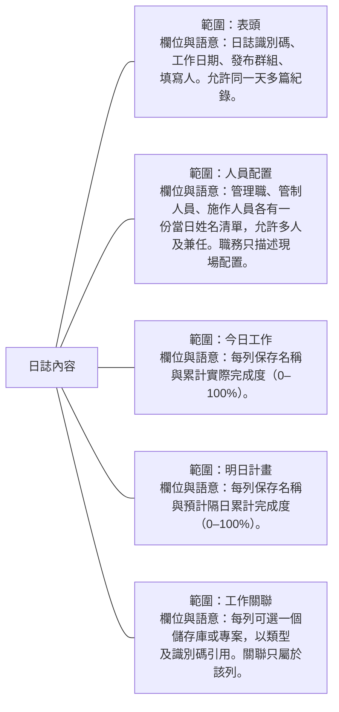
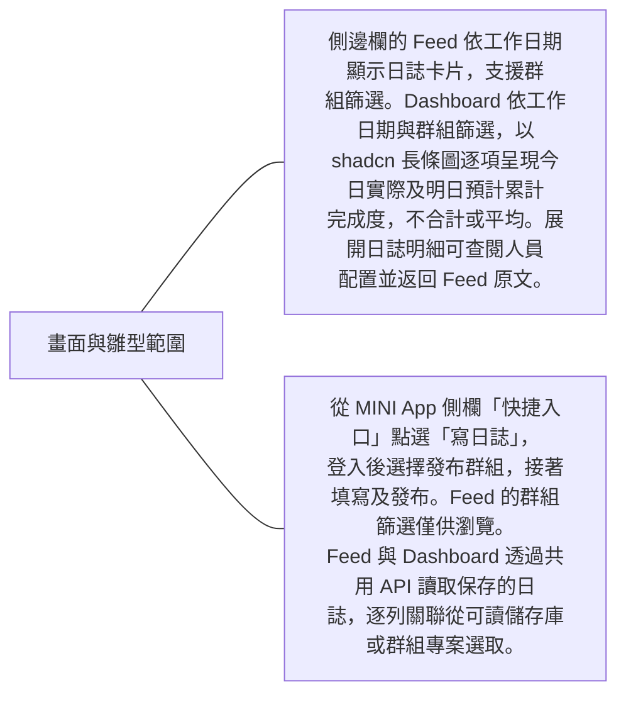
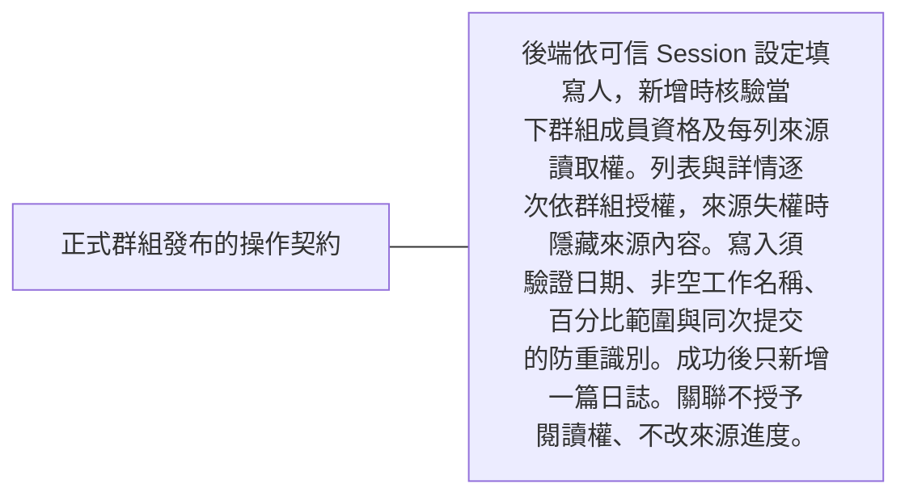
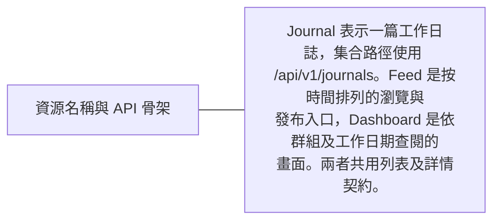
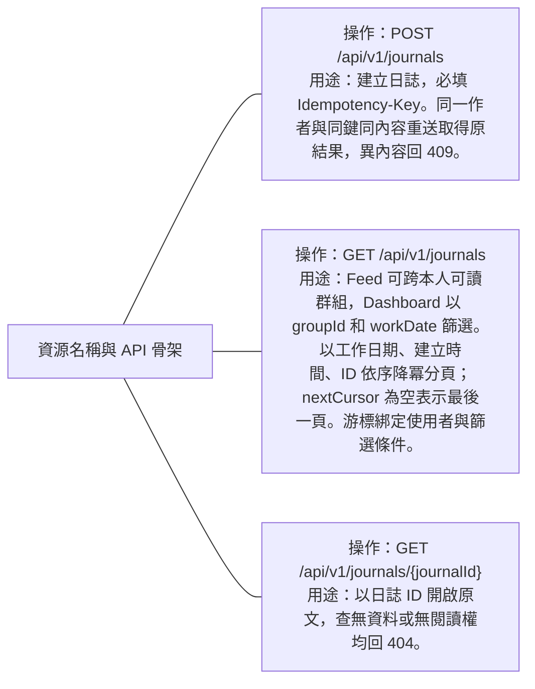
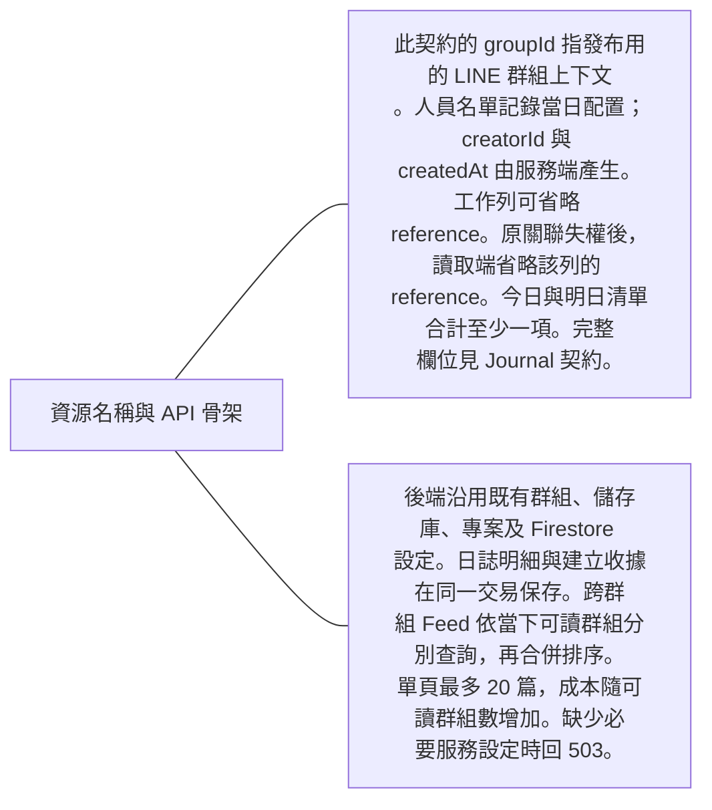

# 獨立日誌feed-與-dashboard

## 工作對象與實際作業空間

每筆工作可直接手寫。選擇儲存庫後，可搜尋該庫的物件或子物件，並選擇最多 20 個實際作業空間。子物件顯示「父物件 › 子物件」，選取時帶入父物件的空間；使用者可移除或加選。切換儲存庫會清除該筆引用，保留工作名稱與完成度。專案關聯維持原有行為，不提供庫內選取。

缺少空間時可輸入名稱並「建立並選用」。空間立即保存，即使取消日誌仍會保留；結果未知時鎖住該筆的關聯與移除，使用原鍵重試，完成前不能取消填寫或發布。

| 操作契約 | 規則 |
| --- | --- |
| Actor／Resource／Action | 可信 Session 使用者，在發布群組新增日誌；每列可引用一個工作對象及多個空間。 |
| Authority／Policy | 沿用群組成員與來源閱讀權；只有儲存庫關聯可帶入物件／空間，子物件須屬於指定父物件，所有項目須來自指定庫。 |
| Context／Decision | 發布交易讀取所選資料與儲存庫狀態；缺少來源或跨庫引用拒絕整篇發布，不新增日誌及收據。 |
| Result | 保存選取的 ID 與當時的工作對象名稱、空間名稱。日後改名或移動不改寫歷史；來源失權時連同這些欄位一併隱藏。日誌不更新來源進度。 |
| 重送／併發 | 原發布鍵與輸入內容決定收據；重試回原日誌，不重新計算名稱快照。空間建立沿用既有防重 API。 |
| Audit／實作 | 日誌保留作者及時間；[後端交易](../../../backend/internal/business/journal/adapter/firestore/store.go)、[前端選取](../../../frontend/miniapp/src/business/journal/WorkContext.tsx)及[API 契約](../../../api/contract/journal/journals.yaml)。 |

驗證沿用既有前端、Go 與 API 檢查。正式 Firestore 與 LINE 裝置驗收另行記錄。

建立日誌時，前端透過 `GET /api/v1/groups/{groupId}/journal-reference-targets` 分頁讀取可引用的儲存庫與專案。後端核對群組資格，依序回傳兩種選項的類型、識別碼與名稱。前端依 `nextCursor` 讀到結尾，發布時由後端再次核對選取項目。
