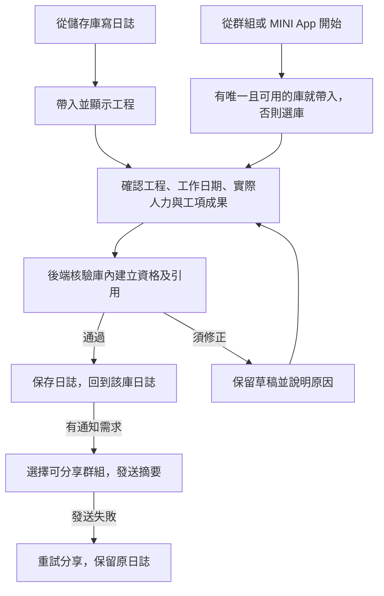

# 日誌、各業務與 LINE 旅程

現場人員需要記錄某個工程當日做了什麼、完成多少、有哪些人實際參與。新版以 **Repository → 工作日期 → 日誌** 查閱。LINE 提供進入與分享的途徑，Attendance 提供可選的人力參考。業務邊界與舊資料處理以[日誌目標規格](journal.md#目標規格日誌歸屬儲存庫)為準。

現行群組選單、MINI App 寫日誌、Feed 與 Dashboard 已有入口。日誌建立全面使用主儲存庫；舊群組日誌僅供歷史查閱。Feed 與 Dashboard 可選庫及工作日期。群組選單有唯一已知庫時帶入，打開後核驗庫資格；也可改選。應用可複製日誌連結及查詢出勤參考。直接發送群組摘要仍待接線。

## 目標時序

未來設計

## 驗收情境

- **A 出勤、B 支援**：選 B 庫記施工成果並確認實際作業人力。A 班次不變。日誌可分享至有權分享的群組，換群後仍能在 B 庫查閱。
- **一群多工程**：群組進入不擅自選庫。從 B 庫進入不必重選。未授權的庫與工項無法讀取或寫入。
- **送出不確定或分享失敗**：可查原提交結果或依契約重試。同一提交只保存一篇日誌。分享失敗時 App 顯示已保存，並提供重送。
- **舊群組日誌**：跨庫工作列和原查閱範圍可重現。新版彙整不因分享連結揭露無權查看的日誌。
- **理解與效率**：實測使用者能不靠提示區分工程歸屬、出勤來源及分享對象。比較找到正確工程的時間、重選次數、誤歸庫次數及錯誤恢復率。
