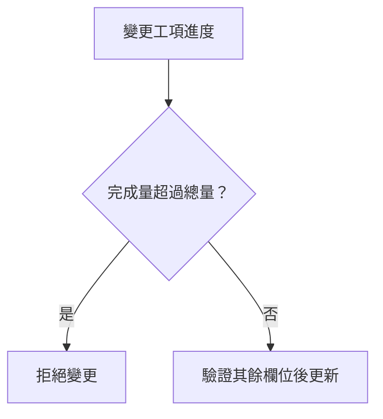

# 工項

**已有實作** · [設計規格](design.md) · [核心流程](#decision-flow) · [代表測試](../../../backend/internal/business/object/application/progress_test.go) · [程式目錄](../../../backend/internal/business/object/README.md) · [維護指引](../../../backend/internal/business/object/AGENTS.md)

## 領域設計

**子域定位**　工程數量與進度的核心候選。

**通用語言**　總量、完成量與狀態共同描述工項進度；未提供完成量與明確填零有不同語意。

**上下文與契約**　Repository 提供操作範圍，Object 負責數量與進度規則。匯入與手動建立都應保留相同的數量語意。

**驗收案例**　總量為 5、完成量為 8 的工項應被拒絕；等值十進位表示不應產生不同的完成狀態。

[對照實作或測試](../../../backend/internal/business/object/application/progress_test.go) · [戰略設計與分類準則](../../architecture/ddd/README.md)

工項規格涵蓋數量、進度與狀態。

[領域設計與操作契約](design.md) · [後端實作入口](../../../backend/internal/business/object/README.md)

## 變更工項進度的判定流程

[入口適配器](../../../backend/internal/business/object/adapter/http/routes.go) · [判定依據](../../../backend/internal/business/object/application/progress_test.go) · [應用層輸出介面](../../../backend/internal/business/object/application/port/object.go) · [相關測試](../../../backend/internal/business/object/application/progress_test.go)

[適用工作指引](../AGENTS.md) · [上層導覽](../README.md)
