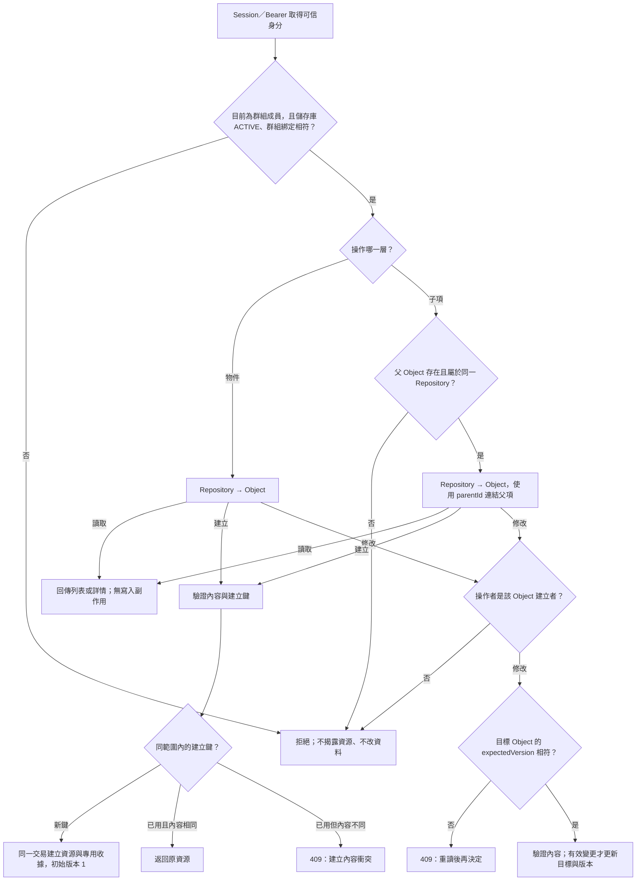
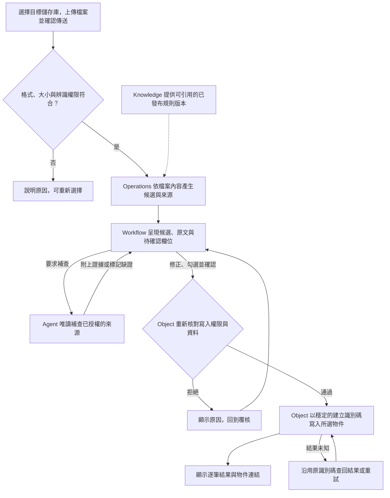

# 儲存庫物件

<a id="儲存庫物件"></a>

狀態：最小切片已完成本機實作與回歸驗證；正式 LINE／Firestore／手機環境待驗收。每個來源文件項次是一筆 Object，quantity 代表該項數量，不自動拆成單件資產。

## Object 後端分層結構

物件、子物件與物件範本同屬 Object 限界上下文。**實作狀態：** 下列分層均已實作。LINE 指令已接入 webhook，訊息發布與排程在設定 Pub/Sub 主題後啟用。

下圖列出模組內的檔案與職責。精確數量與建立者資格分別由 valueobject 和 policy 維護。[後端分層指引](../../../backend/AGENTS.md) · [Object 模組](../../../backend/internal/business/object/)

```text
backend/internal/business/
└── object/
    ├── domain/                        # 領域模型與規則
    │   ├── entity/                    # Object 實體、數量與進度轉換
    │   │   ├── conversion_test.go     # 物件類型轉換測試
    │   │   └── object.go              # Object 實體、數量、進度與編輯規則
    │   ├── valueobject/               # 值物件
    │   │   ├── quantity.go            # 精確十進位數量
    │   │   └── quantity_test.go       # 數量格式、精度與等值比較
    │   ├── service/                   # 範本正規化與實例化規則
    │   │   └── template.go            # 範本正規化與物件建立計畫
    │   ├── template/                  # 範本節點、樹形約束與版本快照
    │   │   ├── version.go             # 範本節點、樹形約束與版本快照
    │   │   └── version_test.go        # 樹形與版本快照測試
    │   ├── event/                     # 領域事件
    │   │   └── quantity_changed.go    # 物件數量變更事件
    │   └── policy/                    # 獨立領域政策
    │       └── edit.go                # 建立者編輯資格
    ├── application/                   # 用例入口與儲存庫資格核對
    │   ├── command/                   # 建立、更新物件，發布與套用範本
    │   │   ├── object.go              # 建立與更新物件
    │   │   └── templates.go           # 建立、發布及套用範本
    │   ├── query/                     # 查詢物件、範本、數量異動，以及準備草稿
    │   │   ├── drafts.go              # 依文件或施工條件準備草稿
    │   │   ├── object.go              # 物件清單、詳情、數量歷史與文件候選
    │   │   └── templates.go           # 查詢本庫與個人範本
    │   ├── port/                      # 用例所需的儲存、查詢與草稿準備介面
    │   │   ├── drafts.go              # 草稿準備介面與輸入
    │   │   ├── object.go              # 儲存庫查詢、物件保存與數量歷史介面
    │   │   └── template.go            # 範本保存與套用介面
    │   ├── dto/                       # 用例輸入與結果
    │   │   ├── draft.go               # 草稿、警告與候選對照
    │   │   ├── object.go              # 物件分頁與數量異動結果
    │   │   └── template.go            # 範本建立、分頁與實例化結果
    │   ├── drafts.go                  # 草稿準備入口
    │   ├── drafts_test.go             # 草稿準備與輸入驗證測試
    │   ├── object.go                  # 物件操作入口與儲存庫資格核對
    │   ├── object_test.go             # 物件用例測試
    │   ├── progress_test.go           # 完成量與進度規則測試
    │   ├── space_test.go              # 空間綁定與解除測試
    │   ├── templates.go               # 範本操作入口與套用目標核對
    │   └── templates_test.go          # 範本驗證與權限測試
    └── adapter/                       # 外部介面與儲存技術的轉接
        ├── http/                      # 接收 API 請求、呼叫用例、轉換回應
        │   ├── drafts.go              # 草稿準備 API
        │   ├── drafts_test.go         # 草稿 API 測試
        │   ├── routes.go              # 物件 API 路由與請求處理
        │   ├── routes_test.go         # 物件 HTTP 契約與權限測試
        │   ├── templates.go           # 範本建立、查詢與套用 API
        │   └── templates_test.go      # 範本 API 測試
        ├── line/                      # LINE Webhook 或 API
        │   ├── webhook.go             # LINE 物件操作入口
        │   └── webhook_test.go        # 範本指令、連結與重送測試
        ├── firestore/                 # 物件與範本的保存、交易及防重收據
        │   ├── hierarchy_test.go      # 父子物件保存測試
        │   ├── history.go             # 查詢儲存庫數量異動歷史
        │   ├── progress_test.go       # 進度與版本更新測試
        │   ├── space_test.go          # 空間綁定與儲存庫範圍測試
        │   ├── store.go               # 物件讀寫、版本檢查與交易
        │   ├── store_test.go          # 物件儲存測試
        │   ├── templates.go           # 範本快照、改版、原子套用與防重收據
        │   └── templates_test.go      # 範本交易、回滾、跨庫套用與改版測試
        ├── messaging/                 # 訊息佇列
        │   ├── publisher.go           # 發布物件領域事件
        │   └── publisher_test.go      # Pub/Sub 主題、事件資料及識別碼測試
        └── scheduler/                 # 排程觸發
            └── handler.go             # 接收排程觸發並呼叫物件用例
```

### LINE 入口與數量事件投遞

登入入口沿用既有 Mini App。LINE 收到「物件範本」文字指令時回覆範本庫連結，開啟後由既有 API 核對身分與儲存庫權限。

設定 `OBJECT_QUANTITY_PUBSUB_TOPIC=projects/<project>/topics/<topic>` 可啟用數量異動投遞。主題須已建立，執行身分須有發布權限。啟用後，變更總數量時會在同一筆 Firestore 交易寫入物件、版本歷史及待送事件。事件包含頻道、儲存庫、物件、版本與前後數量及單位。未設定時沿用既有數量稽核。

伺服器運行期間每分鐘最多投遞 50 筆至設定的 Google Cloud Pub/Sub 主題，發布成功才移除待送紀錄。發布失敗會保留事件供重試。並行執行或回應遺失可能重送，訂閱端應依訊息屬性 `eventId` 防重。實例停止或無 CPU 時，待送資料留待實例恢復運行後處理。

<a id="範圍與欄位"></a>

<a id="物件與子物件歸屬"></a>

## 物件與子物件歸屬

父物件與子項都是同一個儲存庫內的 `Object`。子項透過 `parentId` 指向父物件，兩者分別維護數量、單位、完成數與版本。

- 使用 `GET /api/v1/repositories/{repositoryId}/objects?parentId={id}` 分頁列出直接子項。
- 建立子項使用 `POST /api/v1/repositories/{repositoryId}/objects`，在請求本文帶入 `parentId`。編輯子項使用其自身的 Object ID 與版本。
- 專案與工作日誌都引用子項自己的 Object ID。

## 範圍與欄位

儲存庫內提供「物件」列表、詳情、手動新增與編輯。新增只填名稱；類型、數量、單位與空間確定後由建立者補充，不猜測預設值；核心不負責分類目錄、AI 模型、檔案解析、附件、價格／稅／付款／驗收、庫存、問題關聯或刪除。工序可逐層建立子物件，父子各自維護進度。詳見 [Object 階層](#object-階層)。

| 欄位                                                       | 規則                                                                                                                                                                                               |
| ---------------------------------------------------------- | -------------------------------------------------------------------------------------------------------------------------------------------------------------------------------------------------- |
| name、description                                          | 名稱 1–120 字元、完整說明最多 8000 字元；首尾空白移除，不靜默截斷                                                                                                                                  |
| type、unit                                                 | 新UI使用 work（施作）／non_work（非施作）；可留空表示未分類，原自由類型保留相容。單位可留空，填寫時最多32字元；追蹤進度時必填，不換算                                                              |
| quantity                                                   | 可留空表示未知；填寫時為精確正十進位字串，最多 18 位整數及 6 位小數；不用浮點數。拒絕零、負數、指數、千分位，整數前導零只允許單一 0，小數尾零正規化後保存                                          |
| completedQuantity                                          | 可選精確非負十進位字串，精度同quantity；施作已知完成量須介於0與總量，非施作不保存完成量。缺值不是0                                                                                                 |
| status                                                     | 施作有完成量時由後端switch衍生：0為not_started、中間為in_progress、等總量為completed；新UI不可另選狀態。未分類物件不顯示進度與狀態；非施作在UI顯示不適用，底層三值僅相容保留；完成不代表驗收／付款 |
| id、repositoryId、creatorId、version、createdAt、updatedAt | 後端可信來源，建立不可自行指定；不提供額外 #number                                                                                                                                                 |

來源欄位可獨立留白，只是追溯資料，不承諾 sourceDocument＋revision＋itemNo 唯一。同來源換建立鍵仍可新增另一筆；不自動認定為同一物件。新版 PDF 不會自動比對、合併或覆寫既有物件與狀態。來源項次不作為資料庫 ID。

<a id="進度與歷史相容"></a>

## 進度與歷史相容

- quantity是唯一總數，completedQuantity是完成數；畫面進度由兩者組成，不另外保存百分比或重複總量。後端以math/big精確比較18位整數／6位小數，前端以固定小數位的BigInt預驗，不使用float或int64保存數量。更新是設定絕對完成數，不是每次加一；同一值不製造版本變更。

- 施作已有完成量時，省略完成量保留現值；減少總量到完成數以下拒絕，除非同次明確提交合法新完成數。目前完成數大於0時拒絕轉為非施作或舊類型；須先明確將施作完成數調為0保存，再改類型。從非施作或舊自由類型轉施作必須明確提供完成數，不靜默歸零；新施作已提供總量與單位時，建立省略值才預設0。

- 歷史自由type（包含原字串恰為work／non_work）及缺完成量的紀錄仍可讀，沒有批次遷移或猜測Engineering就是施作。畫面顯示類型待確認／進度待補；轉施作時可依舊not_started／completed提供0／總量預填，使用者可改；舊in_progress不捏造數字。舊PATCHstatus相容路徑保留；已追蹤施作若另送與完成數矛盾的status則拒絕。非施作底層原status不因改名被重設，UI一律不適用，不能把technical status解釋成施作完成。

- 既有expectedVersion、建立者與當下成員資格不變；交易讀取目前總量／完成量／類型／版本後同時驗證與更新。舊建立鍵的v1內容指紋保持相容，缺完成量／新施作預設0可取回舊資源，不重設原紀錄。

<a id="操作契約"></a>

## 操作契約

- 讀取游標綁定本人與儲存庫，子列表另綁父 ID。分頁不是總數。建立收據按本人與儲存庫隔離，請求內容包含父 ID。相同鍵若改用另一父 ID 會發生衝突，結果未知時應以原鍵與原內容重試。ID、建立者、時間與版本由伺服器決定。更新回傳保存快照，記錄操作者、時間、版本與變更；讀取不另記個資，寫入不記 token。啟用數量事件投遞時，由排程在交易提交後發布事件。

- 群組成員核驗屬當下外部觀察，不能和 Firestore 組成原子快照；交易仍核對容器啟用及群組綁定。讀取資格不自動授予修改他人資源的權限。身分或來源服務不可用時拒絕，不以快取或 UI 按鈕取代授權。

### 群組庫的物件操作判定

現行群組庫操作的判定示意。個人庫的授權及所有請求格式依本頁規格與 OpenAPI。



<a id="api-與保存"></a>

## API 與保存

HTTP 請求與回應以 [Object OpenAPI 契約](../../../api/contract/object/objects.yaml) 為準。Go 與 TypeScript 型別由此契約產生。

- GET／POST /api/v1/repositories/{repositoryId}/objects；列表依不透明文件 ID 遞增分頁，不宣稱為建立時間或來源項次順序。

- GET／PATCH /api/v1/repositories/{repositoryId}/objects/{id}。

- 建立只收內容與可選來源欄位；新施作已填總量與單位時，省略完成量會預設為 0。新非施作的初始 technical status 為 not_started。PATCH收完整內容、expectedVersion及可選completedQuantity／status；可選來源欄位省略時保留現值，明確空字串才清除；不做文件版本自動合併。

- 資料位於 channels/{channelId}/repositories/{repositoryId}/objects/{id}；不改 Issue、共用編號計數器或既有資料。建立資源與防重收據同交易提交；交易 callback 不呼叫外部服務或發通知。

### HTTP JSON 範例

建立工項時，向 `POST /api/v1/repositories/{repositoryId}/objects` 傳送 `Content-Type: application/json` 與 `Idempotency-Key`（例如 `create-object-0001`）。身分可使用 Bearer 或 Cookie Session，後者寫入時另須提供 `X-CSRF-Token`。以下是 `ObjectCreation` 的請求本文，數量使用十進位字串以保留精度：

```json
{"name":"配電盤","type":"work","quantity":"12.5","unit":"組"}
```

建立成功回傳 HTTP 200，本文為契約中的 `Object`。查詢清單則回傳 `ObjectPage`，以下是查詢範圍內沒有物件時的完整回應：

```json
{"items":[],"nextCursor":""}
```

### Pub/Sub 數量事件的線上格式

發布端將一筆事件序列化為 UTF-8 JSON，再以標準 Base64 編碼，放入 Pub/Sub REST 發布請求的 `messages[].data`。同一則訊息的 `attributes.type` 固定為 `object.quantity_changed`，`attributes.eventId` 是該次異動的穩定防重鍵。直接處理 REST 資料時先解 Base64；若訂閱端 SDK 已提供訊息本文的 bytes，直接解析 JSON 即可。[發布實作](../../../backend/internal/business/object/adapter/messaging/publisher.go)

以下是解碼後的完整本文範例。欄位名稱大小寫須與範例一致；`Version` 是物件修訂版號，型別為整數，異動前後數量則為字串。[事件型別](../../../backend/internal/business/object/domain/event/quantity_changed.go)

```json
{
  "ChannelID": "1234567890",
  "RepositoryID": "aaaaaaaaaaaaaaaaaaaaaaaaaaaaaaaa",
  "ObjectID": "bbbbbbbbbbbbbbbbbbbbbbbbbbbbbbbb",
  "Version": 2,
  "Change": {
    "BeforeQuantity": "10",
    "BeforeUnit": "組",
    "AfterQuantity": "12.5",
    "AfterUnit": "組"
  }
}
```

<a id="畫面與驗收"></a>

## 畫面與驗收

- 儲存庫物件頁籤使用既有元件與 typed client。只有作者顯示編輯；切換身份／儲存庫隔離舊回應，失敗保留可重試意圖。未知建立結果保留原 key 與內容，不以另一鍵重複提交。

- 最小驗收包含精確數量／非法輸入、預設及三態轉換、未登入／非成員／停用／跨儲存庫拒絕、非作者修改拒絕、版本衝突、防重重送與內容衝突、未知結果重試、前端載入／失敗／切換身份及手機表單。使用脫敏測資；真實商業 PDF 不進儲存庫或公開 fixtures。

- 實作位置：後端 object、前端 object；正式 LINE／Firestore／手機整合另行驗收，測試替身或 build 不代表正式環境通過。本輪驗證不將真實來源文件的 54 項寫入資料庫。

  - [object](../../../backend/internal/business/object/)

  - [object](../../../frontend/miniapp/src/business/object/)

[物件與子物件歸屬](#物件與子物件歸屬) · [範本操作與權限](template.md#操作與權限)

## 從文件辨識候選

成員可在物件清單選取文件，確認將文件傳送至 OpenAI 後執行辨識。選檔器不以副檔名篩選，格式由 Responses API 判定；每份原檔最多 8 MiB。API 契約及 HTTP 接收上限容納對應的 Base64 與 JSON。物件 API 核對儲存庫權限，再透過 Operations 呼叫模型；沒有配置辨識模型時，手動建立仍可使用。

辨識只回傳候選、引文、來源位置與模型回應。畫面列出每筆候選，讓使用者核對原件、補正數量與單位、選擇類型，再透過既有物件建立操作確認寫入。試算表每張工作表最多處理前 1,000 列，其他文件也可能漏列。候選留在當前畫面，重新辨識會產生新的結果。

[文件辨識能力與領域分工](../../proposals/domain-collaboration.md)

### 候選覆核與匯入流程

未來設計。沿用「從文件辨識物件」入口與目前支援的檔案格式。來源定位依格式呈現，例如文件頁碼、圖片區域、文字段落或工作表列號。缺少定位或引文時，畫面標示待確認。掃描文件與照片需使用能辨識影像內容的處理方式，實際支援能力以代表性原件驗收。



首版接通 Operations 的候選辨識與 Workflow 的覆核、確認流程。確認綁定操作者、目標儲存庫、候選版本及選取內容。修改候選或更換儲存庫後須重新確認。正式寫入沿用 Object 的建立規則及逐筆建立識別碼；重試只重送結果未知的項目。跨頁或跨工作階段續作有實際需求時，再保存流程和候選。

Agent 與 Knowledge 按需求接入。Agent 只補查本次授權的來源，回傳證據或待確認事項。Knowledge 只提供有權引用且已發布的規則，候選須標明採用的版本；先以有重複使用需求的文件版型驗證。

首版驗收：

- 用一份有文字層的文件和一張手機拍攝的工項表走同一覆核流程。候選可回查引文與來源位置，缺證時明確標示。
- 修正候選後只勾選一筆，應只建立這一筆，並顯示結果與物件連結。確認後撤銷寫入權限時，後端拒絕建立。
- 模擬寫入成功但回應遺失，使用相同建立識別碼重試，應回傳原結果且只保留一筆物件。

## 先記名稱，再補資料

手動新增物件僅顯示名稱，不要求或預填類型、數量、單位、空間與完成數；也不讀取空間選項。只含 `name` 的 API 請求可成功建立，未提供的資料以空值保存，不補施作、1 或 SET。既有資料不遷移。

建立者開啟編輯後可逐步補資料；名稱仍必填，數量若填寫仍須為精確正數。要追蹤施作完成量時才核驗總量、單位與完成數，既有有進度物件仍不能藉清空欄位繞過進度保護。來源文件覆核建立也只要求名稱，保留來源與引文，不暗中套入未確認的類型或數量。更新仍使用原有完整內容與 expectedVersion 契約。

### Object 階層

建立 Object 時可指定同一 Repository 中已存在的 `parentId`。省略時建立根節點。父、子和葉是依階層推導的角色。父連結建立後固定，因此新節點可以接到現有節點，更新內容不會改寫階層或產生循環。每個節點各自保存數量、單位與進度。一般 Object 清單仍使用既有分頁，回傳包含各層的 Object。

根物件與子物件使用同一份表單。手動建立只需名稱，新增子物件時一併提交父 ID。儲存庫成員可在同庫的既有物件下建立子物件；編輯則以該子物件自身的建立者與版本核對。手動建立及範本套用沿用相同的初始數量、進度與版本規則。子項與父物件共用 Object API 與 Firestore 集合。專案和日誌直接引用子項的 Object ID。ObjectTemplate 屬於獨立的範本模型，實例化會建立新的 Object 並保存範本來源和版本。

[ObjectTemplate 規格](template.md)

<a id="quantity-audit"></a>

## 數量原位編輯與儲存庫稽核

目前已接通既有物件更新、數量歷史查詢與儲存庫「稽核」分頁。查詢使用 `GET /api/v1/repositories/{repositoryId}/object-quantity-changes`，部署前須先建立 [Firestore 索引](../../../firestore.indexes.json)。以下原位編輯互動待實作。

使用者在「物件」分頁點選可編輯物件或子物件的數量，在原欄位修改並確認。取消時還原原值；只有確認才送出寫入。數量沿用精確十進位字串。後端依現行物件規則核對寫入權限、起始版本及完成量，保留未編輯欄位。版本衝突時提示重新讀取，讓使用者看過最新數量後再決定。

「稽核」分頁用來回答誰在何時修改了什麼。本階段涵蓋物件數量。後端沿用物件更新交易內的版本異動紀錄，提供以儲存庫為範圍、由新到舊且可分頁的歷史查詢。每筆回傳物件 ID、異動當時的名稱、版本、操作者識別、時間，以及數量的前值、後值與各自的單位。有可顯示且獲授權的操作者名稱時優先顯示名稱，否則顯示可辨識該帳號的代稱。缺值顯示「未填」。每次查詢均須由後端核驗該儲存庫的讀取權限，只回傳本功能所需欄位，不公開完整快照。

前端維持最小職責：頂層與子物件共用數量編輯及儲存流程，以物件 ID 和版本定位更新；「稽核」分頁僅負責載入、顯示與分頁。差異由後端從已提交的版本產生，前端不另寫稽核事件、不自行比對快照，也不以本機暫存充當歷史。

### 驗收

- 將「配電盤」數量從 10 改為 12 後，物件列顯示 12。切換至同庫「稽核」並重新整理，仍能看到一筆包含操作者、時間及「配電盤：10 → 12」的紀錄。從詳情或原位編輯更新，都走同一條紀錄路徑。
- 取消、提交等值數量、數量低於已知完成量、無權寫入或版本衝突，均不新增數量異動紀錄。成功後回應遺失，重新讀取可確認已提交的值及唯一紀錄。
- 無讀取權限者無法查詢歷史；切換儲存庫或帳號後不顯示前一範圍的紀錄。翻頁時，同一時間修改的不同物件也不得重複或漏列。
