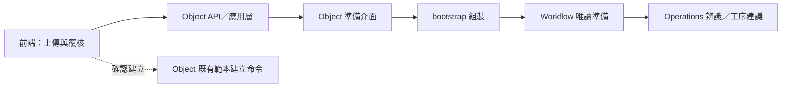

# ObjectTemplate 領域規格

ObjectTemplate 是 Object 領域內的獨立聚合。本庫範本歸屬單一儲存庫，個人範本歸屬持有人。套用範本時，應用層依確認的節點建立獨立的 Object 樹。

## 現行操作與權限

<a id="操作與權限"></a>

| 操作       | 已實作的行為                                                                                                             |
| ---------- | ------------------------------------------------------------------------------------------------------------------------ |
| 準備草稿   | 登入者可從文件或施工條件取得可編修的個人範本草稿。這一步只回傳草稿，使用者確認儲存後才建立範本。                         |
| 建立與查詢 | 個人範本與本庫範本皆從 v1 開始。持有人可列出自己的範本，儲存庫成員可列出及讀取本庫範本。                                 |
| 發布新版   | 個人範本持有人可提交同一範本 ID 和起始版本，發布下一版。起始版本過期時回傳 `409 version_conflict`。本庫範本目前只有 v1。 |
| 套用範本   | 本庫範本限同庫套用。個人範本持有人可將目前版本套用到有建立權限的目標庫。後端一次建立整棵樹，物件保留建立時的來源版本。   |

操作者取自已驗證的 Session 或 Bearer 憑證。列表每頁最多 20 筆，游標綁定操作者與查詢範圍。新的個人範本套用請求省略版本時預設為 v1，選到過期版本須重新選取。已成功的請求以原鍵及原內容重送時，即使範本已改版，仍回傳原結果。套用成功會回傳根物件 ID、所有新物件 ID 與父子關係。

公開路徑、請求欄位與錯誤回應見 [Object OpenAPI 契約](../../../api/contract/object/objects.yaml)。尚未實作的範圍見[後續範圍](#後續範圍)。

## 我的範本

側邊欄選取個人範本後，按「編輯範本」可接續修改名稱、單位與階層。例如，編輯 v1 後按「儲存為 v2」，請求會帶入原範本的 `templateId` 和 `baseVersion: 1`。儲存時交易核對持有人與起始版本，封存上一版並更新範本。若版本已更新，使用者須返回範本庫重新載入。已建立的物件保留原版本來源。

個人範本保存完整工項名稱與多層父子關係。數量一律留空，單位可選填。只有持有人可讀取及使用個人範本。

獨立工具使用 `GET /api/v1/object-templates` 與 `POST /api/v1/object-templates`，Actor 由 Session／Bearer 取得，沿用個人範本的保存與防重規則；未登入拒絕存取。套用仍使用既有目標庫 instances API，後端核驗目標權限。未知結果重試固定原目標、內容與識別碼。頁面重用既有 shadcn 元件與 Templates 面板，登入身分變更時清除舊狀態。

### 建立個人範本

使用者可從空白開始，或從估價單、計價單、合約建立草稿。從文件建立時，先確認將原檔傳送至 OpenAI，再把辨識結果帶入同一個編輯表單。文件檔名預填為可修改的範本與根節點名稱，分類標題形成父節點。使用者核對完整工項名稱、父子關係與單位。文件的數量只供覆核，即使能確定同列欄位也不寫入範本。遇到多個數量欄位或分類不明時，標示待確認。超過既有名稱或節點樹限制時保留草稿並指出需修正的位置。

### 文件與工序草稿接線

現行實作；模型辨識與推導品質仍待代表性原件及工法案例驗收。

登入使用者呼叫 `POST /api/v1/object-template-drafts`，選擇文件辨識或提供單一工項與施工條件。這是個人範本的唯讀準備操作，不要求儲存庫，也不授予任何儲存庫寫入權。Object 應用層驗證輸入，透過自己定義的準備介面，由 bootstrap 組裝 Workflow 的同步準備步驟與 Operations 模型適配器。Object 不 import Workflow、Agent 或模型 SDK。

分類合併、節點 ID、父子結構及範本限制由 Object 後端處理。草稿不帶數量；文件數量留在候選供核對。超出正式範本限制時回傳可編修草稿與警告，確認建立時仍重新驗證。前端只提交來源、顯示候選、編修草稿與確認建立，沿用既有建立 API 與防重鍵。

工序推導為一次有界模型操作，不呼叫工具、不查未授權知識、不寫入正式資料。推導說明不是文件引文；畫面區分原文與推導說明，提醒核對工法、順序與條件。節點排序只表達建議顯示順序，不構成可執行的前置依賴。Agent 動態補查、Knowledge 規範檢索及跨請求 Workflow 恢復不在此同步切片內。

現行實作的呼叫方向；虛線為使用者確認後的獨立命令。



實作入口見[草稿應用層](../../../backend/internal/business/object/application/drafts.go)、[組裝](../../../backend/internal/bootstrap/template_drafts.go)、[前端入口](../../../frontend/miniapp/src/business/object/TemplatePreparation.tsx)。驗收涵蓋未登入及無效輸入不呼叫模型、辨識不寫入、分類與同名工項保留、數量排除、推導失敗可重試，以及使用者確認前不建立範本。

### 使用範本與建立物件

1. 從側邊欄「工具 → 物件範本」開啟獨立頁面，瀏覽、從空白或文件建立個人範本，也可由單一工項推導工序，不需先選儲存庫。範本操作目前集中在側邊欄工具；儲存庫的「物件」分頁只呈現物件操作。
2. 選擇「使用範本」後，獨立工具才載入可存取的目標儲存庫供選擇，並在同一面板開啟可編輯的「本次建立清單」。使用者可改名、填寫數量、調整單位或移除不適用的工序。移除父工序前顯示會一併移除的子工序，並允許復原。本次調整只用於這次建立。
3. 按「建立 N 個物件」才送出確認後的樹，數字包含實際會建立的根物件。後端核對範本持有人與目標 Repository 的建立權限，驗證最終樹並原子寫入。若結果未知，以同一個重試鍵及同一份請求重試，已成功時回傳原建立結果。

編輯本次清單時，保留節點沿用原父子關係。前端沿用同一面板及既有表單元件。填寫、移除、復原與計數在本機草稿內完成，按確認才提交。

### Firestore 讀寫與重試

- 個人範本按持有人範圍查詢，每個版本用一份文件保存整棵樹。首版沿用分頁，不另寫摘要或逐節點文件。
- 確認建立前核對登入身分與目標庫存取權。交易內重新核對目標庫和防重收據。新請求只讀一次來源範本版本，核對所有權、保留節點、父子關係與確認值。有指定外部父物件時，同交易核對它屬於目標庫。
- 收據按目標庫、操作者和重試鍵隔離。請求指紋涵蓋來源範本 ID、版本、選填父物件與正規化後的本次清單。相同鍵與相同內容回傳原結果，相同鍵但內容不同回傳 `idempotency_conflict`。回放由收據提供結果，無須逐一讀回 Object，仍須核對套用權限。
- 新請求在同一交易寫入 N 個保留節點與一份收據。交易失敗不留下部分樹。個人範本的收據命中時不重讀來源範本。驗收區分單次交易嘗試的文件操作、授權查詢與交易重試。以 emulator 驗證交易及重送行為，帳單成本另行量測。

### 驗收

- 以「XX 電力系統」驗證多層工序。甲案移除接地測試、填入線材用量後建立，讀回的名稱、數量、單位與階層須符合最後確認的清單。乙案仍從包含接地測試、數量留空的原範本開始。
- 從文件建立時，核對跨行工項與不同分類下的同名工項。名稱裡的「6組」不能取代同列的「12 式」。儲存後確認數量留空。取消或辨識失敗時不得建立範本或物件。
- 其他使用者不得讀取或使用該個人範本。持有人無權在目標庫建立時不得寫入。確認前零物件寫入，成功請求重試不得建立第二棵樹。

## 輸入與領域規則

- 範本名稱最多120字。節點 ID 在版本內唯一，為1至64字的英數、底線或連字號。每版只有一個根節點，其餘父節點必須存在，所有節點都可從根抵達，禁止循環。節點清單順序保留在版本與套用結果中；一般 Object 列表仍沿用既有排序。
- 正式範本每棵樹最多 100 個節點，正規化後的建立內容 JSON 最多 48,000 UTF-8 bytes。建立與改版的 HTTP 本體上限為 64 KiB。文件草稿請求另有上傳大小限制。限制確保快照、收據與整棵樹能在單次交易內處理。
- 節點保存名稱，可帶說明、類型與單位。本庫範本可保存預設數量，個人範本在套用時才填寫本次數量。應用層沿用 Object 的精確數量驗證。帶數量的施作需有單位，建立時完成數為 0。範本不保存實際完成數、施工日誌或驗收結果。
- 選填的父 Object 必須屬於目標儲存庫。套用時重新配置所有 ID 與父連結，根連至選填父節點；未提供即建立新根。
- 每個 Object 保存不可修改的 `templateId`、`templateVersion`、`templateNodeId`。後續修改進度或內容保留來源，不會改動範本或另一棵實例樹。

## 一致性、重送與失敗

建立或改版的收據屬於範本所在的個人或本庫範圍，套用收據屬於目標儲存庫。各自以操作者及 `Idempotency-Key` 識別請求。相同鍵與正規化內容重送回原結果，內容不同回409 `idempotency_conflict`。套用收據包含原始節點 ID、名稱與父連結；結果回放代表建立時狀態，目前內容由既有 Object 讀取 API 取得。

Firestore adapter 在交易內重新檢查 Repository 的有效容器、範本快照及選填父節點，全部讀取先於寫入。Object 文件與套用收據一起提交；任何錯誤均不留下部分 Object 或成功收據。Repository 成員判定沿用目前服務的交易前存取查詢，未新增另一套授權機制。操作不呼叫 LINE，也沒有雲端部署副作用。

本庫範本位於 `channels/{channelId}/repositories/{repositoryId}`，個人範本位於同一 channel 的 `personalObjectTemplateLibraries/{ownerKey}`。`objectTemplates` 保存目前快照，個人範本改版時將上一版封存至該範本之下。`objectTemplateCreationReceipts` 與來源範本同庫，`objectTemplateInstanceReceipts` 和實際建立的 `objects` 位於目標儲存庫。未提供來源欄位的既有 Object 維持可讀，不搬移舊 `subobjects`。

錯誤包括400 `invalid_input`、404 `not_found`、409 `idempotency_conflict`／`version_conflict`，以及結果未確認時的503 `unavailable`。拒絕發生在寫入前或交易中；未知結果須保留原鍵與原內容重送，不能依掃描物件列表猜測成功與否。

## 分層與入口

| 層級      | 責任與位置                                                                                                                                                                                                          |
| --------- | ------------------------------------------------------------------------------------------------------------------------------------------------------------------------------------------------------------------- |
| 前端      | [Templates.tsx](../../../frontend/miniapp/src/business/object/Templates.tsx) 收集名稱、節點名稱與父節點，選用並送出一次套用請求；未知結果凍結輸入、重試沿用原請求。                                                 |
| API       | [契約](../../../api/contract/object/objects.yaml) 生成 Go／TypeScript 型別；[HTTP adapter](../../../backend/internal/business/object/adapter/http/templates.go) 映射格式與可信 Actor。                              |
| 應用層    | [templates.go](../../../backend/internal/business/object/application/templates.go) 驗證權限與輸入、準備 Object 建立內容，依[儲存介面](../../../backend/internal/business/object/application/port/template.go)寫入。 |
| 領域      | [template/version.go](../../../backend/internal/business/object/domain/template/version.go) 驗證單根樹與不可變版本，不匯入 Object 實體或基礎設施。                                                                  |
| Firestore | [templates.go](../../../backend/internal/business/object/adapter/firestore/templates.go) 實作快照、分頁、交易及收據。                                                                                               |
| 組裝      | [repository.go](../../../backend/internal/bootstrap/repository.go) 注入既有 Repository 服務及 Object store，不由 HTTP adapter 建立資料庫 client。                                                                   |

## 驗證與限制

草稿端點的回應與錯誤案例見 [HTTP 草稿測試](../../../backend/internal/business/object/adapter/http/drafts_test.go)。個人範本發布 v2、版本衝突與重送的案例見 [Firestore 改版測試](../../../backend/internal/business/object/adapter/firestore/templates_test.go)。

[應用層測試](../../../backend/internal/business/object/application/templates_test.go)、[HTTP 測試](../../../backend/internal/business/object/adapter/http/templates_test.go)、[Firestore 交易測試](../../../backend/internal/business/object/adapter/firestore/templates_test.go)與[前端互動測試](../../../frontend/miniapp/tests/object-templates.test.tsx)涵蓋最小閉環、拒絕、重送及結果開啟。

```bash
bash scripts/tooling/tool-exec.sh pnpm api:check
bash scripts/tooling/tool-exec.sh pnpm --filter @repo/miniapp check
bash scripts/tooling/tool-exec.sh pnpm --filter @repo/miniapp test
bash scripts/tooling/tool-exec.sh --tool go bash -c 'cd backend && go test -race ./internal/business/object/... ./internal/architecture'
```

交易實測另需啟動本機 Firestore 模擬器，並設定 `FIRESTORE_EMULATOR_HOST` 為 loopback 位址。gcloud 592 的模擬器需要 Java 25+，系統 Java 21 無法執行；本次使用環境已有的 Java 25 執行，未更改專案工具版本。隔離測試各自建立隨機測試專案，不使用 ADC 或正式資料。

實測案例：同一範本套用兩次得到獨立樹；多個相同請求併發只建立一棵；修改一棵的完成數不改另一棵；回應遺失重送仍回原結果；第二筆已緩衝寫入前發生驗證錯誤時整筆回滾。未進行正式環境、LINE 裝置或實體瀏覽器驗收。

Firestore 交易順序依 [Google 官方文件](https://docs.cloud.google.com/firestore/native/docs/manage-data/transactions) 與本專案 `cloud.google.com/go/firestore v1.29.2` 的 `RunTransaction` 實作核對。Context7 本次達配額，未取得該服務的新查證結果。Graphify 用於入口探索，Repomix 打包 Object 與接線範圍，公開契約及文件另以原文核對。

## 後續範圍

跨請求保存與恢復未發布草稿、發布審核、本庫範本改版、範本退役、本庫範本跨庫共用及舊 `subobjects` 資料遷移尚未實作。
