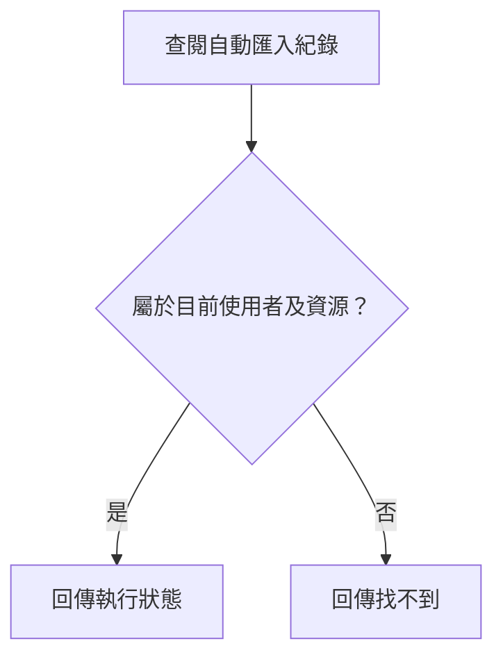

# 工項匯入

**已有實作** · [設計規格](design.md) · [核心流程](#decision-flow) · [代表測試](../../../backend/internal/business/objectimport/adapter/firestore/automatic_test.go) · [程式目錄](../../../backend/internal/business/objectimport/README.md) · [維護指引](../../../backend/internal/business/objectimport/AGENTS.md)

## 領域設計

**子域定位**　工程資料導入的支援候選。

**通用語言**　解析結果是候選項目；匯入執行紀錄追蹤一次操作，建立者決定該紀錄對誰可見。

**上下文與契約**　解析器提供候選資料，ObjectImport 協調匯入；Repository 的存取範圍與 Object 的工項規則仍適用。

**驗收案例**　以其他使用者的身分操作已有的自動匯入紀錄時，回傳找不到，避免揭露該筆紀錄是否存在。

[對照實作或測試](../../../backend/internal/business/objectimport/adapter/firestore/automatic.go) · [戰略設計與分類準則](../../architecture/ddd/README.md)

工項匯入的輸入、解析及執行流程見匯入規格。

[領域設計與操作契約](design.md) · [後端實作入口](../../../backend/internal/business/objectimport/README.md)

## 查閱自動匯入紀錄的判定流程

[入口適配器](../../../backend/internal/business/objectimport/adapter/http/routes.go) · [判定依據](../../../backend/internal/business/objectimport/adapter/firestore/automatic_test.go) · [應用層輸出介面](../../../backend/internal/business/objectimport/application/port/object_import.go) · [相關測試](../../../backend/internal/business/objectimport/adapter/firestore/automatic_test.go)

[適用工作指引](../AGENTS.md) · [上層導覽](../README.md)
