# 物件自動匯入

## 逐項分類匯入

使用者選擇 PDF 即可開始。判斷單位是訂單項次。一個項次代表一筆物件，數量沿用原單位。逐筆分類的建議判準是此項是否包含需追蹤完成量的施作；業務驗收應以實際訂單確認此判準。

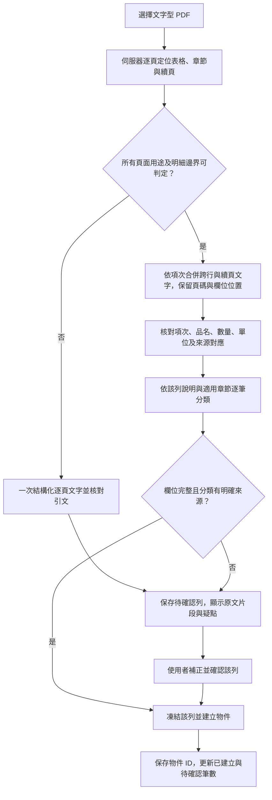

**資料邊界。** 原 PDF 由瀏覽器送至伺服器，伺服器使用 Poppler 擷取文字與座標，不歸檔原 PDF。表格重建、跨頁接續與分類由應用程式負責。表格可辨識時，送往模型的內容限於有來源編號的明細。後端先核對每個擷取項次都有一筆對應候選，再核對分類引用是否來自該項次在指定頁的原文；單靠無法歸屬的章節標題時轉人工確認。表格可辨識時，模型缺列會遭拒絕。

**分類。** 明示「僅供料」可判為非施作；明示「供應並安裝」且需追蹤安裝完成量可判為施作。只寫「燈具 10 盞」時保留待確認。列文與章節衝突同樣待確認。待確認是匯入列的狀態，正式物件仍只有兩種類型。畫面顯示來源頁、項次及判斷依據。

**契約與續跑。** 新版建立請求以明確版本區分，移除整批 type。伺服器保存同一作業的候選快照、列 ID、決策與建立結果。確認操作依作業建立者與儲存庫授權，交易內核對列 ID 及凍結類型，重複送出只回原結果。同一分頁可以離開已保存的作業，回到匯入畫面後以原識別碼讀取凍結候選並續跑。已保存候選的作業可用 `resume` 續跑，無須附帶原檔；若初次送出結果不明且尚未取得已保存的進度，可重選原檔，以檔案指紋找回識別碼。只有所有列均已對應物件才顯示完成。舊版作業依原版本續跑，保留既有類型與物件 ID。

**目前 PDF 支援。** 支援文字型表格、常見表頭別名，以及能依前頁欄位座標辨識的續頁。數量與單位取自來源座標。分類證據不足或欄位無法核對時，可先補正品名、數量與單位，再確認類型。無法可靠定位表格時，仍可將擷取出的逐頁文字交由 OpenAI 一次產生候選。此路徑可能送出價格與條款，畫面在選檔前揭露。後端逐列核對引文，全部保留待確認。此路徑無法獨立判斷是否漏列，確認前須與原件比對。完全無法擷取文字的掃描檔會被拒絕。

**驗收。** 同一份訂單含僅供料、含安裝、用途不明三列，首次結果為已建立兩筆、待確認一筆；補正第三列後共三筆。另驗證跨頁延續不重複、無法判讀續頁時零寫入、模型漏列不完成、確認後斷線重送不重建，以及舊作業續跑。

## 舊版已部署流程與契約紀錄

以下圖表記錄舊版整批分類設計，供維護與相容性對照。新版開發與驗收以上方流程為準。

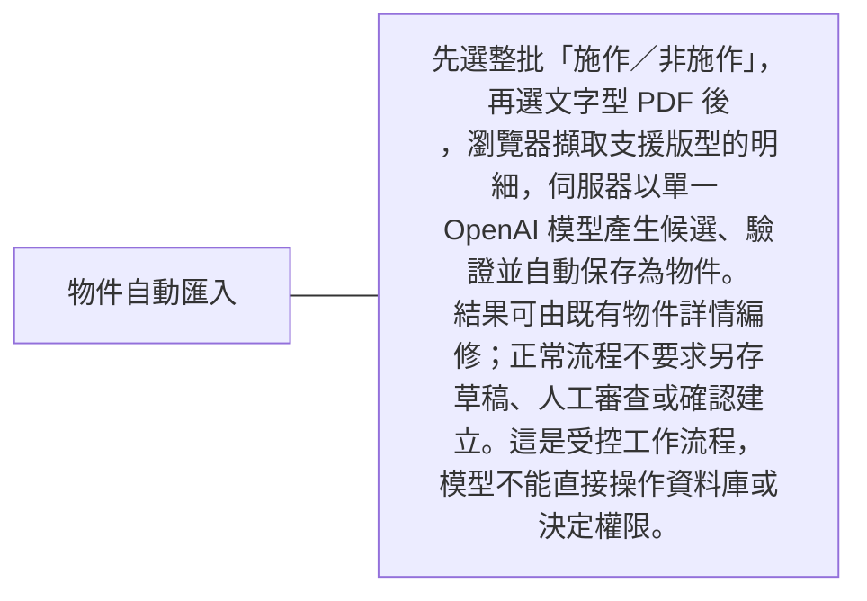

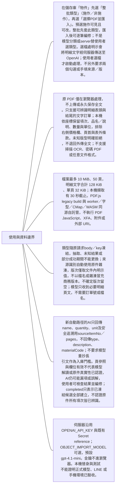

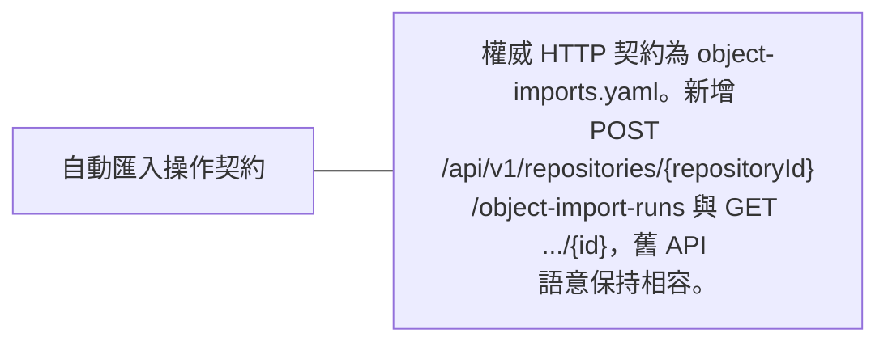

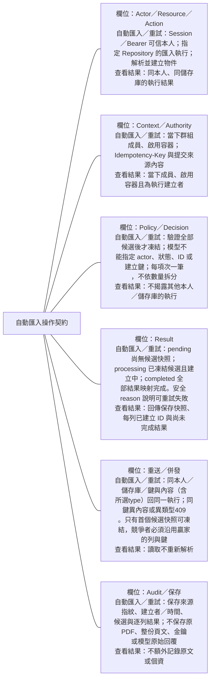

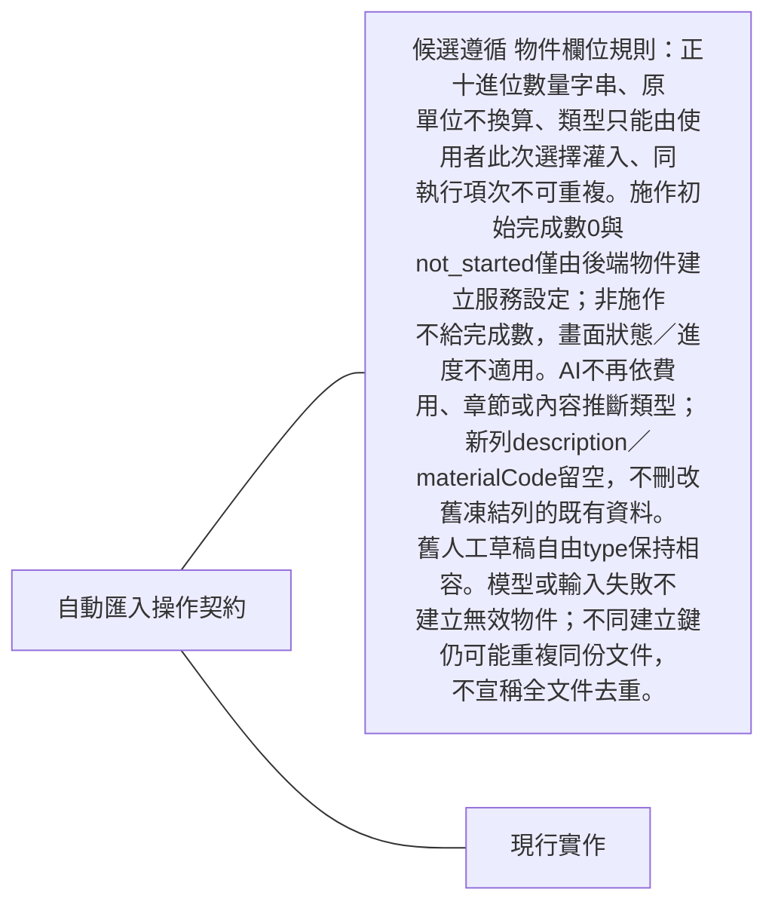

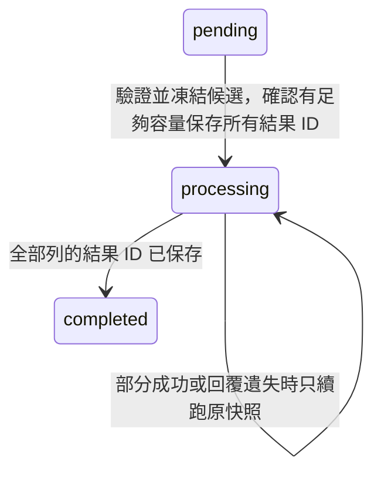

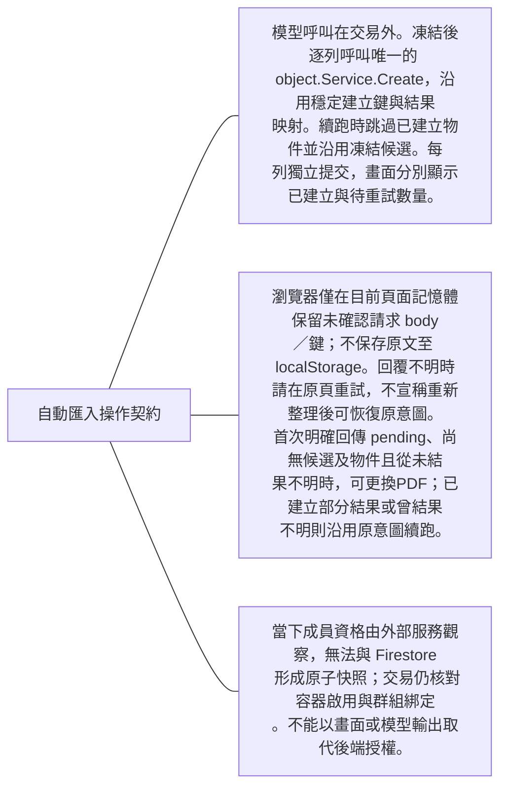

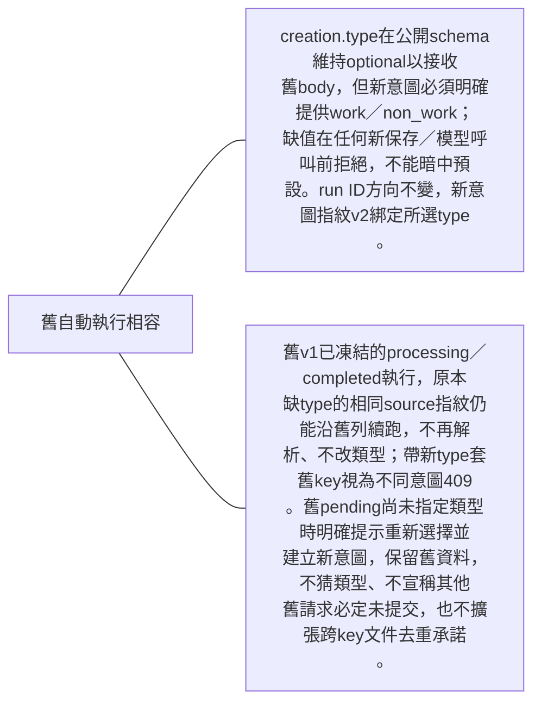

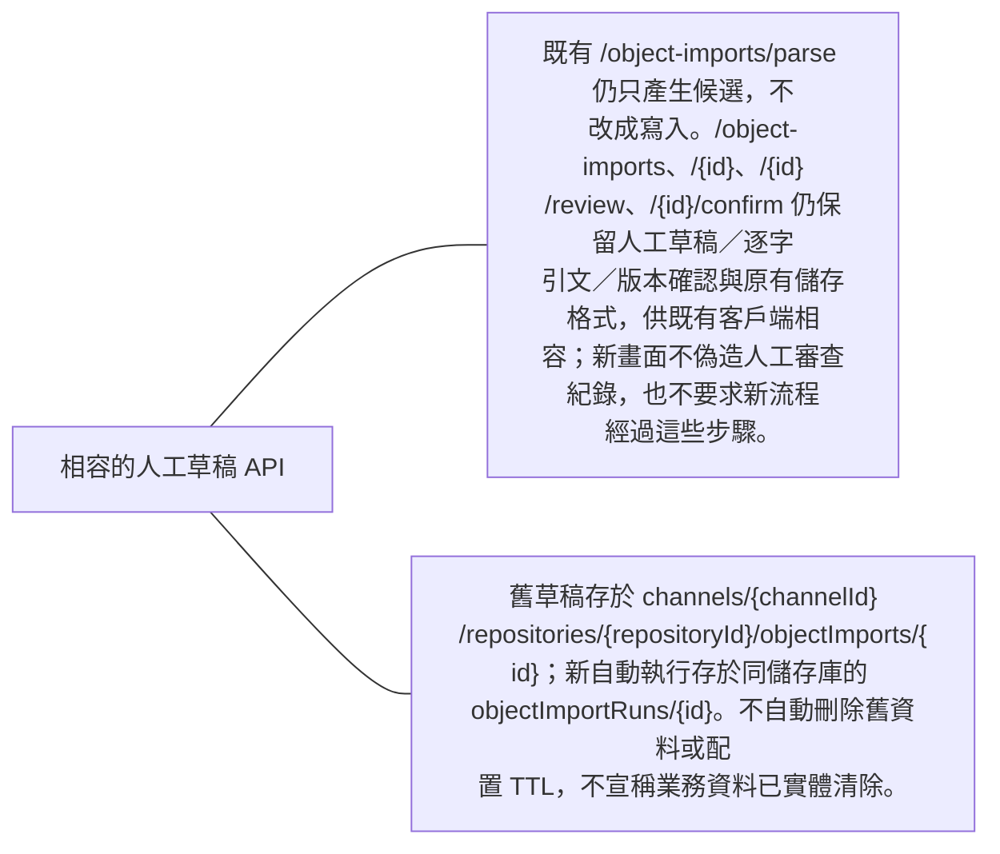

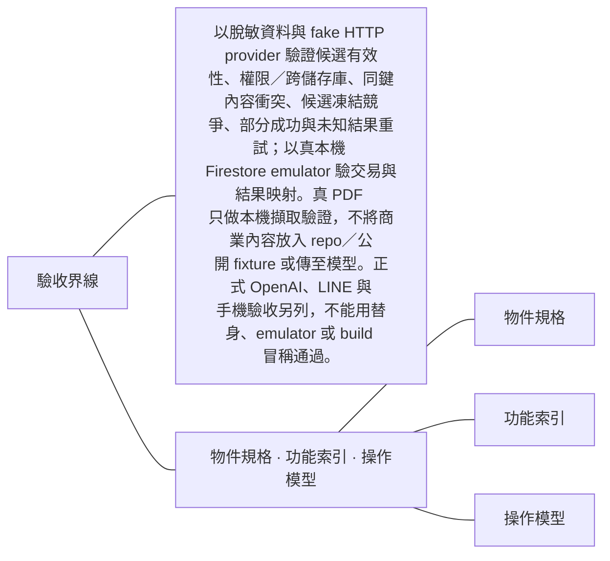

自動匯入作業回傳 `createdCount`、`needsReviewCount` 與 `canReplaceSource`，供畫面呈現進度及更換來源操作。瀏覽器曾遺失回應時仍須沿用原始請求重試。現行 PDF 上傳由伺服器辨識表頭、座標與項次，模型只接收擷取的明細。

## 單一工作表 XLSX 匯入

使用者選擇 Excel 時，整份檔案傳至自動匯入 API（最大 300 KiB）。後端核對身分、儲存庫與檔案雜湊後，讀取唯一工作表及首列欄名。項次、品名、契約數量或數量、單位必須各對應唯一欄位；最多 100 列，不採用明細公式或重複項次。數量取自原始儲存格，保留工作表及 A1 位置。每列等待使用者確認類型，再沿用既有交易與重送規則建立工項。Excel 資料不傳至模型。

## XLSX 原檔留存與授權重讀

`OBJECT_IMPORT_SOURCE_BUCKET` 留空時，Excel 仍可匯入，不另存原檔。設定 bucket 後，objectimport 在核驗權限、檔案雜湊與執行意圖後，以僅限新物件的條件保存原始 XLSX；Firestore 的匯入紀錄保存建立者、來源雜湊與已採納的儲存格位置。物件名稱依渠道、儲存庫、使用者的雜湊及檔案 SHA-256 組成。PDF 原檔由伺服器擷取，不使用 XLSX 原檔留存。

重讀時需提供 actor、repository、run ID、既有候選的儲存格位置；服務重新核對匯入歸屬、檔案雜湊及項次，只回傳該格數量。Agent 不取得 bucket client 或下載網址。保留期限由 bucket lifecycle 管理；啟用前部署方需設定期限並告知使用者。這次沒有設定正式 bucket、IAM 或生命週期。

## UTF-8 文字表格

CSV、TSV、Tab 分欄 TXT 與 Markdown 單一表格使用與 XLSX 相同的欄名、數量與項次驗證。每個檔案上限 300 KiB、100 筆，記錄來源起始行號（例如 L4）。CSV 支援引號、引號內的分隔符與換行；Markdown 需有表頭分隔列，不接受跳脫直線或表格外段落。後端只擷取具名欄位，不呼叫模型或留存原始文字檔，需確認類型後才建立工項。
