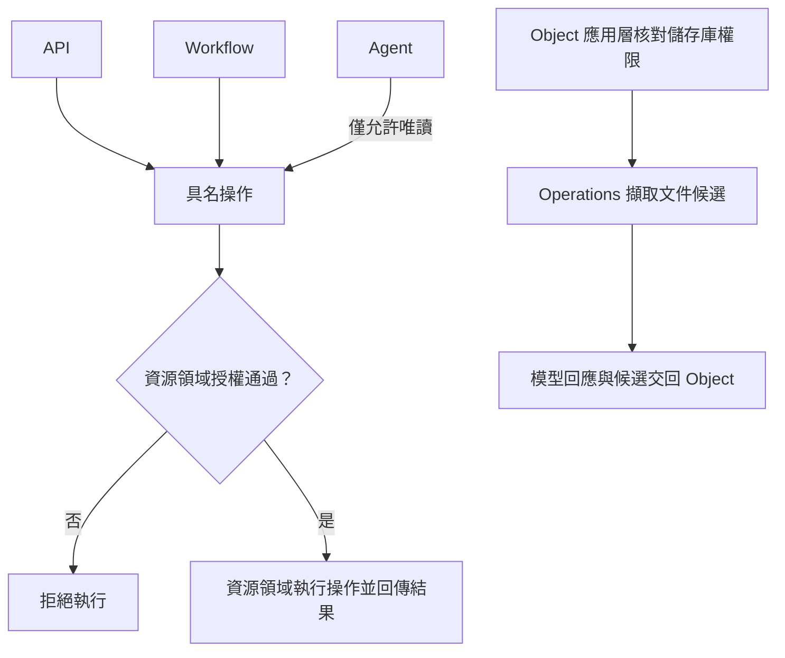

# Business operations 設計

**狀態：PDF 辨識已實作；通用操作模型為提案** · [操作與授權流程](#design-diagram) · [跨領域驗收](../../proposals/domain-collaboration.md) · [模組規則](../../../backend/AGENTS.md)

通用具型別操作委派給擁有規則的領域，現仍為提案。[PDF 擷取](../../../backend/internal/business/operations/adapter/http/poppler_test.go)已實作。Cloud Run 部署與復原由[維運文件](../../operations/cloud-run.md)維護。

[Domain guidance](../../AGENTS.md)

## Operations 領域設計

以下通用操作模型為提案。目錄入口見[領域導覽](../../../backend/internal/business/operations/)。

資源領域可以呼叫 Operations 提供的 AI 能力。API 與 [Workflow](../workflow/design.md) 可呼叫具名操作。[Agent](../agent/design.md) 只可呼叫列入允許清單的唯讀操作。寫入由具名業務命令執行，重新核驗當下權限及資源狀態，並回傳正式結果或收據。每個操作定義輸入、結果及副作用，透過介面委派資源領域執行。授權沿用[業務操作模型](../../contracts/business-operations.md)，由資源領域依可信呼叫者及資源範圍判定。

### 查詢與命令契約

依 [Query](../../references/ddd/query.md)、[Command](../../references/ddd/command.md)與[公開契約](../../references/ddd/domain-contract.md)，查詢回傳可見結果且不變更業務狀態。命令由原業務域核驗授權與不變條件，以作用範圍及提交識別碼判定重試。相同識別碼、不同命令內容回報衝突。對外區分拒絕、衝突、暫時不可用及結果未知；Adapter 將供應商錯誤轉成這些契約結果。

### 操作與授權流程圖

未來設計

[跨領域協作與驗收](../../proposals/domain-collaboration.md)

## 後端分層結構

[operations 模組原始碼](../../../backend/internal/business/operations/) · [代表測試](../../../backend/internal/business/operations/adapter/http/poppler_test.go) · [六邊形分層與依賴方向](../../architecture/runtime/backend-boundaries.md#六邊形分層參考)
