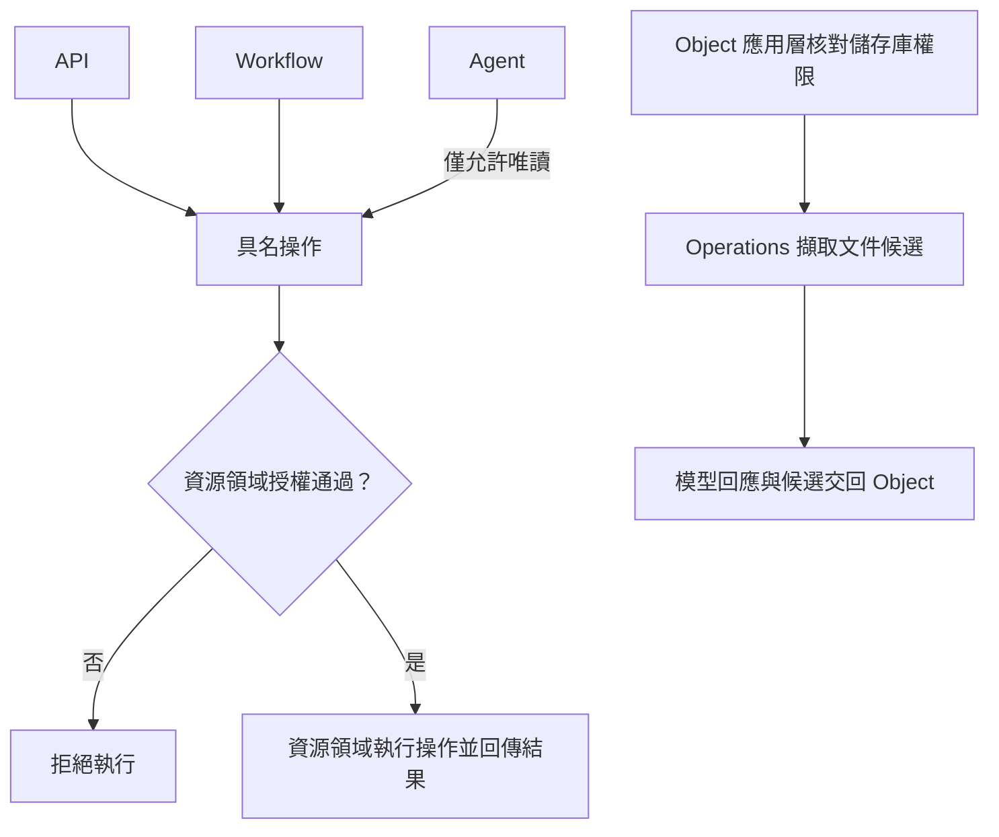

<a id="業務操作能力"></a>

# Business operations 設計

**狀態：PDF 辨識已實作；通用操作模型為提案** · [操作與授權流程](#design-diagram) · [跨領域驗收](../../proposals/domain-collaboration.md) · [模組規則](../../../backend/AGENTS.md)

通用具型別操作委派給擁有規則的領域，現仍為提案。[PDF 擷取](../../../backend/internal/business/operations/adapter/http/poppler_test.go)已實作。Cloud Run 部署與復原由[維運文件](../../operations/cloud-run.md)維護。

[Domain guidance](../../AGENTS.md)

## Operations 領域設計

以下通用操作模型為提案。目錄入口見[領域導覽](../../../backend/internal/business/operations/)。

資源領域可以呼叫 Operations 提供的 AI 能力。API 與 [Workflow](../workflow/design.md) 可呼叫具名操作。[Agent](../agent/design.md) 只可呼叫列入允許清單的唯讀操作。寫入由具名業務命令執行，重新核驗當下權限及資源狀態，並回傳正式結果或收據。每個操作定義輸入、結果及副作用，透過介面委派資源領域執行。授權沿用[業務操作模型](../../contracts/business-operations.md)，由資源領域依可信呼叫者及資源範圍判定。

### 查詢與命令契約

依 [Query](../../references/ddd/query.md)、[Command](../../references/ddd/command.md)與[公開契約](../../references/ddd/domain-contract.md)，查詢回傳可見結果且不變更業務狀態。命令由原業務域核驗授權與不變條件，以作用範圍及提交識別碼判定重試。相同識別碼、不同命令內容回報衝突。對外區分拒絕、衝突、暫時不可用及結果未知；Adapter 將供應商錯誤轉成這些契約結果。

<a id="design-diagram"></a>

### 操作與授權流程圖

未來設計



[跨領域協作與驗收](../../proposals/domain-collaboration.md)

## 後端分層結構

下列為[Business operations 後端模組](../../../backend/internal/business/operations/)的完整檔案樹，包含實作、測試與目錄文件。

**範圍**　此樹列出「文件辨識與工序推導」模組根目錄內的 10 個檔案。檔名以 `_test.go` 結尾的是測試；同名檔案依所在目錄區分職責。

**分層對照**　共通範本中，以下路徑未在此模組根目錄下獨立設置：`domain/entity/`、`domain/valueobject/`、`domain/service/`、`domain/event/`、`domain/policy/`、`application/command/`、`application/query/`、`application/port/`、`application/dto/`、`adapter/line/`、`adapter/firestore/`、`adapter/messaging/`、`adapter/scheduler/`。子功能的分層以樹中實際路徑為準。

```text
backend/internal/business/operations/
├── adapter/                                  # 外部系統轉接
│   ├── http/                                 # HTTP 入口
│   │   ├── poppler.go                        # PDF文字擷取（處理 HTTP 請求與回應）；Register、ExtractPopplerText
│   │   └── poppler_test.go                   # 驗證PDF文字擷取（處理 HTTP 請求與回應）；TestExtractionErrorResponses
│   ├── openai/
│   │   ├── candidates.go                     # 辨識候選；Extractor、ExtractCandidates
│   │   ├── candidates_test.go                # 驗證辨識候選；TestFileResponseContract
│   │   ├── procedures.go                     # 施工工序推導；SuggestProcedures
│   │   └── procedures_test.go                # 驗證施工工序推導；TestProcedureSuggestionsAreBoundedAndUntrusted
│   └── poppler/
│       └── text.go                           # 文字擷取；Extractor、Write
├── application/                              # 應用用例
│   ├── candidates.go                         # 辨識候選；Document、Candidate
│   └── document.go                           # 來源文件；DocumentTextExtractor、DocumentTextService
└── AGENTS.md                                 # 本目錄開發指引
```
