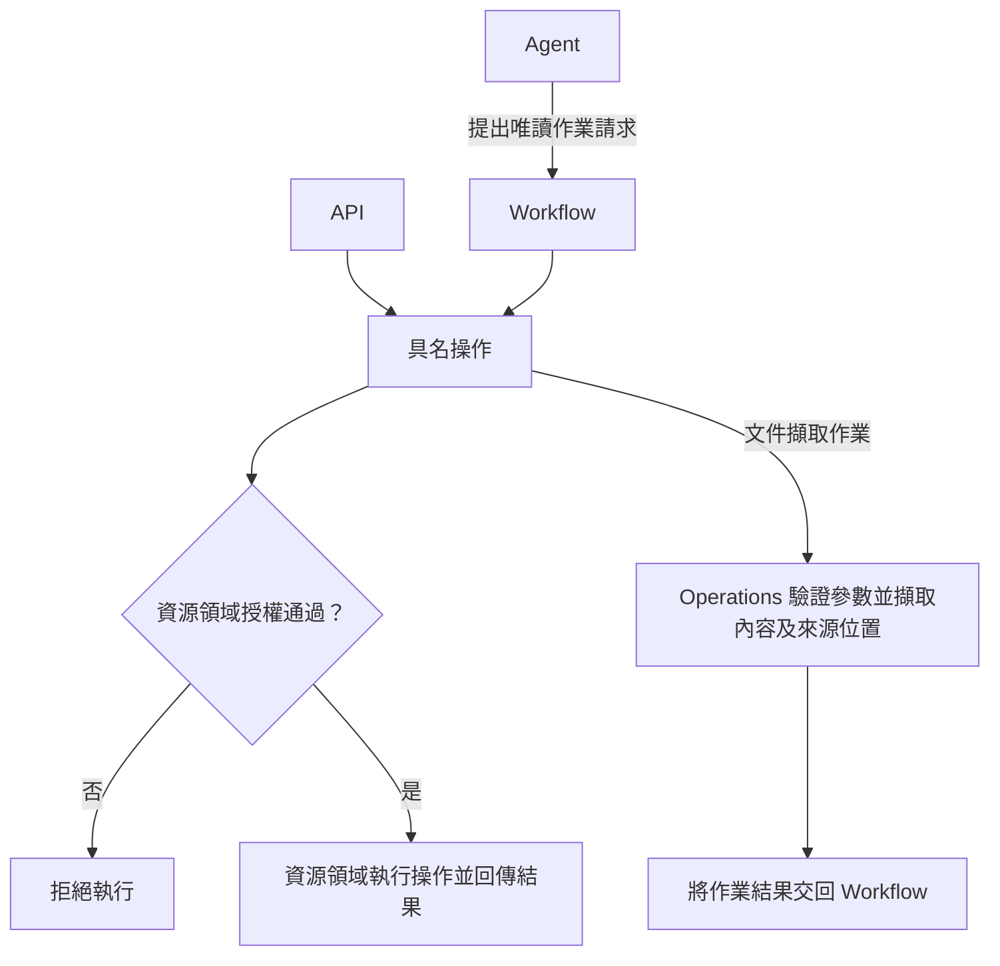

<a id="業務操作能力"></a>

# Business operations 設計

**狀態：PDF 辨識已實作；通用操作模型為提案** · [操作與授權流程](#design-diagram) · [跨領域驗收](../../proposals/domain-collaboration.md) · [模組規則](../../../backend/AGENTS.md)

通用具型別操作委派給擁有規則的領域，現仍為提案。[PDF 擷取](../../../backend/internal/business/operations/adapter/http/poppler_test.go)已實作。Cloud Run 部署與復原由[維運文件](../../operations/cloud-run.md)維護。

[Domain guidance](../../AGENTS.md)

## 核心契約

負責作業執行與結果管理。

- 作業定義（Operation）
- 工具註冊（Tool Registry）
- 參數驗證（Validation）
- 作業執行（Execution）
- 執行授權檢查（Authorization）
- 冪等控制（Idempotency）
- 執行結果（Result）
- 執行紀錄（Execution Log）
- 作業取消與逾時控制

**輸出**為實際作業結果與執行事件。

## Operations 領域設計

以下通用操作模型為提案。目錄入口見[領域導覽](../../../backend/internal/business/operations/)。

資源領域可以呼叫 Operations 提供的 AI 能力。API 與 [Workflow](../workflow/design.md) 可呼叫具名操作。[Agent](../agent/design.md) 在文件流程中只提出允許清單內的唯讀作業請求，由 Workflow 決定是否交付 Operations。寫入由具名業務命令執行，重新核驗當下權限及資源狀態，並回傳正式結果或收據。每個操作定義輸入、結果及副作用，透過介面委派資源領域執行。授權沿用[業務操作模型](../../contracts/business-operations.md)，由資源領域依可信呼叫者及資源範圍判定。

### 查詢與命令契約

依 [Query](../../references/ddd/query.md)、[Command](../../references/ddd/command.md)與[公開契約](../../references/ddd/domain-contract.md)，查詢回傳可見結果且不變更業務狀態。命令由原業務域核驗授權與不變條件，以作用範圍及提交識別碼判定重試。相同識別碼、不同命令內容回報衝突。對外區分拒絕、衝突、暫時不可用及結果未知；Adapter 將供應商錯誤轉成這些契約結果。

<a id="design-diagram"></a>

### 操作與授權流程圖

未來設計



[跨領域協作與驗收](../../proposals/domain-collaboration.md)

## 後端分層結構

現行檔案樹；只列出已實作的正式程式碼：

```text
backend/internal/
├── business/operations/
│   ├── application/
│   │   ├── candidates.go       # 文件候選型別、結果與 CandidateExtractor 出站契約
│   │   └── document.go         # PDF 文字擷取用例與 DocumentTextExtractor 出站契約
│   └── adapter/
│       ├── http/poppler.go     # PDF 文字擷取的 HTTP 入站 Adapter
│       ├── openai/
│       │   ├── candidates.go   # OpenAI 文件候選辨識出站 Adapter
│       │   └── procedures.go   # OpenAI 工序建議出站 Adapter
│       └── poppler/text.go     # Poppler PDF 文字擷取出站 Adapter
├── bootstrap/object_preparation.go  # Object 的文件與工序準備接線
└── bootstrap/
    └── repository.go           # 注入 Object 文件候選、範本草稿與工序建議
```

Object 與範本準備使用本領域的 OpenAI Responses Adapter；[共用文字生成套件](../../../backend/internal/platform/textgeneration/)供 Agent 與 Summary 使用，不在 Operations 的文件辨識路徑內。PDF 文字擷取另有 HTTP 入口。現行模組沒有獨立 Domain 層或通用寫入操作 Adapter；上方通用操作模型仍是提案。

[operations 模組原始碼](../../../backend/internal/business/operations/) · [代表測試](../../../backend/internal/business/operations/adapter/http/poppler_test.go) · [六邊形架構參考](../../references/ddd/hexagonal-architecture.md)
