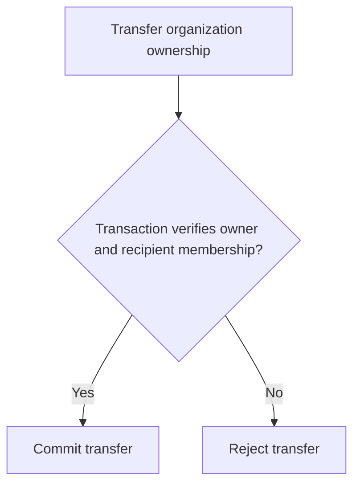

# Organization

**Implemented** · [Design](design.md) · [Core flow](#decision-flow) · [Decision implementation](../../../backend/internal/business/organization/adapter/firestore/store.go) · [Code](../../../backend/internal/business/organization/README.md) · [Guidance](../../../backend/internal/business/organization/AGENTS.md)

## Domain design

**Subdomain classification:** supporting organizational governance candidate.

**Language:** owners initiate transfers; membership determines eligible recipients. Enterprise links/team affiliation have separate rules.

**Context/contracts:** Organization owns transfers; Team owns management scope. Enterprise/team navigation does not combine management permissions.

**Acceptance:** transfer checks current owner/membership in one transaction; nonowners/nonmember recipients cannot transfer.

[Implementation/tests](../../../backend/internal/business/organization/adapter/firestore/store.go) · [Strategic classification criteria](../../references/ddd/README.md)

Entry for target organization ownership, transfer and team affiliation specifications.

[Domain design/operation contracts](design.md) · [Backend entry](../../../backend/internal/business/organization/README.md)

## Organization transfer decision flow

[Entry adapter](../../../backend/internal/business/organization/adapter/http/routes.go) · [Decision rules](../../../backend/internal/business/organization/adapter/firestore/store.go) · [Related tests](../../../backend/internal/business/organization/adapter/firestore/conversation_test.go)

[authorization boundaries across three domains](../../contracts/organization-team-ownership.md#ownership-boundaries)

[applicable guidance](../AGENTS.md) · [parent directory guide](../README.md)
