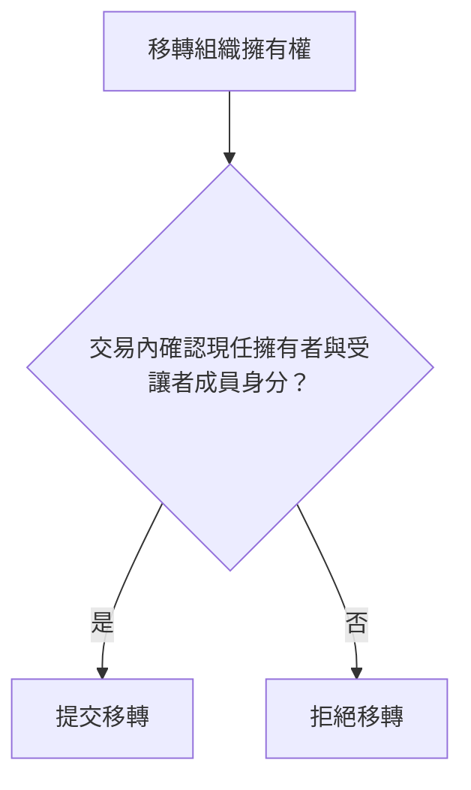

# 組織

**已有實作** · [設計規格](design.md) · [核心流程](#decision-flow) · [判定實作](../../../backend/internal/business/organization/adapter/firestore/store.go) · [程式目錄](../../../backend/internal/business/organization/README.md) · [維護指引](../../../backend/internal/business/organization/AGENTS.md)

## 領域設計

**子域定位**　組織治理的支援候選。

**通用語言**　組織擁有者可發起移轉；成員資格決定誰能成為新擁有者。企業連結與團隊歸屬另有規則。

**上下文與契約**　Organization 決定組織移轉，Team 決定團隊管理範圍。企業與團隊可出現在同一導覽結果，各自的管理權仍需核對。

**驗收案例**　將組織移轉給他人時，在同一交易以目前擁有者與成員資料判斷；非擁有者或非成員受讓者不能完成移轉。

[對照實作或測試](../../../backend/internal/business/organization/adapter/firestore/store.go) · [戰略設計與分類準則](../../references/ddd/README.md)

組織所有權、移轉及團隊歸屬的目標規格集中於此入口。

[領域設計與操作契約](design.md) · [後端實作入口](../../../backend/internal/business/organization/README.md)

## 移轉組織擁有權的判定流程

[入口適配器](../../../backend/internal/business/organization/adapter/http/routes.go) · [判定依據](../../../backend/internal/business/organization/adapter/firestore/store.go) · [相關測試](../../../backend/internal/business/organization/adapter/firestore/conversation_test.go)

[三領域授權邊界](../../contracts/organization-team-ownership.md#ownership-boundaries)

[適用工作指引](../AGENTS.md) · [上層導覽](../README.md)
