# 個人或工程群組擁有的-project

## 專案項目進度

每個 Project item 各自保存待辦、進行中或完成。缺少欄位的既有項目讀為待辦。來源狀態依[問題生命週期](repository/issues.md#issue-lifecycle)、工程物件或巡檢規則讀取。畫面分別標示「本專案進度」與「來源狀態」。更新進度沿用 Project 編輯權、版本檢查與交易；來源讀權仍由來源庫核驗。

驗收時，將同一 Issue 加入維修與稽核兩個 Project。完成維修項目後重新載入兩個看板，只有維修項目顯示完成，稽核項目保留原進度，來源 Issue 仍為開啟。關閉來源 Issue 後，兩個看板的來源狀態都應反映關閉，各自的專案進度保留。

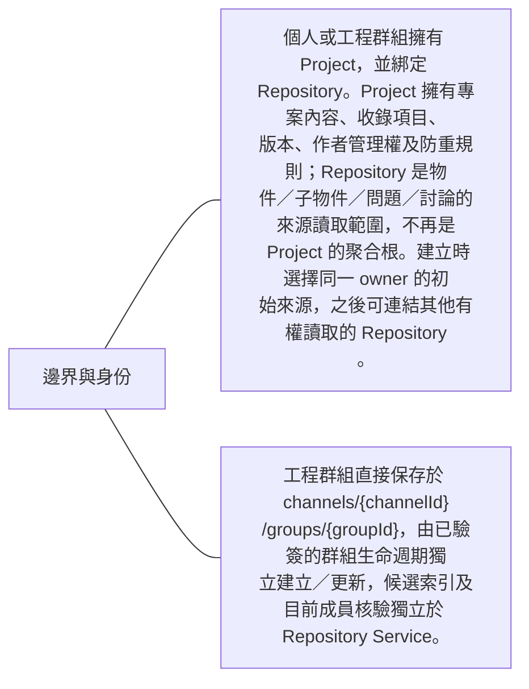

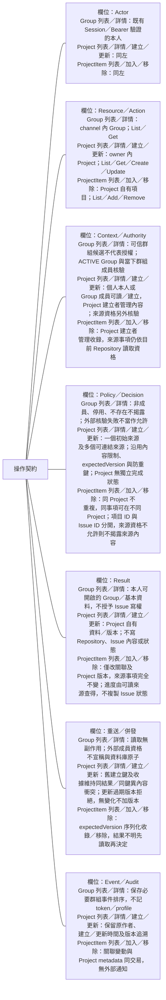

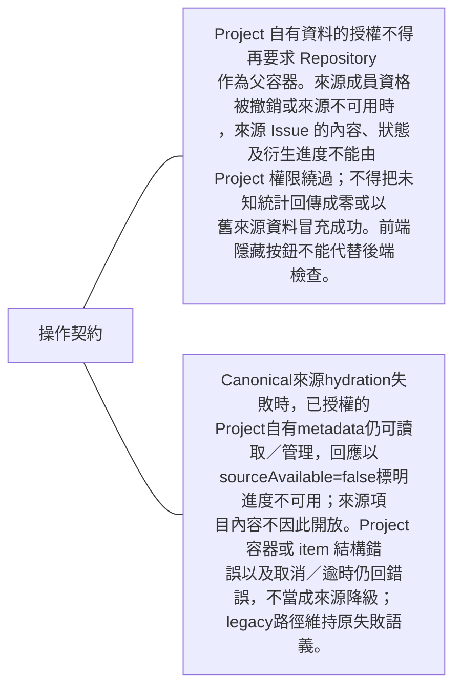

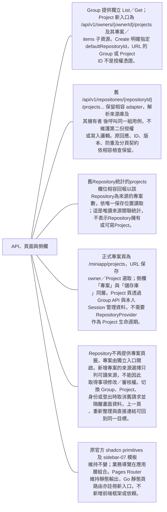

## 最小來源引用骨架

現行實作

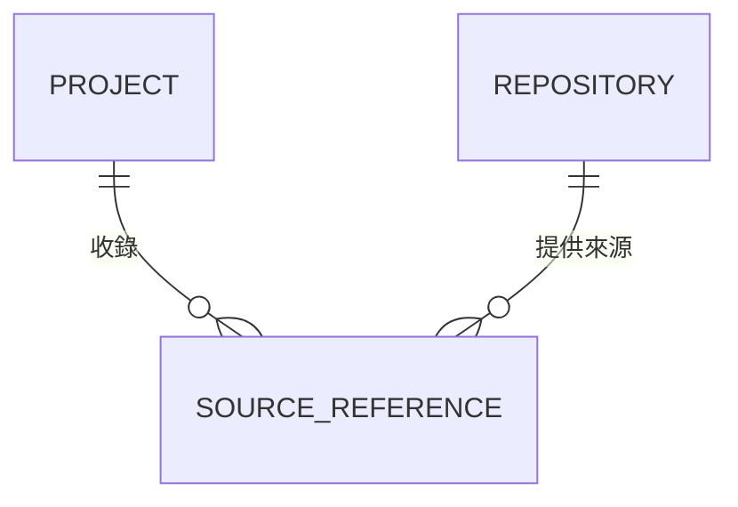

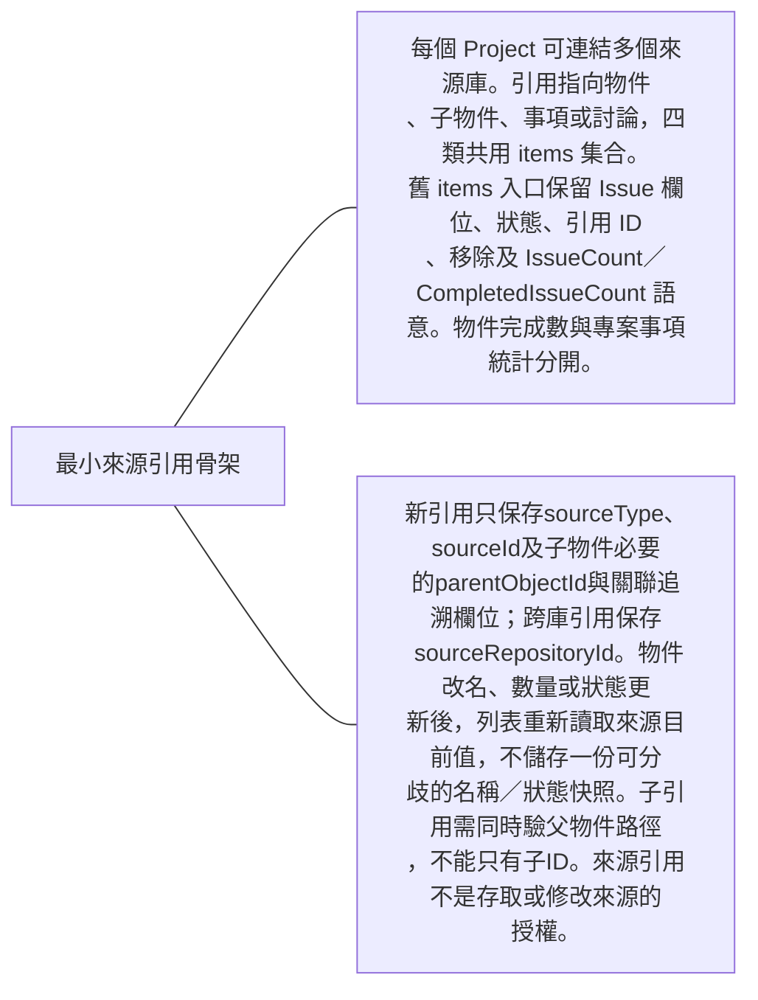

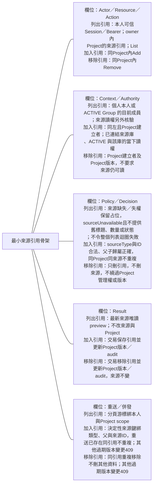

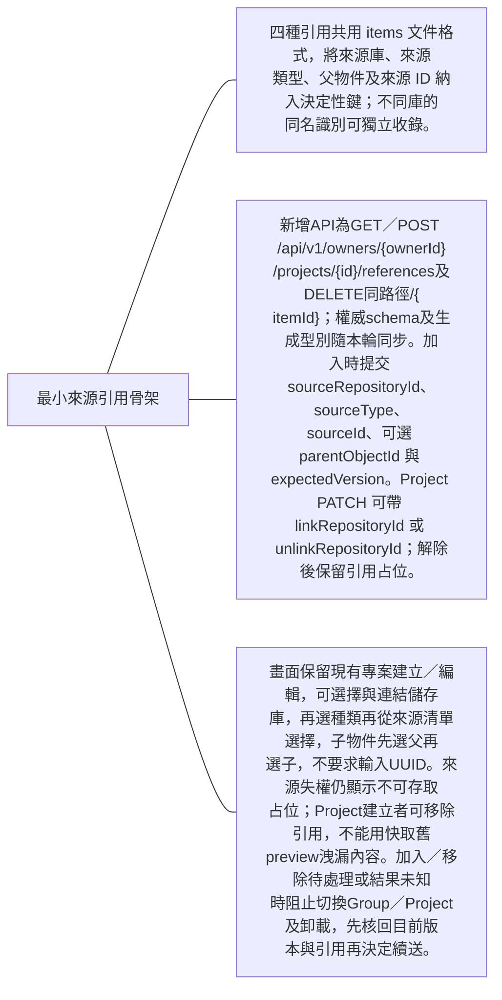

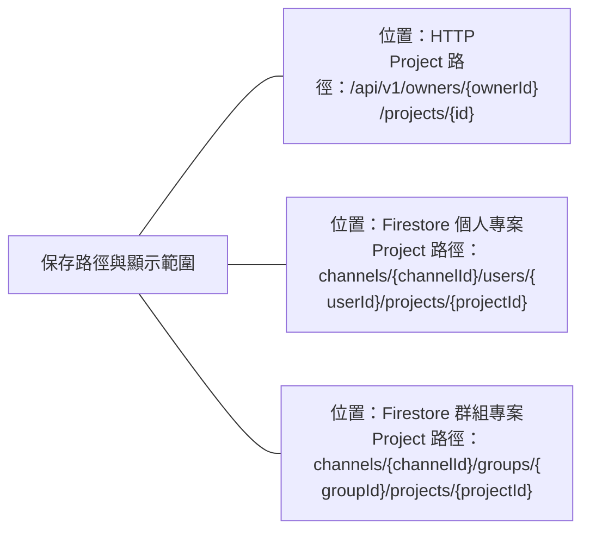

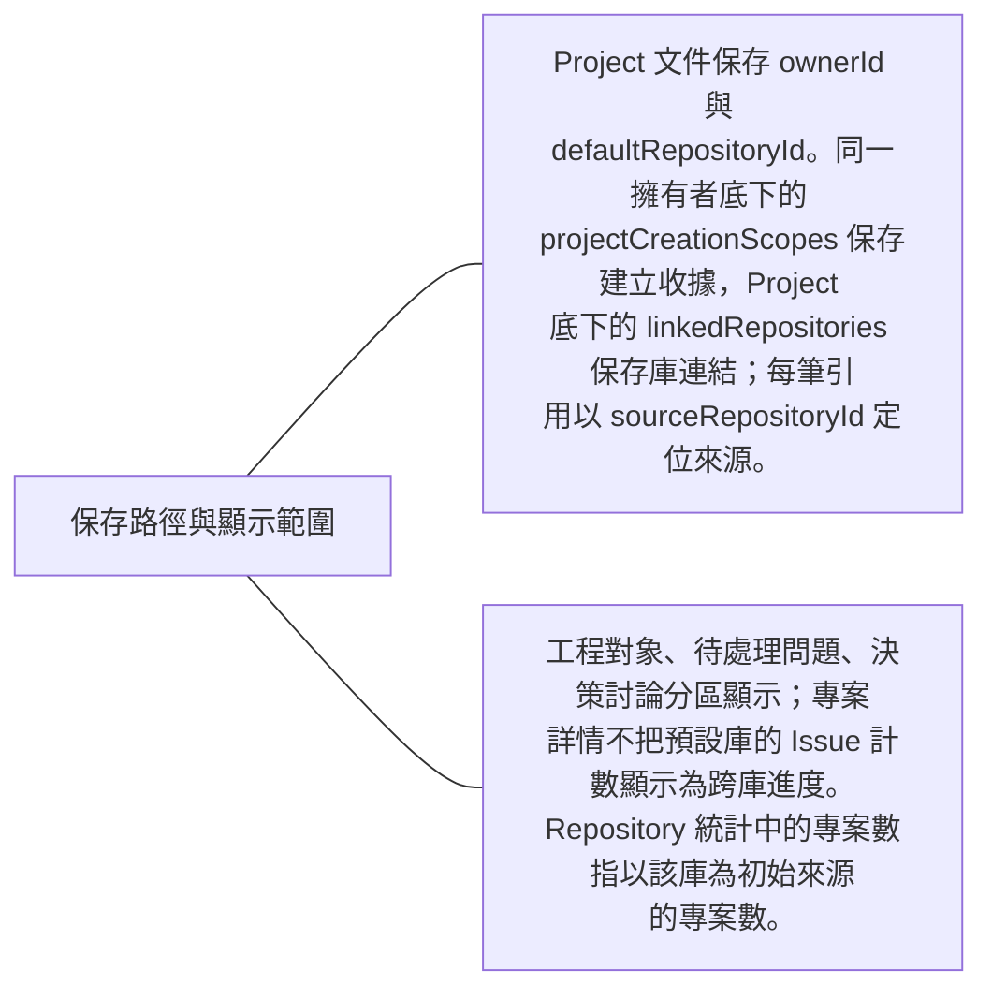

## 工程驗收送件

現行實作

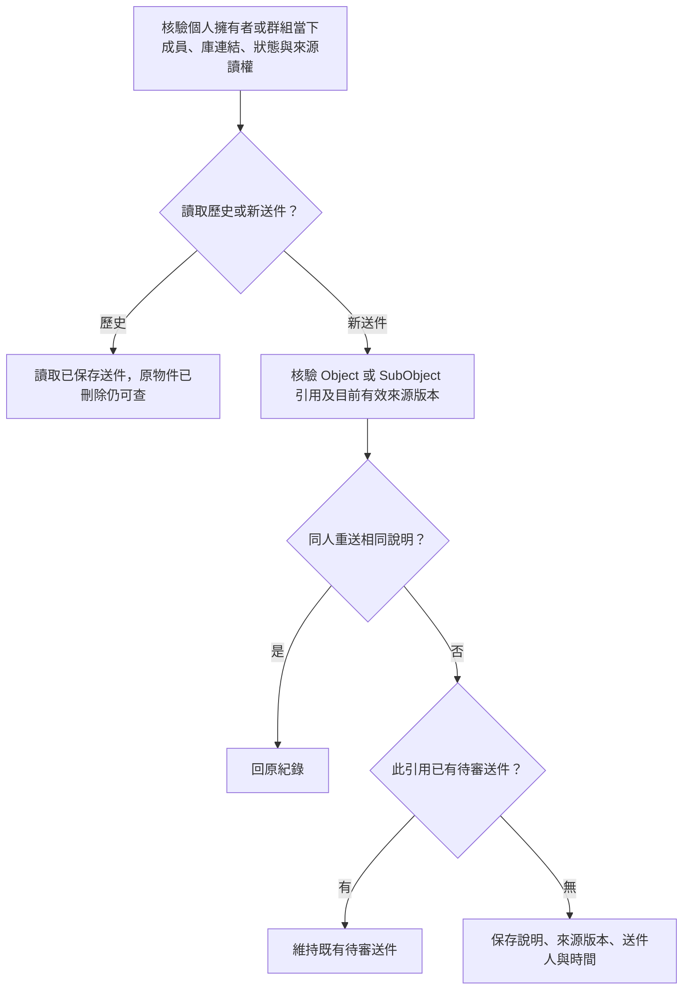

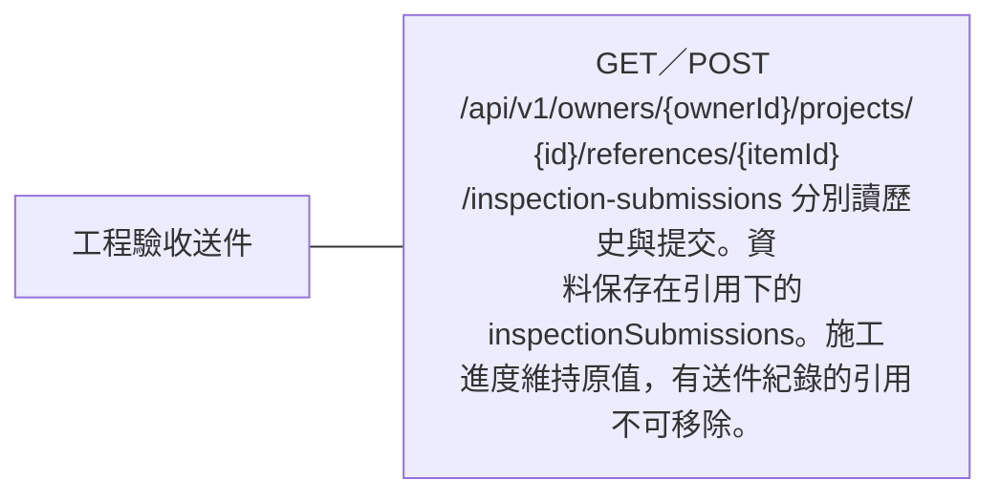
