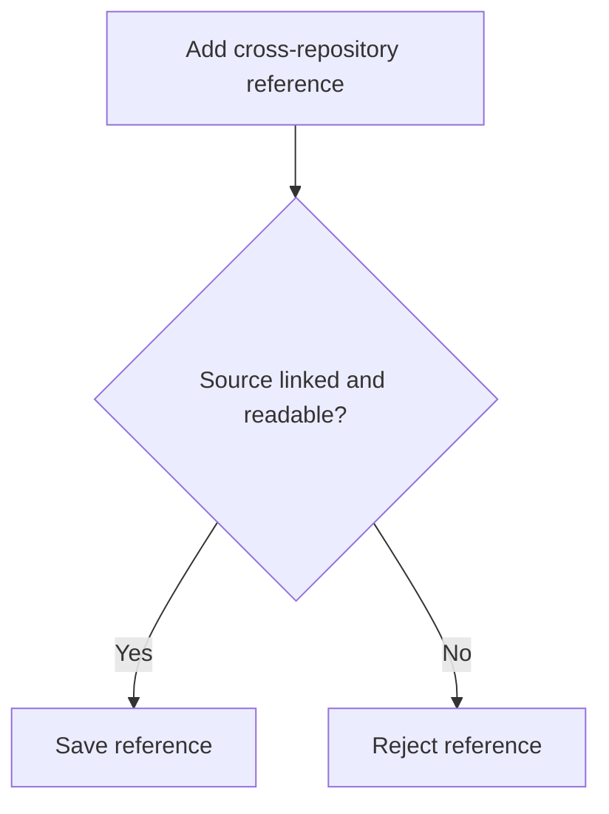

# Project

**Implemented** · [Design](project.md) · [Core flow](#decision-flow) · [Representative tests](../../../backend/internal/business/project/application/reference_source_test.go) · [Code](../../../backend/internal/business/project/README.md) · [Guidance](../../../backend/internal/business/project/AGENTS.md)

[Repository containers, projects and LINE journeys](journey.md)

## Domain design

**Subdomain classification:** core candidate for cross-repository construction collaboration.

**Language:** target Projects belong to users/organizations and can be copied to other Owners. Ownership differs from sources; links identify selectable sources; references identify concrete items.

**Context/contracts:** Project owns links, references/inspections. Source domains such as Repository/Issue own objects and permissions.

**Acceptance:** verify selected sources/links for cross-repository references; Project access grants no other-repository source access.

[Implementation/tests](../../../backend/internal/business/project/application/reference_source_test.go) · [Strategic classification criteria](../../references/ddd/README.md)

Project specifications define references, inspections and access scope.

[Business specification](project.md) · [Backend project implementation](../../../backend/internal/business/project/README.md)

## Cross-repository reference decision flow

[Entry adapter](../../../backend/internal/business/project/adapter/http/routes.go) · [Decision rules](../../../backend/internal/business/project/application/reference_source_test.go) · [Application output port](../../../backend/internal/business/project/application/port/project.go) · [Related tests](../../../backend/internal/business/project/application/reference_source_test.go)

[applicable guidance](../AGENTS.md) · [parent directory guide](../README.md)
