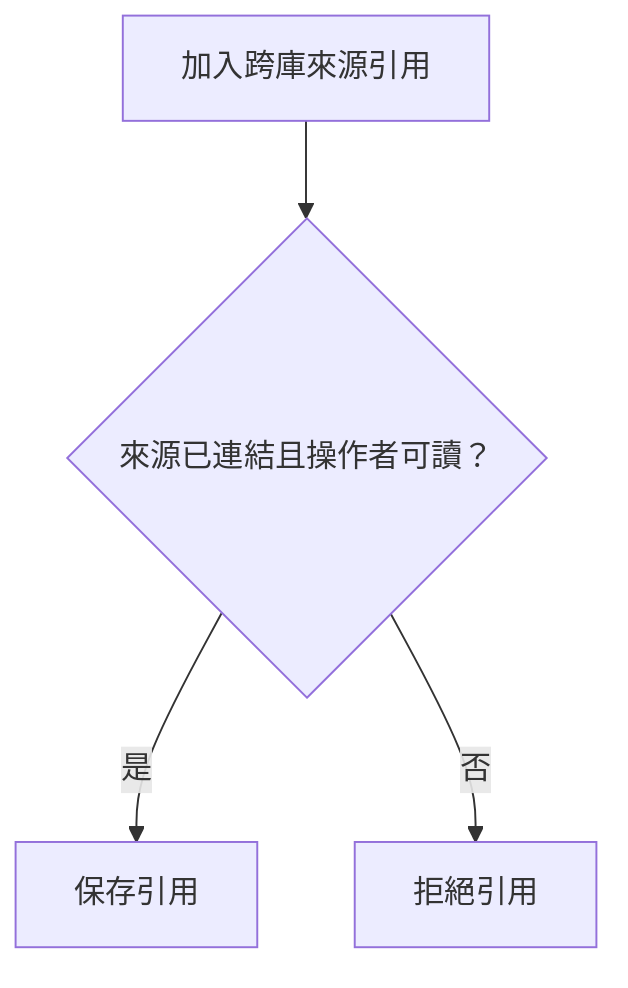

# 專案

**已有實作** · [設計規格](project.md) · [核心流程](#decision-flow) · [代表測試](../../../backend/internal/business/project/application/reference_source_test.go) · [程式目錄](../../../backend/internal/business/project/README.md) · [維護指引](../../../backend/internal/business/project/AGENTS.md)

## 領域設計

**子域定位**　跨庫工程協作的核心候選。

**通用語言**　專案擁有者與引用來源分開識別；連結表示可選來源，來源引用指向具體項目。

**上下文與契約**　Project 管理專案連結、引用與巡檢；Repository、Issue 等來源各自維護其物件與權限。

**驗收案例**　加入跨庫引用時應核對選定來源及其專案連結；持有專案權限不會自動授予其他儲存庫的來源讀權。

[對照實作或測試](../../../backend/internal/business/project/application/reference_source_test.go) · [戰略設計與分類準則](../../architecture/ddd/README.md)

專案規格說明來源引用、巡檢與存取範圍。

[相關業務規格](project.md) · [後端project 實作說明](../../../backend/internal/business/project/README.md)

## 加入跨庫來源引用的判定流程

[操作入口與適配器](../../../backend/internal/business/project/adapter) · [判定依據](../../../backend/internal/business/project/application/reference_source_test.go) · [應用層輸出介面](../../../backend/internal/business/project/application/port/project.go) · [相關測試](../../../backend/internal/business/project/application/reference_source_test.go)

[適用工作指引](../AGENTS.md) · [上層導覽](../README.md)
