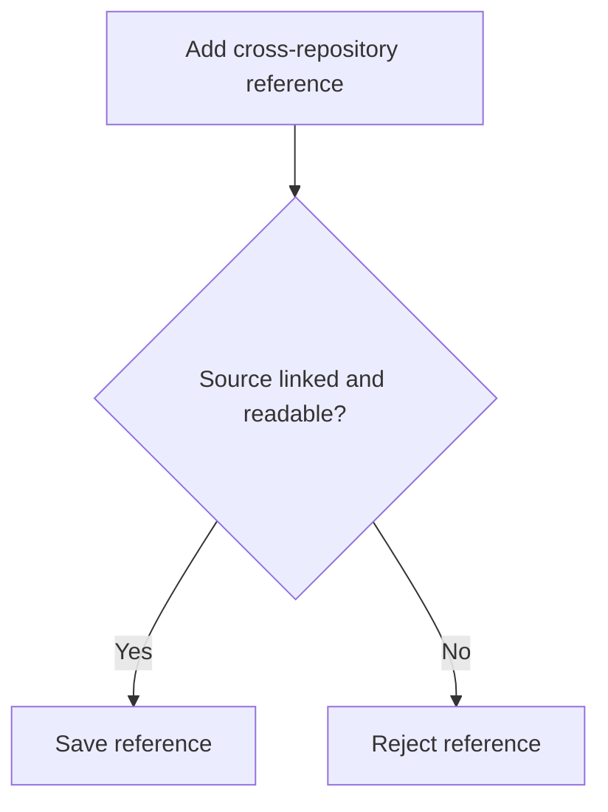

<a id="專案"></a>

# Project 設計

**Implemented** · [Design](project.md) · [Core flow](#decision-flow) · [Representative tests](../../../backend/internal/business/project/application/reference_source_test.go) · [Module guidance](../../../backend/AGENTS.md)

[Repository containers, projects and LINE journeys](journey.md)

<a id="領域設計"></a>

## Domain design

**Subdomain classification:** core candidate for cross-repository construction collaboration.

**Language:** target Projects belong to users/organizations and can be copied to other Owners. Ownership differs from sources; links identify selectable sources; references identify concrete items.

**Context/contracts:** Project owns links, references/inspections. Source domains such as Repository/Issue own objects and permissions.

**Acceptance:** verify selected sources/links for cross-repository references; Project access grants no other-repository source access.

[Implementation/tests](../../../backend/internal/business/project/application/reference_source_test.go) · [Strategic classification criteria](../../references/ddd/design-guide.md)

Project specifications define references, inspections and access scope.

[Business specification](project.md) · [Backend project implementation](../../../backend/AGENTS.md)

<a id="decision-flow"></a>

<a id="加入跨庫來源引用的判定流程"></a>

## Cross-repository reference decision flow



[Entry adapter](../../../backend/internal/business/project/adapter/http/routes.go) · [Decision rules](../../../backend/internal/business/project/application/reference_source_test.go) · [Application output port](../../../backend/internal/business/project/application/port/project.go) · [Related tests](../../../backend/internal/business/project/application/reference_source_test.go)

[Domain guidance](../../AGENTS.md)

## 後端分層結構

下列為[Project 後端模組](../../../backend/internal/business/project/)的完整檔案樹，包含實作、測試與目錄文件。

**範圍**　此樹列出「專案」模組根目錄內的 30 個檔案。檔名以 `_test.go` 結尾的是測試；同名檔案依所在目錄區分職責。

**分層對照**　共通範本中，以下路徑未在此模組根目錄下獨立設置：`domain/valueobject/`、`domain/service/`、`domain/event/`、`domain/policy/`、`application/command/`、`application/query/`、`adapter/line/`、`adapter/messaging/`、`adapter/scheduler/`。子功能的分層以樹中實際路徑為準。

```text
backend/internal/business/project/
├── adapter/                                  # 外部系統轉接
│   ├── firestore/                            # Firestore 保存與查詢
│   │   ├── testdata/
│   │   │   └── project_browser.py
│   │   ├── access_test.go                    # 驗證存取資格（讀寫 Firestore 資料）；TestSourceHydrationFailurePreservesProjectMetadata、TestOwnerProjectStorageRightsAndLegacyAlias
│   │   ├── browser_test.go                   # 驗證瀏覽器入口（讀寫 Firestore 資料）；TestProjectSettingsBrowserRoundTrip
│   │   ├── inspections.go                    # 查驗紀錄（讀寫 Firestore 資料）；Inspections
│   │   ├── items.go                          # 項目（讀寫 Firestore 資料）；Progress、ListItems
│   │   ├── ownership_test.go                 # 驗證所有權（讀寫 Firestore 資料）；TestProjectOwnershipIndependentOfSelectedRepository
│   │   ├── references.go                     # 來源引用（讀寫 Firestore 資料）；ListReferences、ChangeReference
│   │   ├── references_test.go                # 驗證來源引用（讀寫 Firestore 資料）；TestEmulatorProjectTypedReferencesLatestAndRevokedSources
│   │   └── store.go                          # 資料存取（讀寫 Firestore 資料）；AuthorizeOrganization、Get
│   ├── group/
│   │   └── access.go                         # 存取資格；Access、AuthorizeGroup
│   ├── http/                                 # HTTP 入口
│   │   ├── inspections.go                    # 查驗紀錄（處理 HTTP 請求與回應）；ListInspectionSubmissions、SubmitInspection
│   │   ├── references.go                     # 來源引用（處理 HTTP 請求與回應）；ListProjectReferences、AddProjectReference
│   │   ├── references_test.go                # 驗證來源引用（處理 HTTP 請求與回應）；TestReferencePostHasIdentityRetryWithoutCreationHeader、TestReferenceInspectionModes
│   │   ├── routes.go                         # API路由（處理 HTTP 請求與回應）；Register、ListProjects
│   │   └── storage_error_test.go             # 驗證保存錯誤轉換（處理 HTTP 請求與回應）；TestStorageFailureResponse、TestDevelopmentStorageFailureResponse
│   └── repository/
│       └── sources.go                        # 來源清單；Sources、Authorize
├── application/                              # 應用用例
│   ├── dto/                                  # 用例資料型別
│   │   ├── project.go                        # 專案（定義傳遞資料）；Page
│   │   └── references.go                     # 來源引用（定義傳遞資料）；ReferencePage
│   ├── port/                                 # 外部能力介面
│   │   ├── project.go                        # 專案（定義用例所需介面）；Groups、Sources
│   │   └── references.go                     # 來源引用（定義用例所需介面）；ReferenceStateStore
│   ├── access_test.go                        # 驗證存取資格；TestGroupProjectMetadataSurvivesSourceDenial、TestSourceHydrationFailurePreservesCanonicalMetadata
│   ├── inspections.go                        # 查驗紀錄；Inspections
│   ├── project.go                            # 專案；Service、List
│   ├── reference_source_test.go              # 驗證引用來源；TestReferenceSource
│   ├── references.go                         # 來源引用；ListReferences、AddReference
│   └── references_test.go                    # 驗證來源引用；TestReferenceIdentityAndIndependentAuthorization
├── domain/                                   # 領域模型與規則
│   └── entity/                               # 實體與聚合
│       ├── inspections.go                    # 查驗紀錄（維護領域狀態與規則）；InspectionSubmission
│       ├── project.go                        # 專案（維護領域狀態與規則）；IsOrganizationOwner、Valid
│       └── references.go                     # 來源引用（維護領域狀態與規則）；Reference、SupportsInspection
└── AGENTS.md                                 # 本目錄開發指引
```
