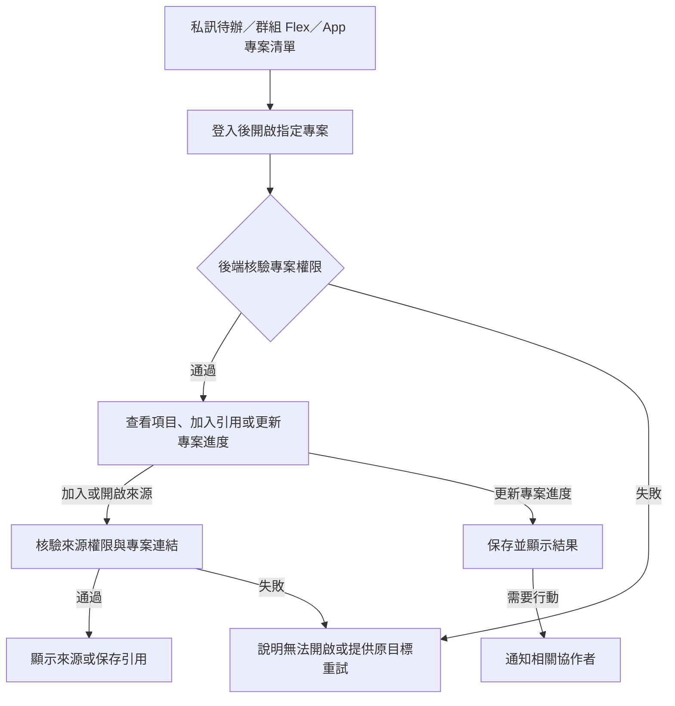

# Repository 業務容器、專案與 LINE 旅程

專案讓負責人追蹤跨庫工作，並讓協作者回到有權開啟的來源。使用者應能分辨「這項專案工作進度如何」和「來源資料目前是什麼狀態」。以[專案契約](project.md)和[儲存庫旅程](../repository/journey.md)為準。

| 業務 | 責任 |
| --- | --- |
| Repository | 定義來源庫的存取範圍。Object、Issue、Discussion 各自管理內容、狀態及操作規則。 |
| Project | 管理專案、可選來源與具體引用，以及專案內進度和巡檢。專案資格與來源資格分開核驗。 |
| LINE | 讓協作者找到指定專案或待辦。群組卡片只傳達可共享的進度或下一步。 |

## 現況與目標

MINI App 已有獨立專案工作區及跨庫引用。目標是在 1:1 提供個人專案待辦，群組 Flex 直達指定專案或項目，直接開 App 時從專案清單進入。登入後保留原目標。使用者從專案開來源時，後端再次核驗來源可見性。失去來源權限時，保留依法可讀的專案工作資訊，依契約處理來源欄位。

未來設計。LINE 任務卡片及通知須另外接線與驗收。

驗收先選一個包含兩個庫的專案，測試開啟指定項目、加入有效來源、來源失權與版本衝突。確認更新專案進度不改寫來源狀態，並量測首次完成率、找到指定項目時間與重選次數。
