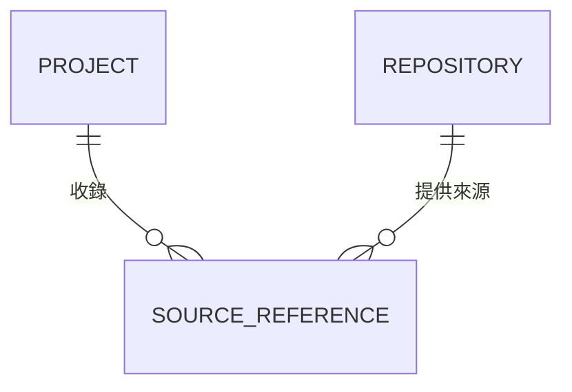
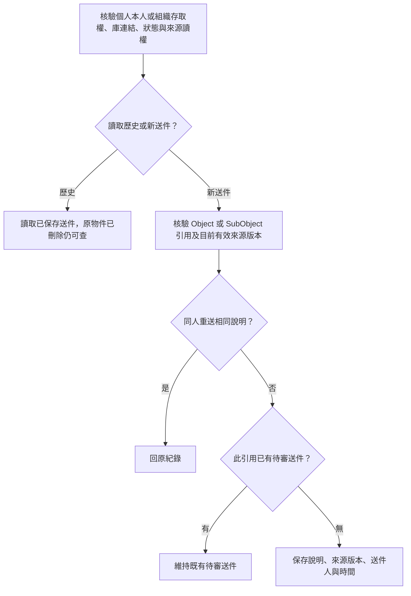
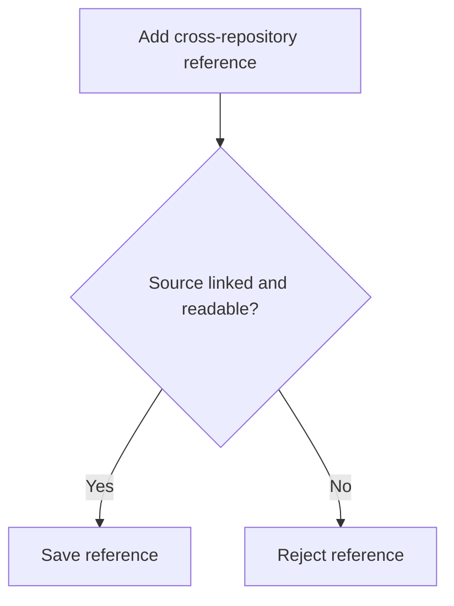

# 專案的 Owner、來源與跨 Owner 複製

<a id="個人或工程群組擁有的-project"></a>

## 專案歸屬與可選來源（現行實作）

每個專案恰有一個 Owner，類型只能是使用者或組織。LINE 群組可提供入口，但群組身分本身不具備專案所有權。一個專案可追蹤零至多個儲存庫的工作。建立時可以先建空白專案；若從儲存庫進入，可預選有權使用且屬於同一擁有者的初始來源。之後可加入其他有權讀取的來源。各項引用沿用來源庫的讀取權限。

### 欄位與檢視設定

專案建立者可在詳情頁編輯自訂欄位、選項及檢視，與專案內容一併儲存。每個檢視依專案內的穩定欄位 ID 建立關聯，重新命名欄位後仍指向同一欄位。移除欄位前須先改選或移除引用它的檢視。後端在同一筆專案版本更新中驗證設定；版本衝突時須重新讀取。一般讀者可以查看設定。

### 複製到另一個 Owner

使用者可選擇另一個有權建立專案的 Owner 作為目的地。後端須同時核驗來源專案讀取權與目的地建立權。成功後目的地清單出現具有新 ID 的獨立副本；原專案保留原 ID、Owner 與內容。副本的存取權由目的地決定，引用的儲存庫資料仍須逐庫核驗。

複製以來源專案作為設定範本。使用者選擇自己的帳戶或有建立權的組織，並指定新專案名稱。副本保留檢視、自訂欄位與選項；檢視參照的欄位須對應到副本自己的欄位。原有工作項目、外部引用、巡檢紀錄、協作者、團隊與儲存庫連結均不複製，副本的初始來源為空。

對照 [GitHub Projects 複製規則](https://docs.github.com/en/issues/planning-and-tracking-with-projects/creating-projects/copying-an-existing-project)，若專案支援草稿議題，使用者可選擇連同草稿及其欄位值一起複製。若支援工作流程或 Insights，複製其設定，但排除自動加入項目的流程。這些條件只適用於已支援的能力。

開發階段不要求遷移舊群組專案或相容舊群組 Owner 入口。

現行專案入口使用個人或組織 Owner，初始來源可省略；複製時讀取來源專案自身保存的欄位與檢視設定。下方另標示舊資料的相容路徑；程式接線不代表真實 Firestore 或 LINE 裝置驗收已完成。

<a id="project-item-progress"></a>

## 專案項目進度

每個 Project item 各自保存待辦、進行中或完成。缺少欄位的既有項目讀為待辦。來源狀態依[問題生命週期](../repository/issue/design.md#issue-lifecycle)、工程物件或巡檢規則讀取。畫面分別標示「本專案進度」與「來源狀態」。更新進度沿用 Project 編輯權、版本檢查與交易；來源讀權仍由來源庫核驗。

驗收時，將同一 Issue 加入維修與稽核兩個 Project。完成維修項目後重新載入兩個看板，只有維修項目顯示完成，稽核項目保留原進度，來源 Issue 仍為開啟。關閉來源 Issue 後，兩個看板的來源狀態都應反映關閉，各自的專案進度保留。

<a id="邊界與身份"></a>

## 邊界與身份

- 個人或組織擁有 Project，可先建立沒有來源的專案。Project 擁有專案內容、收錄項目、版本、作者管理權及防重規則；Repository 是物件／子物件／問題／討論的來源讀取範圍，不再是 Project 的聚合根。建立時若選擇初始來源，須核驗同一 Owner 與來源讀權；之後可連結其他有權讀取的 Repository。

- LINE 群組的候選資料與目前成員核驗屬於 Group／Team 與 LINE 整合。群組可作為操作入口或來源庫擁有者，不能因此成為 canonical Project 的 Owner；組織權限由組織領域核驗。

<a id="操作契約"></a>

## 操作契約

| 欄位               | Group 列表／詳情                                        | Project 列表／詳情／建立／更新                                                                                               | ProjectItem 列表／加入／移除                                                                               |
| ------------------ | ------------------------------------------------------- | ---------------------------------------------------------------------------------------------------------------------------- | ---------------------------------------------------------------------------------------------------------- |
| Actor              | 既有 Session／Bearer 驗證的本人                         | 同左                                                                                                                         | 同左                                                                                                       |
| Resource／Action   | channel 內 Group；List／Get                             | owner 內 Project；List／Get／Create／Update                                                                                  | Project 自有項目；List／Add／Remove                                                                        |
| Context／Authority | 可信群組候選不代表授權；ACTIVE Group 與當下群組成員核驗 | 個人本人或目前可存取該組織的成員可讀／建立；現行組織授權沿用啟用的 legacy 組織規則。Project 建立者管理內容；來源資格另外核驗 | Project 建立者管理收錄，來源事項仍依目前 Repository 讀取資格                                               |
| Policy／Decision   | 非成員、停用、不存在不揭露；外部核驗失敗不當作允許      | 零或一個初始來源及多個可連結來源；沿用內容限制、expectedVersion 與防重鍵；Project 無獨立完成狀態                             | 同 Project 不重複，同事項可在不同 Project；項目 ID 與 Issue ID 分開，來源資格不允許則不揭露來源內容        |
| Result             | 本人可開啟的 Group／基本資料，不授予 Issue 寫權         | Project 自有資料／版本；不寫 Repository、Issue 內容或狀態                                                                    | 僅改關聯及 Project 版本，來源事項完全不變；本專案進度獨立保存，來源狀態另按可讀來源取得，不改寫 Issue 狀態 |
| 重送／併發         | 讀取無副作用；外部成員資格不宣稱與資料庫原子            | 舊建立鍵及收據維持同結果／同鍵異內容衝突；更新過期版本拒絕，無變化不加版本                                                   | expectedVersion 序列化收錄／移除，結果不明先讀取再決定                                                     |
| Event／Audit       | 保存必要群組事件排序，不記 token／profile               | 保留原作者、建立／更新時間及版本追溯                                                                                         | 關聯變動與 Project metadata 同交易，無外部通知                                                             |

- Project 自有資料的授權不得再要求 Repository 作為父容器。來源成員資格被撤銷或來源不可用時，來源 Issue 的內容、狀態及衍生進度不能由 Project 權限繞過；不得把未知統計回傳成零或以舊來源資料冒充成功。前端隱藏按鈕不能代替後端檢查。

- Canonical來源hydration失敗時，已授權的Project自有metadata仍可讀取／管理，回應以sourceAvailable=false標明進度不可用；來源項目內容不因此開放。Project 容器或 item 結構錯誤以及取消／逾時仍回錯誤，不當成來源降級；legacy路徑維持原失敗語義。

<a id="api頁面與側欄"></a>

## API、頁面與側欄

- Group 提供獨立 List／Get；Project 新入口為 /api/v1/owners/{ownerId}/projects 及其專案／items 子資源。Create 可省略 defaultRepositoryId；提供時須驗證初始來源，URL 的 Group 或 Project ID 不是授權憑證。

- 舊 /api/v1/repositories/{repositoryId}/projects... 保留相容 adapter，解析來源庫及其擁有者 後呼叫同一組用例，不維護第二份授權或寫入邏輯。原回應、ID、版本、防重及分頁契約依相容檢查保留。

- 舊Repository統計的projects欄位相容回報以該Repository為來源的專案數，依唯一保存位置讀取；這是唯讀來源關聯統計，不表示Repository擁有或可寫Project。

- 正式專案頁為 /miniapp/projects，URL 保存 owner／Project 選取；側欄「專案」與「儲存庫」同層。Project 頁透過本人 Session 與組織導覽資料選擇 Owner，不需要 RepositoryProvider 作為 Project 生命週期。

- Repository不再提供專案頁籤，專案由獨立入口開啟。新增專案的來源選擇只列可讀來源，不能因此取得事項修改／審核權。切換 Owner、Project、身份或登出時取消舊請求並隔離畫面資料，上一頁、重新整理與直接連結可回到同一目標。

- 原官方 shadcn primitives 及 sidebar-07 模板維持不變；業務導覽在應用層組合。Pages Router 維持靜態輸出，Go 靜態頁路由亦註冊新入口，不新增前端框架或依賴。

<a id="最小來源引用骨架"></a>

## 最小來源引用骨架

現行實作



- 每個 Project 可連結多個來源庫。引用指向物件、子物件、事項或討論，四類共用 items 集合。舊 items 入口保留 Issue 欄位、狀態、引用 ID、移除及 IssueCount／CompletedIssueCount 語意。物件完成數與專案事項統計分開。

- 新引用只保存sourceType、sourceId及子物件必要的parentObjectId與關聯追溯欄位；跨庫引用保存 sourceRepositoryId。物件改名、數量或狀態更新後，列表重新讀取來源目前值，不儲存一份可分歧的名稱／狀態快照。子引用需同時驗父物件路徑，不能只有子ID。來源引用不是存取或修改來源的授權。

| 欄位                    | 列出引用                                                                                  | 加入引用                                                                    | 移除引用                                        |
| ----------------------- | ----------------------------------------------------------------------------------------- | --------------------------------------------------------------------------- | ----------------------------------------------- |
| Actor／Resource／Action | 本人可信Session／Bearer；owner 內 Project的來源引用；List                                 | 同Project內Add                                                              | 同Project內Remove                               |
| Context／Authority      | 個人本人或目前可存取該組織的成員；來源讀權另外核驗                                        | 同左且Project建立者；已連結來源庫、ACTIVE 與該庫的當下讀權                  | Project建立者及Project版本，不要求來源仍可讀    |
| Policy／Decision        | 來源缺失／失權保留占位，sourceUnavailable且不提供舊標題、數量或狀態；不令整個列表迴圈失敗 | sourceType與ID合法、父子歸屬正確，同Project同來源不重複                     | 只刪引用，不刪來源，不繞過Project管理權或版本   |
| Result                  | 最新來源唯讀preview；不改來源與Project                                                    | 交易保存引用並更新Project版本／audit                                        | 交易移除引用並更新Project版本／audit，來源不變  |
| 重送／併發              | 分頁游標綁本人與Project scope                                                             | 決定性來源鍵綁類型、父與來源ID，重送已存在同引用不重複；其他過期版本變更409 | 同引用重複移除不刪其他資料；其他過期版本變更409 |

- 四種引用共用 items 文件格式，將來源庫、來源類型、父物件及來源 ID 納入決定性鍵；不同庫的同名識別可獨立收錄。

- 新增API為GET／POST /api/v1/owners/{ownerId}/projects/{id}/references及DELETE同路徑/{itemId}；權威schema及生成型別隨本輪同步。加入時提交 sourceRepositoryId、sourceType、sourceId、可選 parentObjectId 與 expectedVersion。Project PATCH 可帶 linkRepositoryId 或 unlinkRepositoryId；解除後保留引用占位。

- 畫面保留現有專案建立／編輯，可選擇與連結儲存庫，再選種類再從來源清單選擇，子物件先選父再選子，不要求輸入UUID。來源失權仍顯示不可存取占位；Project建立者可移除引用，不能用快取舊preview洩漏內容。加入／移除待處理或結果未知時阻止切換Owner／Project及卸載，先核回目前版本與引用再決定續送。

<a id="保存路徑與顯示範圍"></a>

## 保存路徑與顯示範圍

| 位置               | Project 路徑                                                                                                                      |
| ------------------ | --------------------------------------------------------------------------------------------------------------------------------- |
| HTTP               | /api/v1/owners/{ownerId}/projects/{id}                                                                                            |
| Firestore 個人專案 | channels/{channelId}/users/{userId}/projects/{projectId}                                                                          |
| Firestore 組織專案 | channels/{channelId}/organizations/{organizationId}/projects/{projectId}                                                          |
| 舊群組專案相容資料 | channels/{channelId}/groups/{groupId}/projects/{projectId}；由既有 legacy adapter 隔離處理，不代表 canonical API 接受 Group Owner |

- Project 文件保存 ownerId；沒有初始來源時，對外回應省略 defaultRepositoryId。同一擁有者底下的 projectCreationScopes 保存建立收據，Project 底下的 linkedRepositories 保存庫連結；每筆引用以 sourceRepositoryId 定位來源。

- 工程對象、待處理問題、決策討論分區顯示；專案詳情不把預設庫的 Issue 計數顯示為跨庫進度。Repository 統計中的專案數指以該庫為初始來源的專案數。

<a id="工程驗收送件"></a>

## 工程驗收送件

現行實作



GET／POST /api/v1/owners/{ownerId}/projects/{id}/references/{itemId}/inspection-submissions 分別讀歷史與提交。資料保存在引用下的 inspectionSubmissions。施工進度維持原值，有送件紀錄的引用不可移除。

## 引用目前狀態核對

`GET /api/v1/owners/{ownerId}/projects/{id}/reference-state` 供已登入的專案建立者核對目前引用狀態。後端核驗 Project owner 範圍與建立者，再於交易內重查 owner、Project 及目標引用，不讀取來源內容，因此來源權限失效時仍可核對。

輸入為 `desiredPresent` 與互斥的兩種識別：`itemId`，或完整來源組合 `sourceRepositoryId`、`sourceType`、`sourceId`（子物件另帶 `parentObjectId`）。混用、缺漏或格式無效回傳 `invalid_input`；非建立者拒絕存取。回傳 `present` 與 `matches`，只代表讀取當下狀態，不是原寫入的成功收據，也不保證後續未被其他操作改變。

這是唯讀操作，不新增業務事件、不寫入資料；回應禁止快取。前端在符合預期後解除待確認狀態並重新讀取專案，不再逐頁掃描引用推斷原操作結果。未符合或查詢失敗時保留原請求供重試。

契約見 [references.yaml](../../../api/contract/project/references.yaml)，核心見 [references.go](../../../backend/internal/business/project/domain/entity/references.go)。既有引用授權、HTTP 與前端流程檢查涵蓋此路徑；真實 Firestore 交易與 LINE 裝置驗收仍需另行執行。

專案引用回傳 `inspectionMode`。工程物件與子物件可查閱驗收紀錄，來源可用時可在空紀錄下提交；問題與討論不提供驗收入口。實際讀寫時，後端仍會核對儲存庫存取、專案連結及既有驗收紀錄。

<a id="專案"></a>

## 瀏覽器閉環驗收

先建置 MINI App 靜態頁面，啟動本機 Firestore emulator，並準備 Python Playwright 與 Chromium。在 backend 目錄執行：

```bash
MINIAPP_BROWSER_EXPORT="$(cd ../frontend/miniapp/out && pwd)" \
FIRESTORE_EMULATOR_HOST=127.0.0.1:8080 \
go test -count=1 -run '^TestProjectSettingsBrowserRoundTrip$' ./internal/business/project/adapter/firestore
```

瀏覽器送出建立個人專案後，測試等後端成功寫入才中斷回應。從畫面重試原請求後，核對開啟的專案 ID 與第一次寫入一致，並透過清單 API 確認個人範圍只有該筆專案。接著儲存欄位與檢視、複製到組織，再重新開啟兩份專案核對欄位名稱、選項及檢視引用。組織與專案資料經 Go HTTP 處理器讀寫 emulator；LINE 登入與 session 使用測試身分。

## Project 設計

**現行實作** · [判定流程](#decision-flow) · [代表測試](../../../backend/internal/business/project/application/reference_source_test.go) · [模組規則](../../../backend/AGENTS.md)

[Repository containers, projects and LINE journeys](../../integrations/line/journey.md#project-journey)

<a id="領域設計"></a>

### Domain design

**Subdomain classification:** core candidate for cross-repository construction collaboration.

**Language:** target Projects belong to users/organizations and can be copied to other Owners. Ownership differs from sources; links identify selectable sources; references identify concrete items.

**Context/contracts:** Project owns links, references/inspections. Source domains such as Repository/Issue own objects and permissions.

**Acceptance:** verify selected sources/links for cross-repository references; Project access grants no other-repository source access.

[Implementation/tests](../../../backend/internal/business/project/application/reference_source_test.go) · [Strategic classification criteria](../../references/ddd/design-guide.md)

Project specifications define references, inspections and access scope.

<a id="decision-flow"></a>

<a id="加入跨庫來源引用的判定流程"></a>

### Cross-repository reference decision flow



[Entry adapter](../../../backend/internal/business/project/adapter/http/routes.go) · [Decision rules](../../../backend/internal/business/project/application/reference_source_test.go) · [Application output port](../../../backend/internal/business/project/application/port/project.go) · [Related tests](../../../backend/internal/business/project/application/reference_source_test.go)

[Domain guidance](../../AGENTS.md)

### 後端分層結構

下列為[Project 後端模組](../../../backend/internal/business/project/)的完整檔案樹，包含實作、測試與目錄文件。

**範圍**　此樹列出「專案」模組根目錄內的 30 個檔案。檔名以 `_test.go` 結尾的是測試；同名檔案依所在目錄區分職責。

**分層對照**　共通範本中，以下路徑未在此模組根目錄下獨立設置：`domain/valueobject/`、`domain/service/`、`domain/event/`、`domain/policy/`、`application/command/`、`application/query/`、`adapter/line/`、`adapter/messaging/`、`adapter/scheduler/`。子功能的分層以樹中實際路徑為準。

```text
backend/internal/business/project/
├── adapter/                                  # 外部系統轉接
│   ├── firestore/                            # Firestore 保存與查詢
│   │   ├── testdata/
│   │   │   └── project_browser.py
│   │   ├── access_test.go                    # 驗證存取資格（讀寫 Firestore 資料）；TestSourceHydrationFailurePreservesProjectMetadata、TestOwnerProjectStorageRightsAndLegacyAlias
│   │   ├── browser_test.go                   # 驗證瀏覽器入口（讀寫 Firestore 資料）；TestProjectSettingsBrowserRoundTrip
│   │   ├── inspections.go                    # 查驗紀錄（讀寫 Firestore 資料）；Inspections
│   │   ├── items.go                          # 項目（讀寫 Firestore 資料）；Progress、ListItems
│   │   ├── ownership_test.go                 # 驗證所有權（讀寫 Firestore 資料）；TestProjectOwnershipIndependentOfSelectedRepository
│   │   ├── references.go                     # 來源引用（讀寫 Firestore 資料）；ListReferences、ChangeReference
│   │   ├── references_test.go                # 驗證來源引用（讀寫 Firestore 資料）；TestEmulatorProjectTypedReferencesLatestAndRevokedSources
│   │   └── store.go                          # 資料存取（讀寫 Firestore 資料）；AuthorizeOrganization、Get
│   ├── group/
│   │   └── access.go                         # 存取資格；Access、AuthorizeGroup
│   ├── http/                                 # HTTP 入口
│   │   ├── inspections.go                    # 查驗紀錄（處理 HTTP 請求與回應）；ListInspectionSubmissions、SubmitInspection
│   │   ├── references.go                     # 來源引用（處理 HTTP 請求與回應）；ListProjectReferences、AddProjectReference
│   │   ├── references_test.go                # 驗證來源引用（處理 HTTP 請求與回應）；TestReferencePostHasIdentityRetryWithoutCreationHeader、TestReferenceInspectionModes
│   │   ├── routes.go                         # API路由（處理 HTTP 請求與回應）；Register、ListProjects
│   │   └── storage_error_test.go             # 驗證保存錯誤轉換（處理 HTTP 請求與回應）；TestStorageFailureResponse、TestDevelopmentStorageFailureResponse
│   └── repository/
│       └── sources.go                        # 來源清單；Sources、Authorize
├── application/                              # 應用用例
│   ├── dto/                                  # 用例資料型別
│   │   ├── project.go                        # 專案（定義傳遞資料）；Page
│   │   └── references.go                     # 來源引用（定義傳遞資料）；ReferencePage
│   ├── port/                                 # 外部能力介面
│   │   ├── project.go                        # 專案（定義用例所需介面）；Groups、Sources
│   │   └── references.go                     # 來源引用（定義用例所需介面）；ReferenceStateStore
│   ├── access_test.go                        # 驗證存取資格；TestGroupProjectMetadataSurvivesSourceDenial、TestSourceHydrationFailurePreservesCanonicalMetadata
│   ├── inspections.go                        # 查驗紀錄；Inspections
│   ├── project.go                            # 專案；Service、List
│   ├── reference_source_test.go              # 驗證引用來源；TestReferenceSource
│   ├── references.go                         # 來源引用；ListReferences、AddReference
│   └── references_test.go                    # 驗證來源引用；TestReferenceIdentityAndIndependentAuthorization
├── domain/                                   # 領域模型與規則
│   └── entity/                               # 實體與聚合
│       ├── inspections.go                    # 查驗紀錄（維護領域狀態與規則）；InspectionSubmission
│       ├── project.go                        # 專案（維護領域狀態與規則）；IsOrganizationOwner、Valid
│       └── references.go                     # 來源引用（維護領域狀態與規則）；Reference、SupportsInspection
└── AGENTS.md                                 # 本目錄開發指引
```
