# Personal and group repositories

**Implemented** · [Domain design](#領域設計) · [Core flow](#decision-flow) · [Decision implementation](../../../backend/internal/business/repository/domain/entity/repository.go) · [Code](../../../backend/internal/business/repository/README.md) · [Guidance](../../../backend/internal/business/repository/AGENTS.md)

## Domain design

**Subdomain classification:** core candidate for construction resource management.

**Language:** repositories have IDs, owners and active state; spaces are internal locations, separate from cross-repository projects.

**Context/contracts:** Issue, Discussion and Object use Repository scope/state, checking current repository facts within write transactions.

Issue, Discussion and Object are capabilities within the Repository context. Repository owns ID/version limits, labels, milestones and spaces. Issue/Discussion own content updates and validate referenced catalogs within write transactions. Object owns hierarchy rules while reusing Repository ID/space contracts.

**Acceptance:** matching IDs do not preserve authorization after owner changes or non-ACTIVE state.

[Implementation/tests](../../../backend/internal/business/repository/domain/entity/repository.go) · [Strategic classification criteria](../../references/ddd/README.md)

Specifications for Repositories and spaces, labels, issues, discussions and other capabilities.

This page owns Repository scope/authorization; capability documents own details.

## Reading and editing entry points
[Containers/LINE journeys](journey.md) explains responsibilities, target navigation, wiring and acceptance.

Start with [spaces.md](spaces.md), [Issue specifications](issue/design.md) and [organization/team ownership](../../contracts/organization-team-ownership.md).

## Container capabilities

Capabilities share Repository scope but own operation/authorization rules. Documents are grouped by container; code remains separated by capability.

| Capability | Specification/acceptance |
|---|---|
| Spaces | [Space/ID ownership](spaces.md) |
| Issue | [Entry/core flow](issue/README.md) · [Design/contracts](issue/design.md) |
| Discussion/comments | [Entry/core flow](discussion/README.md) · [Design/contracts](discussion/design.md) |
| Object/subobjects | [Entry/core flow](object/README.md) · [Objects](object/design.md) · [Templates](object/template.md) |
| Labels | [Catalog/references](labels.md) |
| Milestones | [Specification](milestones.md) |
| Shared numbering | [Numbering rules](numbering.md) |
| Insights | [Overview/Pulse](insights.md) |
| Wiki | [Pages/revisions](wiki.md) |
| Container acceptance | [Completion boundaries](acceptance.md) |

`Object.parentId` represents subobjects governed by [object specifications](object/design.md); no separate Subobject domain documents. Cross-repository [Project](../project/README.md) and independent [Journal](../journal/README.md) retain their domains.

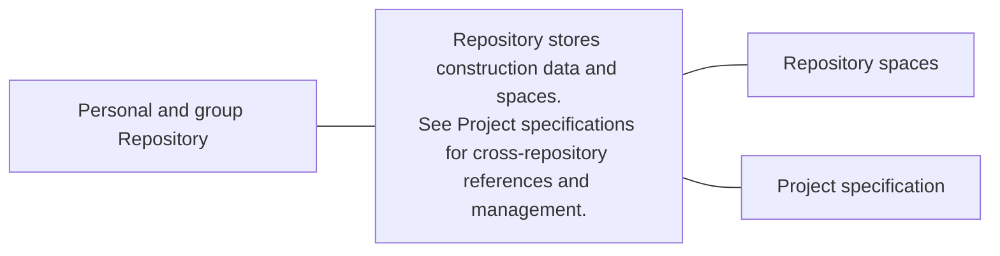

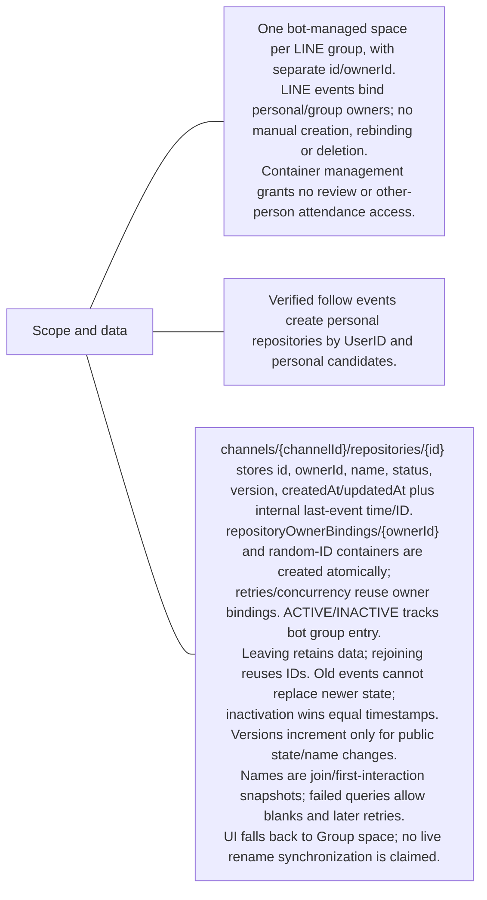

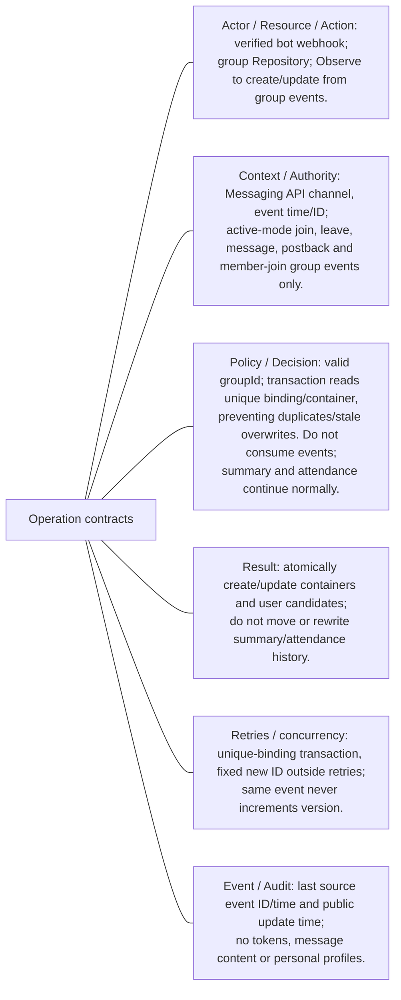

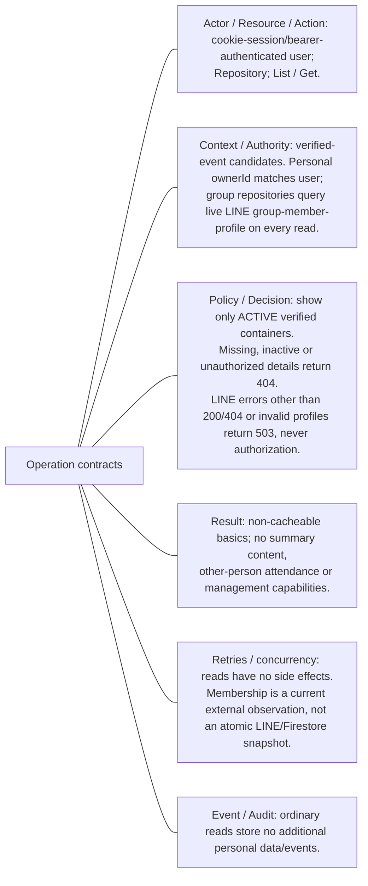

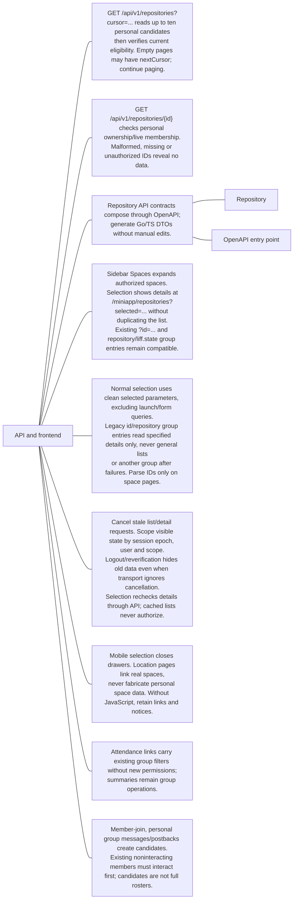

## Space loading sequence

Current implementation

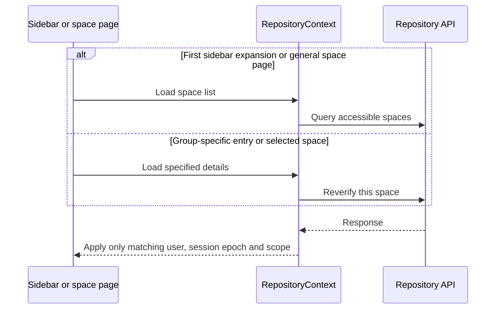

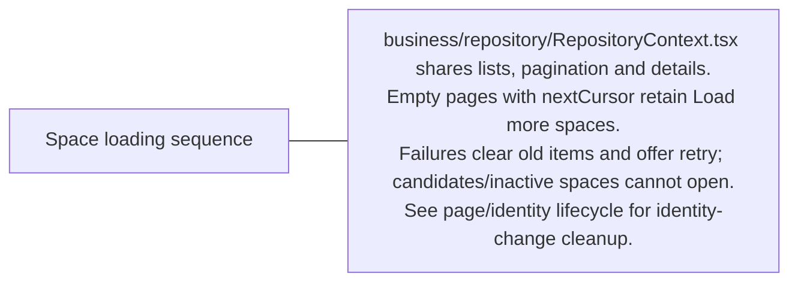

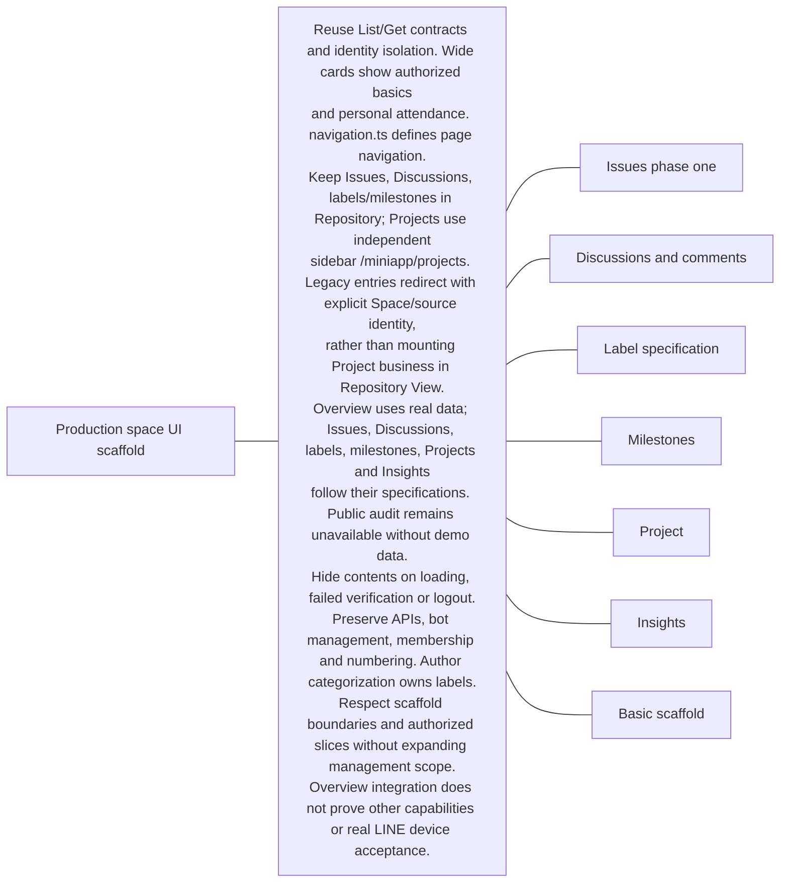

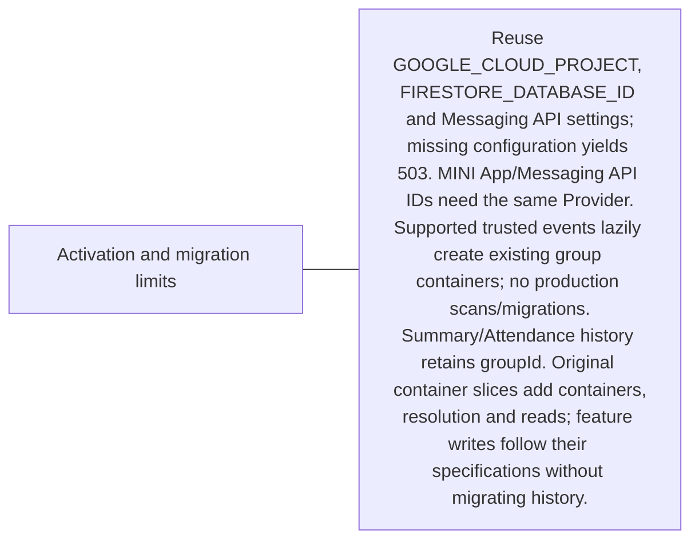

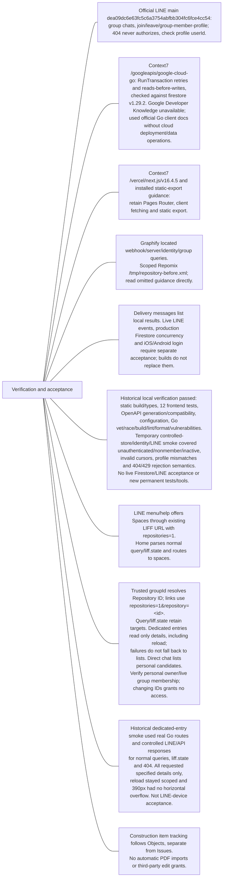

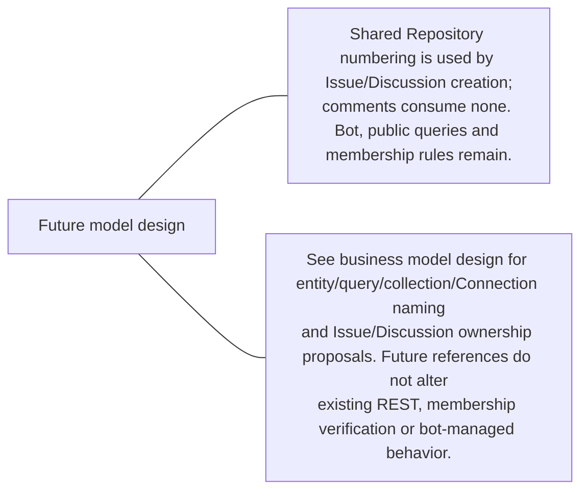

## Restricted repository write decision flow

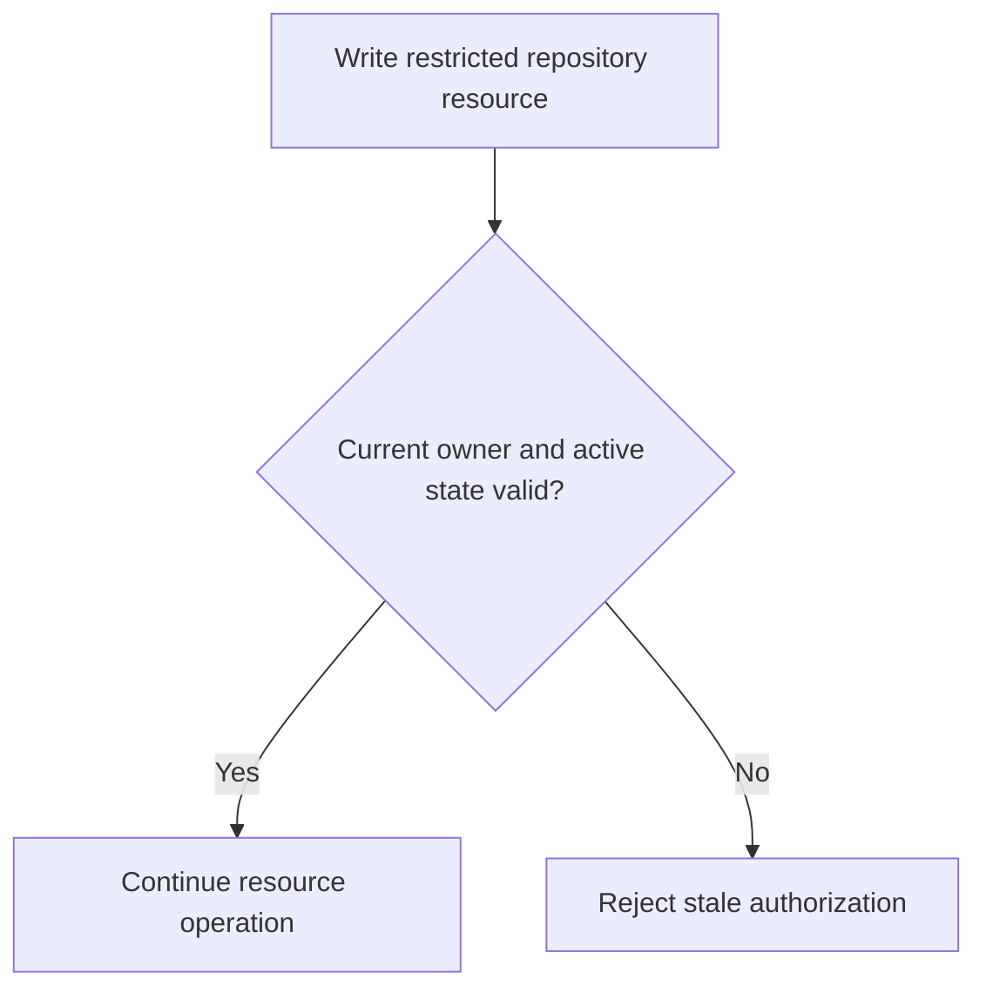

[Entry adapter](../../../backend/internal/business/repository/adapter/http/routes.go) · [Decision rules](../../../backend/internal/business/repository/domain/entity/repository.go) · [Application output port](../../../backend/internal/business/repository/application/port/repository.go) · [Related tests](../../../backend/internal/business/repository/adapter/firestore/labels_test.go)

[applicable guidance](../AGENTS.md) · [parent directory guide](../README.md)
