# 個人與群組-repository

**已有實作** · [領域設計](#領域設計) · [核心流程](#decision-flow) · [判定實作](../../../backend/internal/business/repository/domain/entity/repository.go) · [程式目錄](../../../backend/internal/business/repository/README.md) · [維護指引](../../../backend/internal/business/repository/AGENTS.md)

## 領域設計

**子域定位**　工程資源管理的核心候選。

**通用語言**　儲存庫具有識別碼、擁有者及啟用狀態；空間是庫內工作位置，與跨庫專案分開管理。

**上下文與契約**　Issue、Discussion、Object 等能力使用 Repository 的範圍與狀態；各自在交易中以最新儲存庫資料確認能否寫入。

**驗收案例**　即使庫 ID 相符，只要擁有者已變更或狀態不再是 ACTIVE，就不能沿用舊授權完成受限操作。

[對照實作或測試](../../../backend/internal/business/repository/domain/entity/repository.go) · [戰略設計與分類準則](../../architecture/ddd/README.md)

## 用途與範圍

保存 Repository 及其空間、標籤、事項、討論與其他子能力的規格。

## 架構與責任邊界

Repository 範圍及功能授權在此說明，各子能力細節由對應文件維護。

## 閱讀與修改入口

先查閱[spaces.md](spaces.md)、[議題規格](../issue/design.md)、[組織與團隊歸屬契約](../../architecture/contracts/organization-team-ownership.md)。

## 相關規格

[Repository Insights 與 Pulse](insights.md) · [工程知識庫 Wiki](wiki.md)

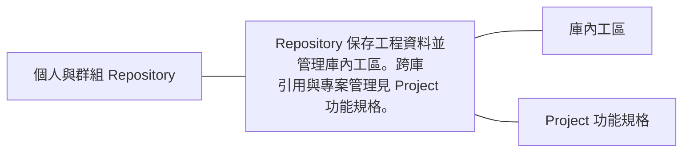

[Repository Insights 與 Pulse](insights.md) · [工程知識庫 Wiki](wiki.md)

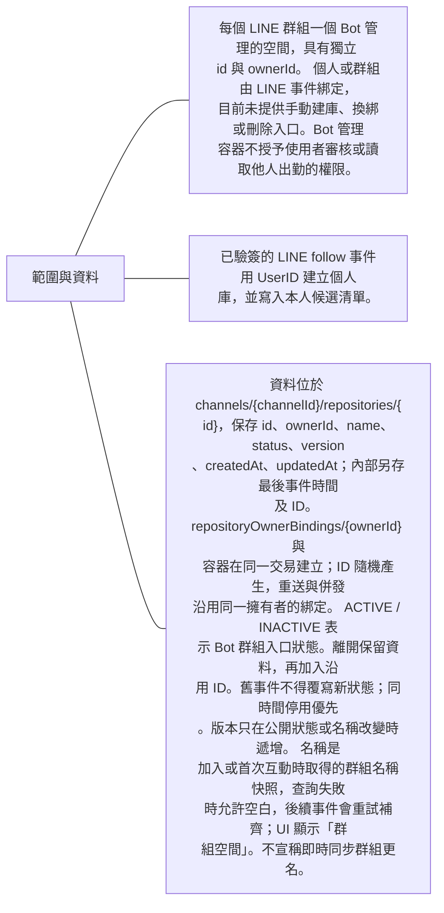

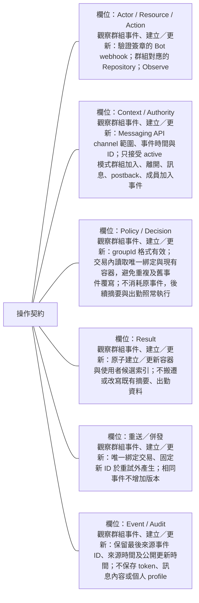

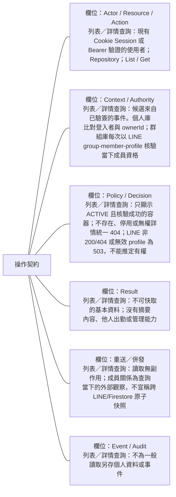

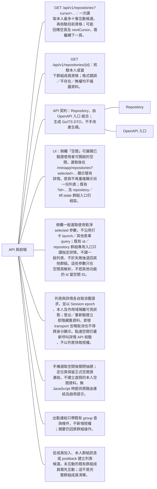

## 空間載入時序

現行實作

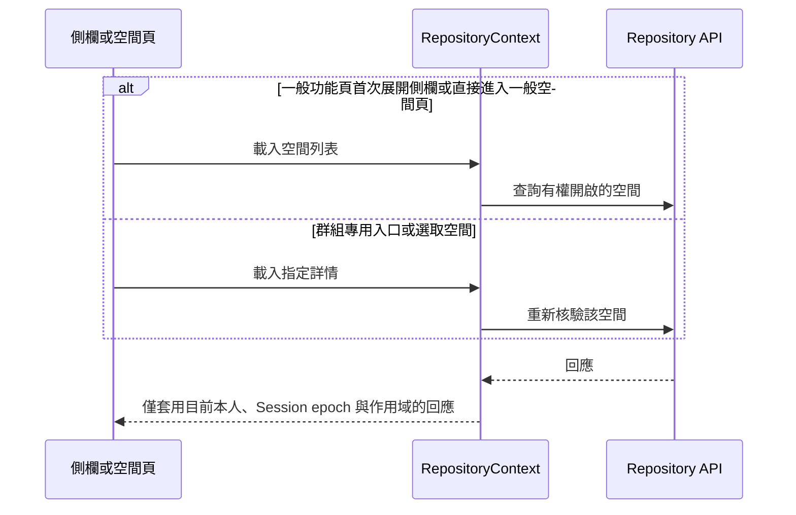

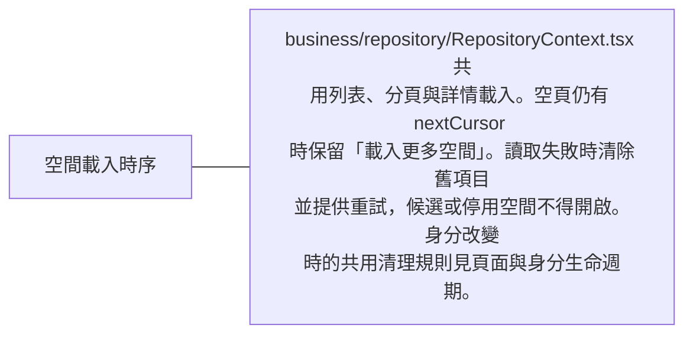

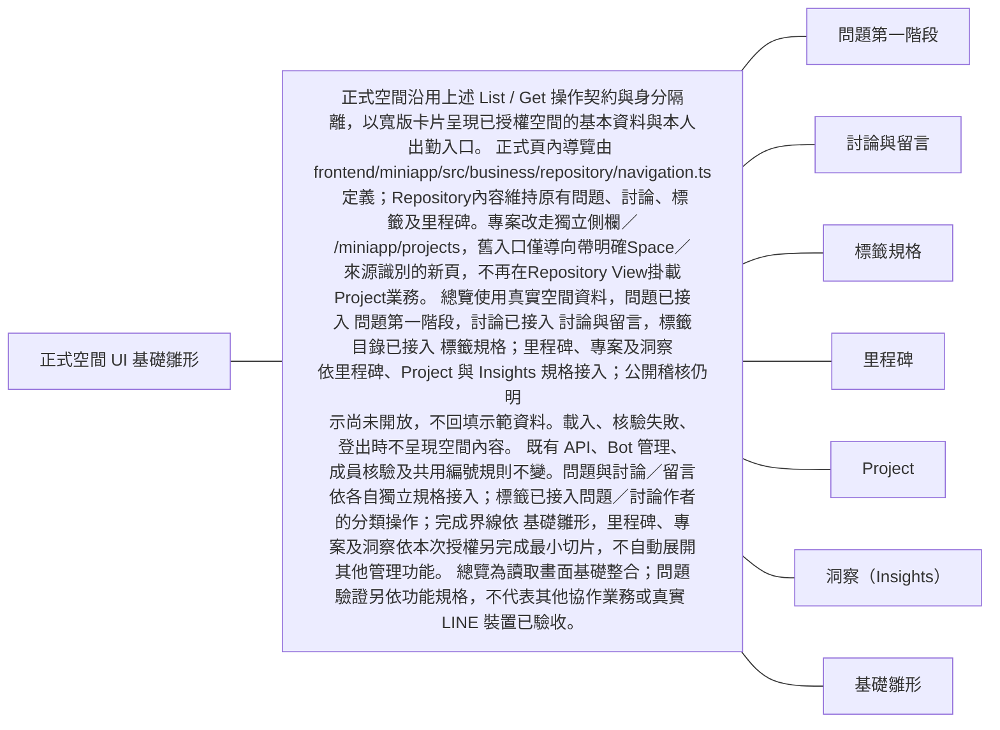

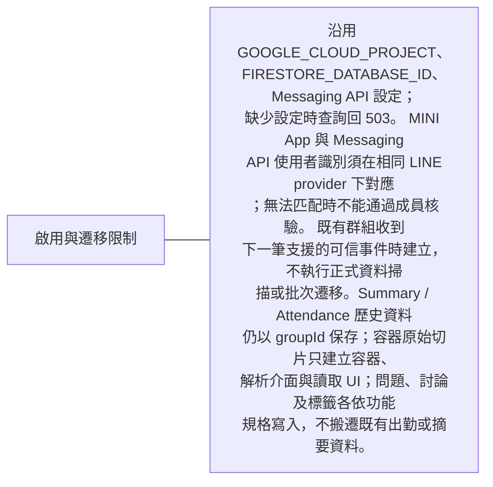

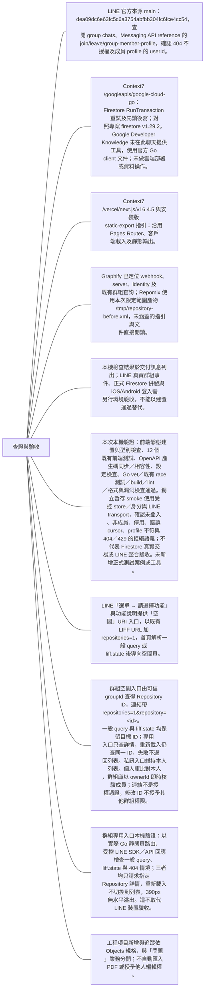

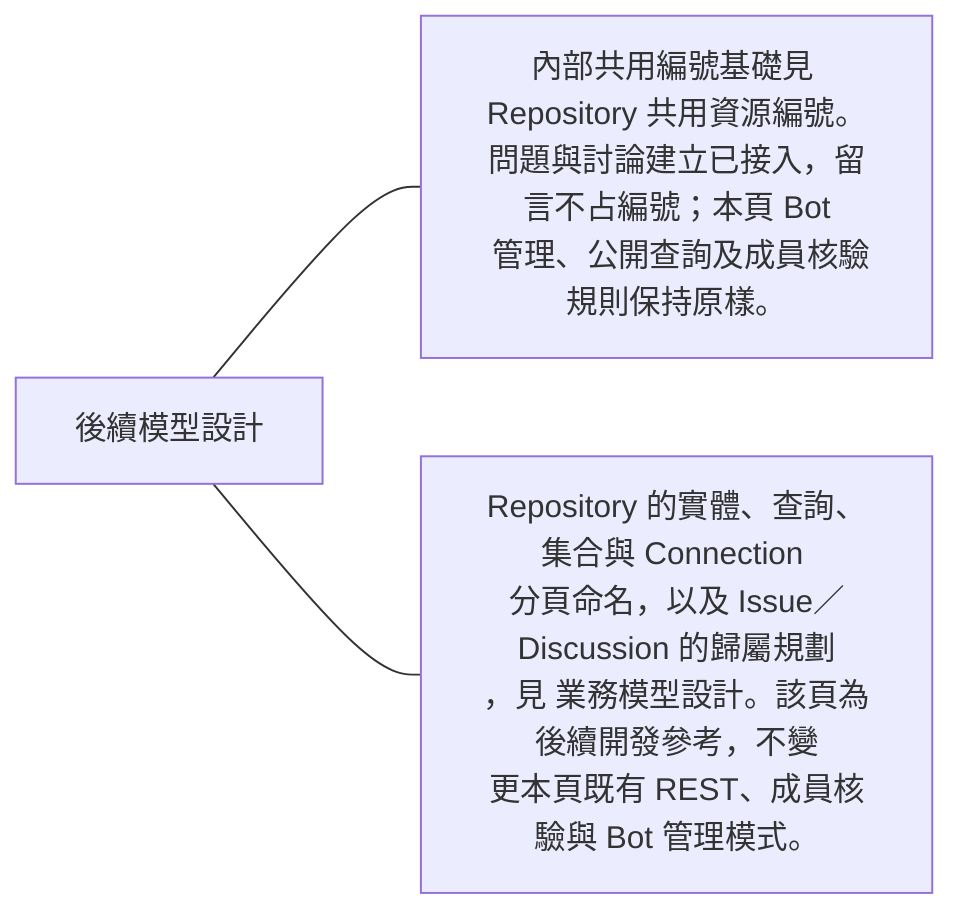

## 寫入庫內受限資源的判定流程

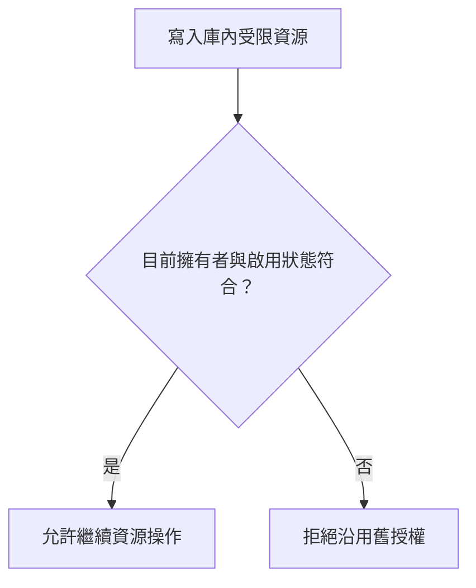

[入口適配器](../../../backend/internal/business/repository/adapter/http/routes.go) · [判定依據](../../../backend/internal/business/repository/domain/entity/repository.go) · [應用層輸出介面](../../../backend/internal/business/repository/application/port/repository.go) · [相關測試](../../../backend/internal/business/repository/adapter/firestore/labels_test.go)

[適用工作指引](../AGENTS.md) · [上層導覽](../README.md)
