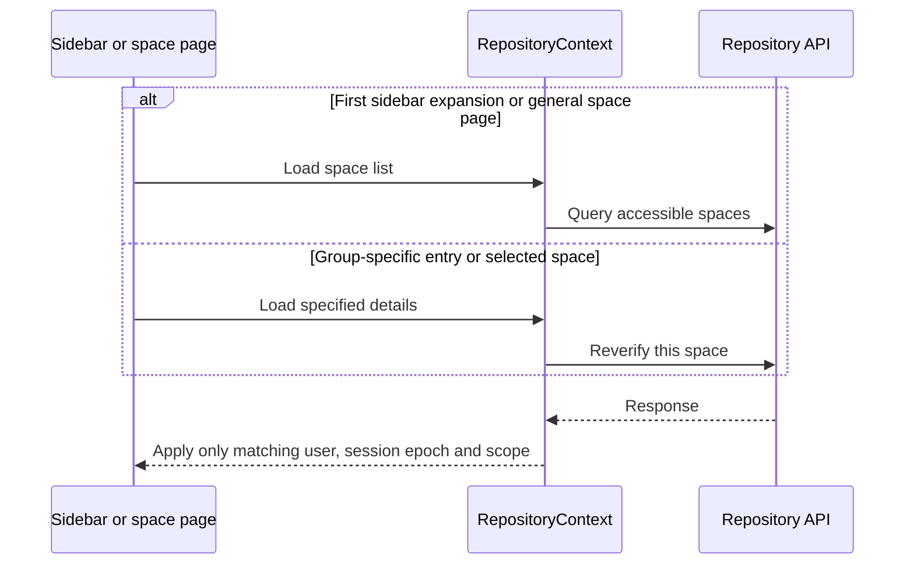
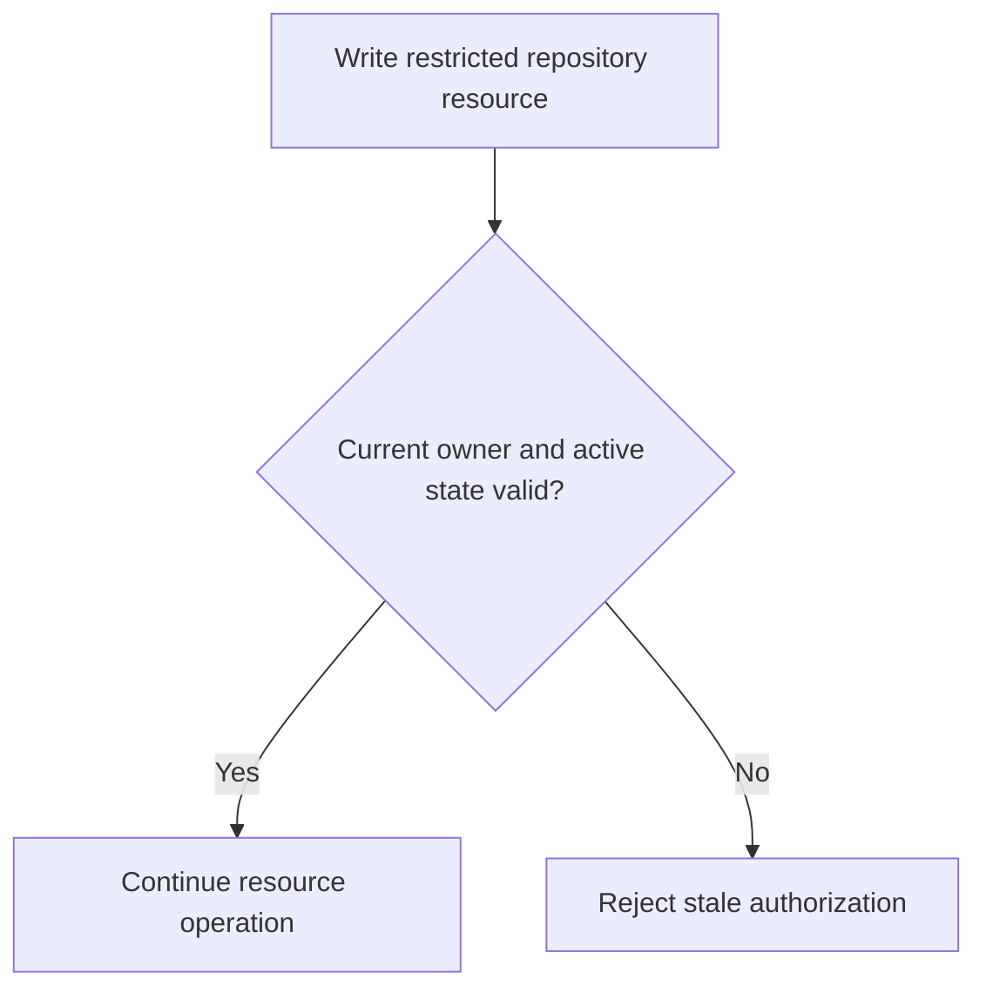

# Personal and group repositories 設計

**Implemented** · [Domain design](#領域設計) · [Core flow](#decision-flow) · [Decision implementation](../../../backend/internal/business/repository/domain/entity/repository.go) · [Module guidance](../../../backend/AGENTS.md)

## Domain design

**Subdomain classification:** core candidate for construction resource management.

**Language:** repositories have IDs, owners and active state; spaces are internal locations, separate from cross-repository projects.

**Context/contracts:** Issue, Discussion and Object use Repository scope/state, checking current repository facts within write transactions.

Issue, Discussion and Object are capabilities within the Repository context. Repository owns ID/version limits, labels, milestones and spaces. Issue/Discussion own content updates and validate referenced catalogs within write transactions. Object owns hierarchy rules while reusing Repository ID/space contracts.

**Acceptance:** matching IDs do not preserve authorization after owner changes or non-ACTIVE state.

[Implementation/tests](../../../backend/internal/business/repository/domain/entity/repository.go) · [Strategic classification criteria](../../references/ddd/design-guide.md)

Specifications for Repositories and spaces, labels, issues, discussions and other capabilities.

This page owns Repository scope/authorization; capability documents own details.

## Reading and editing entry points

[Containers/LINE journeys](../../integrations/line/journey.md#repository-journey) explains responsibilities, target navigation, wiring and acceptance.

Start with [spaces.md](spaces.md), [Issue specifications](../issue/design.md) and [organization/team ownership](../../contracts/organization-team-ownership.md).

## Container capabilities

Capabilities share Repository scope but own operation/authorization rules. Each resource specification is maintained in its own domain. This page indexes those resources and owns the shared container rules.

| Capability           | Specification/acceptance                                                                |
| -------------------- | --------------------------------------------------------------------------------------- |
| Spaces               | [Space/ID ownership](spaces.md)                                                         |
| Issue                | [Issue design and contracts](../issue/design.md)                                        |
| Discussion/comments  | [Discussion design and contracts](../discussion/design.md)                              |
| Object/subobjects    | [Object design and contracts](../object/design.md) · [Templates](../object/template.md) |
| Labels               | [Catalog/references](labels.md)                                                         |
| Milestones           | [Specification](milestones.md)                                                          |
| Shared numbering     | [Numbering rules](numbering.md)                                                         |
| Insights             | [Overview/Pulse](insights.md)                                                           |
| Wiki                 | [Pages/revisions](wiki.md)                                                              |
| Container acceptance | [Completion boundaries](acceptance.md)                                                  |

`Object.parentId` represents subobjects governed by [object specifications](../object/design.md); no separate Subobject domain documents. Cross-repository [Project](../project/project.md) and independent [Journal](../journal/journal.md) retain their domains.

### 容器責任與內部能力

| 責任       | 能力與邊界                                                                                                                                                                                                                                                                                        |
| ---------- | ------------------------------------------------------------------------------------------------------------------------------------------------------------------------------------------------------------------------------------------------------------------------------------------------- |
| 容器治理   | Repository 管理個人或群組擁有者、啟用狀態及庫內範圍。庫的讀取資格與資源的操作權分開判定。                                                                                                                                                                                                         |
| 共用能力   | [工區 Space](spaces.md)用於庫內分類。[標籤](labels.md)、[里程碑](milestones.md)與[共用編號](numbering.md)依各自規格供資源引用。工區沿用庫的存取範圍。                                                                                                                                             |
| 業務資源   | [Object](../object/design.md)管理工項階層與數量進度，[範本](../object/template.md)用來建立獨立物件樹。個人範本依持有人及目標庫建立權限判定；庫範本依本庫範圍判定。[Issue](../issue/design.md)追蹤異常與狀態，[Discussion](../discussion/design.md)承載討論與留言，[Wiki](wiki.md)保存知識與修訂。 |
| 衍生讀取   | [Insights](insights.md)提供庫內統計與現況。Pulse 屬規劃，稽核入口依[容器驗收界線](acceptance.md)判定。                                                                                                                                                                                            |
| 跨領域引用 | [Project](../project/project.md)獨立維護跨庫協作與進度。[Journal](../journal/journal.md)獨立維護日誌。開啟引用時依來源資源權限判定，來源狀態由來源領域維護。                                                                                                                                      |

## Personal and group Repository

- Repository stores construction data and spaces.See Project specifications for cross-repository references and management.

  - [Repository spaces](spaces.md)

  - [Project specification](../project/project.md)

## Scope and data

- One bot-managed space per LINE group, with separate id/ownerId.LINE events bind personal/group owners; no manual creation, rebinding or deletion.Container management grants no review or other-person attendance access.

- Verified follow events create personal repositories by UserID and personal candidates.

- channels/{channelId}/repositories/{id} stores id, ownerId, name, status,version, createdAt/updatedAt plus internal last-event time/ID.repositoryOwnerBindings/{ownerId} and random-ID containers are created atomically;retries/concurrency reuse owner bindings. ACTIVE/INACTIVE tracks bot group entry.Leaving retains data; rejoining reuses IDs. Old events cannot replace newer state;inactivation wins equal timestamps. Versions increment only for public state/name changes.Names are join/first-interaction snapshots; failed queries allow blanks and later retries.UI falls back to Group space; no live rename synchronization is claimed.

## Operation contracts

- Actor / Resource / Action: verified bot webhook;group Repository; Observe to create/update from group events.

- Context / Authority: Messaging API channel, event time/ID;active-mode join, leave, message, postback and member-join group events only.

- Policy / Decision: valid groupId; transaction reads unique binding/container,preventing duplicates/stale overwrites. Do not consume events;summary and attendance continue normally.

- Result: atomically create/update containers and user candidates;do not move or rewrite summary/attendance history.

- Retries / concurrency: unique-binding transaction, fixed new ID outside retries;same event never increments version.

- Event / Audit: last source event ID/time and public update time;no tokens, message content or personal profiles.

- Actor / Resource / Action: cookie-session/bearer-authenticated user;Repository; List / Get.

- Context / Authority: verified-event candidates. Personal ownerId matches user;group repositories query live LINE group-member-profile on every read.

- Policy / Decision: show only ACTIVE verified containers.Missing, inactive or unauthorized details return 404.LINE errors other than 200/404 or invalid profiles return 503, never authorization.

- Result: non-cacheable basics; no summary content,other-person attendance or management capabilities.

- Retries / concurrency: reads have no side effects.Membership is a current external observation, not an atomic LINE/Firestore snapshot.

- Event / Audit: ordinary reads store no additional personal data/events.

## API and frontend

- GET /api/v1/repositories?cursor=... reads up to ten personal candidatesthen verifies current eligibility. Empty pages may have nextCursor; continue paging.

- GET /api/v1/repositories/{id} checks personal ownership/live membership.Malformed, missing or unauthorized IDs reveal no data.

- Repository API contracts compose through OpenAPI;generate Go/TS DTOs without manual edits.

  - [Repository](../../../api/contract/repository/repositories.yaml)

  - [OpenAPI entry point](../../../api/contract/openapi.yaml)

- Sidebar Spaces expands authorized spaces. Selection shows details at/miniapp/repositories?selected=... without duplicating the list.Existing ?id=... and repository/liff.state group entries remain compatible.

- Normal selection uses clean selected parameters, excluding launch/form queries.Legacy id/repository group entries read specified details only, never general listsor another group after failures. Parse IDs only on space pages.

- Cancel stale list/detail requests. Scope visible state by session epoch, user and scope.Logout/reverification hides old data even when transport ignores cancellation.Selection rechecks details through API; cached lists never authorize.

- Mobile selection closes drawers. Location pages link real spaces,never fabricate personal space data. Without JavaScript, retain links and notices.

- Attendance links carry existing group filters without new permissions;summaries remain group operations.

- Member-join, personal group messages/postbacks create candidates.Existing noninteracting members must interact first; candidates are not full rosters.

## Space loading sequence

Current implementation

[business/repository/RepositoryContext.tsx shares lists, pagination and details.Empty pages with nextCursor retain Load more spaces.Failures clear old items and offer retry; candidates/inactive spaces cannot open.See page/identity lifecycle for identity-change cleanup.](../../architecture/runtime/react-lifecycle.md#頁面與身分生命週期)

## Production space UI scaffold

- Reuse List/Get contracts and identity isolation. Wide cards show authorized basicsand personal attendance. navigation.ts defines page navigation.Keep Issues, Discussions, labels/milestones in Repository; Projects use independentsidebar /miniapp/projects. Legacy entries redirect with explicit Space/source identity,rather than mounting Project business in Repository View.Overview uses real data; Issues, Discussions, labels, milestones, Projects and Insightsfollow their specifications. The [Audit tab](../object/design.md#數量原位編輯與儲存庫稽核) shows committed object quantity changes for readers authorized on the selected repository. Broader public audit remains unavailable. Hide contents on loading, failed verification or logout.Preserve APIs, bot management, membership and numbering. Author categorization owns labels.Respect scaffold boundaries and authorized slices without expanding management scope.Overview integration does not prove other capabilities or real LINE device acceptance.

  - [Issues phase one](../issue/design.md)

  - [Discussions and comments](../discussion/design.md)

  - [Label specification](labels.md)

  - [Milestones](milestones.md)

  - [Project](../project/project.md)

  - [Insights](insights.md)

  - [Basic scaffold](acceptance.md)

## Activation and migration limits

Reuse GOOGLE_CLOUD_PROJECT, FIRESTORE_DATABASE_ID and Messaging API settings;missing configuration yields 503. MINI App/Messaging API IDs need the same Provider.Supported trusted events lazily create existing group containers; no production scans/migrations.Summary/Attendance history retains groupId. Original container slices add containers,resolution and reads; feature writes follow their specifications without migrating history.

## Verification and acceptance

- Official LINE main dea09dc6e63fc5c6a3754abfbb304fc6fce4cc54:group chats, join/leave/group-member-profile; 404 never authorizes, check profile userId.

- Context7 /googleapis/google-cloud-go: RunTransaction retries and reads-before-writes,checked against firestore v1.29.2. Google Developer Knowledge unavailable;used official Go client docs without cloud deployment/data operations.

- Context7 /vercel/next.js/v16.4.5 and installed static-export guidance:retain Pages Router, client fetching and static export.

- Graphify located webhook/server/identity/group queries.Scoped Repomix /tmp/repository-before.xml; read omitted guidance directly.

- Delivery messages list local results. Live LINE events, production Firestore concurrencyand iOS/Android login require separate acceptance; builds do not replace them.

- Historical local verification passed: static build/types, 12 frontend tests,OpenAPI generation/compatibility, configuration, Go vet/race/build/lint/format/vulnerabilities.Temporary controlled-store/identity/LINE smoke covered unauthenticated/nonmember/inactive,invalid cursors, profile mismatches and 404/429 rejection semantics.No live Firestore/LINE acceptance or new permanent tests/tools.

- LINE menu/help offers Spaces through existing LIFF URL with repositories=1.Home parses normal query/liff.state and routes to spaces.

- Trusted groupId resolves Repository ID; links use repositories=1&repository=<id>.Query/liff.state retain targets. Dedicated entries read only details, including reload;failures do not fall back to lists. Direct chat lists personal candidates.Verify personal owner/live group membership; changing IDs grants no access.

- Historical dedicated-entry smoke used real Go routes and controlled LINE/API responsesfor normal queries, liff.state and 404. All requested specified details only,reload stayed scoped and 390px had no horizontal overflow. Not LINE-device acceptance.

- [Construction item tracking follows Objects, separate from Issues.No automatic PDF imports or third-party edit grants.](../object/design.md)

## Future model design

- [Shared Repository numbering is used by Issue/Discussion creation;comments consume none. Bot, public queries and membership rules remain.](numbering.md)

- [See business model design for entity/query/collection/Connection namingand Issue/Discussion ownership proposals. Future references do not alterexisting REST, membership verification or bot-managed behavior.](../../proposals/platform/domain-model.md)

## Restricted repository write decision flow

[Entry adapter](../../../backend/internal/business/repository/adapter/http/routes.go) · [Decision rules](../../../backend/internal/business/repository/domain/entity/repository.go) · [Application output port](../../../backend/internal/business/repository/application/port/repository.go) · [Related tests](../../../backend/internal/business/repository/adapter/firestore/labels_test.go)

[Domain guidance](../../AGENTS.md)

## 後端分層結構

[repository 模組原始碼](../../../backend/internal/business/repository/) · [代表測試](../../../backend/internal/business/repository/application/repository_test.go) · [六邊形分層與依賴方向](../../architecture/runtime/backend-boundaries.md#六邊形分層參考)
