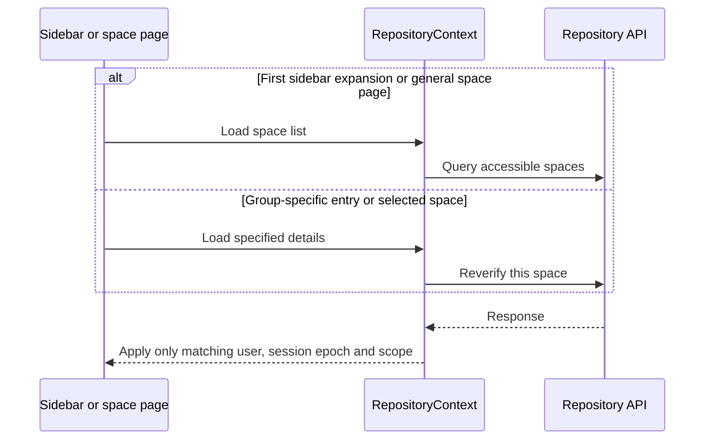
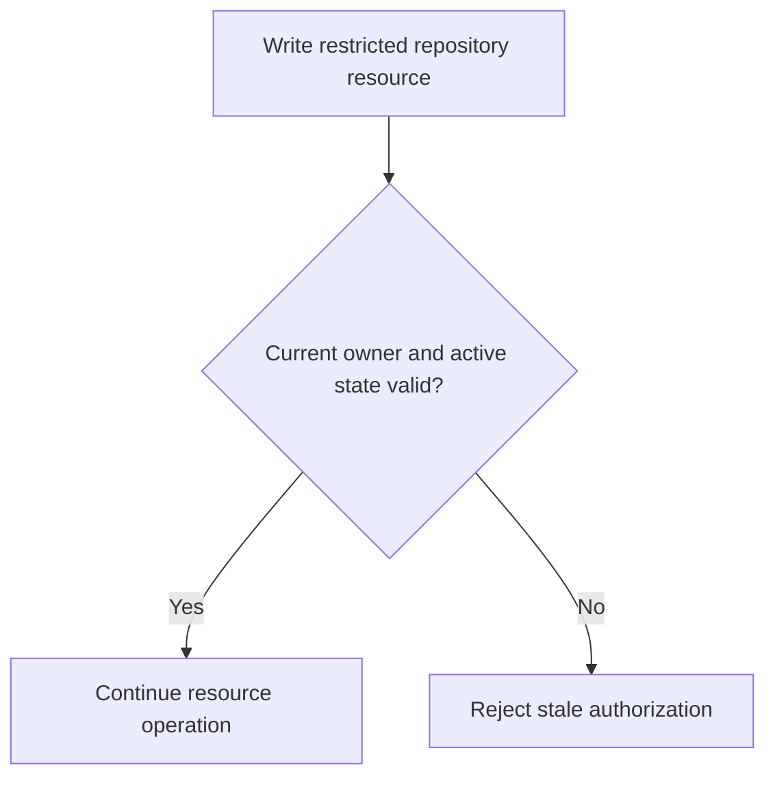
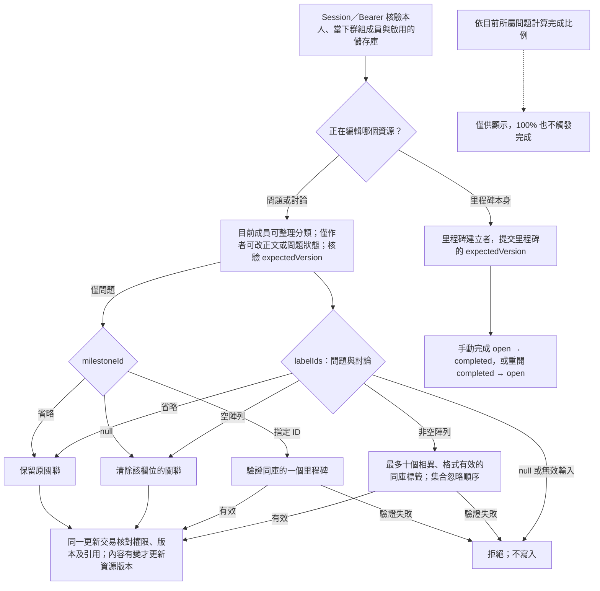
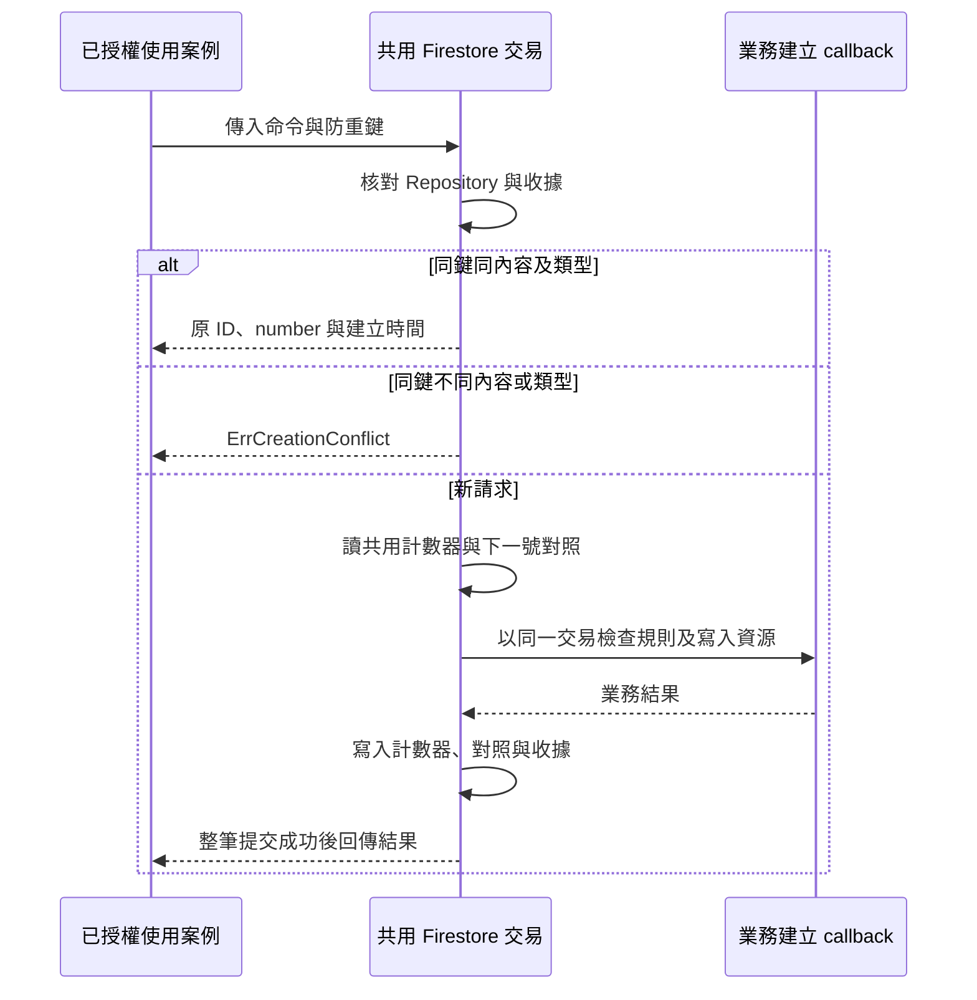

# Personal and group repositories 設計

**Implemented** · [Domain design](#領域設計) · [Core flow](#decision-flow) · [Decision implementation](../../../backend/internal/business/repository/domain/entity/repository.go) · [Module guidance](../../../backend/AGENTS.md)

## Domain design

**Subdomain classification:** core candidate for construction resource management.

**Language:** repositories have IDs, owners and active state; spaces are internal locations, separate from cross-repository projects.

**Context/contracts:** Issue, Discussion and Object use Repository scope/state, checking current repository facts within write transactions.

Issue, Discussion and Object are capabilities within the Repository context. Repository owns ID/version limits, labels, milestones and spaces. Issue/Discussion own content updates and validate referenced catalogs within write transactions. Object owns hierarchy rules while reusing Repository ID/space contracts.

**Acceptance:** matching IDs do not preserve authorization after owner changes or non-ACTIVE state.

[Implementation/tests](../../../backend/internal/business/repository/domain/entity/repository.go) · [Strategic classification criteria](../../references/ddd/design-guide.md)

Specifications for Repositories and spaces, labels, issues, discussions and other capabilities.

This page owns Repository scope/authorization; capability documents own details.

## Reading and editing entry points

[Containers/LINE journeys](../../integrations/line/journey.md#repository-journey) explains responsibilities, target navigation, wiring and acceptance.

Start with [spaces.md](#spaces), [Issue specifications](../issue/design.md) and [organization/team ownership](../../contracts/organization-team-ownership.md).

## Container capabilities

Capabilities share Repository scope but own operation/authorization rules. Each resource specification is maintained in its own domain. This page indexes those resources and owns the shared container rules.

| Capability           | Specification/acceptance                                                                       |
| -------------------- | ---------------------------------------------------------------------------------------------- |
| Spaces               | [Space/ID ownership](#spaces)                                                                  |
| Issue                | [Issue design and contracts](../issue/design.md)                                               |
| Discussion/comments  | [Discussion design and contracts](../discussion/design.md)                                     |
| Object/subobjects    | [Object design and contracts](../object/design.md) · [Templates](../object/design.md#template) |
| Labels               | [Catalog/references](#labels)                                                                  |
| Milestones           | [Specification](#milestones)                                                                   |
| Shared numbering     | [Numbering rules](#numbering)                                                                  |
| Insights             | [Overview/Pulse](#insights)                                                                    |
| Wiki                 | [Pages/revisions](#wiki)                                                                       |
| Container acceptance | [Completion boundaries](#acceptance)                                                           |

`Object.parentId` represents subobjects governed by [object specifications](../object/design.md); no separate Subobject domain documents. Cross-repository [Project](../project/project.md) and independent [Journal](../journal/journal.md) retain their domains.

### 容器責任與內部能力

| 責任       | 能力與邊界                                                                                                                                                                                                                                                                                             |
| ---------- | ------------------------------------------------------------------------------------------------------------------------------------------------------------------------------------------------------------------------------------------------------------------------------------------------------ |
| 容器治理   | Repository 管理個人或群組擁有者、啟用狀態及庫內範圍。庫的讀取資格與資源的操作權分開判定。                                                                                                                                                                                                              |
| 共用能力   | [工區 Space](#spaces)用於庫內分類。[標籤](#labels)、[里程碑](#milestones)與[共用編號](#numbering)依各自規格供資源引用。工區沿用庫的存取範圍。                                                                                                                                                          |
| 業務資源   | [Object](../object/design.md)管理工項階層與數量進度，[範本](../object/design.md#template)用來建立獨立物件樹。個人範本依持有人及目標庫建立權限判定；庫範本依本庫範圍判定。[Issue](../issue/design.md)追蹤異常與狀態，[Discussion](../discussion/design.md)承載討論與留言，[Wiki](#wiki)保存知識與修訂。 |
| 衍生讀取   | [Insights](#insights)提供庫內統計與現況。Pulse 屬規劃，稽核入口依[容器驗收界線](#acceptance)判定。                                                                                                                                                                                                     |
| 跨領域引用 | [Project](../project/project.md)獨立維護跨庫協作與進度。[Journal](../journal/journal.md)獨立維護日誌。開啟引用時依來源資源權限判定，來源狀態由來源領域維護。                                                                                                                                           |

## Personal and group Repository

- Repository stores construction data and spaces.See Project specifications for cross-repository references and management.

  - [Repository spaces](#spaces)

  - [Project specification](../project/project.md)

## Scope and data

- One bot-managed space per LINE group, with separate id/ownerId.LINE events bind personal/group owners; no manual creation, rebinding or deletion.Container management grants no review or other-person attendance access.

- Verified follow events create personal repositories by UserID and personal candidates.

- channels/{channelId}/repositories/{id} stores id, ownerId, name, status,version, createdAt/updatedAt plus internal last-event time/ID.repositoryOwnerBindings/{ownerId} and random-ID containers are created atomically;retries/concurrency reuse owner bindings. ACTIVE/INACTIVE tracks bot group entry.Leaving retains data; rejoining reuses IDs. Old events cannot replace newer state;inactivation wins equal timestamps. Versions increment only for public state/name changes.Names are join/first-interaction snapshots; failed queries allow blanks and later retries.UI falls back to Group space; no live rename synchronization is claimed.

## Operation contracts

- Actor / Resource / Action: verified bot webhook;group Repository; Observe to create/update from group events.

- Context / Authority: Messaging API channel, event time/ID;active-mode join, leave, message, postback and member-join group events only.

- Policy / Decision: valid groupId; transaction reads unique binding/container,preventing duplicates/stale overwrites. Do not consume events;summary and attendance continue normally.

- Result: atomically create/update containers and user candidates;do not move or rewrite summary/attendance history.

- Retries / concurrency: unique-binding transaction, fixed new ID outside retries;same event never increments version.

- Event / Audit: last source event ID/time and public update time;no tokens, message content or personal profiles.

- Actor / Resource / Action: cookie-session/bearer-authenticated user;Repository; List / Get.

- Context / Authority: verified-event candidates. Personal ownerId matches user;group repositories query live LINE group-member-profile on every read.

- Policy / Decision: show only ACTIVE verified containers.Missing, inactive or unauthorized details return 404.LINE errors other than 200/404 or invalid profiles return 503, never authorization.

- Result: non-cacheable basics; no summary content,other-person attendance or management capabilities.

- Retries / concurrency: reads have no side effects.Membership is a current external observation, not an atomic LINE/Firestore snapshot.

- Event / Audit: ordinary reads store no additional personal data/events.

## API and frontend

- GET /api/v1/repositories?cursor=... reads up to ten personal candidatesthen verifies current eligibility. Empty pages may have nextCursor; continue paging.

- GET /api/v1/repositories/{id} checks personal ownership/live membership.Malformed, missing or unauthorized IDs reveal no data.

- Repository API contracts compose through OpenAPI;generate Go/TS DTOs without manual edits.

  - [Repository](../../../api/contract/repository/repositories.yaml)

  - [OpenAPI entry point](../../../api/contract/openapi.yaml)

- Sidebar Spaces expands authorized spaces. Selection shows details at/miniapp/repositories?selected=... without duplicating the list.Existing ?id=... and repository/liff.state group entries remain compatible.

- Normal selection uses clean selected parameters, excluding launch/form queries.Legacy id/repository group entries read specified details only, never general listsor another group after failures. Parse IDs only on space pages.

- Cancel stale list/detail requests. Scope visible state by session epoch, user and scope.Logout/reverification hides old data even when transport ignores cancellation.Selection rechecks details through API; cached lists never authorize.

- Mobile selection closes drawers. Location pages link real spaces,never fabricate personal space data. Without JavaScript, retain links and notices.

- Attendance links carry existing group filters without new permissions;summaries remain group operations.

- Member-join, personal group messages/postbacks create candidates.Existing noninteracting members must interact first; candidates are not full rosters.

## Space loading sequence

Current implementation

[business/repository/RepositoryContext.tsx shares lists, pagination and details.Empty pages with nextCursor retain Load more spaces.Failures clear old items and offer retry; candidates/inactive spaces cannot open.See page/identity lifecycle for identity-change cleanup.](../../architecture/runtime/react-lifecycle.md#頁面與身分生命週期)

## Production space UI scaffold

- Reuse List/Get contracts and identity isolation. Wide cards show authorized basicsand personal attendance. navigation.ts defines page navigation.Keep Issues, Discussions, labels/milestones in Repository; Projects use independentsidebar /miniapp/projects. Legacy entries redirect with explicit Space/source identity,rather than mounting Project business in Repository View.Overview uses real data; Issues, Discussions, labels, milestones, Projects and Insightsfollow their specifications. The [Audit tab](../object/design.md#數量原位編輯與儲存庫稽核) shows committed object quantity changes for readers authorized on the selected repository. Broader public audit remains unavailable. Hide contents on loading, failed verification or logout.Preserve APIs, bot management, membership and numbering. Author categorization owns labels.Respect scaffold boundaries and authorized slices without expanding management scope.Overview integration does not prove other capabilities or real LINE device acceptance.

  - [Issues phase one](../issue/design.md)

  - [Discussions and comments](../discussion/design.md)

  - [Label specification](#labels)

  - [Milestones](#milestones)

  - [Project](../project/project.md)

  - [Insights](#insights)

  - [Basic scaffold](#acceptance)

## Activation and migration limits

Reuse GOOGLE_CLOUD_PROJECT, FIRESTORE_DATABASE_ID and Messaging API settings;missing configuration yields 503. MINI App/Messaging API IDs need the same Provider.Supported trusted events lazily create existing group containers; no production scans/migrations.Summary/Attendance history retains groupId. Original container slices add containers,resolution and reads; feature writes follow their specifications without migrating history.

## Verification and acceptance

- Official LINE main dea09dc6e63fc5c6a3754abfbb304fc6fce4cc54:group chats, join/leave/group-member-profile; 404 never authorizes, check profile userId.

- Context7 /googleapis/google-cloud-go: RunTransaction retries and reads-before-writes,checked against firestore v1.29.2. Google Developer Knowledge unavailable;used official Go client docs without cloud deployment/data operations.

- Context7 /vercel/next.js/v16.4.5 and installed static-export guidance:retain Pages Router, client fetching and static export.

- Graphify located webhook/server/identity/group queries.Scoped Repomix /tmp/repository-before.xml; read omitted guidance directly.

- Delivery messages list local results. Live LINE events, production Firestore concurrencyand iOS/Android login require separate acceptance; builds do not replace them.

- Historical local verification passed: static build/types, 12 frontend tests,OpenAPI generation/compatibility, configuration, Go vet/race/build/lint/format/vulnerabilities.Temporary controlled-store/identity/LINE smoke covered unauthenticated/nonmember/inactive,invalid cursors, profile mismatches and 404/429 rejection semantics.No live Firestore/LINE acceptance or new permanent tests/tools.

- LINE menu/help offers Spaces through existing LIFF URL with repositories=1.Home parses normal query/liff.state and routes to spaces.

- Trusted groupId resolves Repository ID; links use repositories=1&repository=<id>.Query/liff.state retain targets. Dedicated entries read only details, including reload;failures do not fall back to lists. Direct chat lists personal candidates.Verify personal owner/live group membership; changing IDs grants no access.

- Historical dedicated-entry smoke used real Go routes and controlled LINE/API responsesfor normal queries, liff.state and 404. All requested specified details only,reload stayed scoped and 390px had no horizontal overflow. Not LINE-device acceptance.

- [Construction item tracking follows Objects, separate from Issues.No automatic PDF imports or third-party edit grants.](../object/design.md)

## Future model design

- [Shared Repository numbering is used by Issue/Discussion creation;comments consume none. Bot, public queries and membership rules remain.](#numbering)

- [See business model design for entity/query/collection/Connection namingand Issue/Discussion ownership proposals. Future references do not alterexisting REST, membership verification or bot-managed behavior.](../../proposals/platform/domain-model.md)

## Restricted repository write decision flow

[Entry adapter](../../../backend/internal/business/repository/adapter/http/routes.go) · [Decision rules](../../../backend/internal/business/repository/domain/entity/repository.go) · [Application output port](../../../backend/internal/business/repository/application/port/repository.go) · [Related tests](../../../backend/internal/business/repository/adapter/firestore/labels_test.go)

[Domain guidance](../../AGENTS.md)

## 後端分層結構

[repository 模組原始碼](../../../backend/internal/business/repository/) · [代表測試](../../../backend/internal/business/repository/application/repository_test.go) · [六邊形分層與依賴方向](../../architecture/runtime/backend-boundaries.md#六邊形分層參考)

## 空間基礎雛形完成界線

- 狀態：本機基礎雛形完成。最後切片「標籤引用」已通過本機與隔離驗證；完成後停止功能擴充。正式環境驗收另計。

- 本次使用者要求落實最基礎實作，雛形完成即刻告知；完成後停止新增功能，後續只做評估，不自動展開其他頁籤。

- [必要流程：真實空間入口 完成條件與來源：Repository：沿用登入、群組成員核驗、列表／詳情及身分隔離，沒有假資料冒充正式內容](design.md)

- [必要流程：事項 完成條件與來源：Issue：建立、查詢、作者編輯及生命週期；防重、版本與交易規則一致](../issue/design.md)

- [必要流程：討論與留言 完成條件與來源：Discussion：主題、單層留言、各自作者編輯、分頁與重送處理；不加入事項狀態](../discussion/design.md)

- [必要流程：標籤分類 完成條件與來源：Labels：目錄列出／建立，同名唯一；作者可對自己的事項／討論套用及移除同空間標籤，重新載入仍保存](#labels)

- 必要流程：三層接線 完成條件與來源：OpenAPI 生成型別、後端核心／HTTP／Firestore、正式前端入口皆接入；不新增框架或改 primitives

本機完成只表示以上最小協作流程及對應程式驗證通過，不代表真實 LINE 裝置、正式資料庫或部署通過。里程碑、專案管理、公開稽核與總覽統計均不屬於當時的基礎雛形驗收範圍。現行儲存庫「稽核」分頁的查詢範圍與驗收案例見[物件數量異動規格](../object/design.md#數量原位編輯與儲存庫稽核)。

### 完成後評估

1. 先補實際 LINE 身分、群組成員、裝置及資料庫整合證據；既有本機驗證不能取代正式驗收，本次不推送或部署。

2. 完成後先收集使用回饋與修正實際問題；總覽若需要摘要，優先組合既有資料，不用示範數字或把單頁筆數當總數。

3. 里程碑、專案與公開稽核依需求另開切片；先定完成規則、項目歸屬及可見權限，避免自動擴成完整管理平台。

### 本次完成證據

- Graphify CLI 更新為 3,660 節點、9,091 關係；AST 未涵蓋的非支援檔案不作程式正確性依據。Repomix CLI 將 48 個範圍內檔案（含新檔）打包至本機 /tmp/assignment-implemented-20261113.xml，安全檢查通過，並逐檔核對原文。API 40 項能力、生成同步及相容性檢查通過。

- Go 格式、lint、vet、完整既有 race suite 及 build；前端型別、23 個既有測試及靜態建置通過。隔離 Firestore emulator 的暫存 race smoke 驗證事項及討論的分類保存／清除、同空間引用、作者／成員限制、過期與併發版本、原子 metadata、舊欄位省略及建立收據／共用編號相容性。實際頁面的 React smoke 驗證兩種資源的分類選取、重新讀取、移除、唯讀權限、目錄分頁與失敗保留選取、遲到回應隔離；讀取目錄不會誤送出父表單。

- 沿用 Context7 官方 Firestore Go client 與本機 v1.29.2 交易語意、固定 shadcn 4.23.0 Checkbox／Field 官方範例；Go 1.27.4 本機文件確認 slices.Equal 的 nil／空集合相等語意。Google skills／Developer Knowledge MCP 無可用入口，未宣稱正式 Google 或 LINE 整合通過。govulncheck 未發現應用可達漏洞，仍有三筆未被應用呼叫的 required-module 項目。修改保留本機，未提交、推送或部署。

### 後續授權的最小追蹤擴充

- 里程碑、專案與洞察的現行範圍依里程碑、Project 與 Insights 規格。本頁基本協作雛形的完成界線不取代各功能後續已確認的契約。

  - [里程碑](#milestones)

  - [Project](../project/project.md)

  - [洞察（Insights）](#insights)

## 儲存庫洞察（Insights）

### 洞察：現況總覽

成員可讀取所屬儲存庫的事項狀態、討論、里程碑與相容專案數。此數量只計入以該庫為初始來源（`defaultRepositoryId`）的專案；後來才連結此庫的跨庫專案不計入。Project 由個人或組織擁有，這項統計不表示 Repository 擁有 Project。

### 現行統計與查詢契約

Mini App 的 Repository 分析入口命名為「洞察（Insights）」。選取「洞察」時才載入統計資料。既有 statistics 是其中的「現況總覽」：回答現在有多少問題、討論與里程碑，保留既有 API 與計數定義。期間報告另見[近期動態提案](#insights-近期動態pulse提案)。Owner Project 的跨庫看板進度由 [Project](../project/project.md) 定義。

| 視圖                   | 問題                   | 資料來源                                     |
| ---------------------- | ---------------------- | -------------------------------------------- |
| 現況總覽（已實作統計） | 現在有幾個已關閉問題？ | Go 查詢本庫 Issue 的當前狀態，回傳觀察時間。 |

### 操作契約

| 項目                    | 規則                                                                |
| ----------------------- | ------------------------------------------------------------------- |
| Actor／Resource／Action | Session／Bearer 核驗本人，讀取所屬儲存庫的完整統計                  |
| Context／Authority      | 啟用儲存庫與當下群組成員資格；只可讀取有權範圍                      |
| Policy／Decision        | 統計完整集合，不以單頁筆數作總數；沿用各功能自己的狀態              |
| Result                  | 真實數量與觀察時間；讀取失敗顯示錯誤，不偽裝為 0 或沿用過期成功數字 |
| 併發／一致性            | 即時查詢，無快取或背景工作；不提供跨請求統計快照保證                |
| Event／Audit            | 唯讀，不建立額外寫入或外部通知                                      |

### 實作與驗收入口

- 用例位於 backend/internal/business/repository/statistics，不建立通用統計引擎。資料量增長時依實際查詢成本另行評估聚合，不自動增加計數器、排程或趨勢圖。

- OpenAPI 來源 · Project 規格 · 驗收矩陣。真實 LINE 身分、群組與正式資料庫須有獨立驗收證據，不沿用舊報告的通過結論。

  - [OpenAPI 來源](../../../api/contract/repository/statistics.yaml)

  - [Project 規格](../project/project.md)

  - [驗收矩陣](../../development/tooling/testing/commands.md)

### 近期動態（Pulse）提案

| 視圖          | 問題                                 | 預計資料來源                                     |
| ------------- | ------------------------------------ | ------------------------------------------------ |
| Pulse（規劃） | 過去七天有幾個問題新建、關閉或重開？ | Go 依 Issue 建立時間與有前後狀態的變更紀錄統計。 |

Pulse 首版預設最近 7 天，可選最近 30 天。Go 固定一次查詢的 UTC 截止時間，採左含右不含的滾動期間，回傳起訖時間供前端顯示。每項指標各按 Issue ID 去重：同一問題在期間內關閉兩次又重開，在「關閉」與「重開」各計一個。首次建立只計入「新建」。修改正文、分類或 Project item 進度不計為關閉或重開。歷史覆蓋不足時顯示可用期間或「資料不足」；無活動且覆蓋完整才顯示零。

權限沿用本庫讀取資格。驗收涵蓋期間邊界、同一 Issue 多次轉換、跨庫排除與失權。實作前先驗證歷史紀錄完整性、查詢範圍與成本；前端不逐筆載入 Issue 歷史來計數。參照 [GitHub Pulse](https://docs.github.com/en/repositories/viewing-activity-and-data-for-your-repository/using-pulse-to-view-a-summary-of-repository-activity)。

## 空間標籤目錄

狀態：依使用者「先用最基礎的實現」完成目錄列出與建立及本機隔離驗證；正式環境待驗收。

### 分類協作與改名

分類操作只更新同庫的標籤引用，以及 Issue 可選的里程碑。Go 重新核驗操作者資格、資源歸屬與版本。只有分類權的操作者若同時修改正文或問題狀態，整筆拒絕。Discussion 沿用同一套標籤規則。

授權改名時保留 Label ID；新名稱仍需在同庫唯一，名稱綁定與標籤在同一交易更新。以原建立鍵重送原請求，應取回同一 ID 與目前名稱。改名不需要逐筆更新 Issue 或 Discussion。群組 Repository 的所有目前成員均可分類及改名；個人 Repository 僅限本人。改名須提交讀到的原名稱，名稱過期回 409。

### 首版歷史範圍

- 先以 Graphify CLI、Repomix CLI 核對討論／留言原始碼，與上一階段驗證包一致，沿用已有契約、分層、交易及 UI 驗證證據。 查核發現空間文件仍稱共用編號未接入業務，已修正為事項與討論已接入、留言不占號；程式未發現阻擋此切片的結構或方向問題。

- 沿用現有成員核驗模式，核驗成員可列出及建立空間標籤。目錄只有名稱，不新增改名、刪除、自訂顏色、角色或編號；本次以既有事項／討論的作者編輯權限接入標籤引用，不擴大可編輯對象。

### 操作契約

| 欄位                      | 列出目錄                                                      | 建立標籤                                                                              |
| ------------------------- | ------------------------------------------------------------- | ------------------------------------------------------------------------------------- |
| Actor / Resource / Action | 既有 Session／Bearer 驗證本人；指定 Repository 的 Label；List | 同左；CreateLabel，作者由伺服器取得                                                   |
| Context / Authority       | 啟用空間、當下群組成員資格、本人範圍游標                      | 同左；正規化名稱與原建立鍵                                                            |
| Policy / Decision         | 只回傳該空間目前核驗成員可讀取的標籤                          | 核驗成員可建立；同一空間名稱比較值必須唯一，交易內確認容器狀態與群組綁定              |
| Result                    | 最多二十筆及 nextCursor，不變更資料                           | 保存不透明 ID、名稱、建立時間與可信作者；不消耗共用 number                            |
| 重送／併發                | 游標綁定 channel、空間與本人，依 ID 穩定遞增                  | 同空間、本人及建立鍵重送相同名稱回同一 ID；同鍵不同名稱或同空間同名回 409，不重複建立 |
| Event / Audit             | 一般讀取不額外保存個資                                        | 作者與建立時間保存於標籤，收據提供防重證據；無外部通知                                |

名稱去除首尾空白後 1–40 個 Unicode 字元，不得含控制字元；名稱比較值使用 strings.ToLower，不宣稱 Unicode NFC 或完整 case-fold 等價。 名稱唯一性限於同一 Repository，不因另一個空間有同名標籤而拒絕。JSON 上限 1024 bytes，不接受未知欄位；ID、時間及作者不能由客戶端指定。首版建立後不提供修改或刪除。

### API、資料與結構

- 契約來源為 api/contract/repository/labels.yaml，由既有 OpenAPI 入口生成 Go／TS 型別，不變更相容性 baseline。

- `GET /api/v1/repositories/{repositoryId}/labels?cursor=...`：列出可讀目錄，每頁二十筆。

- `POST /api/v1/repositories/{repositoryId}/labels`：body 只有 name，必填 Idempotency-Key；同一次未確認建立重試沿用原鍵及內容。

- 資料位於既有 channels/{channelId}/repositories/{repositoryId} 下的 labels/{id}；labelNames/{hash} 保存名稱唯一綁定，labelCreationReceipts/{hash} 保存本空間、本人及建立鍵的收據。建立以同一交易保存標籤、名稱綁定與收據，所有讀取先於寫入。 Bot 停用保留資料、拒絕新讀寫；再次啟用沿用標籤。LINE 成員核驗是外部資格觀察，不宣稱與 Firestore 原子一致。錯誤只公開領域分類，SDK 原因保留在 adapter 私有值。

- 核心位於 repository/labels，HTTP 在其 http 子目錄；Firestore 使用既有 Repository Store，不新增 client。前端 由正式空間「標籤」入口組合現有 UI，不改 primitives 或 Shell 業務責任。 失敗語義：400 輸入／游標、401 身分、403 CSRF、404 無權或不存在空間、409 同名／建立鍵衝突、415 非 JSON、503 未配置／不可用／結果不明。 前端分開取消讀寫請求，離開空間或身分變更時丟棄舊回應；同步鎖阻擋連點，建立結果不明時鎖定原名稱並沿用鍵重試。鍵僅保留本次畫面，離頁或重新整理前應先確認結果。

  - [repository/labels](../../../backend/internal/business/repository/domain/entity/labels/labels.go)

  - [Firestore](../../../backend/internal/business/repository/adapter/firestore/labels.go)

  - [前端](../../../frontend/miniapp/src/business/repository/labels/View.tsx)

### 標籤目錄完成當時的評估

- 下表記錄當時的排序；里程碑現況見里程碑規格。目錄本身不授予事項／討論寫入權。本次已接入下述標籤引用切片，保留各自作者與版本規則；基礎雛形完成界線見 空間雛形。 在擴大功能前，仍需實際 LINE 身分、群組成員與正式資料庫的整合驗收，本機模擬器不取代這些證據。里程碑與專案管理排在標籤引用後；里程碑完成規則、專案歸屬與項目狀態應先定義，不由預覽百分比或事項狀態猜測。

  - [里程碑規格](#milestones)

  - [空間雛形](#acceptance)

| 優先順序 | 後續工作               | 評估與邊界                                                                                     |
| -------- | ---------------------- | ---------------------------------------------------------------------------------------------- |
| 1        | 實際整合驗收           | 目前只完成本機／隔離驗證，正式 LINE 裝置與資料庫證據仍缺；部署前先補齊，不因目錄完成就宣稱上線 |
| 已接入   | 標籤套用到事項／討論   | 使用既有更新 API，保留作者及版本規則，仍不加入標籤改名／刪除                                   |
| 3        | 正式總覽摘要           | 現況只有空間資料與功能入口；可先組合既有事項／討論查詢，不放示範統計或以單頁筆數作總數         |
| 4        | 里程碑、專案與稽核畫面 | 延後；先定義完成條件、項目來源、狀態歸屬及可見權限；既有更新 metadata 不等於完整公開稽核系統   |

### 查證與驗證

- 沿用本對話已查閱的 Context7 官方 Google Go client 交易契約及本機 firestore v1.29.2：所有讀取先於寫入，callback 可能重試，只有交易回傳 nil 才確認提交。Google skills／Developer Knowledge MCP 未提供可用入口；本次未操作正式資源。 錯誤邊界沿用官方 errors.Is／Unwrap 語意及既有 adapter 模式，Go 1.27.4；UI 沿用固定 shadcn 官方範例與 Next.js 16.4.5 Pages Router 架構，不新增套件或改寫 primitives。Graphify 與 Repomix 用於定位及原文交叉核對，不取代行為驗證。

- API 能力／生成同步／向後相容、Go 格式／lint／vet／完整既有 race suite／build、前端型別／23 個既有測試／靜態輸出、設定與文件連結檢查通過。govulncheck 未發現應用可達漏洞，另報三筆未被程式呼叫的 required-module 項目。 隔離 Firestore emulator 的暫存 overlay race smoke 確認正規化同名拒絕、不同空間同名允許、同鍵重送、同鍵異名拒絕、併發名稱唯一及重送只建立一次、分頁／游標範圍、成員資格、不占共用編號、HTTP 契約／CSRF／大小限制、無修改或刪除端點、停用交易拒絕及取消語義。 暫存 React smoke 確認正式目錄入口、連點鎖、原鍵重試、查詢失敗時清空舊目錄而不顯示成功空態、切換身分後拒收遲到標籤。驗證程式與 Java runtime 僅放 /tmp，未新增正式測試框架；不代表正式環境或真實 LINE 裝置已驗收。

### 標籤引用切片

現行實作

問題與討論的分類更新，以及里程碑本身的狀態轉換。

- 問題與討論沿用既有 PATCH，留言不套用標籤。標籤建立者沒有因此取得修改他人內容的權限。過期版本回 409；任何引用驗證失敗都不提交更新。成功只改該資源與既有更新紀錄（操作者、版本、時間），標籤與共用編號不變，也不產生通知或公開稽核端點。

- 既有未含 labelIds 的資料讀作空集合，HTTP 新回應提供陣列（可選欄位，不回 null），舊更新請求省略欄位時不清空關聯。既有建立收據 v1 雜湊與 ID／number 分配完全不變，不掃描或回填歷史資料。 核心只共用 labels.NormalizeIDs 這個實際跨業務需要的值驗證；各領域保留自己的用例及版本規則。Firestore adapters 透過小型 LabelValidator 介面，在同一交易的寫入前驗證引用，由 bootstrap 注入既有 Repository Store，不建立共通操作引擎或新 client。 前端共用 business/repository/labels/Picker，透過既有目錄 API 分頁讀取名稱；載入或失敗不清除目前選取，讀取更多頁不觸發表單送出。目前成員選取或移除分類後沿用資源版本與衝突處理。

## 里程碑

[進度顯示「已關閉 X/Y 個問題」，依所屬 Issue 的關閉數與總數計算。里程碑本身由建立者手動關閉或重開。正式環境驗收須有實際證據。](#labels-標籤引用切片)

### 操作契約

| 項目                    | 規則                                                                                        |
| ----------------------- | ------------------------------------------------------------------------------------------- |
| Actor／Resource／Action | Session／Bearer 核驗本人；同一啟用儲存庫中的 Milestone；列出、建立、詳情與更新              |
| Context／Authority      | 核驗當下群組成員資格；建立者才能編輯                                                        |
| Policy／Decision        | 標題 1–120 字元、描述最多 8000 字元；可選 YYYY-MM-DD 曆日                                   |
| Result                  | 回傳內容、版本與更新時間；無事項時顯示「尚無事項」                                          |
| 重送／併發              | 建立鍵同內容回同一 ID，異內容回 409；更新檢查 expectedVersion，衝突回 409；無變化不增加版本 |
| Event／Audit            | 保存建立者與時間、更新操作者／版本／時間；無外部通知                                        |

### 資料與相容邊界

- 核心位於 backend/internal/business/repository/milestones，Firestore 使用既有 Repository Store；資料在 channel／repository 下的 milestones，建立收據使用對應功能的 receipt collection。不占共用資源編號，不更動既有事項／討論收據。

- 舊事項缺少 milestoneId 時視為未歸屬。事項建立收據雜湊保持相容。寫入交易檢查容器啟用、群組綁定、作者、版本與引用範圍，全部讀取先於寫入。

- 進度由當前來源事項計算，不複製事項狀態；查詢成本隨資料量增長，不自行加入計數器或排程。

### 契約與驗收入口

- OpenAPI 來源 · 事項規格 · 驗收矩陣。文件規則與歷史通過紀錄均不能代替本次變更或目標環境的驗收。

  - [OpenAPI 來源](../../../api/contract/repository/milestones.yaml)

  - [事項規格](../issue/design.md)

  - [驗收矩陣](../../development/tooling/testing/commands.md)

## repository-共用資源編號基礎

### Repository 共用資源編號基礎

- 狀態：內部共用基礎，已接入 事項建立 與 討論建立，留言不消耗共用編號。初期先完成編號基礎；目前事項契約、畫面與資料保存依事項規格，不由編號基礎自行決定。

  - [事項建立](../issue/design.md)

  - [討論建立](../discussion/design.md)

### 範圍與識別

- 每個 Bot 管理的 Repository 共用一條資源編號序列，從 1 開始。例如 Issue #1、Discussion #2、Issue #3；不按資源類型另建計數器。另一個 Repository 從 1 開始。

- id 是不透明的隨機識別碼，number 是資源在空間內的可見編號。資料保存整數，畫面接入時才加 #。單一號碼能解析為資源類型與 ID，但不是授權憑證。各業務仍擁有獨立的狀態、權限與資料。

- 事項與討論已使用共用編號；其他資源是否需要編號仍待各功能規格確認。未來接入的業務若需要編號，一律使用同一入口；不預建 Issue、Discussion、Member、Label、Milestone 或 Project 的建立權限與生命週期。

### 保存結構

以下路徑均位於既有 channels/{channelId}/repositories/{repositoryId} 下：

| 路徑                            | 責任                                                                     |
| ------------------------------- | ------------------------------------------------------------------------ |
| counters/resources              | 唯一計數器，schemaVersion 與 lastNumber                                  |
| resourceNumbers/{number}        | schemaVersion、repositoryId、resourceType、resourceId、number、createdAt |
| resourceCreationReceipts/{hash} | schemaVersion、payloadHash 與原始編號對照結果                            |

- 資源類型使用穩定的小寫名稱；本基礎不接受客戶端直接選擇類型、操作者、ID 或號碼。收據鍵使用命名空間、可信操作者與防重鍵的 JSON tuple 做 SHA-256；channel 與 Repository 由保存路徑隔離。同一操作者在同一空間共用建立鍵範圍，跨類型重用鍵會回傳衝突。

- 初次成功寫入時才建立計數器，不由 Bot 建立 Repository 時預配。不回收、不重設、不因 Bot 離開或再加入而清零；不因刪除業務資料而刪除編號對照。上限為 JavaScript 可精確表示的最大整數 2^53−1。既有損壞計數器與下一號已存在時拒絕寫入，不覆蓋舊對照；不自動修復手動刪改的資料。

### 操作契約

| 欄位                      | 建立帶編號的業務資源                                                                                                                                           |
| ------------------------- | -------------------------------------------------------------------------------------------------------------------------------------------------------------- |
| Actor / Resource / Action | 未來業務使用案例傳入的可信操作者；既有 Repository；CreateNumberedResource                                                                                      |
| Context / Authority       | 呼叫者必須先驗證登入及該項業務建立權；GroupID 來自已授權的 Repository。本方法不是授權服務，不由讀取資格推導建立權                                              |
| Policy / Decision         | 交易內讀取 Repository，確認啟用且群組綁定與已授權範圍一致；檢查防重收據、計數器與下一號對照。額外業務規則由 callback 在同一交易檢查                            |
| Result                    | 同一交易提交業務資源、共用計數器、編號對照與防重收據；僅整個方法成功後可使用回傳結果                                                                           |
| 重送／併發                | 同操作者、鍵、類型與內容雜湊回原 ID／number／時間，不呼叫建立 callback、不增加計數。同鍵不同內容或類型回 ErrCreationConflict。不同請求透過共用計數器交易序列化 |
| Event / Audit             | 對照保存類型、ID、號碼與時間；收據提供操作者／鍵範圍的防重證據。正式業務 Audit 由未來功能定義；不記錄 token 或原始防重鍵                                       |
| 失敗                      | callback 或驗證拒絕會回滾本次交易；整體方法發生錯誤時回傳零值與錯誤。提交結果不明的網路錯誤必須沿用原鍵重試，不宣稱一定未提交                                  |

| 欄位                      | 依編號解析                                                                                       |
| ------------------------- | ------------------------------------------------------------------------------------------------ |
| Actor / Resource / Action | 未來已授權使用案例；指定 Repository 的編號；GetResourceNumber                                    |
| Context / Authority       | 此方法只做低層持久化查詢；對外使用前必須核驗容器及目標業務資源存取權，不能直接轉成無授權公開端點 |
| Policy / Decision         | 檢查 ID、號碼範圍與對照資料完整性；無資料回 ErrNotFound，損壞或服務不可用則拒絕                  |
| Result / 重送 / Audit     | 回傳類型、ID、號碼與建立時間；無寫入、無額外事件，不表示使用者有權讀取目標內容                   |

### 內部接入方式

- [核心型別與錯誤：numbering.go，不依賴 Firestore／HTTP DTO。](../../../backend/internal/business/repository/domain/entity/numbering.go)

- [Firestore 實作：numbering.go。使用既有 Store 的 client 與 channel，不另建服務或連線。](../../../backend/internal/business/repository/adapter/firestore/numbering.go)

- CreateNumberedResource(ctx, command, create)：command 包含已核驗的 Repository／群組／操作者、資源類型、防重鍵及正規化且帶版本的業務內容雜湊。雜湊不包含伺服器產生的 ID／number／時間。

- create(ctx, tx, reference)：未來業務 Firestore adapter 依 reference 的 ID／number 建立自己的資料，所有讀寫使用同一 tx。可先讀取額外資料檢查業務規則，再寫入；不得提交交易、開新交易、呼叫外部服務或發送通知。

- 隨機 ID 與微秒精度 UTC 時間在交易 callback 外產生，號碼在交易內決定。重試結果不更改原資源建立時間。

- GetResourceNumber(ctx, repositoryID, number)：只解析對照，未新增 API 路徑或修改生成型別。

- 現行實作

- callback 可能重跑。僅使用已提交結果，提交不明時沿用原鍵。

- 群組成員核驗依既有外部機制完成，無法與 Firestore 組成原子快照；交易中的容器狀態檢查不擴大此保證。未來業務寫入權須另定，不把本基礎視為已授權。

### 查證與驗收範圍

- Graphify 定位既有 Repository 與交易模式，Repomix 限定核對 Repository、契約雛形及既有補卡防重來源；指引與 Markdown 另讀原文。Context7 /googleapis/google-cloud-go 的官方 transaction.go 與本機 firestore v1.29.2 原始 碼交叉確認：callback 可能重試、所有讀取須先於寫入，只有 RunTransaction 回傳 nil 才能確認提交。

- Google Developer Knowledge 與 Google skills 未在此聊天提供可用入口，因此使用上述官方 Go client 來源；沒有執行 Google Cloud 資源操作。驗證結果於交付訊息列明，本機 emulator 與 race smoke 不取代正式環境驗收。沿用既有 CI，不新增正式測試框架或部署流程。

- 本次本機驗證：使用暫存 Go overlay 與隔離的 Firestore emulator 執行 race smoke，確認跨類型與跨空間計數、併發唯一號、同鍵併發重送、內容／類型衝突、業務寫入回滾、停用／群組綁定拒絕、再加入續號、損壞資料與整數上限及取消語義。驗證程式與 Java runtime 僅放 /tmp，未新增正式測試案例或修改專案工具版本。Graphify 更新有既有 Identity 方法名稱碰撞警告，該區不作為本次編號實作證據；文件圖譜的本機連結檢查通過。

## 儲存庫業務空間

Space 是 Repository 內的業務分類空間，具有獨立的 32 位小寫十六進位 ID 與名稱。它不是 LINE 群組，也不產生新的成員或授權範圍；既有物件可保持未分配。

### 身分與相容邊界

| 識別碼       | 權威與責任                                                                                                                          |
| ------------ | ----------------------------------------------------------------------------------------------------------------------------------- |
| GroupID      | 簽章驗證的 LINE 群組上下文與目前成員資格；C 加 32 位十六進位。                                                                      |
| UserID       | 後端驗證 LINE 身分取得的 actor，不接受 body 宣告。LINE User ID 以 provider 為範圍；同 provider 的相關 channels 才能對應同一使用者。 |
| RepositoryID | 伺服器管理的資料來源容器，與 LINE GroupID 分開。                                                                                    |
| SpaceID      | 本功能的 repository-owned 業務空間 ID；同一空間不能掛到其他 repository 或 channel。                                                 |

- [庫內工區使用 Repository 的 spaces 路徑及 spaceId。跨庫收錄工程對象的規則見 Project 功能規格。](../project/project.md)

- [LINE 規則核對官方 User IDs，官方 source main revision 259d1fa7698d597f95a7f044f2592379a63defbe，2026-11-18。不同 provider 的 User ID 不得僅憑同一真人自行合併。](https://developers.line.biz/en/docs/messaging-api/getting-user-ids/)

### 操作契約

| 操作                                                                                                                        | Result／重送                                                                                                  |
| --------------------------------------------------------------------------------------------------------------------------- | ------------------------------------------------------------------------------------------------------------- |
| 成員讀取列表／單筆Context／Authority／Policy：可信 actor、目前 repository 成員；容器 ACTIVE；不另設 Space 成員              | GET /api/v1/repositories/{repositoryId}/spaces[/id]，列表每頁 20 筆，游標綁 actor/channel/repository。        |
| 成員建立空間Context／Authority／Policy：同上；名稱 trim 後 1–120 字；寫入交易核 repository ID/GroupID/ACTIVE                | POST collection；Idempotency-Key 綁 actor/repository 與名稱。同鍵同內容回原空間，異內容衝突；不使用共用編號。 |
| 物件建立／修改分配Context／Authority／Policy：沿物件既有權限與 expectedVersion；同交易核業務空間屬於目前 channel/repository | 可選 spaceId：建立省略為未分配；PATCH 省略保留、空字串解除。失敗不寫物件或收據。                              |

資料位於 channels/{channelId}/repositories/{repositoryId}/spaces/{spaceId}；建立收據位於同庫 spaceCreationReceipts。首版只提供建立／讀取，不提供刪除、獨立成員管理或正式資料遷移。Subobject 沿父物件的空間，不另存 SpaceID 或建立權限。

### 實作與驗收範圍

- 後端由 backend/internal/business/repository/space 擁有，OpenAPI 權威為 api/contract/repository/spaces.yaml。物件編輯器提供未分配／空間選取及建立空間。建立結果不明時沿同一 body/key 重試，不因切換選項建立另一意圖。

- 必要驗收包含 ID 隔離、可信 actor、目前成員／停用容器、同庫同 channel 分配、PATCH 省略與清除、legacy 收據指紋、並行重送與分頁。local emulator 不等於正式 Firestore／LINE 驗收；本輪不操作正式資料。

## Repository Wiki

Wiki 是單一 Repository 的工程知識庫。群組庫可放巡檢 SOP、設備異常排查與已定案的施工方法；個人庫可放自己的操作筆記。以「泵浦壓力異常」為例：Issue 追蹤這次維修，Discussion 討論告警門檻，Wiki 的〈泵浦壓力檢查〉記錄下次可重用的步驟，附上討論或問題連結。設備識別與數量仍由 Object／Subobject 提供，驗收結果仍由驗收紀錄提供。

### 頁面、版本與連結

首版提供目錄、建立、閱讀、修改及版本歷史。每頁有固定 page ID、庫內唯一標題、Markdown 內容及目前版本。首頁可由目錄進入；頁面互引使用固定 ID，改名後舊連結仍可開啟。每次有效修改由 Go 在同一交易更新頁面與修訂，保存作者、時間、標題和內容。提交時核對預期版本，過期回 409 並保留編輯草稿供使用者比對；建立請求重送沿用同一識別鍵。首版以文字與連結為主。

### 權限與 LINE 入口

首版採庫內共同編輯：個人庫限本人，群組庫限經核驗的目前成員，可閱讀、建立及修訂同庫頁面。Go 在每次 API 請求核驗 Repository 存取資格。每次開啟頁面、讀歷史或寫入時核驗庫資格；LINE 訊息分享的是 Mini App 頁面連結，開啟時重新登入或核驗身分。引用來源另驗讀權，不將私有來源預覽附在群組訊息。Markdown 顯示僅允許安全的連結與標記，停用原始 HTML。

### 驗收

成員甲建立 SOP，成員乙修改標題與步驟後，原連結可開啟新版，歷史仍可查看舊版及修訂作者。兩人從同版提交，僅第一筆成功。離群者持有舊連結也無法取得正文或歷史；相同標題可分別存在不同 Repository。由 OpenAPI 定義正式操作與資料格式，Go 負責存取與版本規則，React 負責閱讀及編輯。

目錄與歷史每頁最多 20 筆，歷史依版本由新到舊。目錄只傳標題與修訂資訊，開啟頁面才取得正文。首版標記支援標題、段落與 HTTP(S) 連結。操作格式見 [Wiki OpenAPI](../../../api/contract/repository/wiki.yaml)。

參照 [GitHub Wiki](https://docs.github.com/en/communities/documenting-your-project-with-wikis/about-wikis)。
