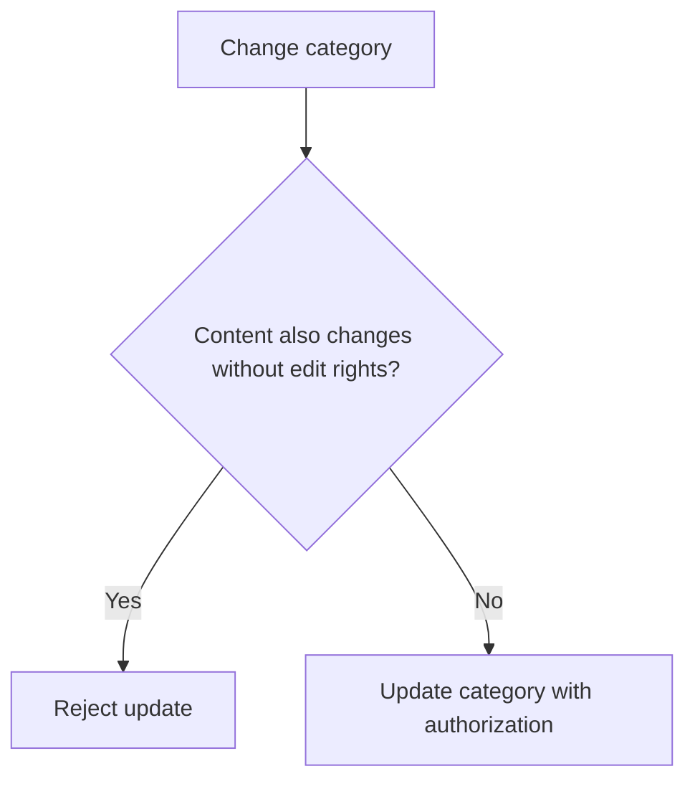

# Discussion

**Implemented** · [Design](design.md) · [Core flow](#decision-flow) · [Representative tests](../../../../backend/internal/business/discussion/domain/entity/classification_test.go) · [Code](../../../../backend/internal/business/discussion/README.md) · [Guidance](../../../../backend/internal/business/discussion/AGENTS.md)

[Frontend](../../../../frontend/miniapp/src/business/discussion/README.md) · [Public API](../../../../api/contract/discussion/README.md)

## Domain design

**Subdomain classification:** collaboration supporting candidate.

**Language:** threads hold conversations; comments are replies; categories classify discussions.

**Context/contracts:** Repository supplies scope. Discussion separately authorizes content/category changes.

**Acceptance:** categorization-only members may change categories but not bundled content updates.

[Implementation/tests](../../../../backend/internal/business/discussion/domain/entity/classification_test.go) · [Strategic classification criteria](../../../references/ddd/README.md)

Discussion specifications define threads, comments and categories.

[Domain design/operation contracts](design.md) · [Backend entry](../../../../backend/internal/business/discussion/README.md)

## Discussion category decision flow

[Entry adapter](../../../../backend/internal/business/discussion/adapter/http/routes.go) · [Decision rules](../../../../backend/internal/business/discussion/domain/entity/classification_test.go) · [Application output port](../../../../backend/internal/business/discussion/application/port/store.go) · [Related tests](../../../../backend/internal/business/discussion/domain/entity/classification_test.go)

[Guidance](../../AGENTS.md) · [Repository capabilities](../README.md#repository-capabilities) · [Domain overview](../../README.md)
