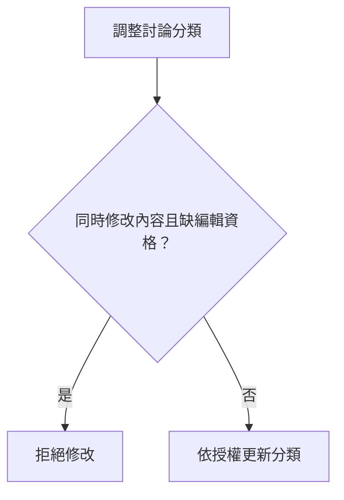

# 討論

**已有實作** · [設計規格](design.md) · [核心流程](#decision-flow) · [代表測試](../../../../backend/internal/business/discussion/domain/entity/classification_test.go) · [程式目錄](../../../../backend/internal/business/discussion/README.md) · [維護指引](../../../../backend/internal/business/discussion/AGENTS.md)

## 領域設計

**子域定位**　協作支援候選。

**通用語言**　討論串承載對話；留言是串內回應；分類描述討論的歸類。

**上下文與契約**　Repository 提供討論所屬範圍。Discussion 決定更新討論內容與更新分類各自需要的資格。

**驗收案例**　只具分類權限的成員可以調整分類；同一請求若夾帶內容修改，應拒絕越權變更。

[對照實作或測試](../../../../backend/internal/business/discussion/domain/entity/classification_test.go) · [戰略設計與分類準則](../../../architecture/ddd/README.md)

討論串、留言與分類的行為由討論規格定義。

[領域設計與操作契約](design.md) · [後端實作入口](../../../../backend/internal/business/discussion/README.md)

## 調整討論分類的判定流程

[入口適配器](../../../../backend/internal/business/discussion/adapter/http/routes.go) · [判定依據](../../../../backend/internal/business/discussion/domain/entity/classification_test.go) · [應用層輸出介面](../../../../backend/internal/business/discussion/application/port/store.go) · [相關測試](../../../../backend/internal/business/discussion/domain/entity/classification_test.go)

[適用工作指引](../../AGENTS.md) · [Repository 能力索引](../README.md#repository-capabilities) · [領域總覽](../../README.md)
