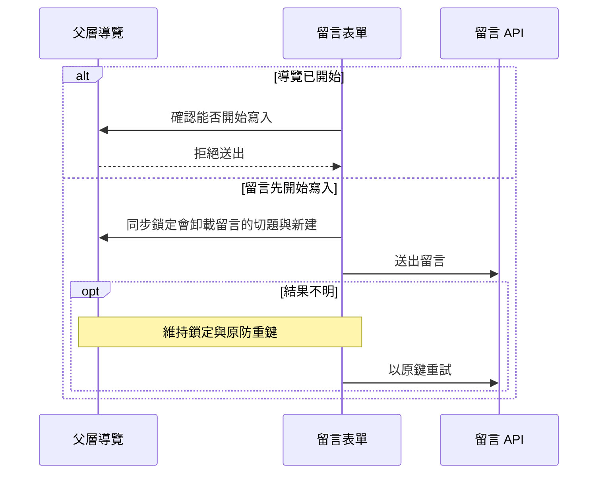

# 空間討論與單層留言

<a id="空間討論與單層留言"></a>

狀態：產品規則已於 2026-11-13 由使用者確認，已完成本機實作及隔離驗證；正式環境待驗收。

<a id="前置查核與範圍"></a>

## 前置查核與範圍

- [先以 Graphify CLI、Repomix CLI 核對 事項切片 的契約、核心、adapter、畫面與組裝；來源與先前驗證包一致。 查核發現事項 Firestore 未保留未知 SDK 錯誤的內部原因，已依既有分層規範改用私有錯誤包裝，對外仍只公開領域錯誤；受影響套件與分層檢查通過後，才進入本階段。](../issue/design.md)

- 使用者確認：目前核驗的空間成員可讀取、發起討論及留言；主題、留言只能由各自作者編輯。留言為單層，不支援留言的子留言。 討論使用既有空間共用 number，留言只使用不透明 ID，
  不消耗共用編號。首版沒有關閉狀態、刪除、分類、標記解答、Reaction 或轉換事項。 Discussion 與 Issue 保持獨立業務，不因畫面或欄位相似而共用狀態模型或引入萬用資源引擎。

<a id="操作契約"></a>

## 操作契約

- [讀取、建立與編輯依問題、討論與留言操作圖。討論與留言各自判定作者；留言只有一層，建立或編輯留言不會改變主題內容版本。各自的建立收據、查詢順序與保存位置見下節。](../issue/design.md#操作契約)

- 主題 title 去除首尾空白後 1–120 字元，body 最多 8000 字元；留言 body 去除首尾空白後 1–4000 字元。以 Unicode 字元計算。JSON 上限 65536
  bytes，不接受未知欄位；作者、ID、number、時間由伺服器取得。所有建立操作必須提供 Idempotency-Key，所有編輯操作必須提供 expectedVersion。

<a id="api-與資料責任"></a>

## API 與資料責任

- 契約由
  [討論契約](../../../../api/contract/discussion/discussions.yaml)與[留言契約](../../../../api/contract/discussion/comments.yaml)
  擁有，經既有 OpenAPI 入口生成 Go／TS 型別；不修改既有相容性 baseline。

| 操作       | 路徑                                                                        | 行為與限制                  |
| ---------- | --------------------------------------------------------------------------- | --------------------------- |
| GET、POST  | `/api/v1/repositories/{repositoryId}/discussions`                           | GET 列表與 POST 發起。      |
| GET、PATCH | `/api/v1/repositories/{repositoryId}/discussions/{id}`                      | GET 詳情與 PATCH 編輯主題。 |
| GET、POST  | `/api/v1/repositories/{repositoryId}/discussions/{id}/comments`             | GET 單層留言與 POST 留言。  |
| PATCH      | `/api/v1/repositories/{repositoryId}/discussions/{id}/comments/{commentId}` | PATCH 編輯自己的留言。      |

- 討論依共用 number 遞減，一頁掃描二十筆候選後依標題搜尋；允許空頁續查。留言依 createdAt 及 ID 遞增分頁，每頁二十筆；新增留言不改主題內容版本。兩者皆有範圍綁定游標，
  前端不以單頁資料推算總數。

- 資料位於既有 channels/{channelId}/repositories/{repositoryId}/discussions/{id}，留言在其
  comments/{commentId}，留言防重收據在其 commentCreationReceipts/{hash}，有效編輯的 metadata 在各資源自己的
  changes/{version}。 建立討論與共用編號同一交易提交；新增留言原子保存留言與防重收據。各寫入交易重讀啟用空間、群組綁定及所屬主題，編輯另讀資源及版本；所有讀取先於寫入。
  既有 LINE 資格核驗仍是外部觀察，不能宣稱與 Firestore 原子一致。 錯誤沿用 400 輸入、401 身分、403 作者權限／CSRF、404 無權或不存在、409
  版本／建立鍵衝突、415 非 JSON、503 未配置或結果不明；不回傳 SDK 原因或輸入內容。

<a id="最小實作邊界與驗證"></a>

## 最小實作邊界與驗證

- 後端 business/discussion 核心及其 HTTP、Firestore adapters，由 bootstrap 注入既有身分、Repository
  client 與編號能力。前端 business/discussion 由正式空間「討論」入口組合既有官方 UI；不修改 primitives、既有出勤或事項模型。 前端分開取消列表、
  主題、留言與寫入請求，切換空間／主題或身分時隔離資料。編輯失敗先重新讀取。

  - [business/discussion](../../../../backend/internal/business/discussion/application/service.go)

  - [business/discussion](../../../../frontend/miniapp/src/business/discussion/View.tsx)

- 現行實作



防重鍵只保留在本次畫面。離頁或重新整理前應先核對不明結果。遇到跨儲存庫頁籤切換、身分失效或整頁離開時，這項互鎖無法提供持久保障。 沿用既有驗收命令與必要隔離 smoke，不新增正式測試框架；
本機、真實 LINE 裝置及正式 Firestore 驗收分別回報。

<a id="查證與本機驗證"></a>

## 查證與本機驗證

- Graphify CLI 定位事項核心、編號與 adapter 關係，Repomix
  CLI 限定打包核對原文；圖譜的同名符號與動態 JSX 仍須由來源及實際行為核對。 錯誤包裝依 Context7
  /websites/go_dev_doc 的官方 errors.Is／Unwrap 語意及既有 adapter 模式，對照 Go
  1.27.4；未知 SDK 原因保留於私有值，不暴露在 HTTP 或領域錯誤鏈。 Google skills／Developer Knowledge
  MCP 在此對話不可用；交易依本對話已查閱的官方 Go client 契約及本機 firestore
  v1.29.2，留言游標另核對 query.go 與 Context7
  /websites/cloud_google_firestore_native 的 Standard 索引文件：同方向的 createdAt、`__name__`
  排序可沿用自動單欄索引，不新增複合索引或操作正式資源。 UI 沿用本對話已查閱的固定 shadcn 官方範例與 Next.js
  16.4.5 Pages Router 文件，不新增套件、SSR 或 App Router。

- 本機 API 能力／生成同步／向後相容、Go 格式／lint／vet／完整既有 race
  suite／build、前端型別／23 個既有測試／靜態輸出、設定及文件路徑檢查通過。govulncheck 未發現應用可達漏洞，另報三筆未被呼叫的 required-module
  項目。 隔離 Firestore
  emulator 的暫存 overlay race
  smoke 確認 Issue／Discussion 共用編號、留言不占號、各自作者權限、防重收據、併發留言只建立一次、編輯衝突、相同建立時間的 ID 排序與分頁、
  跨主題／空間／身分游標拒絕、更新 metadata、HTTP 契約／CSRF、停用容器交易拒絕及取消語義。 暫存 React
  smoke 確認正式空間入口、發起主題及留言的連點鎖與原鍵重試、主題作者不能代改他人留言、編輯衝突後重新讀取、切換主題隔離及登出後拒收遲到留言。驗證檔案與 Java
  runtime 僅放 /tmp；不代表真實 LINE 裝置、正式資料庫或部署已驗收。

- [標籤分類透過既有更新的可選 labelIds 接入，目前成員可套用或移除；省略欄位保留、空陣列清除、同空間及版本規則依 標籤引用切片。既有建立防重雜湊不變。](../labels.md#標籤引用切片)

## 後端分層結構

下列為[Discussion 後端模組](../../../../backend/internal/business/discussion/)的完整檔案樹，包含實作、測試與目錄文件。

**範圍**　此樹列出「討論」模組根目錄內的 11 個檔案。檔名以 `_test.go` 結尾的是測試；同名檔案依所在目錄區分職責。

**分層對照**　共通範本中，以下路徑未在此模組根目錄下獨立設置：`domain/valueobject/`、`domain/service/`、`domain/event/`、`domain/policy/`、`adapter/line/`、`adapter/messaging/`、`adapter/scheduler/`。子功能的分層以樹中實際路徑為準。

```text
backend/internal/business/discussion/
├── adapter/                                  # 外部系統轉接
│   ├── firestore/                            # Firestore 保存與查詢
│   │   ├── comments.go                       # 留言（讀寫 Firestore 資料）；ListComments、CreateComment
│   │   └── store.go                          # 資料存取（讀寫 Firestore 資料）；Numberer、Store
│   └── http/                                 # HTTP 入口
│       └── routes.go                         # API路由（處理 HTTP 請求與回應）；Register、ListDiscussions
├── application/                              # 應用用例
│   ├── command/                              # 寫入用例
│   │   └── service.go                        # 應用用例（執行寫入用例）；Service、Create
│   ├── dto/                                  # 用例資料型別
│   │   └── page.go                           # 分頁資料（定義傳遞資料）
│   ├── port/                                 # 外部能力介面
│   │   └── store.go                          # 資料存取（定義用例所需介面）；Access、Scope
│   ├── query/                                # 查詢用例
│   │   └── service.go                        # 應用用例（執行讀取用例）；Service、List
│   └── service.go                            # 應用用例；New
├── domain/                                   # 領域模型與規則
│   └── entity/                               # 實體與聚合
│       ├── classification_test.go            # 驗證分類（維護領域狀態與規則）；TestMemberClassificationCannotEditContent
│       └── discussion.go                     # 討論（維護領域狀態與規則）；Discussion、CanEdit
└── AGENTS.md                                 # 本目錄開發指引
```
