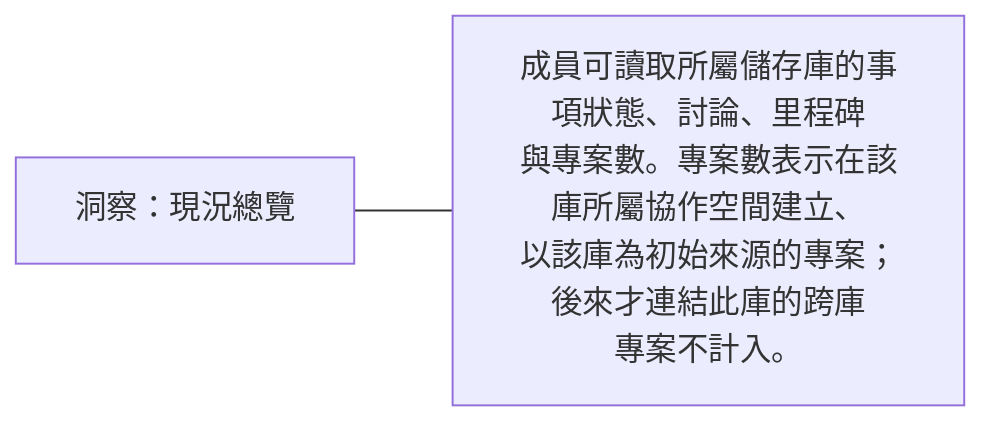
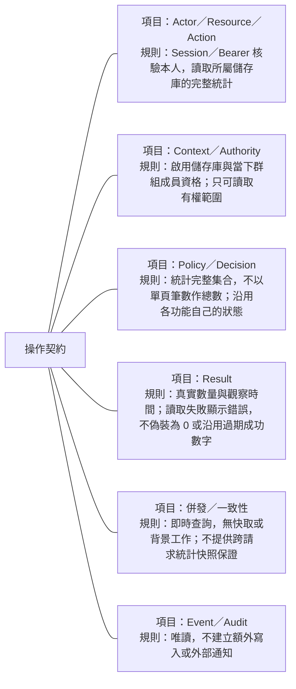
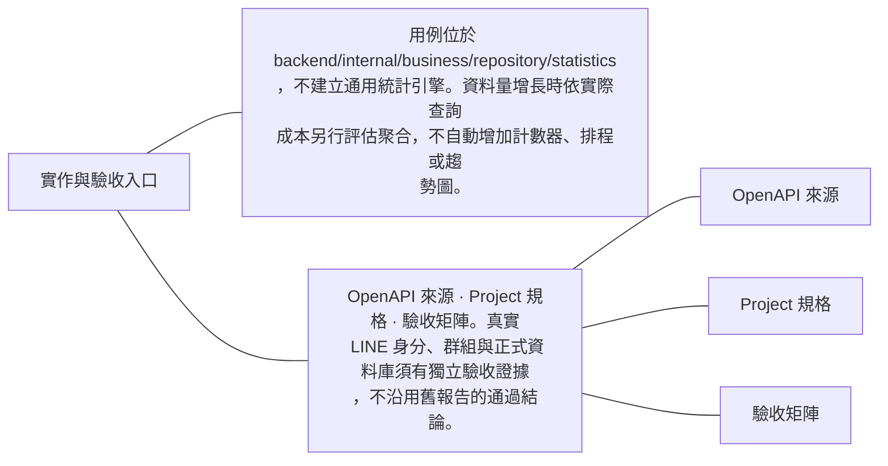

# 儲存庫洞察（Insights）

## 現況總覽與 Pulse 規劃

Mini App 的 Repository 分析入口命名為「洞察（Insights）」。選取「洞察」時才載入統計資料。既有 statistics 是其中的「現況總覽」：回答現在有多少問題、討論與里程碑，保留既有 API 與計數定義。「近期動態（Pulse）」是 Insights 下的期間報告。Owner Project 的跨庫看板進度由 [Project](../project.md) 定義。

| 視圖 | 問題 | 資料來源 |
|---|---|---|
| 現況總覽（已實作統計） | 現在有幾個已關閉問題？ | Go 查詢本庫 Issue 的當前狀態，回傳觀察時間。 |
| Pulse（規劃） | 過去七天有幾個問題新建、關閉或重開？ | Go 依 Issue 建立時間與有前後狀態的變更紀錄統計。 |

Pulse 首版預設最近 7 天，可選最近 30 天。Go 固定一次查詢的 UTC 截止時間，採左含右不含的滾動期間，回傳起訖時間供前端顯示。每項指標各按 Issue ID 去重：同一問題在期間內關閉兩次又重開，在「關閉」與「重開」各計一個。首次建立只計入「新建」。修改正文、分類或 Project item 進度不計為關閉或重開。歷史覆蓋不足時顯示可用期間或「資料不足」；無活動且覆蓋完整才顯示零。

權限沿用本庫讀取資格。驗收涵蓋期間邊界、同一 Issue 多次轉換、跨庫排除與失權。實作前先驗證歷史紀錄完整性、查詢範圍與成本；前端不逐筆載入 Issue 歷史來計數。參照 [GitHub Pulse](https://docs.github.com/en/repositories/viewing-activity-and-data-for-your-repository/using-pulse-to-view-a-summary-of-repository-activity)。

