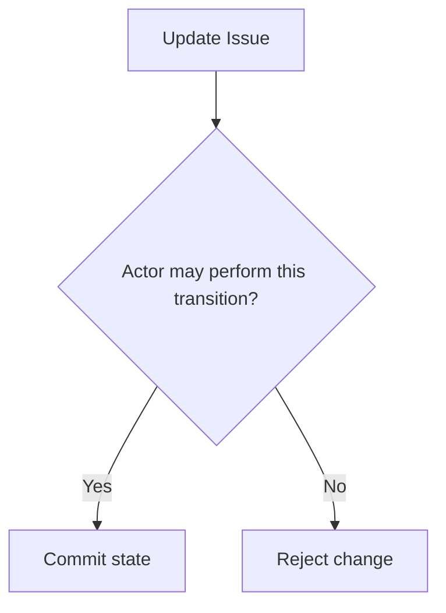

# Issue

**Implemented** · [Design](design.md) · [Core flow](#decision-flow) · [Representative tests](../../../../backend/internal/business/issue/domain/entity/issue_test.go) · [Code](../../../../backend/internal/business/issue/README.md) · [Guidance](../../../../backend/internal/business/issue/AGENTS.md)

[Frontend](../../../../frontend/miniapp/src/business/issue/README.md) · [Public API](../../../../api/contract/issue/README.md)

## Domain design

**Subdomain classification:** issue-tracking supporting candidate.

**Language:** Issues have creators and open/closed states; classification/content editing are separately authorized.

**Context/contracts:** Repository supplies scope; Issue owns state. Project operation results cannot replace source Issue state.

**Acceptance:** creators may reopen closed Issues; category-only members cannot edit content through categorization.

[Implementation/tests](../../../../backend/internal/business/issue/domain/entity/issue_test.go) · [Strategic classification criteria](../../../references/ddd/README.md)

Issue specifications own creation, classification and transitions.

[Domain design/operation contracts](design.md) · [Backend entry](../../../../backend/internal/business/issue/README.md)

## Issue update decision flow

[Entry adapter](../../../../backend/internal/business/issue/adapter/http/routes.go) · [Decision rules](../../../../backend/internal/business/issue/domain/entity/issue_test.go) · [Application output port](../../../../backend/internal/business/issue/application/port/store.go) · [Related tests](../../../../backend/internal/business/issue/domain/entity/issue_test.go)

[Guidance](../../AGENTS.md) · [Repository capabilities](../README.md#repository-capabilities) · [Domain overview](../../README.md)
