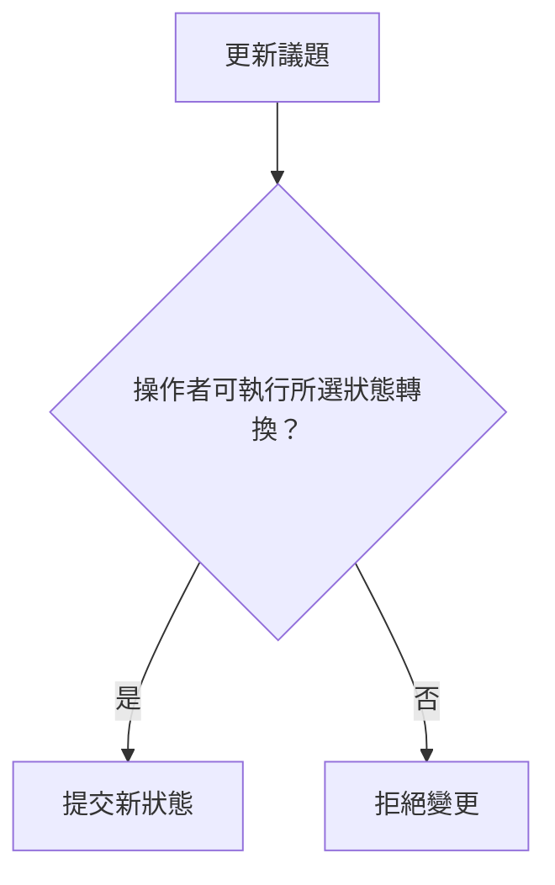

# 議題

**已有實作** · [設計規格](design.md) · [核心流程](#decision-flow) · [代表測試](../../../../backend/internal/business/issue/domain/entity/issue_test.go) · [程式目錄](../../../../backend/internal/business/issue/README.md) · [維護指引](../../../../backend/internal/business/issue/AGENTS.md)

## 領域設計

**子域定位**　事項追蹤的支援候選。

**通用語言**　議題有建立者及開啟、關閉狀態；分類與內容編輯分別授權。

**上下文與契約**　Repository 提供資源範圍；Issue 擁有議題狀態。Project 引用議題時，專案內的操作結果不能直接取代來源議題狀態。

**驗收案例**　建立者可關閉議題後重新開啟；只有分類權限的成員不能藉由分類操作修改內容。

[對照實作或測試](../../../../backend/internal/business/issue/domain/entity/issue_test.go) · [戰略設計與分類準則](../../../references/ddd/README.md)

議題的建立、分類與狀態變更以議題規格為準。

[領域設計與操作契約](design.md) · [後端實作入口](../../../../backend/internal/business/issue/README.md)

## 更新議題的判定流程

[入口適配器](../../../../backend/internal/business/issue/adapter/http/routes.go) · [判定依據](../../../../backend/internal/business/issue/domain/entity/issue_test.go) · [應用層輸出介面](../../../../backend/internal/business/issue/application/port/store.go) · [相關測試](../../../../backend/internal/business/issue/domain/entity/issue_test.go)

[適用工作指引](../../AGENTS.md) · [Repository 能力索引](../README.md#repository-capabilities) · [領域總覽](../../README.md)
