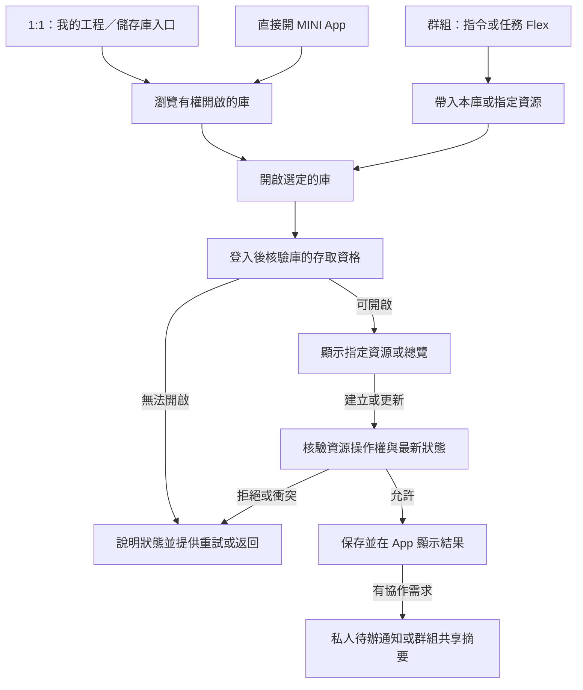

# Repository 業務容器與 LINE 旅程

Repository 是個人或群組的工程工作容器。使用者要能辨識自己正在操作哪個庫，找到工項、回報異常或查閱團隊知識，並確認操作結果。以既有領域與 API 為基礎，先改善導覽和 LINE 入口，再以實測決定是否需要新增關聯資料模型。

本頁記錄目標體驗及現況對照。擁有者綁定、生命週期及存取判定以 [Repository 領域設計](README.md#領域設計)為準。共用的 LINE 入口與訊息選型見 [LINE 整合](../../integrations/line/README.md)。

## 容器責任與內部能力

| 責任       | 能力與邊界                                                                                                                                                                                                                                                                            |
| ---------- | ------------------------------------------------------------------------------------------------------------------------------------------------------------------------------------------------------------------------------------------------------------------------------------- |
| 容器治理   | Repository 管理個人或群組擁有者、啟用狀態及庫內範圍。庫的讀取資格與資源的操作權分開判定。                                                                                                                                                                                             |
| 共用能力   | [工區 Space](spaces.md)用於庫內分類。[標籤](labels.md)、[里程碑](milestones.md)與[共用編號](numbering.md)依各自規格供資源引用。工區沿用庫的存取範圍。                                                                                                                                 |
| 業務資源   | [Object](object/design.md)管理工項階層與數量進度，[範本](object/template.md)用來建立獨立物件樹。個人範本依持有人及目標庫建立權限判定；庫範本依本庫範圍判定。[Issue](issue/design.md)追蹤異常與狀態，[Discussion](discussion/design.md)承載討論與留言，[Wiki](wiki.md)保存知識與修訂。 |
| 衍生讀取   | [Insights](insights.md)提供庫內統計與現況。Pulse 屬規劃，稽核入口依[容器驗收界線](acceptance.md)判定。                                                                                                                                                                                |
| 跨領域引用 | [Project](../project/README.md)獨立維護跨庫協作與進度。[Journal](../journal/README.md)獨立維護日誌。開啟引用時依來源資源權限判定，來源狀態由來源領域維護。                                                                                                                            |

## 依使用者任務組織 MINI App

現行導覽可在[頁籤設定](../../../frontend/miniapp/src/business/repository/navigation.ts)核對。目標是用「總覽」交代所在庫與下一步，「物件」找工項、工區及範本，「問題」追蹤 Issue 與里程碑，「協作」集中討論與 Wiki，「洞察」查看統計。共用目錄的管理操作依資格出現在「設定」。在手機畫面清楚標示個人庫或群組庫及其名稱，避免在相似名稱間誤寫。

例如從「配電盤安裝」工項回報規格不符，建立 Issue 時可帶原工項連結；團隊可從 Issue 開啟相關討論，確認後再整理成 Wiki。先用可存取的連結驗證導覽價值。雙向索引、正式關聯及跨能力自動更新須另有需求與契約。Issue 關閉、工項完成與 Project 進度各自維護。

## LINE 旅程

未來設計。群組直達本庫和私訊查找本人可用庫已有基礎。直達指定工項或表單、登入後恢復以及任務通知依個別路徑驗收。

| 入口       | 現行接線與目標                                                                                                                                               |
| ---------- | ------------------------------------------------------------------------------------------------------------------------------------------------------------ |
| 1:1        | 已有「我的工程」與空間入口可查找有權開啟的庫。目標是讓「儲存庫」成為 Rich Menu 可找回的入口，並保留文字指令。[聊天指令](../../integrations/line/commands.md) |
| 群組       | 「空間」已有指定 Repository 路徑。目標是讓 Flex 針對單一工作情境顯示一個主要動作，直接到對應資源或表單。驗證失敗時保留目標，避免自動切換到別的群組庫。       |
| MINI App   | 現行可從側欄或頁面選庫。目標是從已授權的最近工作區回到原任務，登入後保持目的地並重新核驗資格。                                                               |
| 結果與回饋 | App 依保存結果顯示成功、可修正或結果未確認。結果未確認時依該資源契約查詢或重試。通知是目標行為，私人通知給需要行動的人，群組摘要只包含可共享資料。           |

連結識別操作目標。後端依契約核驗本人或當下群組成員資格，寫入時再核驗資源權限及最新狀態。不可開啟的入口依既有 API 語義顯示通用提示，避免揭露不可見庫。暫時無法核驗時可重試原目標。Bot 離群及重入的資料保留規則沿用[容器契約](README.md#範圍與資料)。

## 優先順序與驗收

1. **先驗證找庫與辨識情境。** 讓使用者分別從私訊找到本人可用庫、從群組直達本庫。記錄首次完成率、找到正確庫的時間、重選次數及誤入另一庫的次數。
2. **再驗證一條庫內工作。** 從工項回報 Issue 並確認保存結果。測試登入後回原目標、無權操作、過期版本及提交中斷。確認使用者能說出位於哪個庫、是否已保存和下一步。
3. **驗證後再擴展通知與引用。** 用手機與桌面入口測試；確認窄螢幕按鈕文案、鍵盤操作與 Flex 替代文字可辨識。比較錯誤恢復率及新增流程所需維護的卡片與路由數。正式 LINE 渠道需另做實機驗收。
