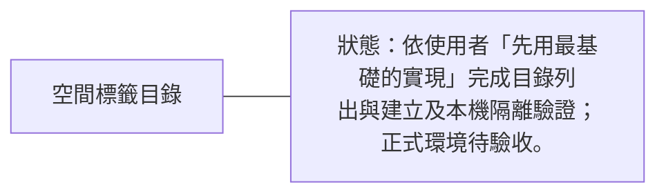
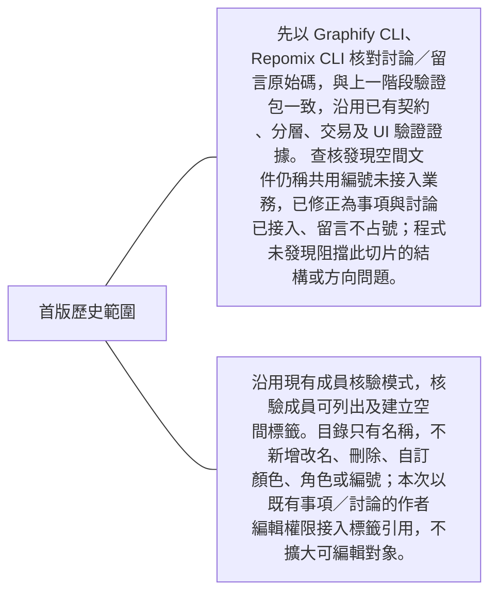
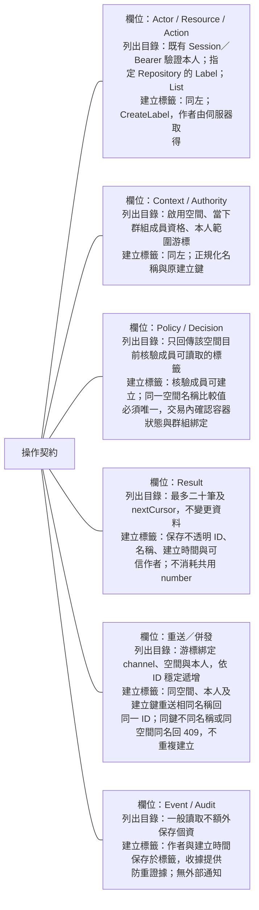
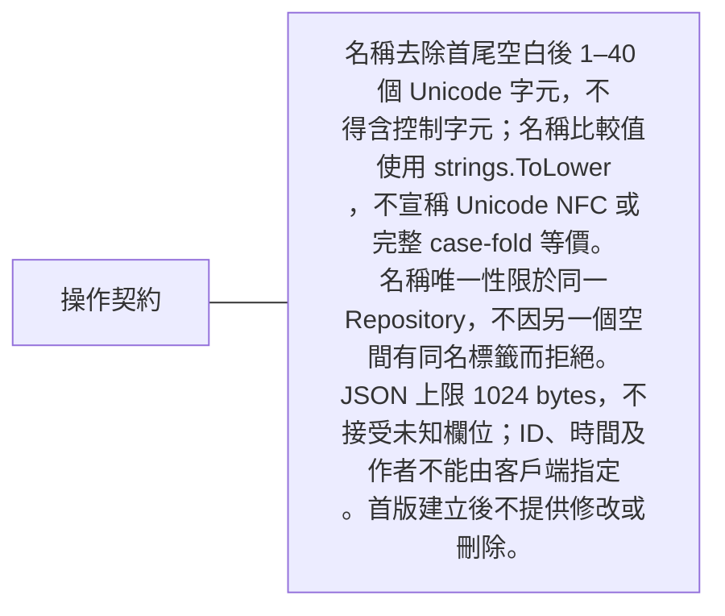
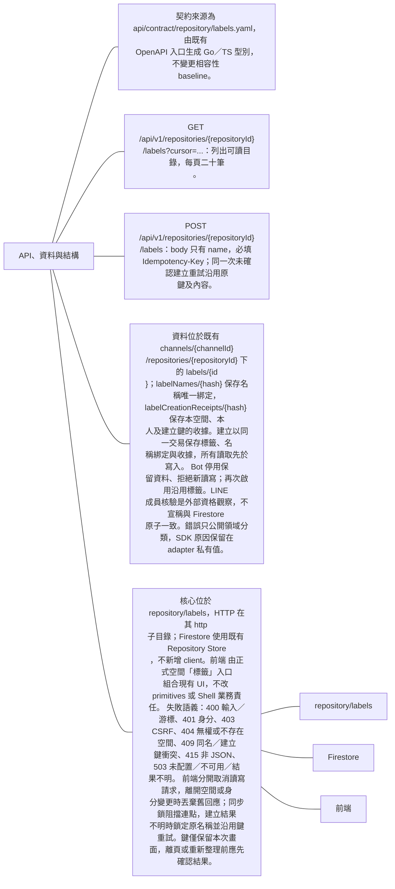
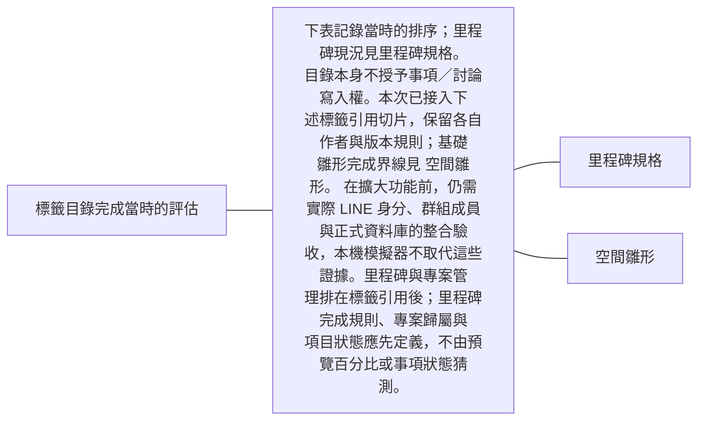
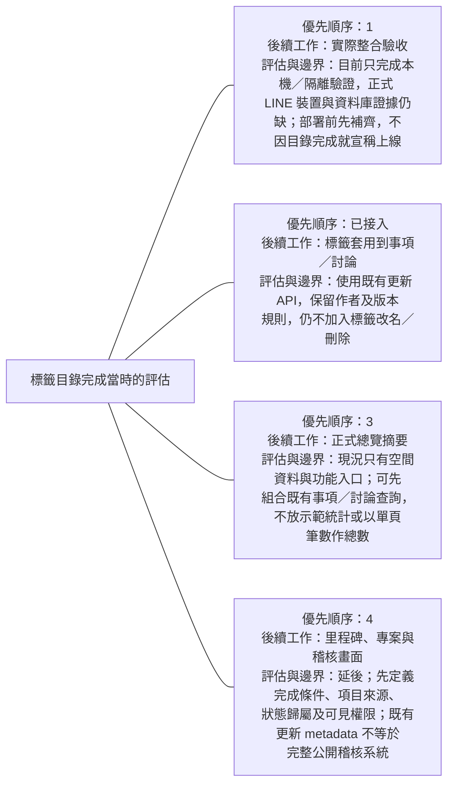
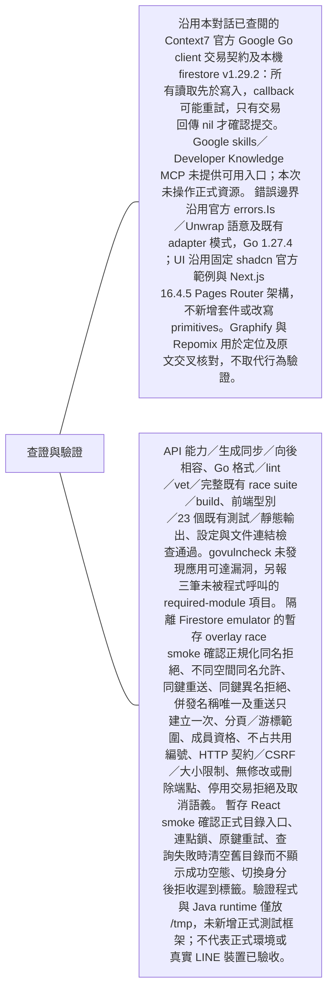
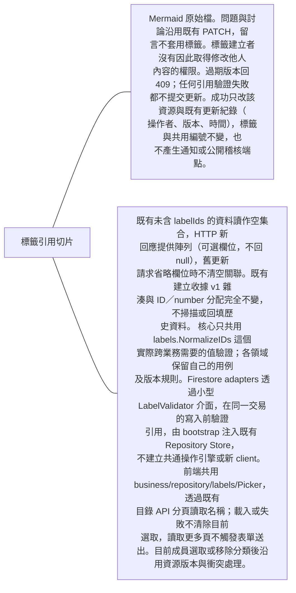

# 空間標籤目錄

## 分類協作與改名

分類操作只更新同庫的標籤引用，以及 Issue 可選的里程碑。Go 重新核驗操作者資格、資源歸屬與版本。只有分類權的操作者若同時修改正文或問題狀態，整筆拒絕。Discussion 沿用同一套標籤規則。

授權改名時保留 Label ID；新名稱仍需在同庫唯一，名稱綁定與標籤在同一交易更新。以原建立鍵重送原請求，應取回同一 ID 與目前名稱。改名不需要逐筆更新 Issue 或 Discussion。群組 Repository 的所有目前成員均可分類及改名；個人 Repository 僅限本人。改名須提交讀到的原名稱，名稱過期回 409。

## 標籤引用切片

現行實作

[問題與討論的分類更新，以及里程碑本身的狀態轉換（Mermaid 原始檔）](diagrams/resource-classification.mermaid)

